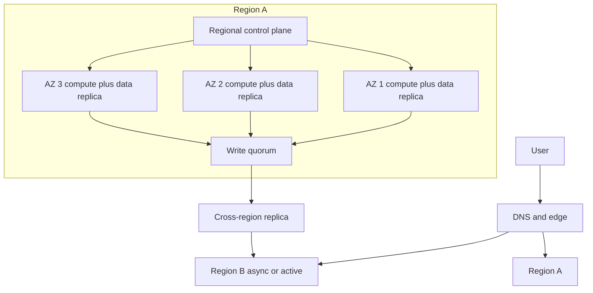

A region is a geographic failure domain with its own buildings, power, network, and usually its own control plane. An availability zone (AZ) is a failure domain inside a region: separate buildings, separate power and cooling, independent enough that a fire or a transformer in one should not take the others. "Independent enough" is the phrase that does the damage. AZs share a region-wide control plane, regional APIs, and often regional identity, networking, and managed-service front ends. When that shared plane fails, every AZ in the region is in the incident, even if every building is fine.

Place compute where you like. Place data and quorum with the failure domain you actually mean. A three-replica database with all three replicas in one AZ is one power event from zero. A three-replica database with replicas in three AZs of one region will survive a building and will not survive a region-wide API outage or a region-wide network partition to the control plane. A quorum that spans continents will survive a region and will pay in latency and in split-brain design.

You can deploy an app to "the cloud" and still not operate this. Operating it means drawing the blast radius of each dependency — including the cloud's own regional services — and putting the data you cannot lose on a quorum that matches the outage you claim to survive.

## Concept

### Regions as distant failure domains

Cloud providers partition the planet into regions: `us-east-1`, `eu-west-1`, and so on. Round-trip time between regions is tens of milliseconds when they are friendly neighbors, and much more when they are not. That latency is physics plus peering. It is also your budget for synchronous replication. If you cannot afford a cross-region round trip on the write path, you cannot have a synchronously replicated, strongly consistent write across those regions. You can have asynchronous replicas, and you then have a recovery-point objective when a region dies.

Control planes are regional more often than marketing slides imply. Many "global" services still have a home region for configuration. AWS historically concentrated a large amount of control-plane gravity in `us-east-1`; an incident there has repeatedly affected people who thought they "did not run in Virginia." When you pick a region for data, you pick a legal jurisdiction, a latency to users, and a set of correlated failures with every other customer in that region, including the provider's own tools.

Multi-region active-active is a product. It needs a data model that can take concurrent writes or a routing model that pins a user to a home region. Multi-region active-passive is a DR plan: promote the replica, update DNS or anycast, accept the RPO. Both are valid. Neither is "tick two regions in the console."

### Availability zones as closer, not independent of the region

An AZ is meant to fail without taking its siblings: separate power, networking, and flood plains as far as the provider can arrange. Cross-AZ latency is low, typically a millisecond or a few, which is why people put database quorum in three AZs and call it HA. For many failure modes — disk, rack, building, AZ network — that is correct.

What it is not: independence from regional STS, regional load-balancer control, regional DNS features, a regional block-storage control plane, or a regional serverless API. Your three-AZ application still calls those. If they sit outside your VPC and they sit in the region, your HA diagram has a hidden single point. Architects who only count VMs per AZ miss the managed services that pin them.

Zonal resources (a disk that cannot attach across AZs, a VM in a subnet bound to an AZ) do not float. Regional resources (some load balancers, some managed databases you configured as multi-AZ) have their own replication story, which you must read. "Multi-AZ" on a managed database usually means a standby in another AZ and automatic failover, not three writable copies. Failover time is not zero. Split-brain protection is why it is not zero.

### Failure domains you actually own

Draw domains in order: process, node, rack (you may not see it), AZ, region, provider, planet. Then place: replicas, backups, queued work, identity, DNS, certificates, CI. CI in one region that must deploy to another is a hidden coupling. DNS in a single provider is a hidden coupling. A third-party auth that has one region is a hidden coupling. Your app can be perfectly triplicated and still be down because login is not.

Quorum math is not optional. For a majority of three, you can lose one. Place the three in three AZs if the failure you fear is a building. Place a fourth and fifth in another region only if you have a consensus protocol that can tolerate the latency, or if they are not in the write quorum (async replica). Two AZs is a split waiting to happen: lose one, and a two-node cluster cannot form majority without a tie-break you must have designed.

Backups are a failure domain of their own. A snapshot in the same region is a comfort against disk loss and a co-casualty of region loss. Copy backups out. Encrypt them. Test restore in a different region, or you have a file, not a plan.

## Trade-offs

| Approach | When it wins | Cost / risk |
| -------- | ------------ | ----------- |
| Single AZ | Lab, batch jobs that can wait, cost-first prototypes | One building event is an outage |
| Multi-AZ, single region | Most production apps, low-latency quorum, node and building faults | Region control-plane and regional service failures still take you |
| Active-passive second region | Disaster recovery with minutes-to-hours RTO | Failover is a muscle; DNS and data lag dominate |
| Active-active multi-region | Users on more than one continent, region independence as a goal | Write conflict, latency, double the operations |
| Two AZs only | Accidental default in some consoles | Quorum tie; a single AZ loss can stall majority |

Multi-AZ in one region is the correct default for a paid API. It is not "we survive the provider having a bad day." Surviving a regional control-plane event means a second region you can fail to, or a data plane that can keep serving already-running VMs without launching, attaching disks, or minting credentials.

Active-active is a company decision about data. If every write can conflict, you need CRDTs, or last-writer, or pinning. If you are not ready to name that, you are not ready for active-active. Buy active-passive and rehearse it.

Two AZs show up because a wizard offered two subnets. Add a third for anything with majority quorum, or run a managed failover pair that is designed for two and understand its freeze behavior.

## Diagram

## Failure modes

### All replicas in one AZ, or quorum in two

A "highly available" cluster was launched in a default subnet. One AZ loss takes all copies, or two AZs stall majority. The load balancer is multi-AZ and looks fine. The data is not.

**Detection.** Instance and disk AZ columns in the inventory. Database replica placement. A Terraform default that created one subnet. Chaos test that stops an AZ and watches quorum. If `describe` shows one AZ for the data and three for the web tier, the web tier will stay up to serve errors.

**Mitigation.** Explicit subnets in three AZs for quorum systems. Anti-affinity. Managed multi-AZ databases whose failover you have timed. Inventory alerts when a stateful resource has fewer AZs than the policy. Do not trust a regional load balancer as evidence that data is placed.

### Treating AZs as independent of the regional control plane

The buildings are healthy. You cannot scale, cannot attach a volume, cannot get tokens, cannot change a load-balancer rule. Existing VMs might still serve. Your on-call procedure is "add capacity," which needs the plane. The status page says the compute service is impaired in the region, not in a single AZ.

**Detection.** API error rates on the provider's control plane, while data-plane probes to existing IPs still work. Inability to launch instances in any AZ of the region. Services that share a regional frontend failing together. If your runbook's first step is an API call to the same region, you will discover this coupling during the incident.

**Mitigation.** Data-plane first: keep serving on what is already running. Pre-provision headroom so you do not need to launch during the event. Cache credentials. Put CI and IaC apply in a different region if you must change things. For the outages you claim to survive, have a second region already warm, with DNS or anycast you can flip without the sick region's APIs. Read the provider's isolation notes for each managed service you depend on.

### Cross-region "HA" with a synchronous write you cannot afford

Every write waits for a region two continents away. Tail latency is the other region plus every retry. On a partition you either stall writes or split brain. Someone then sets the replica to async in an incident and never sets it back.

**Detection.** Write p99 that tracks inter-region RTT. Timeouts on commit. A replication mode in the database that says synchronous to a far region. Application-level two-phase commit across regional APIs. Users in one continent paying the other continent's physics.

**Mitigation.** Synchronous quorum inside a region (three AZs). Asynchronous replication across regions with a named RPO. Pin users to a home region for strong consistency. If you need global strong consistency, use a product designed for it and accept the latency, or put all writers in one region. Do not invent a cross-region commit in application code.

### Backups and identity in the same domain as production

The region dies. Snapshots were regional. IAM, DNS, or the CI system that could recreate the stack were in the same region. You have a diagram of multi-region and a reality of one.

**Detection.** Snapshot locations. Where Terraform state lives. Where GitHub runners or the deploy role assume from. Where the identity provider is homed. A restore test that has never been run in a second region. If restore requires the sick region to mint credentials, restore is fiction.

**Mitigation.** Copy backups to another region, encrypt, test restore on a schedule. Put state and CI in a place that is not the only production region. Document the identity path for DR, including break-glass users that do not depend on the sick region's SSO if you can avoid it. Rehearse. Unrehearsed DR is a wish.

## Real-world example

AWS documents regions as isolated geographic areas and AZs as isolated locations inside a region, with the customer's responsibility to place resources across AZs for fault isolation. That model is real and it is the right default. It is also incomplete if you stop at VMs. The February 2017 Amazon S3 disruption in `us-east-1` was a regional service event: S3 in that region was impaired, and a long list of tools and consoles that depended on S3 in `us-east-1` were impaired with it, including for customers who thought of S3 as "just storage over there." AWS published a summary of that event. The architectural reading is not "S3 is unreliable." It is that a regional service is a failure domain, and a control plane that lives in a popular region is a domain you inherit whether or not your app VMs are there.

Google Cloud and Azure publish analogous region and zone models, including zonal versus regional resource types and, in Azure's case, paired regions for some DR stories. The nouns change. The placement problem does not: data and quorum go into the domain whose loss you have a plan for; everything else is hope.

When I review a cloud design, I list user traffic, writes, quorum, backups, identity, and deploy, and I write an AZ or region next to each. If two of those that must survive a region share a region, we fix the placement before we talk about instance size.

## What to remember

- Regions are distant failure domains with their own control planes; AZs are closer domains inside a region and still share that plane.
- Place data and quorum for the outage you claim to survive: three AZs for buildings, a second region for regional loss, with async replication unless you can pay the latency.
- A multi-AZ web tier in front of a single-AZ disk is a reliable error factory.
- Backups, identity, and deploy are failure domains; if they live only in the production region, you do not have DR.
