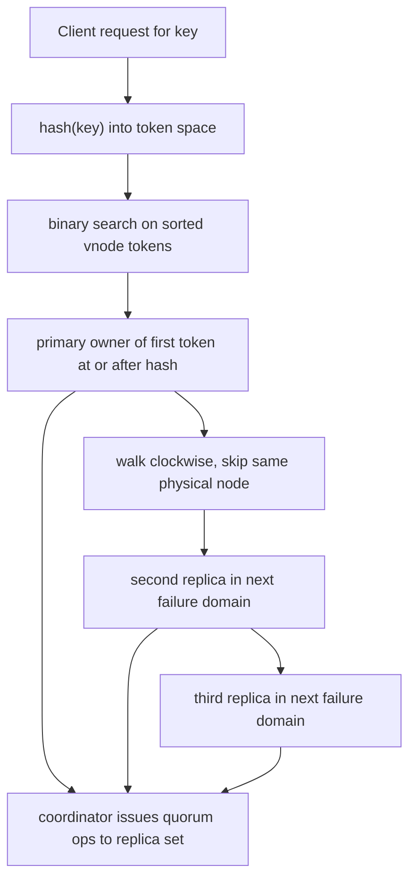

## Concept

### Why modulo hashing collapses under membership change

The first instinct when you need to spread keys across N cache nodes is `hash(key) % N`. It works until N changes. Add one node and nearly every key remaps. Remove one and the same thing happens. In a cache, that is a simultaneous eviction of almost the entire working set. Downstream origin servers see a stampede. In a datastore, it is a cluster-wide reshuffle of disks and compaction queues. The blast radius of a routine scale-out event becomes the whole keyspace, which is an unacceptable operational property.

Consistent hashing makes membership change a local event. Keys and nodes share one hash space. A key lives on the first node whose token is at or after the key's hash, wrapping around when the search falls off the end. A joining node takes only the arc that belonged to its clockwise neighbor. A leaving node hands that arc back. Expected movement is about K/N keys, not K. You still stream bytes and warm caches. You no longer throw away the other (N-1)/N of the working set because one hostname changed.

### The ring and the lookup path

You hash node identifiers onto a circle of 2^m points. Typical implementations use MD5 (Ketama), a 64-bit mix such as MurmurHash3, or a 128-bit hash with a defined byte order. Treat the output as an unsigned integer. Lookup hashes the key into the same space and walks clockwise to the first token. In code this is a sorted array of `(token, node)` pairs and a binary search, not an object named Circle. Off-by-one errors in that search are production incidents: the wrong owner, silent split of a key, or a coordinator that writes to a replica that will never be read.

Replication rides the same structure. For a replication factor of three, continue clockwise from the primary until you have three distinct physical nodes. Skip virtual nodes that resolve to a node you already selected. That walk is how Cassandra builds a replica set and how Dynamo-style systems build a preference list. The preference list is ordered: the first reachable node often acts as coordinator for the request, then issues parallel quorum operations to the rest.

Two details are easy to get wrong. First, the hash must be identical across languages, CPU endianness, and signed versus unsigned interpretation of the digest. Second, the node identity that you hash must be stable. Hashing an ephemeral pod IP puts every reschedule on the ring as a membership change. Hash a logical member id, then map that id to a current address in a separate table.

### Virtual nodes are not optional in production

A naïve ring with one point per machine produces terrible balance. Hash functions scatter well in expectation, but with tens of nodes the arc lengths vary enough that one box can hold twice the keys of another. Heterogeneous hardware makes it worse: a 96-core host and a leftover 16-core host occupy equal arcs if each has one token.

Virtual nodes assign many tokens per physical machine. A Cassandra node often owns tens to a few hundred tokens; larger machines get more. Lookup still walks the ring. Rebalance after a join becomes many small transfers instead of one sequential scan of a half-ring, which is kinder to disks, compaction, and tail latency. You can throttle per range and abort a bootstrap without leaving a single giant hole.

Vnodes change failure blast radius. One token per node dumps a dead machine's entire range onto the next clockwise neighbor, which already had its own load. Hundreds of tokens fan that load across many successors. That is why vnodes won. The cost is metadata size, more SSTable groups, and a vnode-count knob operators will set badly unless you tie the default to disk count and heap.

### Bounded load and cousin algorithms

Classic consistent hashing still allows hot keys and unlucky arcs. Google's Maglev and consistent hashing with bounded loads add a second rule: skip a node already above a load factor, such as 1.25 times average, and continue. Maglev precomputes a permutation table so dataplane lookup is an array index, which suits an L4 or L7 balancer and is a poor durable partitioner. Rendezvous hashing scores every node per key and picks the maximum. It handles arbitrary names and weights, at O(N) lookup. Jump hashing is O(1) only when the node set is a dense `0..N-1` that only grows by appending. Pick the variant from membership shape and whether key-to-disk locality matters.

### Who owns the ring

Three deployments show up. Client-side hashing keeps the token map in the SDK. Lowest hop count, but a stale ring sends traffic to the wrong box: a cache miss, or silent divergence in a store. Proxy hashing puts the ring in Envoy or a lookup service behind a stable VIP. You pay a hop and must align proxies with a control-plane watch. Coordinator hashing lets any node receive a request and forward to the owner. Cassandra and Dynamo gossip or consensus-replicate the ring as cluster state. Use a coordinator for a datastore. A Maglev balancer in front of stateless caches does not need one. Who can be wrong about membership, and for how long, is the failure mode that changes.

## Trade-offs

| Approach | When it wins | Cost / risk |
| -------- | ------------ | ----------- |
| `hash % N` | Fixed, tiny pools where membership never changes | Near-total remap on scale events; cache stampedes |
| Ring with one token per node | Small static clusters, simple mental model | Skewed load; one neighbor absorbs an entire failure |
| Ring plus virtual nodes | Production caches and partitioned stores | Larger token maps; vnode count becomes a tuning knob |
| Bounded-load / Maglev-style tables | L7 balancing with tight per-backend caps | Table rebuild on membership; weak key-to-disk locality |
| Rendezvous (HRW) hashing | Arbitrary node names, weights, modest N | O(N) lookup unless hierarchical; awkward replica walks |

Virtual nodes buy balance and failure isolation. Set vnode count too high and compaction, repair, and startup suffer because each token behaves like a mini-shard. Set it too low and you recreate the hot neighbor. Tie the count to disks, cores, and provisioned IOPS.

Bounded-load variants are the right default for request routing, where a backend already at capacity should be skipped. They are the wrong default for a datastore whose compaction and cache locality assume a stable key-to-owner mapping for hours or days. A Maglev table is not a database partitioner.

Replica walks create a second trade-off. Consecutive clockwise replicas can land in one rack. Production rings skip nodes until process, rack, and zone constraints are met. If the ring cannot satisfy them, fail the bootstrap. Silent packing into one zone is not a placement algorithm.

## Diagram

## Failure modes

### Stale membership and writes to the wrong owner

A client or coordinator with an old token map sends a write to a node that no longer owns the key, or skips a node that now does. Detection is not a CPU graph. Watch redirected-request counts, "not the owner" RPC errors, and digest mismatches during read repair. A sudden rise in repair mutations after a scale event means the rings disagreed.

Mitigation is versioned ring state: a gossip generation, a config epoch, or a consensus revision. Coordinators attach the version they used. If the receiver's version is newer, it returns a retryable ownership error instead of storing the value. Clients must not treat that error as a cache miss. For client-hashed caches, keep membership watches tighter than your SLA, and freeze the hash across a rolling deploy so old and new clients do not split the ring.

### Hot partitions and celebrity keys

The ring assigns a key to one primary vnode. A celebrity user, a flash-sale SKU, or a tenant id that everything joins through cannot be split by hashing. Detection requires per-vnode QPS, lock wait, and disk histograms. Cluster-wide averages hide a single token that is on fire.

Mitigation sits above the ring: application sharding of the hot key (`user:42:bucket:0..N`), request coalescing, a dedicated cache tier, or a deny-list that routes that key to another pool. Bounded-load hashing helps stateless request routing. It does not split a key that must be linearized on one primary.

### Hash-function drift across clients

Two language clients hashing the same string differently split the cluster. The usual causes are signed bytes, UTF-8 versus a raw buffer, and a library upgrade that changed the seed. Detection is a miss storm immediately after a client release, with server logs showing owners that do not match a reference implementation.

Mitigation is a compatibility fixture in CI: input bytes, algorithm, seed, signedness, and the expected token, for every client language. Changing the hash is a flag day. Ketama's MD5 behavior survives because of that, not because MD5 is a good hash.

### Replica placement collapsing into one failure domain

A clockwise walk that ignores racks puts all replicas into the same zone after decommissions leave a hole in the ring. Detection is a placement auditor at bootstrap and on every membership change: fail the move if replicas share a rack. Mitigation is the skip-until-constraint walk plus a hard error. Never fall back to best-effort packing.

Replacing a dense node with a smaller one without changing token count dumps large-node load onto small hardware. Allocate tokens proportional to capacity, bootstrap the replacement, then decommission the old id. Do not shrink a member in place.

## Real-world example

Amazon Dynamo turned consistent hashing from a cache trick into a storage placement function. The paper hashes a key onto a circular space. Each node is assigned multiple tokens so load can be adjusted without rewriting the algorithm. The coordinator is typically the first reachable node in the preference list. That coordinator runs quorum reads or writes against the list, not against "the ring" as an abstract object.

When a node fails, Dynamo does not remap the key range onto a new permanent owner immediately. Hinted handoff lets a neighbor accept writes for the missing replica and deliver them later. The ring stays the durable assignment; hints are a temporary overlay. Consistent hashing answers who should own the key when everyone is healthy. Hints, sloppy quorums, and read repair answer the minutes when someone is not.

Apache Cassandra made the same placement operational. One token per node turned bootstrap and failure into a large sequential stream onto a single successor. Virtual nodes became the default because many small ranges are schedulable and because failure load fans out. The token map is gossiped metadata. Repair, streaming, and bootstrap assume the ring. Copy only the ring into a client and skip repair, and you have a cache partitioner. That is a valid product. It is not a source of truth. The placement function is the easy part; movement and repair are the system.

## What to remember

- Modulo hashing remaps almost every key on membership change; a ring remaps about `1/N`.
- Virtual nodes exist to flatten load and spread failure, and their count is a capacity decision.
- Replica walks must honor failure domains, not only clockwise order on the hash circle.
- Version the token map and freeze the hash function; stale rings and divergent clients corrupt data.
