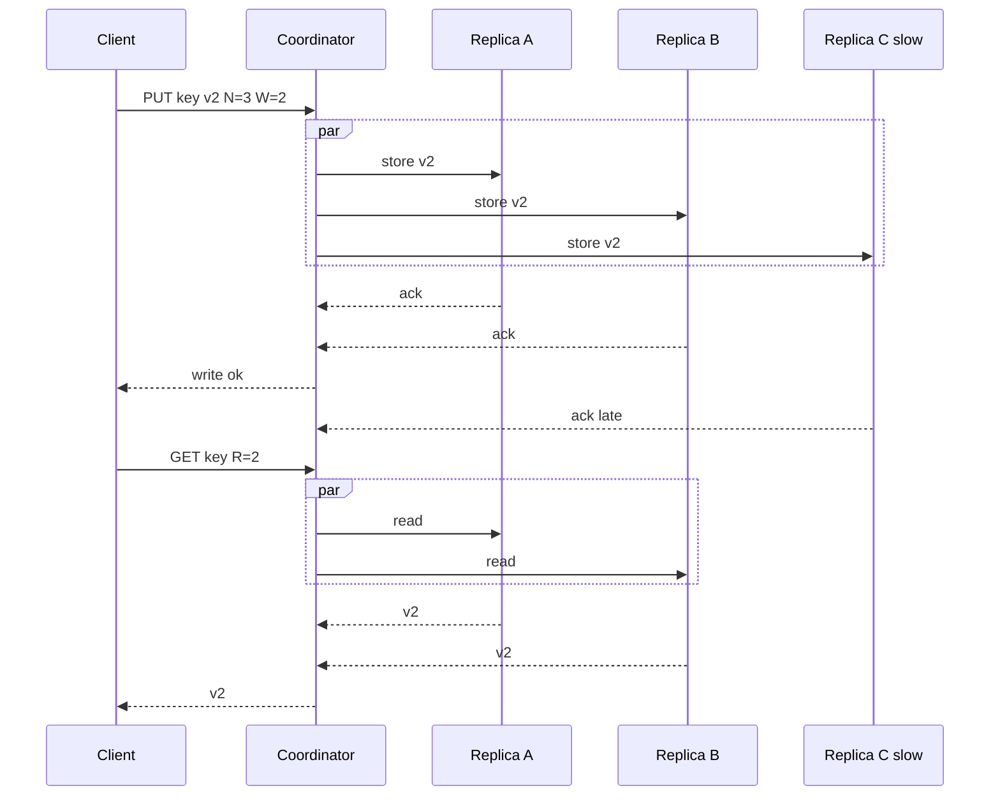

## Concept

### What a quorum actually guarantees

A quorum is not "most of the cluster" as a social convention. It is a numeric overlap rule. You store N replicas of a value. A write succeeds when W of those replicas accept it. A read succeeds when R replicas respond. If `R + W > N`, every read set intersects every write set in at least one replica, so a reader that applies a deterministic conflict rule (last-write-wins timestamp, version vector merge, or ballot number) can see the latest completed write.

That intersection is the entire correctness argument. It does not require a leader. It does not require a total order of all keys. It does require that "success" means the coordinator received W or R acknowledgements from the replica set for that key, not from whatever nodes happened to be reachable in the datacenter.

For the common triple `N=3, R=2, W=2`, any two replicas used for a read share at least one node with any two used for a prior write. `W=3, R=1` is also a quorum: writes are expensive, reads are cheap, and you still intersect. `W=1, R=1` is not a quorum even if N is 3. Two clients can write and read disjoint replicas and disagree forever.

### Coordinators, replica sets, and the happy path

In Dynamo-style systems a request lands on a coordinator, often the first reachable node in the preference list. The coordinator sends the operation in parallel to the N replicas. It waits until W or R responses arrive, then returns to the client. Slow replicas do not block the caller once the quorum is met. Client latency is governed by the W-th or R-th fastest replica, not by the slowest. Tail latency of the slowest replica still matters for anti-entropy, not for the client ACK.

The coordinator must agree with everyone else on which nodes constitute N. That set comes from consistent hashing plus failure-domain placement, not from three random healthy boxes. If the coordinator silently substitutes an extra node to make the count look like W, you have left strict quorum and entered sloppy quorum. Name that choice. It has different guarantees.

Reads that collect R replicas may receive divergent values. The coordinator reconciles them before answering, or returns all versions and lets the client reconcile. Last-write-wins clocks are simple and lose concurrent updates. Version vectors preserve concurrent branches at the cost of read-side merge logic. The quorum rule only guarantees overlap. It does not pick a merge function for you.

### Sloppy quorums, hinted handoff, and read repair

When a replica is down, a strict coordinator fails the write once it cannot collect W acknowledgements from the preference list. Availability drops. Dynamo's sloppy quorum sends the write to the next healthy node outside the preference list and attaches a hint: this value belongs to node B. That neighbor stores the hint and delivers it when B returns. Reads during the window miss the hinted copy unless the remaining preference-list nodes plus repair can satisfy R.

Hinted handoff is an availability overlay, not a new replica factor. If the hint node dies before delivery, you rely on anti-entropy: Merkle-tree repair, read repair, or a background comparer. Systems that skip those backups treat hints as durable truth and then lose writes.

Read repair is the cheap path. A read that already contacted R replicas notices a stale digest, and the coordinator pushes the newer value to the laggard. It repairs only keys that are read. Cold keys need scheduled repair. Setting `R=1` to win a latency benchmark also disables most incidental repair.

### Consistency levels as product knobs

Cassandra exposes this as consistency levels: `ONE`, `QUORUM`, `LOCAL_QUORUM`, `ALL`, and others. `LOCAL_QUORUM` is a quorum inside one datacenter's replica set. That is the usual production choice for multi-DC clusters: you survive a local node loss without a transatlantic round trip on every write. `EACH_QUORUM` waits for a quorum in every DC. It is the rare setting you choose on purpose.

These knobs are per request. Mixing them is a protocol, not a convenience. A writer using `ONE` and a reader using `QUORUM` do not compose into `R+W>N`. The intersection argument uses the W and R that actually happened. Document the pair you allow in production, and reject the others at the API layer if the data is a money field.

Leader-based systems (Raft, Paxos, a Kafka ISR) implement a different quorum: ballots and logs, not independent replica values. A majority of voter nodes for a log index is not R of N blob replicas. Both are quorums. They protect different state machines.

### Time, clocks, and what "latest" means

Without a leader, replicas need a way to compare two values for the same key. Wall clocks plus last-write-wins are operationally easy and wrong under clock skew. A lagging node can resurrect an old value or hide a new one. Bounded-skew assumptions belong in the runbook, not in the proof. Version vectors or hybrid logical clocks give a partial order that does not pretend concurrent writes were sequential.

If you use last-write-wins anyway, treat it as a simplicity choice and make the blast radius explicit: lost updates under concurrency are accepted. Shopping-cart merges can use vectors. Account balances generally cannot. They need a single leader per shard, or commutative operations with an audit trail.

## Trade-offs

| Approach | When it wins | Cost / risk |
| -------- | ------------ | ----------- |
| `W=N, R=1` | Read-heavy caches of durable writes | Writes fail if any replica is down |
| `W=1, R=N` | Write-heavy ingest with rare, complete reads | Reads are slow; a crash after W=1 can lose data |
| `R=2, W=2, N=3` | Default for user data with leaderless replicas | Latency tracks the second-fastest replica; not linearizable |
| `LOCAL_QUORUM` | Multi-DC deployments that must survive a zone | Stale reads across DCs until repair |
| Sloppy quorum plus hints | High availability during short replica outages | Hints are not N; unrepaired hints drop writes |
| Strict quorum, fail on timeout | Financial or identity records | Availability cliff when one replica stalls |

The `R+W>N` rule is necessary for the overlap argument and insufficient for linearizability. Two clients can still observe a write appearing and disappearing if a coordinator returns success at W while a later reader hits replicas that have not applied it, or if you counted a hinted node as a durable replica. Linearizability usually wants a leader, a consensus log, or a protocol built for it. Bigger R and W do not get you there.

Latency is the order statistic at R or W. If replica latencies are 4 ms, 5 ms, and 80 ms, a `W=2` write is about 5 ms plus coordinator overhead, and `W=3` is 80 ms. That is why teams drop to `LOCAL_QUORUM` and why they add speculative retries to the slow replica without waiting on it for the client ACK. Speculative retries without a concurrency budget become retry storms.

Multi-DC quorums trade a round trip for a disaster story. `EACH_QUORUM` makes a partition between DCs stall writes. `LOCAL_QUORUM` keeps writes alive and accepts that a reader in the other DC is behind until replication and repair catch up. A social feed can be locally quorum. A securities ledger cannot, unless you add an explicit cross-DC protocol.

## Diagram

## Failure modes

### Partial writes that still return success

The coordinator reaches W and ACKs the client while N-W replicas never applied the value. A later read that misses the updated replicas returns stale data if R is too small, or mixed versions that the merge function mishandles. Detection is digest-mismatch metrics, read-repair mutation counts, and client-visible version flaps on a key after a successful PUT.

Mitigation: keep `R+W>N` on the paths that matter, run read repair, and run scheduled anti-entropy for cold keys. Do not count hinted nodes toward W for records you cannot afford to lose. For linearizable keys, stop using leaderless quorum and use a consensus group per shard.

### Sloppy quorum promoting a stand-in into a silent source of truth

A hint node accepts a write, the original replica returns, and the hint is never delivered. Detection is hint-backlog age, undelivered-hint gauges, and repair sessions that resurrect values the client thought were stored. Mitigation: cap hint TTL with alarms before expiry, treat expired hints as data-loss events, and require incremental repair of the preference list after any hint storm. Disable sloppy quorum for tables whose loss is a legal incident.

### Read-your-writes violations after coordinator failover

The client ACKed a write against coordinator X. The next request hits coordinator Y, which reads a replica set that has not yet seen the write. Detection is session-level tests, not cluster averages. Inject coordinator kills in staging. Mitigation: client tokens that pin the coordinator, or a write timestamp the read must meet; `LOCAL_QUORUM` plus DC-aware load balancing; a session guarantee in the SDK. Do not promise "always consistent" in the API if you only implemented `QUORUM`.

### Clock skew and a stale replica set

A replica with a fast clock overwrites a newer logical update under last-write-wins. Separately, a coordinator with a stale preference list collects W acks from nodes that no longer own the key, so overlap with future readers is not guaranteed. Detection is conflict logs, NTP offset, "wrong owner" responses, and generation mismatches during bootstrap.

Mitigation: hybrid logical clocks or version vectors; reject writes whose timestamp is far from the coordinator's now; versioned ring membership on every quorum RPC; refuse acks from nodes that disagree on the list. Drain a decommissioning node from lists before you delete its data.

## Real-world example

Amazon Dynamo set the template: N replicas on a consistent-hash ring, configurable R and W, sloppy quorums, hinted handoff, and gossiped membership. The shopping-cart use case was explicit. Losing a cart during a node reboot was worse than occasionally merging concurrent cart versions. `W=2, R=2, N=3` gave overlap. Vector clocks preserved concurrent branches so a merge could union cart items instead of dropping one writer's add.

Cassandra took the same math and made it a table-level consistency level. Operators of multi-region clusters almost always settle on `LOCAL_QUORUM` for user-facing reads and writes: three replicas in the local DC, wait for two. That choice is a failure statement. Lose one node or one rack locally and stay up. Lose the transatlantic path and stay up. Accept that the remote DC is behind until replication and repair catch up. Critical metadata often uses `EACH_QUORUM` or a separate strongly consistent store such as etcd.

The design choice to copy is not "always N=3." It is to publish R and W as a contract per data class. Dynamo did not run the shopping cart and the billing ledger on the same overlap rule. One Cassandra cluster can still hold two contracts: `LOCAL_QUORUM` for a profile blob, and a leader-based store for payment capture. Quorums give replica overlap. They are not a personality for the entire company.

## What to remember

- `R+W>N` is an overlap rule on a defined replica set. It is not linearizability and not a majority of the fleet.
- Client latency follows the R-th or W-th fastest replica, which is why `ALL` and cross-DC quorums change the product.
- Sloppy quorums and hints preserve availability only if anti-entropy runs before hints expire.
- Publish one (R, W) pair per data class and reject mixed levels on the same key.
