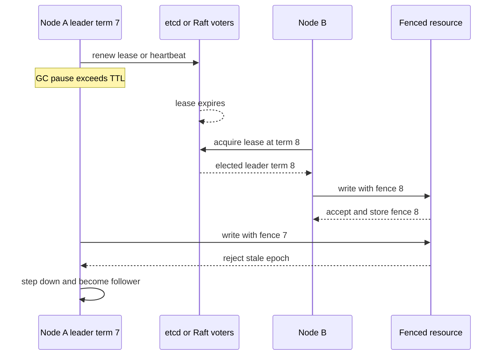

## Concept

### What you are actually electing

Leader election produces, at most, one process allowed to perform a privileged role for a given term: append to a log, assign partitions, mutate a shard, or hold a lock that serializes a control-plane operation. The useful outputs are a leader identity, a term or epoch that increases monotonically, and a way for everyone else to verify that a claimed leader still holds the role.

If you only store "the current leader is host B" in a shared file, you have a rumor. After a network partition you will have two rumors. The epoch is what makes fencing possible. A storage system or a peer can reject requests from an older epoch even if that process still believes it is leader.

### Lease-based election versus consensus log election

Two families dominate production.

Lease-based election uses a strongly consistent store as the ballot box. A process tries to create an ephemeral node, a compare-and-swap key, or a lease: an etcd grant, a ZooKeeper ephemeral znode, a Chubby file. Whoever holds the key is leader. Heartbeats refresh the lease. When heartbeats stop, the key expires and someone else can acquire it. This is how many Kubernetes controllers and a large fraction of in-house active/passive pairs work. The store's consensus is the hard part. Your code is a client of that consensus.

Log-based election is native to Multi-Paxos and Raft. There is no separate lock. A candidate increments the term, requests votes from a majority of voting members, and becomes leader if it receives that majority. The leader then replicates a log. The election is the same majority mechanism that commits entries. Kafka's KRaft, etcd itself, and most new clustered databases sit here. You cannot elect a leader without also defining who votes, what majority means, and how a leader is forced to step down.

Bully algorithms and "lowest IP wins" gossip elections still appear in textbooks and in accidental production code. They assume timely failure detection and a fully connected, well-ordered set. They split under partitions. Do not use them for anything that mutates state unless you add fencing with a store that already solves consensus.

### Failure detection is the hidden protocol

Election time is dominated by how you decide the leader is dead, not by how you count votes. Too short a timeout and you flap. A GC pause or a brief packet loss starts an election, the old leader comes back, and you get a split brain or a storm of term increments. Too long a timeout and you sit in a leaderless window that looks like a complete outage.

Production systems combine several signals: lease TTL, heartbeat RPC, process liveness, and sometimes a disk check. A leader that cannot fsync is not a leader. Raft's randomized election timeout exists to reduce split votes. Kubernetes leader-election leases use `leaseDuration`, `renewDeadline`, and `retryPeriod` as three different clocks. Collapsing them into one sleep is how people cause dueling controllers.

A process that loses its lease must assume it is not leader immediately, before the store's TTL has been observed by others. That is the step-down-on-failed-renew rule. Continuing to serve because you are probably still leader for a few seconds is how you get two writers.

### Fencing tokens are not optional

Election without fencing is a bug farm. Leader A pauses in a GC, its lease expires, B is elected, A wakes and writes to a shared resource that does not know about B. Disks, object stores, and downstream SQL databases will accept A's write.

A fencing token is the epoch or Raft term attached to every privileged request. The resource tracks the highest token it has seen and rejects older ones. ZooKeeper znode versions, Chubby sequencers, and Raft log indices all play this role. If the resource cannot fence, a third-party HTTP API with no token, you cannot safely elect a leader in front of it. Use a single writer queue, idempotent writes with a fencing field you control, or accept the dual-writer risk in writing.

### Stable leadership and per-shard scope

Flipping leaders has a cost. Clients reconnect, in-flight work aborts, caches of "who is leader" go stale, and a new leader may need to replay. Good protocols prefer the incumbent, use Raft pre-vote so an isolated node does not increment terms forever, and pin the lease holder until it fails. Fairness is the wrong objective. Availability of the control plane is the objective.

Multi-leader systems are not a substitute for election. They push conflict resolution into the data model. When you need one writer per shard, elect per shard, not once for the cluster. That is how Kafka partition leaders work: many elections, small blast radius.

## Trade-offs

| Approach | When it wins | Cost / risk |
| -------- | ------------ | ----------- |
| Lease in ZooKeeper / etcd / Chubby | App-level HA without writing Raft | Depends on the store; lease TTL versus GC pause |
| Native Raft / Paxos election | Systems that already replicate a log | Membership change is a protocol you now operate |
| Per-shard leaders | Throughput and failure isolation | Many elections; metadata and client routing complexity |
| Bully / gossip "lowest id" | Lab demos, non-mutating coordinators | Split brain on partitions; no fencing |
| Static primary with a runbook | Tiny, operator-driven failovers | Slow recovery; error-prone cutovers |

Leases are the correct default when your system is not itself a consensus module. Do not implement Raft because you need an active/passive pair of cron schedulers. Use etcd or ZooKeeper and spend the engineering time on fencing the side effects. The cost is a dependency: if etcd is down, you cannot elect. For a control plane, fail closed is usually the right failure.

Native election wins when the leader's job is to append a log that followers already replicate. Inventing a second election on top of Raft for "the scheduler" creates two sources of truth. Use the Raft leader, or a committed log entry that names a role. That entry is still subject to the same term.

Per-shard leaders win at scale. Kafka's partition leaders are the existence proof that thousands of concurrent elections can be boring, but only with a metadata layer clients trust. If your shard map is a YAML file, you do not have this design.

## Diagram

## Failure modes

### Split brain from a non-fencing resource

Two processes both believe they are leader and both mutate an external system. Detection is conflicting updates, duplicate side effects such as a double charge, and audit logs with two leader ids in the same wall-clock window.

Mitigation: attach a monotonic epoch to every privileged call, make the resource reject stale epochs, and on lease loss stop serving before retrying anything. If the resource cannot fence, do not put an elected leader in front of it. Queue the work through a system that can.

### Election flapping on GC and noisy failure detectors

A 15-second stop-the-world pause expires a 10-second lease. The cluster elects a new leader, the old one resumes, terms jump, and clients reconnect in a loop. Detection is election-rate metrics, term or lease revision counters, and correlation with GC logs or CPU steal.

Mitigation: lease duration must exceed the worst pause you actually have. Use a dedicated election thread that is hard to starve. Enable Raft pre-vote. Page on election rate, not only on "no leader." Heap sizing is part of the election protocol in managed languages.

### Isolated candidate and majority loss

A partitioned node starts elections, fails to reach a majority, increments the term, and when the partition heals forces the real leader to step down because its term is higher. Detection is term jumping on a minority node and mass follower churn on heal. Mitigation is pre-vote, sticky leadership, and not running candidates on nodes that cannot see a majority. Lease-based systems see the analogue as a node that cannot reach etcd but still serves.

Separately, two of five voters down plus a third in another partition means no election can complete. Detection is `no leader` alerts and write unavailability. Mitigation is an odd-sized voter set, voters that are not the heavy data nodes, and a rehearsed membership change. Adding voters during an outage without understanding joint consensus extends the outage.

### Stale clients sending to the old leader

Clients cache leader location. The old leader may still accept reads if you allow stale-leader reads. Detection is redirect storms, `not leader` RPC counts, and read-after-write surprises. Mitigation: return the new leader in the error, bound the client cache TTL, and for linearizable reads require a leader round trip or a Raft read index. Document whether followers may serve reads.

## Real-world example

Google Chubby is the canonical lease-based design. Clients open a file that represents a lock. The Chubby cell is a Paxos group. The client holds a lease and must keep it alive. Sequencers travel with operations to other services so a delayed client cannot write after losing the lock. Kubernetes leader election is a direct descendant: a Lease object in etcd, renewed by the holder, observed by others. The controllers that mutate cluster state are not themselves Raft groups. They rent leadership from etcd.

etcd and Kafka KRaft sit on the other side. etcd elects a Raft leader among its voting members. That leader is the only process that appends to the Raft log. There is no separate ZooKeeper. Kafka's move from ZooKeeper controller election to KRaft was a decision to stop renting the ballot box and to make metadata a Raft log with its own voters. The privileged role is still an election, but the votes are the same majority that commits metadata.

The choice to copy: if your service is not a consensus system, rent a lease from one and fence every side effect with the lease epoch. If your service is a consensus system, do not elect a second leader in ZooKeeper for the same log. One term, one log, one writer. Kubernetes made the first choice. etcd made the second. Mixing them in one process is how you get two leaders who cannot name each other.

## What to remember

- A leader identity without a monotonic epoch is not an election you can fence.
- Failure-detector timeouts and GC pauses are part of the protocol, not operations trivia.
- Lease-based election rents consensus. Raft-native election is the consensus.
- If a downstream resource cannot reject stale epochs, an elected dual-writer will eventually happen.
