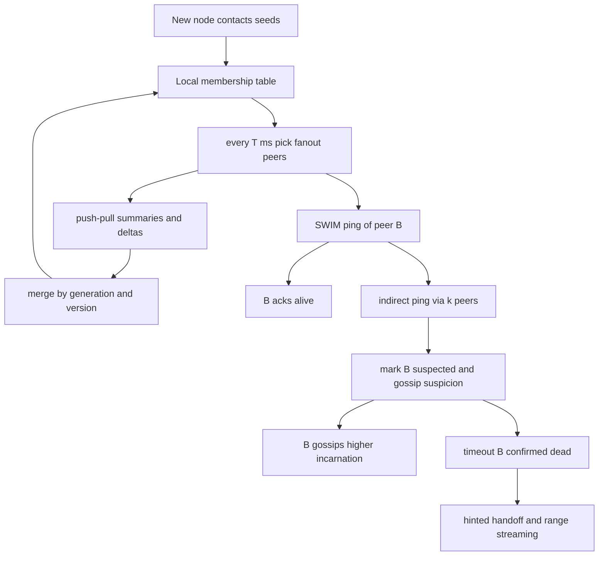

## Concept

### Epidemic dissemination instead of a coordinator

Gossip protocols spread state the way an epidemic spreads. Each node periodically picks a small number of peers, exchanges a compact summary, and the peers merge. There is no elected broadcaster for cluster membership, no full-mesh heartbeat, and no requirement that every node talk to every other node on every round. After O(log N) rounds, with high probability, every healthy node has seen a given update. Fanout, how many peers you contact per round, and the round interval are the two knobs that set convergence time against message cost.

This is a liveness-oriented design. Gossip does not, by itself, give you a linearizable view of membership. Two nodes can disagree about whether C is alive for several rounds. Systems that need a single decided membership, a Raft voter set or a Kubernetes endpoint slice that must not flap, use gossip as an input to a slower strongly consistent plane, or they accept the lag as the price of scaling noisy, high-churn data.

The payload is usually not the database. It is membership, schema version, token maps, failure suspicions, or a digest that says anti-entropy must pull a range. If you gossip the full user table, you have invented a bad database.

### Push, pull, and push-pull rounds

Push: A sends its rumor to B. Simple, fast for new information, wasteful when B already has it, and prone to amplifying a hot rumor if you do not damp.

Pull: A asks B for news. Good for filling holes when A returns from a partition. Alone, pull is slow to start a new rumor because the origin waits to be asked.

Push-pull: A and B exchange summaries, then ship only the deltas. This is the usual production choice. Summaries are version vectors, generation numbers, or digests over a membership table. The merge function must be associative, commutative, and idempotent or you will loop. Last-write-wins on `(generation, version)` tuples is the Dynamo and Cassandra pattern for per-node state. CRDTs show up when the gossiped object is more than a heartbeat.

Fanout of 1 with a long interval converges slowly and can partition the rumor graph. Fanout on the order of log(N) is the textbook. Cassandra talks to a few random peers each second, plus seed nodes so a joining process has someone to find. Seeds are not masters. They are well-known first contacts.

### SWIM: separate failure detection from dissemination

Naive gossip heartbeats mix two jobs: is B alive, and tell everyone B is alive. SWIM, and HashiCorp memberlist used by Consul, splits them.

Failure detection: A pings B. If B does not answer, A asks k intermediaries to ping B. Only if those fail does A mark B as suspected. Suspicion is gossiped, not immediate death. B can refute a suspicion by gossiping a higher incarnation number. That extra state machine keeps a single packet loss from declaring a node dead.

Dissemination: once a membership event exists, join, leave, suspect, confirm, or an incarnation bump, it piggybacks on the ping traffic in a small buffer. You get infection-style spread without a second full-rate protocol. Timeouts and buffer size determine how fast a 2,000-node cluster learns that a member left.

If you skip indirect ping and suspicion, you will mark nodes dead during GC pauses and network blips, then gossip that lie cluster-wide. The correction also gossips, so the cluster flaps. SWIM's extra round trips exist so that death is a rare, high-confidence event.

### Anti-entropy and discovery

Dissemination gets a new fact to everyone eventually. Anti-entropy compares replicas of bulk data and repairs holes. Merkle trees over key ranges, as in Cassandra repair and Dynamo, let two nodes exchange a tree of hashes and stream only mismatched leaves. That exchange is scheduled, or opportunistic on a digest mismatch. Do not run full Merkle repair at gossip interval. Gossip intervals are seconds. Repair is disk and network heavy. The architecture is two speeds: a lightweight membership epidemic, and a rate-limited reconciliation of data.

Gossip needs an initial peer: DNS, a seed list, a cloud API that lists instances, or a dedicated join address. Once you are in, the membership table is the directory. Bootstrap races matter. If every node starts empty with a slightly different seed, you can form two cliques that never merge. Production configs use a small, stable seed set that is always running, not the first three pods this morning.

Leaving is a protocol. A graceful shutdown gossips a leave so peers do not wait for failure-detector timeouts. A crash cannot. The failure detector must eventually confirm death and, in systems with tokens, trigger streaming or hint delivery. Tombstones for left nodes need a TTL or the membership table grows forever with dead names.

## Trade-offs

| Approach | When it wins | Cost / risk |
| -------- | ------------ | ----------- |
| Full-mesh heartbeats | Tiny clusters, trivial code | O(N^2) traffic; collapses past a few dozen nodes |
| Infection-style gossip | Membership and ring state at hundreds to thousands of nodes | Eventual views; lag and transient disagreement |
| SWIM ping plus piggyback | Failure detection that must not flap | More states; timeout tuning |
| Gossip plus Merkle anti-entropy | Leaderless stores that repair in the background | Repair cost; operator-visible lag windows |
| Consensus for membership, gossip for bulky state | Control-plane truth plus cheap rumor | Two protocols; dual sources of status |

Gossip wins when the set is large, the data is mergeable, and a few seconds of disagreement is acceptable. It loses when the event is a firewall change that must take effect everywhere before you open the port, or a Raft voter add that must not create two majorities. Those belong on a consensus log.

Fanout and interval are a product decision. Aggressive gossip, sub-second and high fanout, makes dashboards look live and will drown a 3,000-node cluster in CPU and syscalls. Conservative gossip, a few seconds and fanout of one to three, is usually enough for membership. If a health check needs faster detection, use a local load-balancer probe, not a faster epidemic.

Seeds add a small static dependency and destroy clique splits. Pure random discovery through a cloud API is fine when the API is a reliable oracle. If the API pages inconsistently, you will still split.

## Diagram

## Failure modes

### Cluster split into two gossip cliques

A bad seed list, a network ACL, or a bootstrap race produces two groups that each believe they are the cluster. Detection is two different membership sizes in admin endpoints, token-range holes, and clients that miss data depending on which seed they hit.

Mitigation: a small always-on seed set in at least two failure domains, a startup check that refuses to serve if membership is below an expected floor, and an explicit cluster id so a node cannot merge into a stranger's gossip. Healing a split is a planned merge, not a hope that a random peer will eventually be chosen.

### Death flaps from aggressive timeouts

GC, packet loss, or CPU steal causes suspect storms. Detection is incarnation counters racing, up/down/up in logs, streaming that starts and cancels, and connection pools that churn.

Mitigation: SWIM indirect ping and suspicion, timeouts that exceed real pauses, a dedicated gossip thread, and hysteresis before you decommission or rebalance on a death event. Do not hook auto-scale-down to a single gossip suspicion.

### Unbounded membership and non-mergeable payloads

Crashed names never expire. Every container restart adds a new id. Detection is membership table size, gossip message bytes, and heap of the membership map. Mitigation: stable node ids across restarts, leave messages on shutdown, and tombstone GC with a TTL longer than the longest partition you will tolerate. If a node returns after its tombstone is gone, it bootstraps as new.

The same loop breaks when someone puts per-request metrics or a multi-megabyte schema blob on the epidemic. Rounds slow and membership itself lags. Detection is gossip task latency and message-size histograms. Keep records tiny and mergeable. Put bulky state behind a digest and a pull. If a value cannot merge without a human, it does not belong on gossip.

### Correlated delay hiding a real failure

A datacenter partition lets each side mark the other dead and start streaming. The partition then heals into conflicting token ownership. Detection is simultaneous mass-death events aligned with network alerts.

Mitigation: do not auto-reassign tokens on gossip death without a second signal, an operator or a consensus control plane. Gossip can suspect a datacenter. It should not rewrite the ring during a split. Cassandra-style systems rely on operators, and on not running automated decommission from gossip alone, for this reason.

## Real-world example

Apache Cassandra's gossip is the production artifact most architects will operate. Each node keeps a table of peers with a generation, the process start, and a version, monotonic per process. Every second a node gossips with a small set of peers, exchanging heartbeats and a compact digest of cluster state: status, tokens, schema version, rack, and datacenter. Seeds exist only for discovery. There is no leader in the gossip layer.

Failure is not a single ping. A node that stops heartbeating becomes unreachable in a phi-accrual failure detector, then the cluster treats it as down for hint delivery. Data repair is not that heartbeat. Incremental repair and Merkle trees run on a different schedule because they read disks. The design choice is the two-speed system: an epidemic for who is here and what tokens they claim, and anti-entropy for whether the bytes still match.

Consul's memberlist makes the same split with an explicit suspect state and piggyback. Gossip carries membership. KV consistency is a Raft log in the server quorum. Consul refuses to pretend gossip is a source of truth for writes. Cassandra accepts eventual membership views because the data plane already speaks in quorums and repair.

When you add gossip to a service mesh or a cache fleet, copy Cassandra's payload discipline and Consul's refusal to commit user writes via rumor. Use gossip to find peers and to spread "schema version 44 exists." Use a quorum or a leader to decide that schema version 44 is live.

## What to remember

- Gossip is an epidemic for mergeable, compact state. It is not a linearizable control plane.
- Fanout, interval, and suspicion timeouts are the protocol. Set them from cluster size and GC reality.
- SWIM-style indirect ping exists so packet loss does not become a cluster-wide death rumor.
- Keep a slower anti-entropy path for bulk data, and do not auto-reassign ownership from gossip death alone.
