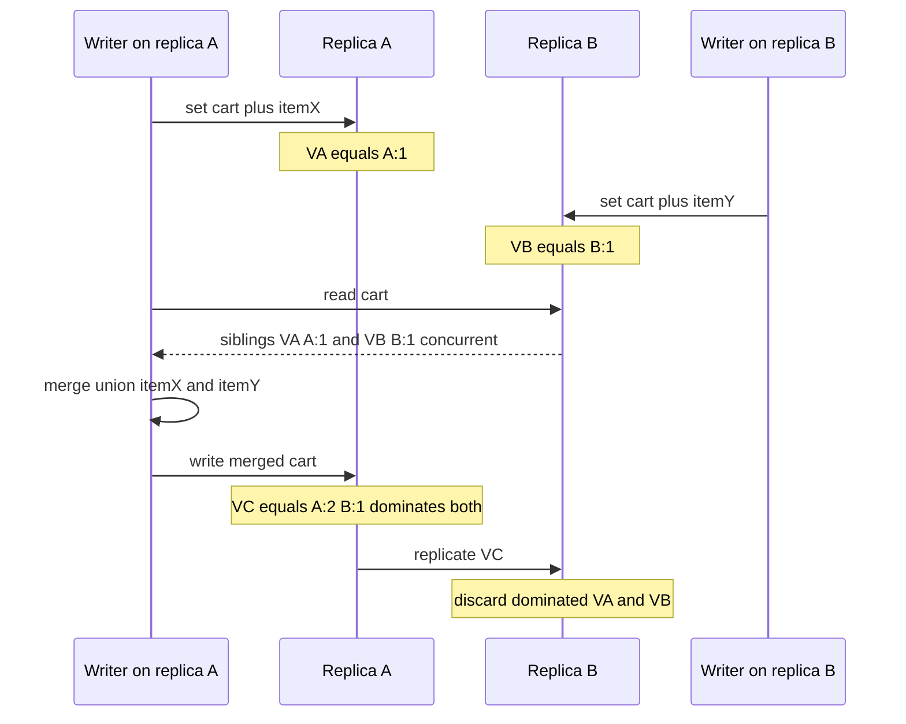

## Concept

### Why wall clocks are not a causality tracker

Distributed processes do not share a now. NTP keeps offsets small most of the time and then does not: a VM pause, a bad hypervisor, a leap smear, or a node that boots with a stale CMOS clock. Last-write-wins using wall time will drop an update that happened later in the real world because a replica's clock was behind, or it will resurrect an old value from a replica whose clock jumped forward. For caches this is a glitch. For concurrent edits to the same key it is silent data loss.

Logical time records happens-before, not the time of day. If event A could have influenced event B, same process order or a message from A received before B, a logical clock must report A before B. If neither could have influenced the other, the clock must report concurrent. It must not pick the one with the larger UNIX timestamp. That distinction is the whole subject.

### Lamport clocks: a total order that is not causality-complete

A Lamport clock is one integer per process. On an internal event, increment. On send, increment and attach the counter to the message. On receive, set local to `max(local, message) + 1`. If A happens-before B, then `C(A) < C(B)`. The converse is false. `C(A) < C(B)` does not imply A happened before B. Two unrelated events can have ordered numbers.

That makes Lamport clocks excellent for a cheap total order, sorting logs or breaking ties when you already have another mechanism, and insufficient for detecting conflicts. If two writers update the same shopping cart without exchanging messages, you want to know they conflicted. Lamport numbers will still rank one above the other, and you will throw one update away if you treat the ranking as truth.

Use Lamport clocks when you need a monotonic label and you do not need to detect concurrency. Do not use them as a merge key for user data.

### Vector clocks: one component per participant

A vector clock is an array of counters, one per process that participates. Process i increments only its own component on a local event. On send, the full vector travels with the message. On receive, the process takes the element-wise maximum with the incoming vector, then increments its own component. Compare two clocks VA and VB.

VA is less than VB if every component of VA is less than or equal to VB and at least one is strictly less. A happens-before B. VA and VB are concurrent if each has at least one component larger than the other.

That pairwise test is the conflict detector Dynamo used for shopping carts and that Riak exposed to clients. When a read returns two concurrent versions, the application merges, a union of cart items, or the user is asked to pick. After the merge, the writer stores a new version whose vector dominates both parents, so the next read sees a single descendant.

Version vectors are the same idea applied to replicas of a key rather than to every process in the universe. You do not need a component per client. You need a component per replica that can accept a write, or per writer id you are willing to track. That reduction is what makes the structure storeable.

### Truncation, dotted version vectors, and actor explosion

The failure mode of naïve vector clocks is width. If you put a client id in the vector, every mobile install adds a component. The metadata becomes larger than the value. Dynamo-style systems therefore track server replicas, not end users, or they use dotted version vectors so a replica can summarize "I have seen all of A's writes up to 17, plus write 19" without an unbounded list of client ids.

Pruning is mandatory. When a replica is decommissioned, its component must be merged into a surviving identity or you keep a dead column forever. When you prune too aggressively, you can make concurrent writes look ordered and drop a branch. If you must err, sometimes report extra conflicts. Do not hide them.

### Hybrid logical clocks and TrueTime

Hybrid logical clocks mix a physical clock with a Lamport-style counter in the low bits. They give a timestamp close to wall time for humans and still respect happens-before for events the protocol has seen. CockroachDB uses them for MVCC timestamps. They still need bounded clock uncertainty. If two nodes' physical clocks differ by more than you assumed, you wait out the uncertainty window before committing.

Google Spanner's TrueTime is the other end: GPS and atomic clocks plus an interval of earliest and latest, not a point. A transaction waits until latest is guaranteed in the past. That is not a vector clock. It is a hardware-assisted way to assign globally meaningful commit times. Most systems have NTP and a choice among last-write-wins, version vectors, and hybrid clocks plus a wait. Storing `System.currentTimeMillis()` on a blob is not Spanner.

## Trade-offs

| Approach | When it wins | Cost / risk |
| -------- | ------------ | ----------- |
| Last-write-wins wall clock | Caches, telemetry, values with a single writer | Lost updates under concurrency; clock skew |
| Lamport clock | Total order for logs or tickets, no conflict detection | Concurrent events look ordered; not a merge key |
| Vector or version vector | Multi-writer keys that can merge or surface siblings | Metadata growth; merge code in the application |
| Dotted version vectors | High client churn with replica-side summarization | Implementation complexity; pruning bugs |
| HLC or TrueTime-style commit wait | SQL and MVCC systems that need global timestamps | Uncertainty waits; still not free under partitions |

Vector clocks buy a correct concurrent-or-ordered test. They cost bytes on every value, CPU on every compare, and an application merge that people will get wrong. "Keep both siblings" is not a product. You need a merge users understand, a union, a max, or an explicit resolve UI, or sibling counts grow until a read is unusable.

Last-write-wins buys operational simplicity. It is the correct choice when a key has one writer at a time, a device shadow or a per-user blob with a session lock, or when a lost update is cheaper than a conflict UI. It is the wrong choice for additive sets, for counters that are not CRDTs, and for anything that looks like inventory.

Hybrid clocks win in databases that already think in timestamps. They do not replace version vectors for a Dynamo-style object store unless you also wait out uncertainty and reject out-of-window writes. Mixing last-write-wins timestamps with occasional vector siblings on the same table is how on-call learns what concurrent means.

## Diagram

## Failure modes

### Sibling explosion from a missing merge

Reads return more versions over time because writers store a new sibling without dominating parents, or clients write without reading first. Detection is sibling-count histograms, value size, and read latency on hot keys.

Mitigation: require a causal context on every write, the vectors the client has seen. Reject writes with no context on conflict-prone keys. Compact siblings with a deterministic merge in the database when the type is a CRDT. Page when sibling count exceeds a small bound, on the order of five.

### False happens-before after pruning or id reuse

You drop a component for a decommissioned replica, then a delayed packet with the old id arrives, or you reuse a node id after a reinstall. Detection is silent lost updates, conflict rates that drop to zero after a topology change, and audit mismatches. A sudden absence of conflicts after a membership change is a bad sign, not a healthy one.

Mitigation: never reuse writer ids. Retire components with a defined merge into a surviving replica. Fence delayed writes with the membership epoch. Keep tombstones for ids longer than the maximum message delay.

### Treating a total order as conflict-free

Two concurrent writes get a Lamport or hybrid-clock order and one is dropped. Detection is user reports of missing edits, last-write-wins loser metrics if you log them, and tests that only use a single writer. Those tests will not catch this.

Mitigation: pick the clock to the data type. If the product cannot lose an add, use vectors or a CRDT. If you use hybrid clocks for MVCC, still use locks or per-key serializability for read-modify-write. A timestamp is not a substitute.

### Vectors too wide, and ignored clock uncertainty

Metadata exceeds the object. Detection is disk amplification, RPC payload size, and serialization CPU. Mitigation is version vectors per replica, not per client, dotted version vectors, and a hard cap that forces a merge.

Hybrid or commit-wait implementations that do not wait, or that assume NTP error is zero, produce stale reads that violate the isolation you documented. Track clock offset as an SLO. Refuse commits when offset exceeds the configured uncertainty. Fall back to a larger wait rather than a smaller timestamp.

## Real-world example

Amazon Dynamo's shopping cart is the canonical vector-clock story. Carts are updated from multiple devices and from multiple service nodes. A last-write-wins timestamp would drop an add from a client whose packet lost a race with an empty-cart write from another node. Dynamo attached a vector clock to each version, returned concurrent versions to the cart service, and let that service union the items. The merged cart was written with a vector that dominated both parents. From that point the old branches were garbage.

Riak made the same mechanism user-visible: siblings on the wire, an application merge, and later built-in CRDTs so the merge would not live in every client. Cassandra made the opposite product choice for most columns: last-write-wins with a timestamp, plus collection types that are not a full client-side vector merge. Operators know that concurrent updates to a non-CRDT column will lose. That is acceptable for many profiles and catastrophic for a naive counter.

The design choice to copy is Dynamo's pairing of a clock with a merge that matches the data type. Vector clocks without a merge are a storage of arguments. Last-write-wins without an admission that updates can vanish is a lie in the API. If you are building a multi-device document, either surface conflicts, a cart union or a collaborative editor, or serialize writers with a lock, a per-user leader, or an event log. Logical time tells you which of those you must do. It does not do the product work for you.

Google Spanner is the foil. They refused application merge and paid for TrueTime so commit timestamps define a global order. That is a valid architecture if you have the clocks and the wait. It is not what you get from a three-node Cassandra cluster and a hope.

## What to remember

- Happens-before is a partial order. Wall clocks and Lamport clocks hide concurrency if you let them.
- Vector clocks detect concurrent writes. They converge only if someone merges and stores a dominating version.
- Track replica ids, prune carefully, and never reuse writer identities.
- Match the clock to the data type: last-write-wins, vectors, CRDTs, or commit-wait MVCC.
