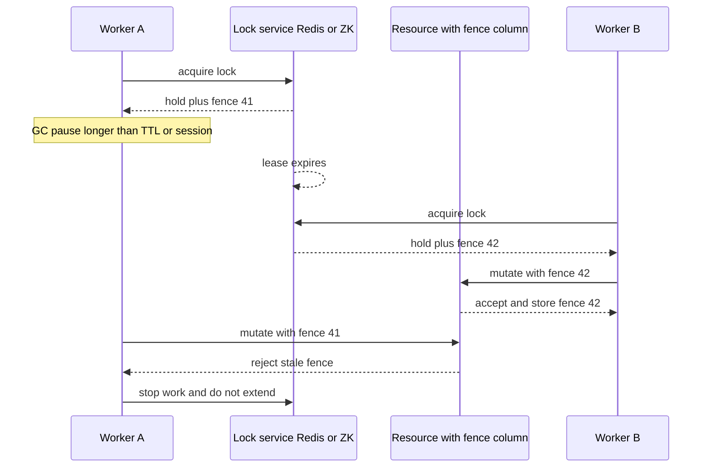

## Concept

### What a distributed lock can and cannot be

A lock in one process is a mutex plus the scheduler. A lock across processes is a lease on a shared name, plus a way to stop a holder that paused, plus a way to make everyone else refuse stale work. If you only implement "SET a key if absent," you have a polite sign on the door. You do not have mutual exclusion against a holder whose GC pause outlasted the TTL, or against a holder that paused after sending a write that is still in flight.

The dangerous sequence is always the same, and it is the core of the critique of Redlock even if you never use Redis. Process A acquires the lock, pauses, the lock expires, process B acquires it, and A resumes and talks to a system that cannot tell A is old. Unless that system fences, you had two critical sections.

A production lock has three parts. A mutually exclusive lease with a TTL or a session. A monotonic fencing token given to the holder. Every side effect in the critical section tagged with that token and rejected if stale. Skip the token and the check and you are optimizing for the demo.

### Redis: fast leases, weak fencing unless you add it

The primitive is `SET resource unique-id NX PX ttl`. The unique id exists so release is "if the value is me, then delete," usually in a Lua script, so you do not delete someone else's lock after expiry. That is correctness for release. It is not mutual exclusion under pause.

Redlock tries to SET on a majority of independent Redis masters. It improves survival of a single Redis crash. It does not create a fencing token a disk will honor, and it still depends on reasonably synchronized clocks for TTLs. After a pause longer than the TTL, the old holder is live without the key. A Redis failover that loses a recent SET can also grant the same lock twice if the SET was not replicated.

You can still use Redis locks. Use them for efficiency, so that only one worker does the expensive job most of the time, not for correctness of exactly one writer to a ledger. If you need correctness, put a token somewhere that can reject: a database column updated with `WHERE fence < ?`, an object-store conditional write, or a log. Redis can mint a monotonically increasing token with INCR in the same Lua as the acquire, and you pass that integer everywhere. You must not lose the INCR on failover. At that point you are building a cheap lease service, not using a cache.

### ZooKeeper: sessions, ephemerals, and ordered znodes

ZooKeeper's lock recipe uses an ephemeral sequential znode under a parent. The client with the lowest sequence number holds the lock. Everyone else watches the predecessor, not the parent, to avoid a herd. If the holder dies, its session expires, the ephemeral node disappears, and the next watcher fires. Session timeout is the TTL analogue, but it is tied to ZooKeeper's view of liveness, heartbeats on the connection, not to a key expiry that keeps ticking on the server while the process is stopped.

The sequence number is a natural fencing token. You send it to the resource. The resource remembers the highest lock sequence it has accepted. That is the Chubby and ZooKeeper story done right. You still must not acquire a ZooKeeper lock, write to MySQL with no version column, and assume MySQL will refuse the paused client. MySQL will not, unless you tell it.

etcd and Consul locks are the same family: a lease with keep-alive, a compare-and-swap on a key, and the revision or lease id as the fence. Kubernetes leader-election Leases are this pattern. Prefer etcd, ZooKeeper, or Chubby when the lock is a correctness boundary. Prefer Redis when the lock is an optimization and a double-enter is recoverable.

### TTLs, renewal, and queues

Holders extend leases so long jobs can run. Extension is where people create immortal locks, a loop that renews even after the process is half-dead, or false safety: I renewed, so my in-flight HTTP call is still exclusive. A request sent before expiry can arrive after expiry. Fencing is the only answer. Longer TTLs only change the race's timing.

GC pauses in the holder must be shorter than the lease, or the holder must step down when renew fails, before doing more work. A dedicated renew thread with a fail-closed path is part of the lock. ZooKeeper session loss already drops ephemerals. Redis will not drop your process's belief that it holds the key unless you check.

Redis `SET NX` is a try-lock. Under contention you spin or back off. ZooKeeper's sequential recipe is a fair queue. Fair queues avoid starvation and create head-of-line blocking. For a job dispatcher that wants someone to do this, an unfair try-lock plus backoff is fine. For a control-plane mutation that must not starve a node, use the queue. Do not implement a fair queue in Redis lists and call it ZooKeeper. You will invent session expiry badly.

## Trade-offs

| Approach | When it wins | Cost / risk |
| -------- | ------------ | ----------- |
| Redis `SET NX PX` | Deduplicating work, rate limits, best-effort single flight | Pause plus TTL expiry means dual holders; no native fence |
| Redlock across a Redis majority | Slightly better crash story than one instance | Still clock and TTL based; weak mutex semantics |
| Redis lease plus a DB fencing token | Fast acquire, correct side effects | Two systems; the token must be durable and monotonic |
| ZooKeeper, etcd, or Chubby lock | Control plane, leader election, correctness-critical sections | Extra dependency; higher latency per acquire |
| No lock: idempotency and a log | Side effects that can be made safe at the consumer | Requires redesign of the critical section |

Redis wins on latency, a sub-millisecond acquire on a local cluster, and on operational familiarity. It loses when the cost of dual entry is a double charge or a split-brain writer. ZooKeeper wins on a well-understood session model and a sequence number. It loses if your only ensemble is a shared, overloaded cluster that pauses under snapshots. Lock latency then becomes ZooKeeper latency.

The adult design for teams that already have Redis is the third row. Acquire in Redis for speed, write the fence into the system of record, and make every mutation check it. If you cannot change the system of record, you cannot have a correct distributed lock in front of it. Move the mutation into a system you control, or accept best-effort.

Skipping the lock is often the better design. A Kafka partition already serializes. A SQL `UPDATE ... WHERE version = ?` is a critical section with optimistic concurrency. Many requests for Redlock die when you ask which row could be versioned instead.

## Diagram

## Failure modes

### Dual holders after pause or clock jump

The TTL expires while A is paused, or while A's Redis SET is lost on failover. B enters. A resumes. Detection is duplicate side effects, conflicting writes, logs showing two lock owners with overlapping wall time, and fencing rejections if you log them.

Mitigation: fencing on every side effect, fail closed on renew failure, and a TTL longer than the worst pause but not so long that death recovery is an outage. For Redis, wait out replication or use a store with a real session. Do not fix this by only lengthening the TTL.

### Herd on lock release

All waiters watch one key or one parent znode. Release wakes thousands. Detection is ZooKeeper outstanding-request spikes, reconnect storms, and Redis CPU on a hot key.

Mitigation: the ZooKeeper recipe of watching the predecessor only, Redis with a small waiter set or a queue per shard, and jittered backoff. For leader election, one lock, not one lock per request.

### Immortal lock and unlocking the wrong lease

A process is unhealthy but still sends heartbeats. Work is not progressing and nobody else can enter. Detection is lock-hold duration histograms, business lag, and an owner that does not increment a progress counter. Mitigation: separate session liveness from work liveness, a progress heartbeat in the resource, and an operator break-glass delete that advances the epoch so in-flight stale work is fenced. Session liveness is not application liveness.

A related bug is DEL without checking the unique value, or a client that thinks it still owns the id. Random owners change without expiry. Compare-and-delete with the unique token. Never delete blindly. Test concurrent extend and expiry.

### Treating the lock as authorization

Any client that can talk to Redis can SET the key if they know the name. Detection is surprising owners and missing access control. Mitigation is Redis ACLs, ZooKeeper ACLs, network policy, and a name that includes a namespace. A lock is not a security boundary unless you design it as one.

## Real-world example

Google Chubby is the existence proof that a lock service is a consensus problem. Chubby cells use Paxos. Clients hold leases. Sequencers travel with operations to other services so a delayed RPC is rejected. Kubernetes copied the shape with Lease objects in etcd: controllers renew, others observe, and a well-behaved controller stops mutating when renew fails. The important part is not the file API. It is the sequencer plus the rule that the leader stops.

Redis is used at huge scale as a lock for jobs that are already idempotent. Only one crawler should fetch this URL in the next minute. If two fetch, the cache still converges. That is a valid Redis lock. A payment capture is not. A payment API needs an idempotency key in the ledger, a row version in the database, and a worker that can safely retry. Putting Redlock in front of a charge call without a fencing-aware ledger is how you double-charge when a worker pauses through the TTL.

ZooKeeper's recipe, and Kafka's older use of ZooKeeper for controller election, is the middle. You paid for a consensus ensemble, so use it for the mutex that protects metadata. Kafka later moved controller election into KRaft to avoid a second system. The lock service is an operational object. If you already run etcd for Kubernetes, elect there. If you already run a log that serializes the work, you may not need a lock at all.

Copy Chubby's sequencer even if your store is Redis plus Postgres. Acquire, increment a fence, write the fence into Postgres, and mutate with a predicate on that fence. That hybrid is more honest than Redlock theater.

## What to remember

- A TTL lock without a fencing token is a performance hint, not mutual exclusion.
- Redis is the right tool for best-effort single-flight. ZooKeeper, etcd, and Chubby are the right tools for a correctness boundary.
- Every side effect in the critical section must reject stale epochs, including calls already in flight after expiry.
- Prefer versioned rows and serialized logs when the resource can implement compare-and-swap itself.
