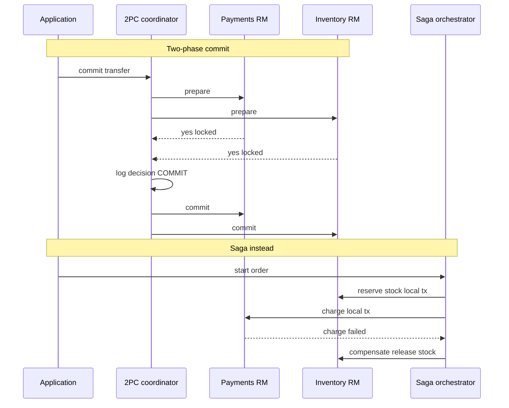

## Concept

### Atomic commit across two managers is a protocol

When a single business action must mutate two or more resource managers, a payments database and an inventory database, or a database and a message broker, you have an atomic commit problem. Either all participants commit, or all abort. Two-phase commit is the classic protocol. A coordinator sends prepare. Each participant votes yes, a durable intent to commit with resources locked, or no. If all vote yes, the coordinator durable-logs a commit decision and tells everyone to commit. If any votes no, or times out in a way the protocol treats as no, it logs abort and tells everyone to roll back.

The prepare vote is the expensive idea. A participant that voted yes is not allowed to forget. It must be able to commit after a crash when the coordinator later says so. That is why XA transactions require a transaction log on every resource manager, and why a process that prepares and then dies while holding row locks becomes everyone else's latency problem.

Two-phase commit gives a single atomic outcome from the application's point of view. The cost is blocking, coordinator availability, and a distributed lock interval that lasts until the second phase. It is a correctness protocol for a small number of XA-capable stores in one failure domain. It is not a way to stitch twenty microservices into one ACID universe.

### Why two-phase commit blocks

After a participant has voted yes, it cannot unilaterally abort. If the coordinator dies after logging the decision but before sending it, participants wait. If the coordinator dies before logging, recovery must abort, or interrogate a surviving log. Either way, locks stay held. A network partition between coordinator and one resource manager looks the same as a slow resource manager. Heuristic decisions, "just commit locally," break atomicity. That is the incident you get if you set aggressive timeouts on XA.

Three-phase commit and other non-blocking variants exist in papers. In production you will see two-phase commit with a highly available coordinator, or you will not see two-phase commit. You will not implement three-phase commit in the application layer.

### Sagas: local transactions plus compensation

A saga splits the business action into a sequence of local transactions, each with a compensating action that semantically undoes it. Book the hotel, book the flight, charge the card. If the charge fails, cancel the flight and cancel the hotel. There is no global prepare. Each local commit is visible as soon as it happens. Isolation is not serializable across the whole saga. You will see "booked hotel, no flight" as a real state. The design job is to make that state livable: reservations with timeouts, holds instead of captures, and compensations that actually work.

Compensation is not a database rollback. You cannot unsend an email. You send a cancellation. You cannot always uncharge if the card network already captured. You refund. Some steps have no compensation, such as a legally required report. Those steps belong at the end, or outside the saga with a different recovery story.

Sagas need a log of progress: which steps completed, which compensations ran. That log is the coordinator in orchestration, or the event history in choreography. Without it you cannot distinguish "never booked the flight" from "booked and lost the response." Idempotency keys on every step are mandatory. At-least-once delivery is the default.

### The isolation gap is the product

Two-phase commit keeps other transactions from seeing in-doubt data, in the protocol's model. Sagas expose intermediate states. Architects who adopt a saga without designing those states recreate two-phase commit's promises in chat after launch.

Patterns that make sagas safe are semantic locks, a status column such as `PENDING_PAYMENT` that other workflows respect, commutative updates, and time-bounded reservations. If two sagas can allocate the last seat, you need a local constraint, a unique seat row, at the inventory service. That local constraint is the real atomicity. A global prepare will not save a service that already committed the seat to two callers.

### Where each protocol lives

XA still appears inside a monolith talking to two databases, or between a database and a message broker, on one JVM with a transaction manager. It still appears in mainframe and banking middleware. It rarely appears as the glue between independently deployed services, because those services do not expose XA resources and should not.

Sagas appear as workflow engines, as a state-machine table in Postgres, as an orchestrator service, or as a chain of events. They are the default for HTTP services. Trying to run two-phase commit over HTTP with ad-hoc prepare endpoints holds locks across garbage collection and deploys. Do not build homemade XA.

## Trade-offs

| Approach | When it wins | Cost / risk |
| -------- | ------------ | ----------- |
| Local ACID only | One resource manager, or a designed single writer | Cannot atomically touch a second store |
| XA / two-phase commit | Few XA-capable managers, short transactions, one team | Blocking, lock duration, coordinator HA, heuristic disasters |
| Saga with compensations | Independent services, long-running business processes | Intermediate states, compensation bugs, no isolation |
| Outbox plus one database transaction | Publishing an event atomically with a local write | Downstream is eventually consistent |
| Consensus log as the system of record | New design where all mutations are events | Participants must be rewritten around the log |

Two-phase commit's benefit is a simple mental model on the happy path: the application commits once. The cost shows up on the failure path and in operations. Database administrators debug in-doubt transactions, lock timeouts fire, and the coordinator must be as available as the data. Stretching two-phase commit across a WAN or a rolling deploy is how you hold locks through a deploy.

Sagas invert the costs. The happy path is several commits and more code. The failure path is designed instead of blocked. You can deploy the hotel service independently. You cannot promise a user that they will never see a pending order. If the business cannot tolerate that, keep the action in one database, or use two-phase commit in the small: two resource managers, same region, seconds of work.

The outbox is often the correct almost-atomic commit. One local transaction writes the row and the event. The consumer is a saga step. You get atomicity where it is cheap, one resource manager, and compensation where it is not. Many arguments about two-phase commit versus saga end once you stop trying to commit a log and a database in one XA transaction.

## Diagram

## Failure modes

### Coordinator crash after prepare

Participants are in doubt, locks are held, and new transactions pile up. Detection is XA recovery logs, in-doubt counts in the database, latency cliffs, and a dead transaction-manager process.

Mitigation: a highly available coordinator with a durable decision log, bounded transaction time, and a runbook to resolve in-doubt transactions with the same decision the log would have made. Never heuristic-commit because a dashboard is red. Page humans before breaking atomicity.

### Heuristic mixed outcomes

One resource manager committed and another aborted after a timeout. Detection is money moved without inventory, or the reverse, and XA heuristic alerts. Mitigation: treat the mix as a severe data incident, replay from business logs, and disable automatic heuristics. If you need timeouts this short, you needed a saga.

### Compensation that is not an inverse

A refund fails, a cancel is not idempotent and double-cancels, or a step has no inverse. Detection is a saga stuck in compensating, manual tickets, and negative inventory.

Mitigation: idempotency keys, compensations tested as first-class code, and steps designed as reservations with a TTL so the inverse is to let it expire. Put irreversible steps last. Dead-letter the remainder with an operator playbook.

### Lost saga progress and locks held across the network

The orchestrator charged the card and crashed before recording success. A retry charges again. Detection is duplicate captures and customer complaints. Mitigation: persist intent before the side effect, and make the payment call idempotent on the provider's key. The log is not optional.

A related failure is starting a database transaction in service A, calling service B over HTTP, then committing. That is two-phase commit without a coordinator: locks in A during a network call. Detection is lock-wait graphs aligned with HTTP time. Commit before the RPC. Use a saga or an outbox. Never hold a SQL transaction across an HTTP boundary.

## Real-world example

Traditional payment cores still run two-phase-commit-shaped protocols inside a small set of XA-aware resource managers because a mixed outcome is a regulatory event. The transaction is short, the managers are collocated, and a transaction manager with recovery is a product they staff. That is the environment two-phase commit was built for.

Order pipelines and payment platforms in the service world do not two-phase-commit checkout across inventory, tax, fraud, and capture. They take a reservation, an inventory hold and an authorization on the card, persist an order record with a state machine, and complete capture and fulfillment as later local transactions. If fraud rejects, they release the hold and void the authorization. If capture fails after a hold, they retry with idempotency keys. They do not un-prepare a global XA branch.

The design choice is the authorization versus capture split. An authorization is a compensation-friendly prepare at the business layer, not at the XA layer. It expires. It is idempotent. It does not hold a row lock in your order database while the card network thinks. That is a saga step that looks a bit like prepare, which is why people confuse them. The difference is who may abort without asking a coordinator. The reservation TTL may. The inventory service may. The global transaction never existed.

If you are joining Postgres and a legacy database in one batch job for a handful of rows, XA may still be the least code. If you are joining many services for a checkout, a saga with reservations is the architecture.

## What to remember

- Two-phase commit is atomic commit with blocking prepares. It needs XA-capable managers and a recoverable coordinator.
- Sagas are visible local commits plus compensations. Intermediate states are real and must be designed.
- Do not hold SQL locks across HTTP, and do not invent XA over REST.
- Prefer a local transaction plus an outbox for a database and an event, and reservations with a TTL for cross-service actions.
