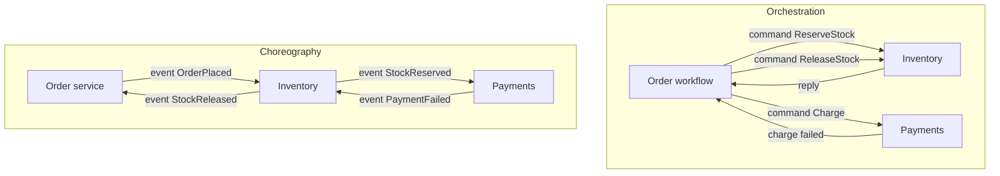

## Concept

### Two ways to drive the same sequence of local transactions

A saga is a long-running business transaction built from local commits and compensations. The remaining design question is who knows the sequence. In orchestration, one component does: an orchestrator, a workflow engine, or a state-machine row that says step 3 of 5, waiting on payment. It sends commands, waits for replies, and decides the next command or the compensation path. Participants stay relatively narrow. They execute a command idempotently and emit a result.

In choreography, there is no central commander. Each service listens for events, does its local work, and emits the next event. Inventory hears `OrderPlaced`, reserves stock, and emits `StockReserved`. Payments hears that, charges, and emits `PaymentCaptured` or `PaymentFailed`. Shipping hears success and ships. Compensation is also event-driven: `PaymentFailed` causes inventory to release. The sequence lives in the subscription graph.

Both are sagas. Both need idempotency, a durable history, and designed intermediate states. They fail differently under change, under partial outage, and under the question "where is order 812?"

### Orchestration mechanics

The orchestrator holds the correlation id and the current state. It should persist that state before issuing a command, so a crash does not double-command without a key. Commands carry an idempotency key derived from the saga id and the step. Timeouts are first-class. If payment does not reply in 30 seconds, the workflow takes the timeout transition, which may retry or compensate. That timeout is business time, not a TCP timeout.

Workflow engines exist because writing this as ad-hoc threads in a web process loses the timers on deploy. A good engine records history so you can replay, patch a bad step, and see the graph. The orchestrator is a dependency. If it is down, new steps do not start. Participants may still complete in-flight work, but the saga does not advance.

Keep each domain's rules in the participant. The orchestrator should not compute tax. It should say calculate tax and route on the result. Orchestrators that absorb every rule become a monolith with extra latency. Orchestrators that only route become a useful skeleton.

### Choreography mechanics

Each service's event contract is the API. The payload must include correlation ids, causation ids, and enough data for the next step, or you will couple on reads as well as on events. Schema evolution is a fleet problem. A new required field in `StockReserved` breaks payments.

Cycles are the danger. Payments emits an event that inventory also consumes for a different reason, and you get a loop. Keep business stages acyclic. Use event names that encode intent, `StockReservedForOrder` rather than `StockUpdated`. A service should not react to its own downstream events without a terminator.

There is no single timeout process unless you add one. A saga that stalls because shipping never subscribed to the new event will sit in `PaymentCaptured` forever. You need a sweeper that looks for orders older than a threshold in a non-terminal state and raises an alarm or emits a compensation. That sweeper is a small orchestrator. Many systems that call themselves pure choreography grow one and do not say so.

### Observability and the hybrid you will actually run

Operations will ask where the saga is. Orchestration answers from one store: current step, last error, history. Choreography answers by stitching traces if everyone forwarded the correlation id, or it does not answer. Require a correlation id and a causation id on every event. Build a view that is not a search across six repositories. If you cannot fund that view, do not pick choreography for a money saga.

A common production shape is choreography for the happy path and a central order service that owns the status column. That order service is an orchestrator that listens instead of commanding. It can time out, compensate, and answer support. The presence of a component allowed to decide "this saga is dead, refund" is the test. Do not call it choreography because the bus is Kafka.

## Trade-offs

| Approach | When it wins | Cost / risk |
| -------- | ------------ | ----------- |
| Orchestration with a workflow engine | Complex branching, timeouts, support, money paths | Central availability; the workflow can become a god object |
| Homegrown state table | A few steps, and you already have Postgres | You will reimplement timers, replay, and versioning |
| Choreography | Simple linear fan-out and independent deploy | Invisible sequences, weak timeouts, cyclic events |
| Hybrid: events plus an order state owner | Most checkouts | Two sources of truth if status and events diverge |
| One local transaction, no saga | One service can own the whole action | Wrong once the databases are already split |

Orchestration wins when the graph has retries, backoff, a deadline across steps, or a legal requirement to explain the path. Payment capture and anything whose compensation must not double-apply belongs here unless the choreography is unusually disciplined. The cost is an engine to run and a temptation to put domain code in the workflow.

Choreography wins when steps are independent notifications. A search index hears `ItemUpdated`. Analytics hears it too. Those listeners must not block a contractual sequence. Using choreography for a six-step checkout with four compensation paths produces a distributed state machine nobody can draw. If you need a drawing to ship, you needed an orchestrator.

Homegrown orchestrators fail on timer durability and on versioning in-flight sagas. When you change step 3, orders currently on step 2 must still run the old step 3 or a written migration. Workflow engines earn their keep on that problem. If you refuse one, budget for the same work anyway.

## Diagram

## Failure modes

### Lost commands or events without idempotent receivers

At-least-once delivery duplicates a charge. Detection is duplicate money movement, provider-side duplicate keys, and saga history with repeated steps.

Mitigation: an idempotency key per saga id and step, stored in the participant, and an outbox on the producer. The orchestrator records that the command was sent before the send, and that the reply was processed after. Choreography needs the same key inside the event.

### Orchestrator as a monolith and a single point of stall

All sagas queue behind a stuck workflow worker or a poisoned history. Detection is workflow lag, one tenant filling the history, and a deploy that breaks in-flight timers.

Mitigation: shard workflows by id, isolate tenant quotas, version workflows, and keep participants able to reject commands they do not understand. Do not run the orchestrator as a single unsharded process.

### Choreographed stall with no subscriber and no timeout

A new step is added to a document, not to a consumer group. Detection is orders in a non-terminal state forever, and consumer lag of zero on the wrong topic.

Mitigation: an explicit timeout sweeper, contract tests that every event type in the graph has a consumer, a schema registry with compatibility checks, and alerts on state age. Choreography without a sweeper is an incomplete protocol.

### Divergent status and compensation cycles

The order row says paid, the payment event never landed, and shipping does not start. Detection is support tickets and a nightly reconciler. Mitigation: one writer for status, events as derived facts, and a reconciler that treats a mismatch as a bug. Do not let every service update the order row.

A second failure is ping-pong. `PaymentFailed` releases stock, which emits a generic stock-changed event, which a pricing service treats as a new order. Detection is event storms and oscillating states. Use event names that encode intent. Terminate compensations in a terminal saga state. Do not emit a generic entity-updated event from a compensation path.

## Real-world example

Amazon-style order pipelines are the public shape most checkout systems copy. An order service records the customer intent. Fulfillment, payments, and inventory are separate systems. The order does not commit atomically with the warehouse. It moves through documented states. Internally that is orchestration: something owns "this order is waiting on payment," with commands or at least with a status authority. Events still fly for search, email, and analytics. Those listeners are choreography beside the saga, not the saga itself.

A payment intent on a Stripe-style platform makes the same split obvious. The intent is an orchestrated state machine: requires action, processing, succeeded, canceled. You do not implement that as five services independently guessing the next hop from a topic named money. The intent object is the orchestrator API. Webhooks to merchants are choreography after the fact: many consumers, and none of them decide whether the payment captured.

Workflow engines became popular among the same companies as a comment on homegrown orchestrators. Once you have timeouts, retries, and in-flight versioning, an engine is cheaper than a unique state table per saga type. Choreography remains the right tool for fan-out that must not block the money path: notify, index, warehouse analytics.

The choice to copy: put the contractual sequence, the path that can lose money or stock, in an orchestrator with durable history. Put the optional reactions on events. If a consumer is allowed to fail without blocking checkout, it is choreography. If a consumer's failure must trigger compensation, it is a saga step and should be a command with a reply, not a hope that someone is subscribed.

## What to remember

- Orchestration centralizes sequence, timeouts, and support views. Choreography centralizes nothing and needs a sweeper to become a protocol.
- Idempotency keys and a durable history are required in both styles. The bus does not provide them.
- Use orchestration for money and stock. Use choreography for notifications and projections.
- A status-owning order service plus events is a hybrid. Give status a single writer so the saga can be explained.
