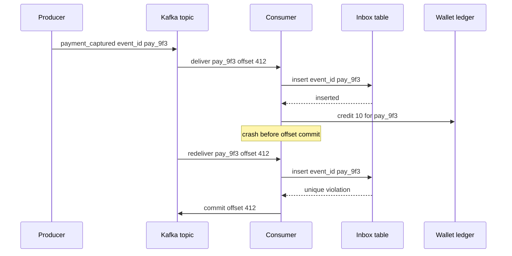

## Concept

### Delivery contracts stop at the log

A broker can offer three delivery contracts, and each one describes how many times a record is handed to a consumer group. At-most-once means a crash, a reset, or a lost acknowledgement can drop the record. The handler runs zero or one times, and silent loss is the failure mode you priced in. At-least-once means the broker redelivers until it observes a durable acknowledgement, so a crash between a side effect and the offset commit produces a second delivery. Effectively-once is the phrase worth using with operators: at-least-once transport plus an application uniqueness constraint that makes the second delivery leave observable state unchanged.

Product language that says "exactly-once" is usually describing a narrower machine: an idempotent producer, a transactional consume-transform-produce loop, or a single log where offsets and output records commit together. That machine is real and valuable. It does not travel with the bytes once they leave the log. A payment posted to a ledger, a welcome email, an inventory decrement, and a webhook are effects. The consumer is the last component that can turn a duplicate record into a duplicate fact. Given the same logical event, an idempotent consumer leaves the world in one result.

### Duplicates are produced by independent retry loops

Duplicates appear wherever two parties cannot tell "never arrived" from "arrived, and the response was lost." A producer times out waiting for an acknowledgement and publishes again. The broker stored the first copy. A consumer writes a row, then dies before committing the offset. After rebalance, another member of the group reads the same record. A load balancer retries a POST because the handler succeeded and the HTTP response never made it back. A human clicks Pay twice. An operator replays a dead-letter topic from last Tuesday.

None of these require a misconfigured cluster. They are the intersection of timeouts, crashes, and at-least-once recovery. Making the second delivery cheap and safe is a local invariant plus a durable record of work already applied. Design for the second delivery, and alert when the duplicate-skip rate collapses to zero on a pipeline that should be seeing retries.

### The inbox shares a transaction with the effect

The standard structure is an inbox, sometimes called a processed-message store. Each event carries a stable idempotency key: a UUID assigned once at the origin, a business identifier such as `payment_id`, or, inside a single log you fully control, the tuple `(topic, partition, offset)`. Before applying effects, the consumer inserts that key into a table with a unique constraint. A successful insert means this process won the right to apply the effect. A conflict means some earlier attempt already won. Skip the effect and commit the offset anyway, so the partition can move forward.

The insert and the business write belong in one database transaction. If they commit separately, a crash between them replays the effect. When the side effect lives in another system — a card network, SMTP, a second database — record intent locally, call out with the same key, and require the remote API to be idempotent under that key. An outbox row in that transaction tells the relay there is work after a crash.

Offset commit comes last. Committing the offset before the transaction commits is how you get at-most-once by accident: a crash drops the event and the broker will not send it again. Committing the offset only after the transaction, and treating a unique violation as success, is how at-least-once becomes effectively-once for that store.

### The key names a business fact

Handlers are idempotent when the write is an upsert of a fact, and they are dangerous when the write is an increment of a counter. Crediting a wallet by ten dollars on every delivery doubles money. Inserting a ledger row "payment `pay_9f3` applied, plus ten, balance derived from the sum of rows" converges. Sending "order shipped" on every delivery spams the customer. Inserting a notifications row keyed by `(order_id, shipped)` and sending only when the insert wins sends once.

The key identifies intent, assigned by the writer and persisted before any retry. A retry that mints a fresh UUID is a new event. Two legitimate payments that share a key will drop a real charge. HTTP mutating endpoints should require `Idempotency-Key` and store the first response body with the key, so the retried client receives the original result. Event producers stamp `event_id` once, in the outbox row. A user who asks to resend a receipt is a new intent (`resend_requested`) that points at the same aggregate.

### Broker transactions cover the log, and only the log

Kafka's idempotent producer assigns a producer id and a sequence number so a retried produce does not append a second record. Transactions extend that to atomic writes across partitions and to the coupling of consumed offsets with produced output. A stream processor can read an input topic, update a changelog, and write an aggregate topic so a crash does not emit a double count into the output log. Pulsar and similar systems offer their own dedup windows and transactional producers. Use them for consume-transform-produce loops that stay inside the log.

The moment the handler calls an HTTP API, increments a cache, or inserts into a warehouse that does not join the transaction, the pipeline is at-least-once again, and the inbox or an idempotent remote API is the remaining safety. State the boundary in the design review: which effects participate in the log transaction, and which effects carry their own key.

## Trade-offs

| Approach | When it wins | Cost / risk |
| -------- | ------------ | ----------- |
| At-most-once, no inbox | Metrics, samples, caches that rebuild from source | Silent loss on crash, timeout, or rebalance |
| At-least-once plus inbox in the same database | Payments, orders, inventory, any fact with a business key | Extra write and unique index per event; key design is a product decision |
| Broker transactions (idempotent producer plus consume-transform-produce) | Enrichment and aggregation that stay inside one log | External side effects fall outside the guarantee; throughput and version constraints |
| TTL dedup cache (`SETNX` with expiry) | High volume where the retry horizon is short and bounded | Eviction before a late replay reapplies the event |

At-most-once is an honest contract for telemetry. A missed sample is cheaper than a doubled charge, and the pipeline stays simple. Most product flows cannot accept a missing order.

An inbox in the same database as the business rows is the workhorse. You pay a unique index and a transaction per event. Retention of keys must exceed every legitimate retry, including operator replay. When the effect is remote, pair the inbox with an outbox and an idempotent API. The local transaction records intent; the remote system records completion under the same key.

Broker transactions are the right tool for stream processors whose outputs are more log records. They shrink the duplicate window between produce and consume. They do not replace a ledger constraint. Teams turn them on, call a billing API from the handler, and then discover two invoices for one offset.

A TTL cache is a hot filter in front of a durable table. Size the TTL to the longest retry you actually run, including dead-letter replay. If operators can replay last month, the table is the source of truth. A support tool that republishes the original payload under a new id will double-apply. Republishing the original id is the crash-recovery path.

## Diagram

The sequence is an inbox under a crash between the ledger write and the offset commit. The redelivery hits the unique key and leaves the wallet unchanged.

## Failure modes

### Dedup window shorter than the retry horizon

Detection is two ledger rows for one `event_id` hours or days apart, or a sudden drop in "duplicate skipped" metrics after a cache eviction, a compacted topic shrinking, or an inbox table that was truncated in a cleanup job. A replay tool that strips ids and mints new ones looks like a traffic spike of brand-new events.

Mitigation is a store whose retention exceeds every path that can redeliver: consumer retries, rebalances, dead-letter replay, backup restore, and the support console. If Redis sits in front, a miss falls through to the durable unique index. Replay tools are required to preserve the original event id. Alert when duplicate-skip rate goes to zero on a topic with a non-zero retry rate.

### Side effects outside the transactional boundary

Detection is an inbox row with no matching remote charge, or a remote charge with no inbox row. Mismatch jobs between the inbox, the outbound audit log, and the vendor's idempotency log are the signal. Timeouts are the usual shape: the call succeeded, the local transaction rolled back, and the retry calls again.

Mitigation is an outbox row in the same transaction as intent and business state. A relay performs the call. The remote API honors the same key and returns the original result. When a vendor cannot do that, record "call attempted" with the request body, and give operations a compensating path that is itself idempotent. Unbounded retries of a timeout-after-success are how an inbox that looked correct still manufactures duplicates downstream.

### Key collision and key reuse

Detection shows up in support: a second legitimate payment is dropped, a resend does nothing, or a corrected amount never lands because the handler treated the new payload as a duplicate of the old one. Metrics show a high unique-violation rate on keys that should have been new intents.

Mitigation is a written key grammar and a producer that mints the id once, upstream of any retry loop. A corrected event is a new id that references the prior aggregate. HTTP handlers store the first response with the key so a retry is a replay of the result, including error bodies, rather than a silent empty success. Reject messages whose id was generated inside the consumer.

### Poison messages and retry amplification

Detection is consumer lag on one partition, the same offset failing until a max-retry policy trips, and error rate up while sibling partitions drain. A handler that times out after the remote side succeeded will look like a poison pill even when the payload is valid.

Mitigation parks the record on a dead-letter topic after N failures, with the original key intact. Alert on dead-letter depth. Fix the handler or the payload, then replay once. Idempotency makes the replay safe. It does not make a bad payload succeed, and it does not justify an infinite retry loop that holds the partition.

## Real-world example

Apache Kafka, built at LinkedIn and still the backbone of LinkedIn's activity and data pipelines, is where the exactly-once claim entered most architecture reviews. The idempotent producer and the transactional protocol let a stream job read a topic, update intermediate state, and write output so that a crash does not append a second copy of the output records. LinkedIn-scale jobs use that for log-to-log work: counting, joining, and republishing within Kafka.

The boundary shows up at the sink. A connector that indexes into a search cluster, writes a graph store, or calls a billing API is an at-least-once consumer of the output topic. Kafka's transactional guarantee covers the offsets and the records that participate in the transaction. It does not cover an HTTP 200 that happened before the connector committed its offset. If the downstream upserts by primary key, the second delivery converges. If it appends a charge per request, the customer is billed twice while the source cluster still reports transactional processing.

The pipeline that holds is three cooperating invariants. A transactional produce writes an `invoices` record once. A billing consumer inserts `invoice_id` into an inbox in the same transaction as the local invoice row. The charge call sends that same id as its idempotency key and returns the original authorization if the call is repeated. Effectively-once is that chain. A broker flag on the source cluster is one link, and the link that moves money is the unique constraint plus the remote key.

## What to remember

- Effectively-once means at-least-once delivery plus a uniqueness constraint on a stable business key.
- Commit the inbox insert and the business write in one transaction, and commit the offset only after that transaction succeeds.
- Broker transactions protect log-to-log pipelines; every external call needs its own idempotent API or an outbox relay.
- Retain keys for the real retry horizon, including dead-letter replay, and treat a resend as a new intent.
