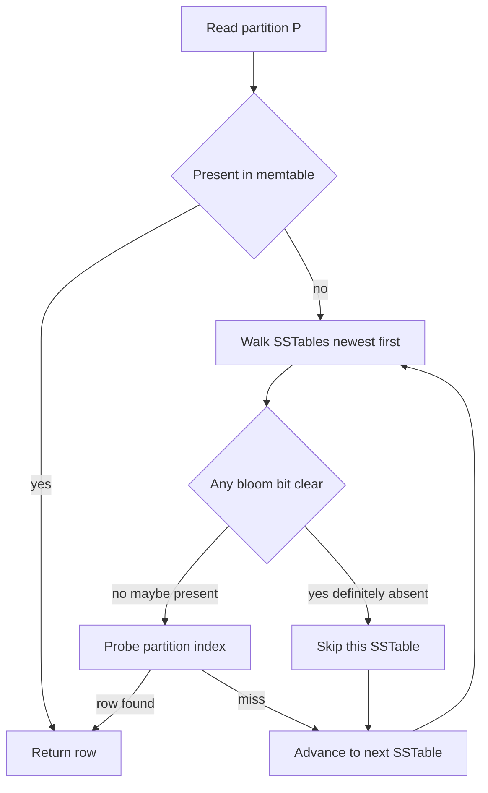

## Concept

### Membership without storing the set

A Bloom filter answers a narrow question: is this key possibly in the set, or definitely absent? The asymmetry is the product. You store a bit array of length `m` and `k` hash functions. Insert hashes the key `k` times and sets those bit positions to one. Query hashes the same way. Any zero bit means the key was never inserted. All `k` bits set means the key is probably present, because other keys may have covered the same positions.

Memory depends on `m`, and key length drops out. A hash table stores the keys plus overhead. A filter sized for a hundred million keys at a one percent false-positive rate is on the order of a hundred megabytes of bits, which is why the structure sits next to files that would otherwise be probed on disk. You pay a chosen false-positive rate. A key that was inserted produces no false negative in a correct, uncorrupted, unfilled-past-design filter. That sentence has three escape hatches — corruption, saturation, and a stale generation — and each one is an incident class.

There is no delete in the classic structure. Clearing a bit can erase the only evidence of a different key that shared it. Delete requires a counting filter, a cuckoo filter, or a rebuild of an immutable generation that simply omits the key.

### Sizing is the capacity plan

The false-positive probability is a function of expected inserts `n`, bits `m`, and hashes `k`. Too few bits and the array saturates: almost every query returns "maybe," and the filter has become a pass-through that still costs CPU. Too many hashes set more bits per insert and saturate faster while also burning CPU on the query path. The usual operating point is a false-positive rate between about 0.1 percent and 2 percent, with `k` a small integer, often derived from the bits-per-key you chose.

Pick `n` from the generation you will seal: keys per SSTable, keys per daily shard, URLs in a Safe Browsing chunk. Pick the tolerable false-positive rate from the cost of a wasted lookup. Then compute `m` and `k`, and treat `n` as a hard budget. A filter that accepts unbounded inserts will quietly approach a false-positive rate of one. Publish the formula in the runbook and alert on the observed rate, measured against production key distributions. Random integers hide clustering and hash weaknesses that real partition keys expose.

Hash quality shows up as a gap between the formula and the measured rate. Cryptographic hashes are slower than an inner loop wants. Production filters use Murmur, xxHash, or double hashing: two independent hashes combined to simulate `k` functions. Freeze the algorithm, the seed, and the byte interpretation in a header. A library upgrade that changes a default seed splits writers and readers.

### Where a negative is worth the CPU

The profitable seat is in front of an expensive negative. Cassandra, Bigtable, and HBase attach a filter to each immutable data file so a read can skip files that cannot contain the key. A false positive pays for an index probe and still returns the correct row or a clean miss. A false negative would skip a file that holds the row, which is a correctness bug. Chrome's Safe Browsing client kept a compact filter so most URLs never left the device; a positive still required a confirmation lookup. CDNs use the same idea to avoid origin fetches for keys that were never cached.

That placement rule decides what the filter may guard. "Definitely absent from the revoked-token set" is a safe fast path only because a false positive falls through to an exact check, and a true negative can skip the round trip. "Definitely a member of the allow set" is a claim the structure cannot make. Authorization, uniqueness, and "skip creating this order because we probably have it" are exact-set problems. A false positive there drops work or admits a stranger.

### Variants and layout

Counting Bloom filters replace bits with small counters so a delete decrements. They cost more memory, and they fail closed or open depending on how you handle saturation: a counter that hits its maximum can no longer represent a delete, and decrementing a key that was never inserted corrupts other keys. Cuckoo filters store fingerprints in buckets, support deletion, and keep a more stable false-positive rate at high load, with the new failure that an insert can fail when the buckets are full. Quotient filters and xor filters trade build time, query time, and bits per key differently. For most service design, a classic filter plus a periodic rebuild is the structure you can explain during an incident. Reach for cuckoo when deletes are frequent and a rebuild cadence cannot keep up.

### Generations, not a filter that lives forever

Filters in storage engines are built when a file is sealed. Cassandra writes one per SSTable at flush and again at compaction. You do not insert into that array for the life of the cluster. A long-lived in-process filter — "users seen today," "objects present in this cache tier" — rotates. Freeze the current generation for queries, start a new one, and test a key against the union until the window slides off. Rotation bounds `n`, fakes deletion by omission, and gives you a moment to checksum and publish the frozen bytes.

Per-file or per-shard filters follow the data layout and fail independently. The filter is part of the generation's identity, alongside the index and the compression metadata.

## Trade-offs

| Approach | When it wins | Cost / risk |
| -------- | ------------ | ----------- |
| Classic Bloom filter | Immutable files and read paths that can afford a false positive | No deletes; silent saturation once `n` is exceeded |
| Counting Bloom filter | Short-lived keys with explicit remove | More memory; counter overflow; delete of a missing key corrupts the array |
| Cuckoo filter | Deletes plus a stable false-positive rate at high fill | Insert can fail when buckets are full; more moving parts |
| Exact set (hash table, roaring bitmap, Redis set) | Membership itself is the product, or the set fits in RAM | Memory and sometimes network; no probabilistic shortcut |

Classic filters match LSM life. Compaction writes a new file and a new filter; deletion is the absence of the key in the new generation. Counting and cuckoo filters earn their place in session caches, notification de-duplication windows, and rate-limit sketches where keys come and go between rebuilds. They are easy to mis-size. An exact set stays simpler until the memory curve says otherwise.

Skip the filter when the alternative lookup is already in memory and cheap. The win is a disk seek, a cross-rack RPC, or a decompression you can avoid on the common negative. Per-SSTable filters scale with compaction and let a corrupt sidecar disable one file's shortcut while the rest of the read path continues.

## Diagram

A Cassandra-style read uses the filter to skip SSTables. A false positive still opens the index and finds nothing. A true negative never touches that file.

## Failure modes

### Saturation after unbounded inserts

Detection is an observed false-positive rate climbing toward one, disk I/O per read rising with it, and in Cassandra a rising `BloomFilterFalseRatio` after a key-count jump or a compaction stall. Query CPU climbs even though the result set did not.

Mitigation caps `n`, rebuilds at a larger `m`, or splits the generation. LSM systems rebuild on compaction, so a saturation incident is often a compaction incident. In-process filters rotate on a clock or a cardinality threshold. Alert on the measured rate against the configured rate. When they diverge, stop inserting into that generation and publish a replacement. A filter that answers "maybe" for every key is still safe if the fallback lookup is correct, and it is an expensive outage if you sized the disks assuming the skip rate you configured last year.

### Stale, truncated, or checksum-failed filter bytes

Detection is a false negative: a key known to be in the file is reported absent, reads miss rows, and repair or hint replay appears to "fix" data that was always on disk. Checksums on the sidecar fail, or a crash left a zero-length file next to a valid SSTable. Restores that copy data files and omit filter files show up as latency spikes or missing reads.

Mitigation checksums the filter with the data generation and stores a sequence number both sides must match. On mismatch, treat the filter as all ones — every query is "maybe" — or rebuild from the keys in the file. A corrupt filter must degrade to a full probe. Startup should refuse a generation whose filter and data sequence numbers disagree rather than serving absence.

### Hash implementation drift

Detection follows a library upgrade, a language port, or an endianness change: every query false-negatives against filters built with the previous function, or two nodes disagree on membership for the same bytes. The theoretical false-positive rate is fine; the observed rate against known keys is total.

Mitigation freezes the algorithm, seed, and byte order in the file header and keeps a decoder for the previous function across a rolling upgrade. Rebuild filters as part of the migration. A golden fixture in CI — input bytes in, bit positions out — stops a "harmless" hash-library bump. Changing Murmur versions in place is a flag day.

### Using the filter as an allow list or a unique constraint

Detection in the dangerous direction is an authorization or uniqueness bug: strangers admitted because a false positive looked like membership, or real inserts skipped because "probably present" was treated as "already written." The safe direction — extra exact lookups for non-revoked tokens — looks like latency, which is how you confirm the filter is doing the job you think it is.

Mitigation restricts the filter to negative shortcuts. Positive membership for security or money hits an exact structure. Unique constraints stay in the database. Skipping a cache fill on "maybe present" wastes nothing important. Skipping an order create at the false-positive rate drops revenue at a rate you configured on purpose and then forgot.

## Real-world example

Apache Cassandra places a Bloom filter beside every SSTable. A partition read consults the memtable and then a stack of SSTables that might contain that partition. Without a filter, each file's index is a candidate seek. With a filter sized at table creation through `bloom_filter_fp_chance` — often near one percent — Cassandra hashes the partition key and skips files whose bits say the key cannot be present. False positives pay for an index probe. They do not return a wrong row. The filter is built from the keys actually flushed or compacted, checksummed with that generation, and discarded in favor of a full probe when the bytes do not match.

Operators treat the structure as a negative cache for the read path, rebuilt by compaction, and left alone between compactions. Wide partitions and high cardinality increase `n` and therefore off-heap memory. Setting the false-positive chance extremely low buys RAM and CPU for a small I/O reduction. Setting it high makes every read touch more files and can erase the point of the filter. The knob is a healthy-path trade between memory and read latency. It does not change what Cassandra does when a replica is down; consistency level still decides that.

The operational failure that shows up in restore runbooks is copying SSTables while leaving stale or missing filter sidecars, or mixing a filter from an older generation with a newer data file. Cassandra can rebuild, and the window until it does is either "assume maybe" — latency rises, answers stay correct — or, with a mismatched filter that is still trusted, missing reads. The architectural lesson is that the filter belongs to the generation, the way the index and the compression offsets do. Dropping it on the floor because it "is only a cache" is safe only if the engine treats a missing filter as "maybe." Trusting a foreign filter is how a negative cache becomes a data-loss bug.

## What to remember

- A Bloom filter yields definite absence and probabilistic presence; size it for a hard `n` and a measured false-positive rate.
- Put it in front of expensive negatives such as SSTable probes or origin fetches, and keep allow-lists and unique constraints on exact structures.
- Rebuild or rotate generations, and checksum the filter with the data file so corruption degrades to "maybe."
- Freeze the hash function in the file header and in CI; a silent hash change turns every lookup into a false negative.
