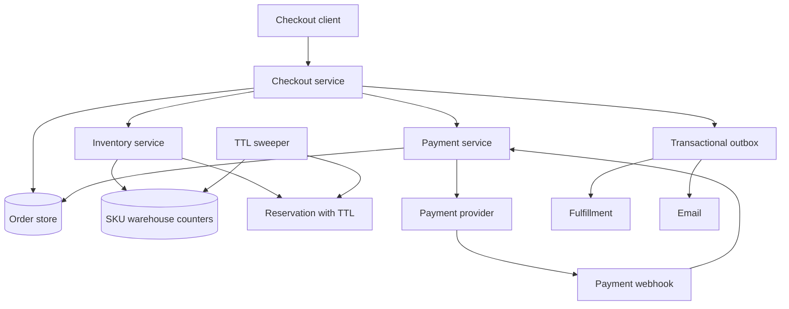

## Concept

Checkout is the path where a maybe-sale becomes money and a promise to ship. Inventory is the path that keeps us from selling the same unit twice. Together they are a distributed transaction we cannot actually run as a single database transaction across payment providers, warehouses, and tax services. I would design an **explicit reservation of stock, an order state machine, an idempotent payment capture, and a release path for every failure**. If any of those is implicit ("the payment webhook will probably fire"), you will double-charge or oversell.

The design I would ship is: cart is advisory; **checkout creates an order in `pending`, inventory service holds units with a TTL, payment is authorized against that order id, then we capture and commit the hold**. Timeouts release the hold. Retries use the same `idempotency_key`. Warehouse truth can lag; the reservation is the online truth for saleability.

### Requirements

Functional: add to cart, start checkout, apply a coupon, choose shipping, pay, receive an order id. Decrement sellable inventory so two customers cannot buy the last unit. Cancel before ship, with refund. Partial capture if we split shipments, if the product needs it; I would avoid partials in v1. Admin: adjust stock, mark shipped, mark returned. Read models: order history, current sellable quantity on the PDP.

Non-functional: checkout p99 of a couple of seconds including the payment provider is a realistic budget; our part should be well under that. Inventory reservation should be safe under contention on a hot SKU. Durability of an accepted order is mandatory. Exactly-once as seen by the customer: one charge, one allocation. Availability: if payments are down, we do not pretend to sell; if the recommendation service is down, we still check out. Consistency: it is better to undersell (leave a unit unsold) than to oversell, unless the business explicitly accepts backorders. Multi-warehouse: sellable is the sum of available-to-promise across locations minus holds, with rules for which warehouse a SKU ships from.

Out of scope: a full OMS with 3PLs, marketplace multi-seller payouts, and real-time store-level omnichannel as v1. Also out of scope: using the cart service as the ledger.

### Capacity sketch

Assumptions: 5 million daily visitors, 2 percent conversion, average 2.5 SKUs per order, so on the order of 100 thousand orders per day, a few thousand checkout starts per minute at peak, and much higher PDP reads of `sellable_qty`. Flash sales can concentrate that onto one SKU. Payment provider latency dominates checkout. Our inventory service must handle reserve/release at a few thousand QPS on a hot SKU without losing the constraint `on_hand - held >= 0`.

Data size: tens of millions of SKUs is a catalog problem; sellable counters are a small row per SKU per warehouse. Order rows at 100 thousand a day are easy. The hard part is contention, not bytes.

Idempotency records must survive as long as a client might retry, on the order of a day, not a minute.

### API shape

`POST /carts/{id}/items` is not checkout.

`POST /checkouts` `{ cart_id, address, shipping_option, idempotency_key }` → `{ checkout_id, order_id, totals, payment_intent }`

`POST /checkouts/{id}/pay` `{ payment_method, idempotency_key }` → `{ status: authorized | failed | requires_action, order_id }`

`GET /orders/{id}`

Internal:

`Reserve { order_id, lines: [{ sku, qty, warehouse? }], ttl }` → `{ reservation_id, ok, rejected_sku? }`

`Commit(reservation_id)` / `Release(reservation_id)`

`AdjustOnHand { sku, warehouse, delta, reason }` for receipts and returns.

Payment provider is called with `idempotency_key = order_id` (or a dedicated key stored on the order). Never generate a new key on retry.

Webhooks: `payment.succeeded` / `payment.failed` must be processed idempotently and must not be the only path that moves the order; the client-facing pay call should wait for a terminal authorization when it can.

### Core data model

`sku(sku, attributes…)`. Catalog.

`inventory(sku, warehouse, on_hand, held, version)`. Sellable is `on_hand - held`. Updates to `held` are optimistic-concurrency on `version` or a single-row transactional increment with a check constraint `on_hand >= held` and `held >= 0`.

`reservation(reservation_id, order_id, sku, warehouse, qty, state: open | committed | released, expires_at)`.

`order(order_id, user_id, status, totals, idempotency_key unique, payment_intent_id, reservation_id, created_at)`. Status: `pending_reservation` → `pending_payment` → `paid` → `fulfilled` | `cancelled` | `refunded`.

`order_line(order_id, sku, qty, price_snapshot)`.

`payment_attempt(order_id, attempt, provider, provider_ref, status, raw_code)`.

`outbox(order_id, event)` so emails, search indexes, and warehouse tasks follow the commit, not a best-effort call in the HTTP handler.

Prices and coupons are snapshotted on the order. Later catalog changes must not mutate a paid order.

## Trade-offs

| Approach | When it wins | Cost / risk |
| -------- | ------------ | ----------- |
| Decrement on payment success only | Low contention, simple shops | Oversell during the payment window |
| Decrement on add-to-cart | Tiny inventory, boutique | Carts hostage stock; abandonment oversells the other way |
| Soft reservation with TTL (proposed) | Flash sales, honest PDP, bounded hold | Abandoned checkouts need release; TTL too long starves stock |
| Single DB transaction across order and stock | One warehouse, one database | Does not include the payment provider; does not survive split services |
| Two-phase commit across services | Looks correct on a whiteboard | Operational nightmare; payment networks will not join your 2PC |
| Saga: reserve → pay → commit, with compensations | Real checkout | You must write every compensate; missed release is oversell or stuck hold |
| Backorder / negative stock | Fashion drops that accept delay | Customer support and oversell become the product |
| Pessimistic row lock on SKU | Extreme contention on a single SKU | Lock queues; p99 explodes |
| Optimistic version + retry | Most SKUs | Hot SKU needs a single-threaded counter or a queue |

I would reserve at checkout start, not at cart add, with a TTL of minutes, not hours. Cart add can show "low stock" from a cached sellable count. I would not 2PC with Stripe or Adyen. The saga is the design: reserve, authorize, commit, and compensating release/refund on any failure. Capture versus authorize-then-capture is a finance choice; authorize-then-capture matches reservation well.

## Diagram

## Failure modes

### Duplicate charges

The client retries `pay` after a timeout. The provider charged the first call. We start a second intent. Mitigation: unique `idempotency_key` on the order, the same key sent to the provider, and a state machine that treats `pay` as idempotent. Webhooks that create a new order are a bug. Detect with provider settlement reports versus order count, not with hope.

### Oversell and lost holds

Two checkouts reserve the last unit because we read `sellable = 1` twice without a transactional increment. Or we capture payment and fail to commit the hold, then the sweeper releases, then someone else buys it. Mitigation: the increment of `held` is a compare-and-set with a check, reservations are the only way to increment, commit of hold and `paid` status happen in a defined order (I prefer commit hold after provider authorize succeeds, with a compensating release if the order write fails), and the sweeper never releases a committed reservation. Alert on `held` versus open reservations mismatch.

### Thundering herd on a flash SKU

A drop of 500 units, 50 thousand clients. Inventory row is hot. Payment provider is hot. Cart service is irrelevant. Mitigation: a queue in front of reserve for that SKU, a gate that draws lottery tokens before checkout, pessimistic locking or a single-writer counter, and cached "sold out" as soon as sellable hits zero so the rest of the fleet stops calling. Do not scale the PDP into a million reserve calls.

### Payment authorized, order not marked paid

We crash after the provider succeeds. User is charged, UI shows failure, they retry, we must attach to the same order. Mitigation: provider idempotency, a reconciliation job that lists intents by `order_id`, and webhooks that only advance state. Never create a second order because the first looked stuck.

### Poison coupons and price drift

Price changed between PDP and pay, or a coupon stacks twice on retry. Mitigation: snapshot totals at checkout, re-validate once at pay, reject if the delta exceeds a policy, and make coupon application idempotent on the order.

### Split-brain warehouse

Warehouse on-hand was adjusted down (damage, theft) below held. Online still sells. Mitigation: `on_hand` updates must not violate `on_hand >= held`; excess holds get a workflow to cancel the worst-status orders, not a silent negative. Cycle counts are an input to the same constraint.

## Real-world example

Amazon checkout is the system people mean, even if what they have actually used is a Stripe-backed store. Amazon's public engineering lore around inventory, fulfillment, and "available to promise" is the right gravity: selling is a promise against a network of warehouses, not a `quantity--` on a product row. Stripe is the payment side most of us will integrate: idempotency keys, intents, and webhooks that will fire more than once.

What I would copy from Amazon-style ATP: reservation, warehouse-level counters, undersell rather than oversell, and a state machine that fulfillment understands. What I would not copy into a first shop: the entire fulfillment network, marketplace sellers, or Prime-level promise windows. A single warehouse with reservations is a valid product.

What I would copy from Stripe: PaymentIntents, idempotency keys on every mutating call, and webhooks as a safety net, not as the happy path. What I would not copy: charging in the cart service, or treating "the charge succeeded" as "the order exists" without our own order row. Stripe is not your OMS.

Shopify's model (platform checkout, inventory at locations, holds) is also a reasonable copy if you are building a platform. If you are building one brand, keep the order state machine in a service you own so you can compensate.

## What to remember

- Reserve with a TTL, then pay, then commit; cart is not inventory.
- Duplicate charges are an idempotency design; oversell is a counter constraint and a sweeper design.
- You cannot 2PC with a payment provider; write the saga and every compensation.
- Hot SKUs need a gate; the rest of the catalog does not.
