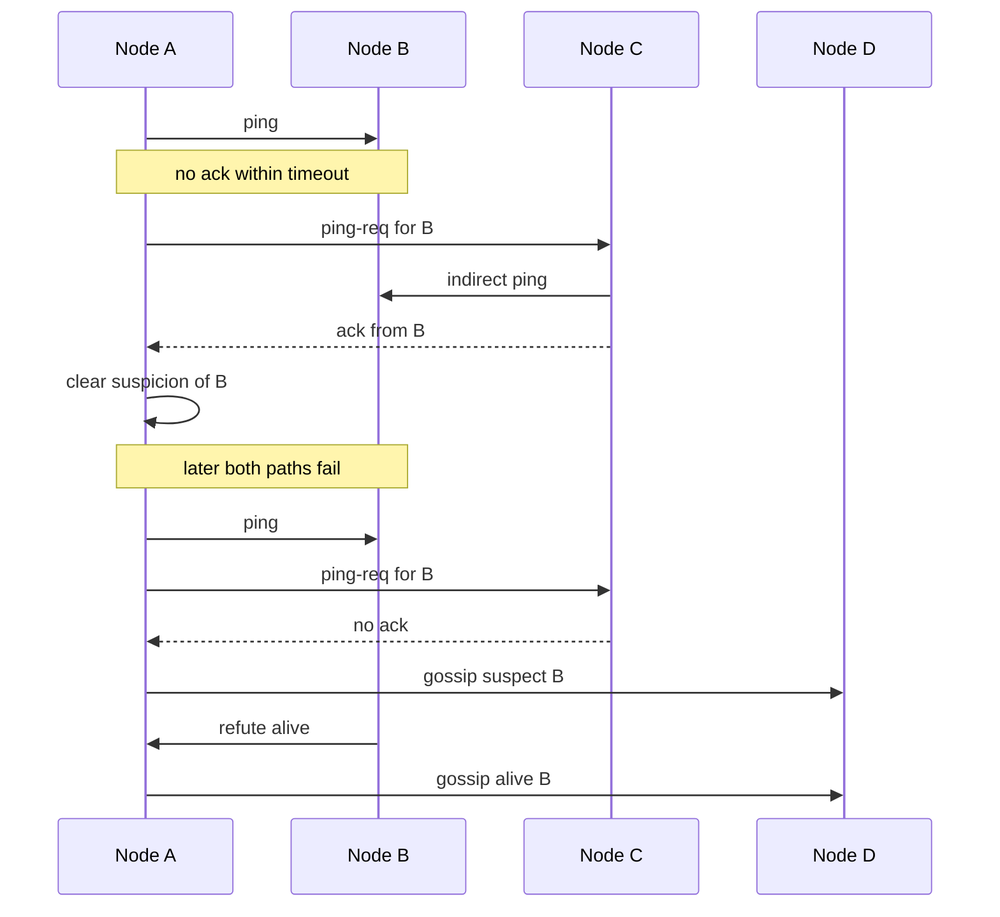

## Concept

### A detector outputs a suspicion, and a fence outputs safety

In a fully asynchronous network there is no deterministic test that a silent process has crashed. Clocks drift, garbage collectors freeze threads, NICs pause, and switches drop a class of packets. A failure detector is a heuristic with two goals that pull apart: completeness, eventually suspecting every process that has actually stopped, and accuracy, avoiding suspicion of a process that is still alive. Production systems pick a point on that curve, name the detection deadline, and then spend years moving the point because the tail of latency moved.

Three events look identical from a peer. Crash-stop means the process is gone and will not resume with its old memory. Crash-recovery means it reboots, often with an empty heap and a new identity generation. Omission means it is alive and you cannot hear it, or you can hear a heartbeat thread while the thread that serves users is wedged. Leader election, replica membership, and load-balancer routing need different reactions to those three. Treating a long stop-the-world pause as crash-stop, and letting a second primary accept writes, is how a cluster dual-writes.

Detection is an opinion about liveness. Fencing is the safety action: revoke a token, increment an epoch, expire a lease, or instruct storage to reject writes from the previous generation. "We suspect node A" is never sufficient authority for node B to accept writes that A might still be making. ZooKeeper sessions, Raft terms, and fencing tokens exist so the opinion can be wrong for a while without corrupting the log. Design the detector for how fast you notice, and the fence for what remains true if the notice was early.

### Fixed heartbeats and the timeout you can explain

The simplest detector has every node send "I am alive" every `T` milliseconds. Miss `k` intervals and mark the peer dead. Detection time is about `T * k`, plus scheduling jitter. Too small and you evict on a noisy neighbor. Too large and failover exceeds the recovery objective you sold. Fixed timeouts work in homogeneous clusters with bounded garbage collection and a dedicated heartbeat path. They degrade in multi-tenant clouds where latency has a long tail that no static `T` matches for every pair of nodes.

Load-balancer health checks are the same mechanism aimed at a different decision. Membership failure detection asks whether this process should remain in the replica set. Serving health asks whether this instance should receive user traffic. A node can sit in a Raft group and still fail an application `/health` because a downstream dependency is down. Evicting it from the group for that dependency shrinks quorum at the moment you most need a majority. Keep the two signals in different control loops. Readiness removes traffic. Liveness restarts a wedged process. Membership conviction starts re-replication or an election, and it should be harder to trip than a single HTTP probe.

### Accrual scores adapt to the path you have seen

The phi accrual detector, used by Cassandra and described by Hayashibara and others, outputs a suspicion score. Heartbeat inter-arrival times fill a sliding window. Phi grows as the current silence becomes surprising relative to that window. Operators pick a threshold: phi above 8 is "pretty sure" on a quiet LAN, and a higher threshold is common across a WAN. The detector adapts when a path is usually slow. A two-second gap after a history of 200 millisecond arrivals is more suspicious than the same gap after a history of 1.5 second arrivals.

Accrual still needs a live sample window. After a topology change, a long pause in gossip, or a partition that just healed, the window describes a network you no longer have. Phi spikes, or phi becomes slow to trust a peer that is healthy again. The score is a better prior than one global timeout. It is still a prior, and the threshold is still an operational bet you validate with suspicion-transition metrics.

### Gossip, indirect probes, and refutation

All-to-all heartbeats cost too much once the cluster is large. SWIM, used in memberlist, Consul, and Nomad, spreads detection. A node pings a random peer. If the acknowledgement is missing, it asks a few intermediaries to ping on its behalf. If those fail, it gossips a suspect message. After a suspicion timeout, suspect becomes confirmed dead. The indirect ping avoids declaring death because one congested path dropped packets. The suspicion interval gives the target time to refute with its own "I am alive" gossip.

Cassandra folds failure detection into gossip. Each node tracks heartbeat versions for peers and feeds inter-arrival times into phi. The membership view is eventually consistent, so one node can show a peer as down while another still shows it up. That skew is expected. An application that treats a single gossip "down" as an instant fence, without a quorum or a lease, will flap storage and routing together. Suspicion state needs a dump you can read during an incident: who convicted whom, at what phi, at what gossip generation.

### What the detector must not decide alone

A correct architecture wires the detector into a protocol that already has a safety story. In Raft, election timeout is the detector, and the term plus a majority vote is the fence; a leader that cannot renew its position stops committing. In a lease system, the old holder loses the right to write when the lease expires, even if it still believes it is primary. In an AP store, conviction changes replica selection and hinted handoff, and the consistency level the client asked for remains the safety control.

## Trade-offs

| Approach | When it wins | Cost / risk |
| -------- | ------------ | ----------- |
| Fixed heartbeat timeout | Homogeneous clusters, leader leases, a single number operators can explain | False conviction under GC pauses and noisy neighbors |
| Phi accrual on gossip | Variable latency and large rings, Cassandra-style membership | Threshold tuning; sample windows lie after incidents |
| SWIM indirect ping plus suspicion | Membership for Consul, Nomad, and similar clusters | Gossip overhead; suspicion delays detection of a true crash |
| Centralized probes (Kubernetes, load balancer) | Removing traffic and replacing instances | Unsafe as the only input to quorum membership |

Fixed timeouts belong on leases, where expiry is the fence and the number is the recovery time. They are a weak sole signal in a large ring of noisy virtual machines, because one `T` cannot fit every path. Accrual and SWIM fit when the cluster is too big for all-to-all heartbeats and latency is a distribution. The cost is that "is node X dead?" becomes "according to whom, at what score, at what generation?" Debugging requires the suspicion log.

Kubernetes liveness probes are a trap when copied into consensus membership. A failing probe restarts a pod. If that pod is a Raft leader, an application dependency timeout just triggered an election. Use liveness for deadlocks inside the process, readiness for traffic, and a membership protocol for the replica set. The three clocks should differ on purpose: readiness is fast, liveness is slower, conviction is slowest and must be tied to a fence.

## Diagram

SWIM-style detection: a direct ping, an indirect ping that refutes the suspicion, then a later path failure that gossips suspect until the target refutes.

## Failure modes

### False conviction of a healthy node

Detection is flapping membership, repeated leader elections, and re-replication or streaming that starts and aborts within seconds. CPU and network spike as data moves. In Cassandra, phi flickers across the threshold. In Kubernetes, liveness restarts line up with garbage-collection logs or disk stalls. A dashboard of suspicion transitions per minute is the chart that makes this visible; average latency will look fine.

Mitigation widens `T` or raises the phi threshold from measured inter-arrival histograms, isolates heartbeat traffic onto its own sockets and QoS class, and requires indirect probes before eviction. Runtimes that can signal a stop-the-world pause should pause conviction for that interval. If marking a node down moves terabytes, false conviction is an availability incident of its own. Make the transition metric loud, and keep the threshold high enough that a pause you already tolerate does not start streaming.

### A dead or wedged node that still looks alive

Detection is clients timing out against a primary that still holds a lease in the membership table, quorum writes hanging, and a process that is `kill -9`'d from the scheduler's point of view while peers still route to it. The classic shape is a heartbeat thread on its own pool that stays green while the request event loop is deadlocked.

Mitigation runs the heartbeat on the same path that serves user work, or watchdogs that path with event-loop lag and queue-depth metrics. A missing UDP packet is one failure mode. A full disk and a stuck thread pool are others, and they need in-process checks. For leaders, a lease renewed by progress on the store beats a peer-only gossip opinion. When the lease expires, the old leader must stop writing even if its own heartbeat code still runs.

### Partition treated as a crash

Detection is two sides of a network split each marking the other dead and both accepting writes. Divergent counters, two primaries, and a switch log that shows a blackhole while application logs only show "peer down."

Mitigation feeds suspicion into a quorum or a fencing rule. An odd replica count and a witness keep a minority from electing itself. On a CP path the minority stops writing. On an AP path both sides may accept writes, and you then need the conflict rule you already designed — and you call the event a partition, with repair, rather than a crash that authorizes a new primary. Mixing AP-style conviction with CP-style single-writer assumptions is the split-brain recipe.

### Detector traffic causing the outage

Detection is CPU in gossip threads, packet loss that starts after a membership storm, and cascading mark-downs because heartbeats were dropped by the detector's own flood. A mass reboot makes it worse: every node gossips full state to every seed.

Mitigation uses random peer selection, caps payload size, and backs off suspicion broadcasts. Failure-detection traffic sits in its own class so a user-traffic spike and a gossip spike do not share one unprotected queue. After a mass restart, seeds come up first, conviction is damped until windows refill, and bootstrap concurrency is limited. The procedure belongs in the runbook before the first power event.

## Real-world example

Cassandra's failure detector is phi accrual on top of gossip, and it is the mechanism large Cassandra estates actually operate. Each node keeps a sliding window of gossip heartbeat inter-arrival times per peer and computes how surprising the current silence is. `phi_convict_threshold` is often left near 8 on a LAN and raised across regions or noisy clouds. Crossing the threshold convicts the peer: coordinators stop preferring it, hinted handoff takes writes that would have gone there, and the ring treats it as down until a newer heartbeat generation arrives.

Netflix has run Cassandra at a size where this knob is an availability control, and the public operational pattern is consistent. A threshold set too low turns compaction or a multi-second garbage-collection pause into a flap. Peers convict the node, coordinators reroute, streaming may start to restore replication factor, the node resumes and gossips a higher generation, and streaming aborts or overlaps. Repeat that across a noisy cluster and membership churn consumes more bandwidth than user reads. A threshold set too high leaves a truly dead node in the preference list until client timeouts fire, which blows the recovery objective for that replica.

The architectural layering at those estates is the part worth copying. Phi and gossip decide replica selection inside Cassandra. They are a poor signal to export raw into an external load balancer that drops the same host from an unrelated tier. A brief gossip "down" during a pause should not fence a different system's primary. Write safety for a given request remains the consistency level the client requested. Detection optimizes how fast the ring stops waiting on a silent replica. The fence for a strongly consistent write is still the quorum that did not include the convicted node, not the numeric value of phi.

## What to remember

- Failure detection is a timed suspicion about liveness; leases, terms, and quorums are what keep writes safe.
- Keep replica-membership conviction separate from readiness and liveness probes, and make conviction the slowest of the three.
- Accrual and indirect pings track noisy networks, and they still need a threshold, a sample window, and a cap on gossip load.
- Watch suspicion transitions: false convictions start re-replication storms, and false negatives leave a dead primary on the path.
