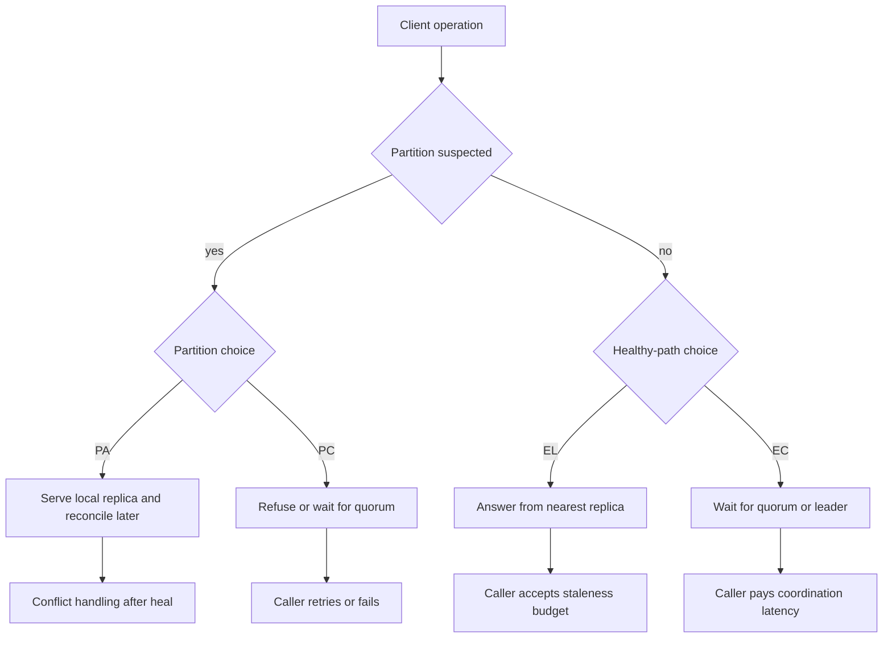

## Concept

### What a partition forces, and what it leaves unsaid

When a network partition prevents a node from reaching a quorum, a replicated store has two honest options. It can refuse the operation and protect a strong consistency guarantee, which makes that side unavailable. It can accept the operation and reconcile later, which keeps that side available and weakens the guarantee clients observe. Partition tolerance, in any wide-area system, is the admission that packets will be lost. CAP is the statement of that fork. It is silent about the path where every replica is reachable, which is the path that produces almost all of your latency and almost all of your staleness bugs.

That silence is how a slide that says "we are a CP database" never mentions that every write waits for a cross-region round trip on a healthy Tuesday. It is also how "we are AP" becomes an excuse for stale reads inside a single rack that could have answered from a quorum in a millisecond. Architects who design only for the outage ship a default for the other 99.9 percent of requests without writing it down.

### The second fork

PACELC, stated by Daniel Abadi, names both forks. If there is a partition, trade availability against consistency. Else, trade latency against consistency. The Else is the design review you should be having weekly. Strong consistency on a healthy path means overlapping quorums or a leader lease: extra round trips, extra coordination, and tail latency when one replica is slow. Lower latency on a healthy path means the nearest replica answers: a staleness window, read repair or anti-entropy later, and application-level conflict handling.

Four families fall out of the sentence, and real products are maps across them rather than a single letter.

PA/EL stays available during a partition and, when healthy, favors a local answer over linearizability. Dynamo-style stores, Cassandra at `ONE` or `LOCAL_ONE`, and DynamoDB's default `GetItem` live here for those calls.

PA/EC stays available during a partition and, when a quorum is reachable, pays for a stronger read or write. The mode switch is the hard part: clients must behave correctly in both regimes, and the moment of switching has to be explicit.

PC/EC refuses or waits during a partition and, when healthy, still waits for consensus or a quorum that gives you linearizability. ZooKeeper, etcd, Raft groups, and Spanner sit here. The everyday cost is commit latency.

PC/EL refuses during a partition and, when healthy, still serves some reads from a local follower. It shows up as a read mode on metadata stores: the write path is CP, the read path is a latency choice. Clients who hear "CP" and then call the follower read are surprised on a healthy day.

### Latency and staleness are both budgets

For a given use case the question is concrete. Is a few milliseconds of staleness worse than a cross-rack quorum on the critical path? A shopping-cart badge can be stale. A ledger posting and a lock cannot. A feature flag depends on whether a stale "off" after a flip to "on" is an incident. Write both numbers into the ADR: the latency budget for the EC path, and the staleness budget for the EL path. An EL path without a bound is an IOU. Some systems let you ask for bounded staleness (a maximum version lag or time lag). If yours does, the bound is the contract. If it does not, measure replica lag and page on it.

Locality changes the Else more than slogans do. A PC/EC group whose leader is in-region can meet a tight SLO. The same group with a leader an ocean away is still PC/EC and will miss the SLO. When you cannot afford the latency, shard so each consensus group is regional, and accept that global linearizability is a different product. PACELC does not remove the need to place replicas. It forces you to say which letter you are buying with that placement.

### Defaults are the Else your clients actually run

The dangerous failure is a client default. DynamoDB's default read is eventually consistent. A service that writes in one region and reads in another, then caches the result, has chosen EL whether or not the design doc said "AWS is consistent." Cassandra drivers and retry policies have shipped defaults of `LOCAL_ONE`. MongoDB write and read concerns have changed across versions, and plenty of clusters still pair majority writes with local reads. The letter that matters is the one in the client, per call.

When a product offers both modes, the English word "strong" is not comparable across vendors. A strongly consistent DynamoDB read is a single-region story with higher latency and more load on the coordinating replica. A Spanner strong read can be global and costs TrueTime and Paxos. Document the window in the API your own callers see: `consistent_read`, a session monotonic read, or an explicit eventual read. Hide the vendor default behind a name your team chose on purpose.

### A taxonomy for decision records

PACELC is a classification aid. It does not replace consensus theory, the FLP result, or CALM. It tells a staff engineer how to read a vendor and how to notice that a system advertised as CP still made an EL choice on secondaries. The useful ADR sentence is per bounded context: "Checkout inventory is PC/EC inside the region. The product catalog on the CDN is PA/EL with a five-minute staleness budget. Feature flags are PC/EL: quorum writes, follower reads bounded by a two-second lag." That sentence is operational. "We follow CAP" is not.

## Trade-offs

| Approach | When it wins | Cost / risk |
| -------- | ------------ | ----------- |
| PA/EL (Dynamo-style, Cassandra `ONE`, default DynamoDB reads) | High availability, low RTT, data that tolerates conflict | Stale reads, repair traffic, lost updates under blind overwrite |
| PA/EC (available on a split, quorum when healthy) | Disaster mode that stays up, without paying EL on every healthy request | Clients must handle both modes; the switch is easy to get wrong |
| PC/EC (Spanner, etcd, Raft leader reads and writes) | Locks, metadata, money, a single source of truth | Commit latency; unavailability when the quorum or leader is lost |
| PC/EL (CP writes, local or follower reads) | Read scale on a metadata store | Followers are stale on a healthy day; callers assume CP means fresh |

PA/EL fits session data, telemetry, and feeds where a short divergence is cheaper than a 503. It is a poor home for username uniqueness, inventory reservation, or anything that behaves like a lock. If you place those there, you will invent a repair job that is really a second consensus system.

PC/EC fits configuration, elections, and ledgers. Replica placement is how you keep Else latency inside the SLO. If the latency cannot be afforded, the problem is locality: smaller regional consensus groups, with a separately designed global read model.

PA/EC and PC/EL are where teams get surprised. A store that is strongly consistent only while a quorum is visible will stall or error when the mode flips, and callers who assumed it never changes will retry into a storm. A CP store with follower reads returns an old value on a quiet afternoon. Name the mode in the API so the Else is a parameter, reviewed like a schema change.

## Diagram

PACELC is two forks: what you do when a partition is suspected, and what you do when the cluster is healthy.

## Failure modes

### One CAP letter for a whole product

Detection is an incident review that says the system is CP while the outage was cross-region latency or a stale secondary. Configuration shows follower reads, `LOCAL_ONE`, or an eventual get. The SLO mentions availability and says nothing about staleness or read-your-writes.

Mitigation classifies each API shape, not the product logo. The runbook lists default read and write concerns for every client. Tests cover healthy-path staleness — two clients, write then read — and a partition drill. If the marketing page says CP and the driver default is a local read, the Else is EL until the client changes.

### Letters treated as a law of nature

Detection is a design argument that "this database is PA/EL, so strong reads do not exist," or "this database is PC/EC, so latency cannot be discussed." Tickets show developers turning off strong reads to make a page faster, with no recorded staleness budget.

Mitigation records the choice per bounded context and gates consistency-level changes through the same review as schema changes. Measure p99 against the latency SLO and measure version skew between replicas so an EL path has a number attached. The letters are a menu. The menu is how you notice an accidental change.

### Hidden coordination on the healthy path

Detection is p99 that tracks a distant replica's pauses, "eventual" reads that wait on a quorum because a library defaulted to `QUORUM`, or "strong" reads that miss a write just acknowledged because they hit a replica that has not applied it.

Mitigation traces which nodes acknowledge a write and which node serves a read, and puts replica lag on a dashboard. For an EC call, verify read-your-writes inside the session. For an EL call, set an explicit bounded-staleness budget where the store supports it. The letter predicts the contract you asked for. The trace tells you whether the wire protocol matched.

### Failover and global tables that move the Else

Detection is a regional failover after which error rates look fine and user-visible anomalies appear: lost updates, duplicate checkouts, a leader now 150 milliseconds away, a system that was EC in-region and is now EL across an ocean. Retry storms follow the new latency and get described as an availability incident.

Mitigation restates PACELC in the failover runbook for the new topology. Leader-capable groups for PC/EC stay pinned to a region unless you have accepted the new commit wait. PA/EL multi-region tables ship with a conflict rule you have tested; last-writer-wins on a counter is a product decision that drops increments. Practice the failover against the staleness and latency SLOs, not only against HTTP 200.

## Real-world example

Amazon DynamoDB is the PACELC map you can read off the API. The system descends from Dynamo's choice to remain available when a replica group is impaired: a partition does not have to take the key offline if a surviving replica can accept the write and repair later. That is the PA side for the calls that allow it. On a healthy day, `GetItem` is eventually consistent unless the caller sets `ConsistentRead`. The default is EL. A read can miss a write that has already returned success. `ConsistentRead=true` is EC inside the region: more latency, more load on the coordinating replica, and a guarantee that is still regional.

Global tables move the map again. A write acknowledged in `us-east-1` is replicated asynchronously to `eu-west-1`. Cross-region reads are PA/EL. Conflict resolution on an item is last-writer-wins. Two regions that increment the same counter keep one of the increments. Teams that treat a global table as one strongly consistent table invent those lost updates in production and then look for a bug in the application logic. The design that matches the letters keeps the invariant inside one region — reserve inventory where the quorum lives — or uses an attribute that can merge, which the table will not invent for you.

The same company will put a different letter on a different table. A session store and a product-detail cache can live on default reads. A payment authorization or a conditional write that must observe the latest item uses the strong read and a condition expression, and the latency budget is explicit. Spanner, by contrast, is the PC/EC end of the industry: commits wait on Paxos and TrueTime, a partition that breaks quorum stops commits, and the Else is latency you pay continuously. DynamoDB's product answer is to let the caller pick EL for speed and regional EC when read-your-writes matters. The architecture review that earns its keep assigns those picks per table and per client, and writes the assignment where the next on-call can find it.

## What to remember

- CAP is the fork during a partition; PACELC adds the everyday fork between latency and consistency.
- Classify each API and each client default; one database can serve PA/EL and PC/EC on different calls.
- Write a latency budget for the strong path and a staleness budget for the local path.
- Failover and multi-region replication change the letters, so treat a topology change as a consistency change.
