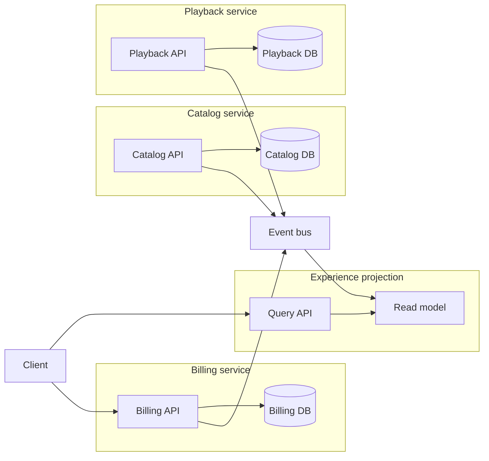

## Concept

### Ownership of the write path

Database per service means each service owns its schema and is the only component allowed to change its records. Everyone else reaches that data through an API or an event, or reads a projection the owner publishes. The payoff is independent deploy, independent scale, and a blast radius that stops at a schema boundary. The cost is every join that used to be a SQL statement, now a composition problem with a staleness budget.

The rule is ownership, not a mandatory extra cluster. Two services on one Postgres instance, with separate databases, separate credentials, and no cross-schema foreign keys, satisfy the pattern. Two services that both update `orders` and `users`, with joins in both codebases, break it, even when they run in different pods. Shared mutable tables are the distributed monolith. A bounded context with an exclusive right to `UPDATE` is the pattern.

Polyglot persistence is a consequence of that ownership. The owning team picks a store for the access pattern and accepts the operational trade. Direct reads of another team's tables are a compatibility break.

### How information crosses the boundary

Foreign data is read in one of three ways. A synchronous API call asks the owner and pays the latency and the availability coupling. A replicated read model is filled by events the owner emits, and the reader accepts a staleness window. A dedicated query service builds a projection for a specific screen or report and is still forbidden to take writes. Foreign keys become identifiers carried in events — `customer_id`, `title_id` — plus validation that can fail closed or tolerate a dangling reference for a defined interval.

Transactions that used to span `orders` and `inventory` become a saga or an orchestrated workflow with compensations. Each participant commits locally. The business outcome is eventually complete, or explicitly compensated, and support can see which step is current. A handler that opens two database connections and hopes both commits succeed is a dual-write bug with a network in the middle.

The read model is how a product page avoids calling six services on the hot path. Catalog still owns product writes. An experience service consumes `ProductUpdated` and stores a denormalized document. If checkout must not lie about price, checkout calls the pricing service or reads a version the pricing service stamped as authoritative for that quote. The projection is for the browse path. The owner remains the source of truth for the decision that charges a card.

### Schema change stays on one release train

With a shared database, an `ALTER TABLE` is a negotiation with every consumer of the column, including teams who only discovered the column by reading production. With database per service, you evolve on your own train: expand the schema, dual-read or dual-write inside the service, then contract. Consumers of your events still need compatibility, which is why the public contract is the API and the event schema. Hide columns. Version events. A database changelog published as an integration bus couples every subscriber to storage shape, including indexes and column nullability you meant to change next quarter.

Physical isolation — separate clusters — is for noisy neighbors, compliance boundaries, and independent failure domains. Logical isolation — separate schemas, separate roles, network policy that denies cross-schema queries — is the minimum that makes the ownership rule enforceable. Start logical when the organization cannot yet run twenty database clusters well. Promote a service to its own engine when scale, regulation, or a different access pattern demands it. The pattern is about who may write, not about how many invoices you pay a vendor.

### The join returns as a product

Cross-entity questions remain: unpaid invoices for customers in a region who watched a title. They move to a place that is allowed to be stale and is forbidden to be a write path. A warehouse fed by CDC, a search index, or a BFF with a precomputed document are the usual homes. If every user request fans out to ten services, the join has become a distributed latency product. That is the signal to build a projection owned by the experience, fed by events from the services that own the writes.

You also lose database-enforced foreign keys across services. Referential integrity becomes a policy. Emit `CustomerDeleted`. Dependents react. Tolerate a window where an order points at a customer row that is already gone, and define what the UI and the billing job do in that window. A thin identity service that mints stable ids is reasonable. A shared `core` schema that reintroduces every foreign key "for integrity" becomes the monolith's schema under a new name, and every migration once again needs every team.

### Credentials are the control

Ownership that lives only in a wiki will be bypassed by the next incident, when someone grants a reporting user write access "just for the backfill." Separate database roles, least privilege, and code owners on the migration directory are the control. A service's deploy pipeline is the only pipeline that can apply DDL to its schema. Other pipelines can subscribe to events. A notebook that can `UPDATE` is a second writer, and the pattern is already gone.

## Trade-offs

| Approach | When it wins | Cost / risk |
| -------- | ------------ | ----------- |
| Shared database, many services | Early split of a monolith, a small team, reporting that still needs joins | Deploy coupling, accidental joins, one saturated instance for every service |
| Logical database per service (schemas on one engine) | Write isolation before you can operate many clusters | Noisy neighbor; a leaked credential undoes the boundary |
| Physical database per service | Scale, compliance, polyglot engines, independent failure | Cost, skills, duplicated data, distributed workflows |
| Warehouse or replica used only for queries | Analytics and search outside the write path | Staleness; becomes a shadow write path if product features start updating it |

A shared database is how many microservice programs actually begin. It can be a stepping stone if new cross-service joins are forbidden and writes already go through the owning service. It stops being viable once two teams cannot deploy because a migration has to land in lockstep.

Logical separation is the middle that teams skip. One engine, a `billing` database and a `playback` database, separate roles, no `SELECT` grants across the boundary. Backup and patching remain one operations problem. You do not get independent engine choice or independent failure. When a billing query saturates IOPS and playback stalls, that is the moment to split the noisy service onto its own instance. Connection limits per role make the coupling visible earlier.

Physical database per service is the full pattern. Pay for it on the boundaries that fail: cardholder data, a write-heavy store beside an OLTP ledger, a region that must fail independently. A warehouse fed by change data capture is allowed. Checkout writing a row there is a new, unowned database.

## Diagram

Each service writes only to its own database. The bus carries facts. The experience projection serves the join-shaped read, and checkout still calls the owning API when the answer must be authoritative.

## Failure modes

### A distributed join on the request path

Detection is p99 latency equal to the sum of downstreams, a blip in one service taking down checkout, dashboards that show high fan-out per user request, and circuit breakers opening in a cascade. The trace for a single page view lists a dozen sequential or lightly parallel RPCs with no cached projection.

Mitigation builds a read model for the page and sets a TTL that matches the staleness you can explain to users. The few reads that must be fresh call one owner. Timeouts and bulkheads per dependency keep a slow messaging service from failing playback. Reports run against the warehouse. They do not run inside the request that renders a button.

### Dual writes from one handler

Detection is two stores that disagree after a crash, a growing queue of compensating tickets, and a code path that writes the service database and a second system in one HTTP handler with no outbox. A mismatch job, if you have one, fires after every deploy.

Mitigation writes the service database and an outbox row in one transaction. A relay publishes the event. If one business action must update two stores the same service owns, that is still one owner and can be one transaction or a local workflow. If it must update two services, it is a saga. A third service that opens transactions to both databases is the pattern breaking in real time.

### Shared tables returning through grants and notebooks

Detection is a new foreign key from service A into service B's schema, a reporting role with write grants, a migration pull request that touches two services and one SQL file, or a notebook history full of `UPDATE`.

Mitigation is least-privilege roles, network policy, and code owners on each migrations directory. Scan for cross-database queries on a schedule. When a join is a permanent product requirement, create a projection or a new owning service. A `SELECT` grant issued during an incident gets a ticket to be revoked, with a date, or it becomes the architecture.

### One engine pretending to be many services

Detection is every "independent" service stalling together when one unindexed query or one tenant saturates IOPS, connections, or WAL. You believed you had database per service because the repositories were separate.

Mitigation treats this as the failure mode of logical isolation. Move the noisy service first. Cap connections per role. Split on the boundary that actually hurts — card data versus the rest is a common first physical cut — and keep the write-ownership rule intact while you do it. Adding a second cluster without removing cross-schema grants just gives you two places to couple.

## Real-world example

Netflix's service architecture is the public case architects copy, and the part that matters is data ownership. Playback history, personalization, billing, and the customer systems that preceded them do not share one transactional schema. Playback needed a store that could take enormous read volume and fail over by region. Billing needed stricter consistency and an audit trail. Teams chose engines — Cassandra and EVCache for high-volume access patterns, relational systems where money and reporting demanded them — and published data through APIs and streams.

A homepage that shows continue-watching, artwork, and a billing message is not a join of a Cassandra partition to a billing table inside one query planner. Experience layers consume events and precompute the document the device will render. A failure stays inside the owner: an incident in a viewing-history cluster is not a billing migration, and a billing deploy does not rewrite playback's schema. The cost is visible and accepted. Continue-watching can lag the moment you stopped a title. Event pipelines and ownership metadata become platform work, because "who is allowed to change this row" has to be answerable without opening a SQL client.

Amazon's internal rule is the stricter sibling of the same idea: data leaves a team through a service interface, and a direct database dependency is a break in compatibility. Billing can ship without coordinating a catalog migration. The question "I need a join" becomes a new service, a stream, or an explicit copy with a freshness contract. The lesson to take from both is the write boundary. The engine logo is a local optimization the owner is allowed to make because nobody else is in their tables.

## What to remember

- Database per service is exclusive write ownership and a public API or event contract.
- Replace cross-service SQL joins with owner APIs, events, and read models that have a staleness budget.
- Multi-service changes belong in sagas and outboxes, with one transactional writer per database.
- Start with separate schemas and credentials; split clusters when noise, compliance, or the engine requires it.
