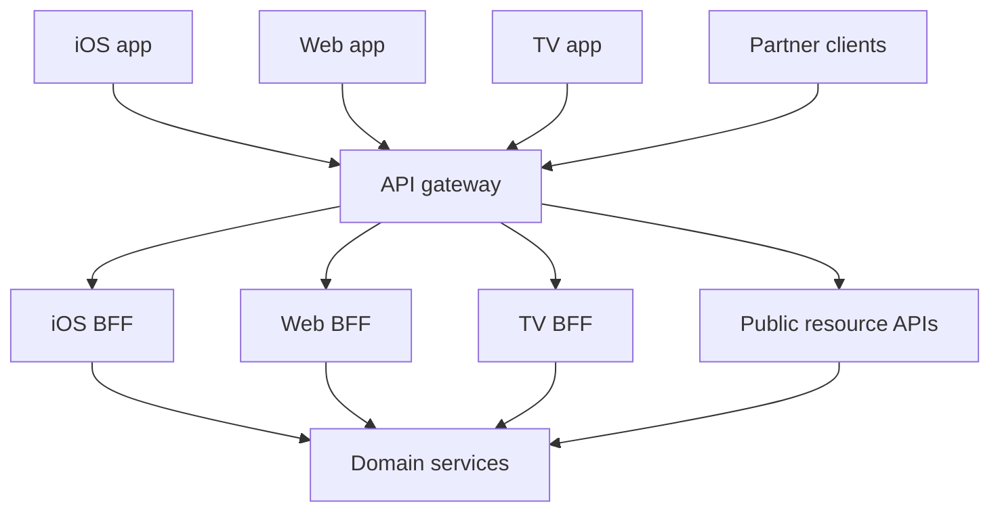

## Concept

### The gateway is the shared front door

An API gateway sits on the trust boundary in front of many clients and many services. It terminates TLS, applies edge policy, authenticates a token or exchanges it for an internal identity, rate-limits by key, routes a public path to a cluster, and emits the access log you will need in an incident. Netflix's Zuul, and later Zuul 2, is the large-scale reference: a filter pipeline for inbound and outbound traffic, dynamic routing so clients never hold a pod address, and a place to shed load when a dependency is already failing.

That list is the gateway's job. It is shared, so its release train is deliberately slower than any one product surface. Security fixes, certificate rotation, and routing changes land there because every client shares the fate of a bad push. The moment the gateway starts composing a homepage — user, billing, recommendations, artwork widths — it has become an accidental BFF used by every device. Device-specific branches accumulate. A mobile release waits on a platform config change that also risks the partner API. Keep the gateway wide and comparatively boring. Product serialization belongs on a train that can ship with the app.

### The BFF is a client-specific server

A Backend for Frontend, described by Sam Newman and practiced at SoundCloud and in Netflix's device-specific API layers, exists for one client family. The iOS BFF returns a screen model: sections, image variants, and flags that app version understands. The web BFF can speak a different shape, including GraphQL when that is the web contract. The TV BFF aggregates more aggressively because a round trip from a remote control is expensive and a television can take a larger payload. Each BFF is owned with the client team, versioned with the app, and allowed to be a poor fit for every other client.

Aggregation lives here. Parallel calls to playback, artwork, and messaging, each with its own timeout, collapse into one response the device can render on a high-latency link. The BFF knows screens. It does not become the source of truth for a business write. Checkout, profile updates, and playback licenses still go to the owning services. The BFF translates, batches, and drops a section that failed so the rest of the screen can paint. A BFF that acquires its own database of record has become a monolith with a client-shaped API.

### Stack them when you have both a public edge and more than one client

The mature shape is public internet, then an edge (often a CDN and then a gateway), then one or more BFFs, then internal services. The gateway does not need to know that iOS wants a different JSON document than the web. It needs to know that the iOS BFF is a valid route, that the token's audience is acceptable, and that partner traffic on the public API host never lands on a BFF built to render a mobile screen. Partners get a resource API with a stability promise. First-party apps get a screen API with a release cadence tied to the store.

Some organizations invert the stack and run one GraphQL gateway as the BFF for every client. That holds when the graph is the product and the clients are thin and similar. It strains when a television, a phone, and a public REST partner share resolvers that grow incompatible cache keys and authorization rules. GraphQL is a BFF technology. It does not replace TLS policy, per-key rate limits, or WAF rules at the edge. Those remain gateway concerns even if the GraphQL process sits behind them.

### Protocol translation and identity

Gateways commonly speak HTTP to the world and HTTP/2 or gRPC to the mesh. BFFs commonly speak JSON or GraphQL to apps and gRPC to domain services. Putting gRPC on the public internet is possible and is usually a poor fit for first-party mobile because of intermediaries, debuggability, and browser clients. The BFF is the comfortable place to fan in several gRPC calls and emit one JSON screen. The gateway can still validate the user token so the BFF is not the only defense in depth.

Identity has to survive the hops without turning the BFF into a god credential. The gateway authenticates the caller and mints an internal context: user, tenant, and the calling workload. The BFF presents its own service identity on the mesh and forwards the user context in a header the gateway signed. Domain services authorize on both. A BFF that forwards the raw client token everywhere, or that calls downstream with a single all-powerful service account, is an incident waiting for a compromised replica.

Aggregation that needs tests and a deploy per app version wants a repository. Configuration remains the right tool for routes, timeouts, and limits.

### Versioning follows the owner

Gateway changes are platform changes. BFF changes are product changes. An iOS BFF can keep a compatibility route for the two app versions still in the field, keyed by an app-version header, and canary that deployment alone. The shared gateway stays clear of per-app business fields. Canary the BFF. Leave the edge routing table stable for every property that is not part of the canary.

## Trade-offs

| Approach | When it wins | Cost / risk |
| -------- | ------------ | ----------- |
| One API gateway, clients call services through it | Few client types, coarse resource APIs, a public partner surface | Chatty mobile clients, over-fetch, composition dumped into gateway config |
| BFF per client, no shared gateway | A small estate, one team, apps that never see the public internet | Duplicated TLS, auth, and rate limits |
| Gateway plus BFF | Internet-facing products with several device classes and a partner API | An extra hop and more services to run and staff |
| One GraphQL gateway as a universal BFF | Similar clients and a team that will govern the schema | Resolver monolith; cache and auth rules collide across devices |

A public partner API should look like a resource model with a long deprecation window, fronted by the gateway. A phone on a cellular network should not issue seven round trips to paint a home screen. Those two sentences together are the architecture: resource APIs for stability, BFFs for chattiness.

Skipping the gateway works in a small cluster until three BFFs each invent JWT validation, CORS, and IP allowlists, and an incident shows they disagree. Skipping the BFF works until the iOS team needs a field the web client must not see and the partner contract forbids. The extra hop of a regional BFF, speaking HTTP/2 to in-region services, is rarely the cost center. The unbounded fan-out behind it is.

Measure before adding a second layer of aggregation inside the gateway "just for the TV app." If the TV payload diverges, that divergence is a BFF, even if it is small. Platform teams stay on the shared controls. Client teams stay on the screen.

## Diagram

The edge gateway terminates the shared boundary. Each BFF aggregates for one client family. Partner traffic stays on resource APIs.

## Failure modes

### The BFF becomes a shared monolith

Detection is one BFF repository owned by platform, every client feature waiting on that team, a service with hundreds of endpoints and per-device conditionals, and a weekly deploy because all clients share the blast radius.

Mitigation splits BFFs by client family, or by a major surface that ships on its own cadence, and staffs them with the client teams. Shared libraries for telemetry and header propagation are appropriate. Shared business aggregation across devices is how the monolith returns. When web and iOS truly need the same document, extract an experience service that still sits behind the gateway, and keep device quirks in the BFFs.

### Fan-out and retry amplification

Detection is one user action turning into dozens of internal calls, a short downstream timeout with retries multiplying load, and a cold cache turning the homepage into a self-inflicted denial of service. Downstream dashboards show the BFF as the dominant client, with a retry ratio above one.

Mitigation sets a budget: a cap on parallel calls, a per-dependency timeout shorter than the client's patience, and retries only where the downstream call is idempotent. Bulkheads keep a messaging failure from blanking playback. A request-scoped cache collapses duplicate lookups. Homepage-shaped data belongs in a projection so the BFF reads one document and hydrates the few fields that must be live.

### Identity collapsed into one trust hop

Detection is the BFF forwarding the client credential to every downstream, so a compromised BFF can impersonate any user, or the gateway stripping identity and the BFF calling services with a broad service account that can read every tenant.

Mitigation authenticates at the gateway, mints a signed internal context, and has the BFF present its own workload identity. Services check both the user scope and the caller. Partner routes never enter a consumer BFF. Tokens are audience-restricted so a mobile token cannot be replayed against the public partner host.

### One deployment serving incompatible app versions

Detection is a cleanup that removes a field still required by the previous store build, error rates rising on that version, and a single BFF revision serving every build because the route table has no version key.

Mitigation runs compatibility routes keyed by app version, with telemetry on how many clients still call the old route. Deprecate from those counts. Parsing business fields by app version stays in the BFF. The gateway continues to route on host and path.

## Real-world example

Netflix's edge is the concrete split. Devices on the internet reach gateway infrastructure descended from Zuul: routing, security filters, and resilience when a cluster is failing. Behind that door, APIs are shaped per device class. A television does not receive the iOS payload. The TV API can aggregate more and can choose image profiles that match a large screen and a slow remote. The iOS API tracks the mobile release. Neither client is expected to stitch dozens of microservice calls over a last mile that may be a cellular network or a living-room wireless link.

Zuul's role in that story is the shared door. Dynamic routing when a cluster moves, load shedding when a dependency is already melting, TLS and authentication at the boundary. The device-specific API layer is the BFF. It knows the screen, batches backend calls, and can fail a section so the UI still renders. When people say "the Netflix edge" they often mean both layers, which is why a team that copies only the gateway dumps homepage composition into filters. An iOS-only field then requires a global config review, and a partner using the same host inherits screen fields they cannot parse.

The failure the BFF is there to prevent is chattiness. Recommendation, ratings, and artwork as three client-side round trips will time out on a phone. One BFF response, or a small number of them, fits the latency budget. The failure a gateway-only design hits is a single JSON model that is nobody's product and is versioned at platform speed. Netflix's scale makes the split obvious. The same split applies wherever you have more than one client with different chattiness and a public API that must remain stable for partners who do not ship on your app-store cadence.

## What to remember

- The gateway owns the shared boundary: TLS, authentication, routing, and rate limits.
- A BFF owns one client's payload shape and aggregation, and it ships with that client.
- Stack them when you have a public edge and more than one device; keep partner APIs on resource contracts.
- Cap BFF fan-out with timeouts, bulkheads, and projections, and keep writes in the domain services.
