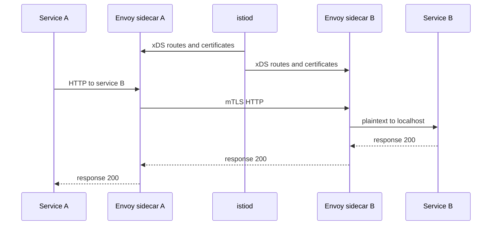

## Concept

### A data plane that moves bytes, and a control plane that programs it

A service mesh takes retries, timeouts, mutual TLS, traffic shifting, and golden-signal telemetry out of per-language libraries and places them on the request path in a data plane. Istio and Linkerd are the two designs platform teams are actually asked to choose between. Both run a proxy beside or in front of the workload and a control plane that configures those proxies. A mesh is a new failure domain. You will debug it when application dashboards say the app is healthy and users still see errors.

The data plane handles bytes. Linkerd uses a purpose-built Rust proxy. Istio uses Envoy, the proxy Lyft built and later donated. In a sidecar deployment, traffic is redirected so the application still dials a short service name. The proxy presents a workload identity, applies routes and retry policy, and emits metrics and trace headers. In Istio's ambient mode, a node-level ztunnel covers L4 and mTLS, and an optional waypoint proxy handles L7. The application code keeps its HTTP or gRPC client.

The control plane is the source of that configuration. Istio's `istiod` watches Kubernetes, issues certificates, and pushes xDS to Envoy. Linkerd's destination, identity, and proxy-injector controllers do the analogous job with a narrower API. If the control plane is down, a mature mesh keeps existing proxy configuration working. New pods, new certificates, and policy changes wait. That split — data plane survives, control plane is required for change — is the first question in a design review, and it is a test you should run before the mesh carries production traffic.

### Why the library stopped scaling

Netflix's Hystrix generation proved the features: bulkheads, timeouts, and fallbacks in the client. It also proved the cost. Every language, every version, and every upgrade of retry policy became a campaign. A mesh makes those policies a platform API, which is the point for a fleet that ships Java, Go, and Node in the same cluster. The tax is a sidecar's CPU and memory, plus an extra hop on localhost, or the newer tax of an ambient or eBPF path with different debugging tools.

A team with one language and a library they already operate can postpone a mesh. A team with a compliance requirement for workload identity on every hop, and five HTTP stacks, usually cannot postpone it without building a private mesh out of libraries and calling it something else. The mesh shines on east-west calls inside the cluster. A payment service calling a card network still wants application-level idempotency and a client that understands that vendor. The mesh will not learn a third party's API for you.

### Istio exposes Envoy

Istio's bet is Envoy's surface: HTTP and TCP, weighted routes, fault injection, authorization policy, telemetry to whatever collector you run, and ingress gateways that are Envoy as well. You can express almost any L7 behavior. You can also ship a route that retries non-idempotent POSTs, multiplies traffic during a partial outage, and is understood by a handful of people. VirtualService, DestinationRule, PeerAuthentication, and AuthorizationPolicy are a language. Budget time to learn it, and restrict who may apply it in production namespaces.

Ambient mesh is the conversation when sidecar memory dominates the bill. A node-level ztunnel handles the secure L4 overlay, and waypoints opt in where you need HTTP policy. You are still operating Istio's control plane. Write down which namespaces are sidecar, which are ambient, and which are exempt.

### Linkerd narrows the surface

Linkerd's bet is a small proxy, automatic injection, mTLS on by default, and a config surface that makes footguns harder to express. Service profiles carry per-route timeouts and retries. Traffic splitting, or the Gateway API, covers canaries. Memory is predictable, and the proxy is small enough that teams notice it less on medium-QPS services. You give up some of Envoy's protocol coverage and some of Istio's policy depth. Odd TCP, some messaging paths, and custom extension filters are where teams discover the boundary.

Choose Linkerd when the job is identity, golden metrics, and conservative HTTP and gRPC retries on Kubernetes, and the platform team is small. Choose Istio when you already run Envoy at the edge, you need rich L7 policy, you want the same control-plane model for multi-cluster east-west, or you depend on extension points Linkerd does not try to match. A hybrid — Istio or Envoy at ingress, Linkerd east-west — stays coherent only with one certificate story and one retry philosophy. Two authorities and two retry layers is two meshes.

### Policy on the mesh is product policy

Retries, timeouts, and outlier detection in the proxy override what the application believed, or they stack on top of it. Double retries, application plus mesh, are a standard way to turn a five percent error rate into a capacity incident. Pick one layer for retries on internal HTTP. Keep application retries for calls that leave the mesh to the public internet. Timeouts nest: the mesh timeout is shorter than the caller's timeout, with a retry budget so a small error rate cannot triple the load. Linkerd's retry budget and Istio's attempts-plus-per-try-timeout are the same idea. A POST is retried only when the platform knows the method is idempotent. The mesh cannot see your business key.

## Trade-offs

| Approach | When it wins | Cost / risk |
| -------- | ------------ | ----------- |
| Client libraries | One language, no sidecar budget, semantics the proxy cannot see | Uneven policy, slow upgrades, a weak workload-identity story |
| Istio with Envoy sidecars | Rich L7, an existing Envoy skill set, multi-cluster, mesh gateways | CRD complexity, sidecar cost, config blast radius |
| Linkerd sidecars | mTLS and metrics with a smaller config surface | Narrower protocols and policy; you will hit an exception |
| Ambient or eBPF datapaths | Sidecar memory dominates the cluster bill | Newer failure modes; L7 still needs a waypoint or equivalent |

Libraries remain the right place for a vendor-specific client and for business idempotency. The mesh is the right place for uniform mTLS and uniform internal timeouts. Istio wins where Envoy is already the house proxy, and the risk is an ungoverned VirtualService that applies to the wrong host. Linkerd wins where the requirement is "encrypt and observe," and the risk is a protocol exception that grows a second, undocumented path around the mesh.

Ambient and eBPF move cost from per-pod memory to a node datapath. The debug skill moves with it, from proxy config dumps to node-level traces. Write down which namespaces are sidecar, which are ambient, and which are exempt. An exempt namespace in a STRICT mTLS cluster is a plaintext gap.

## Diagram

A request through Istio sidecars. `istiod` has already programmed routes and certificates. The application speaks plaintext to localhost. The wire between pods is mTLS.

## Failure modes

### Sidecar exhaustion and pods that skipped injection

Detection is an out-of-memory kill that is actually the proxy, a latency jump while application threads are idle, and a namespace missing the injection label so traffic leaves in plaintext and skips policy. Staging "works" because injection is on only there. Proxy CPU diverges from application QPS.

Mitigation sizes sidecar requests from measured traffic, alerts on proxy saturation, and fails closed where mTLS is required. Peer authentication in strict mode rejects plaintext. An admission policy refuses pods that lack a sidecar in locked namespaces. Injection coverage is a metric. A wiki page that says "please label your namespace" will drift.

### Control plane down, or a webhook that blocks every deploy

Detection is new pods stuck pending certificates or xDS, policy changes that never arrive, and a validating webhook timing out so unrelated deploys fail. Existing connections may still succeed, which hides the outage until the next rollout. Expired certificates after a long control-plane outage become a cluster-wide failure even though the feature is "just TLS."

Mitigation runs the control plane highly available, with disruption budgets, on nodes that are not the hottest data-plane machines. Drill the failure: stop the control plane, prove in-flight traffic continues, and prove new pods fail in a documented way. Certificate lifetime and rotation have to tolerate a control-plane bounce. A webhook timeout needs a fail policy you chose on purpose, because fail-closed blocks the cluster and fail-open admits uninjected pods.

### Retry and timeout multiplication

Detection is a small upstream error rate becoming a large increase in load, latency histograms that show mesh retries, and duplicate POSTs downstream. The application client and the proxy both retry, and each uses a timeout longer than the user will wait.

Mitigation retries idempotent methods, sets a budget, and orders timeouts so the caller waits longer than the BFF, the BFF waits longer than the mesh, and the mesh waits longer than the application handler. Disable application retries on calls the mesh already covers. A chaos test that returns errors from one dependency should show a bounded multiplier, not a retry storm.

### One policy object with a cluster-sized blast radius

Detection is a VirtualService host that shadows traffic it should not, an authorization policy applied in the wrong namespace that denies everyone, or outlier detection that ejects an entire subset because one bad release tripped the threshold.

Mitigation is GitOps with review, a dry run, and a canary namespace. RBAC lets an application team change routes only for its own hosts. Linkerd's smaller API reduces the number of ways to do this and does not remove the need for review. Keep a break-glass path that deletes a bad policy without rebuilding the control plane.

## Real-world example

Envoy started at Lyft as the sidecar and edge proxy that let a polyglot fleet share TLS, retries, and stats. Services dialed localhost. Envoy owned the wire. Application teams stopped embedding a private HTTP stack for those concerns, and proxy upgrades became fleet events with the same care as a service release. Istio took that data plane and added a Kubernetes control plane so the same Envoy could be programmed with API objects: workload certificates, telemetry, and weighted routes for a canary.

A checkout call to inventory is the walk-through. Without a mesh, checkout's library retries on its own timer, the connection inside the cluster is whatever the network policy happens to allow, and each team graphs a different client metric. With Istio, the source Envoy presents a SPIFFE identity, the destination Envoy requires it under strict mesh policy, a destination rule can eject outliers, and a virtual service can shift a small percentage of traffic to the new inventory revision. The application still looks like a plain HTTP call to a service name.

The incidents this design actually produces are operational. A bad xDS push, a webhook deadlock that blocks deploys, sidecar memory on a high-QPS HTTP/2 service, and a retry policy that multiplies a partial outage show up far more often than a break in the cryptography. Lyft's original lesson still applies inside Istio: an overloaded proxy looks like an application failure unless dashboards split proxy CPU, connection counts, and application latency. Linkerd exists for organizations that want the identity and golden-metric outcome with fewer objects to misconfigure. The choice is whether the platform needs Envoy's policy language or a proxy that stays a small, opinionated default. Running Envoy at the ingress, where many teams already have the skill, and a simpler mesh east-west can work. It works when certificates and retries are still one story.

## What to remember

- A mesh is a data plane plus a control plane; existing traffic should survive a control-plane outage, and new pods will not.
- Istio exposes Envoy's policy language and its mistakes; Linkerd narrows the surface around mTLS and HTTP/gRPC defaults.
- Put internal retries and timeouts in one layer, with a budget, or the mesh amplifies the failure it was added to contain.
- Size sidecars, enforce injection where mTLS is mandatory, and restrict who can attach policy to a host.
