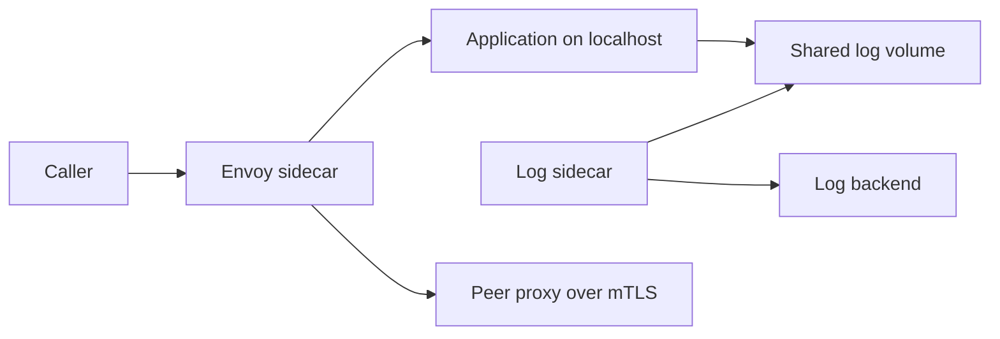

## Concept

### A helper that shares the pod and keeps its own code

A sidecar is a helper process scheduled with the application. They start together, stop together, and share a network namespace and, when you choose, a volume. They do not share an address space or a language runtime. The application talks to `127.0.0.1`. The helper speaks TLS, ships logs, or refreshes a credential. Kubernetes made the pattern ordinary: one pod, more than one container. The architectural decision is what belongs in the sidecar, what belongs in the application, and what belongs in a node agent — and the acceptance that "the process" now has two lifecycles.

The separation is the point. A proxy written in C++ or Rust can sit beside a JVM service. A log collector can sit beside Python. You can roll the helper without rebuilding the application, and you still test the pair, because the helper is on the request path or the data path. A transparent proxy that changes header limits or idle timeouts will break clients that never changed their own code. Treat the sidecar version as a production dependency with a canary, not as an annotation that came free with the cluster.

### What is worth a second container

Network proxies are the common case. Envoy, Linkerd's proxy, or a cloud database proxy listens on localhost. The application uses a boring URL. The sidecar holds mTLS, workload identity, or cloud IAM, and the application never stores the private key. This is the service-mesh data plane and the "JDBC to localhost, IAM to the database" pattern.

Telemetry collectors are the second case. The application writes structured logs to stdout or to a file on a shared volume, or it emits OTLP to localhost. The sidecar speaks the vendor protocol and can be upgraded when that protocol changes. The application stays ignorant of the backend.

Security adapters are the third: secret templates, SPIFFE helpers, and agents that refresh a file the application already knows how to read. Protocol adapters — HTTP in front of a legacy TCP service, JSON in front of gRPC — are a fourth, and they age badly. The adapter becomes the API everyone codes to, with no owner and no version. Use them as a bridge with an end date.

If the helper must parse business payloads to make product decisions, it is another service sharing a pod. Sidecars stay mechanically useful and semantically dull. Retries of idempotent HTTP, TLS, and log shipping fit. Pricing rules, fraud decisions, and feature interpretation do not.

### Lifecycle is part of the interface

Container restart policy, probes, and stop hooks decide whether a sidecar death kills the pod, whether the application becomes ready before the proxy is listening, and whether shutdown drains in-flight calls. The classic deploy bug is readiness too early: the application serves traffic, Envoy has no configuration yet, and the first requests fail. The classic shutdown bug is the proxy exiting while the application still has open calls, or the application exiting while the proxy still accepts new ones.

Kubernetes sidecar containers, as a first-class lifecycle rather than a best-effort second container, exist because ordering was unreliable for years. The proxy should start before the application accepts work and should stop after the application has drained. Readiness of the pod includes the proxy. A `preStop` hook that asks the proxy to drain, then signals the application, belongs in the manifest and in the load test.

Resource requests are part of the same contract. An application sized at a small heap next to a proxy that needs hundreds of megabytes is a sidecar-shaped bill. Set requests per container. Stop the helper from starving the application of CPU during a collection pause. If the helper needs more memory than the service it fronts, ask whether a node-level datapath would be the better home.

### Libraries, sidecars, and node agents

A library — TLS in the runtime, a metrics SDK — has no extra hop and no extra container. It couples upgrades to the application release and multiplies across languages. A sidecar has the hop and an independent release. A DaemonSet node agent — one log collector or CNI helper per machine — is cheaper per replica and has a wider blast radius when it is wrong. Ambient mesh and eBPF move some of the sidecar's network job to the node, leaving a sidecar or waypoint only where L7 policy is required.

Early on, a sidecar everywhere is how you get a uniform wire. Once the RAM bill is measured, L4 moves to the node and L7 stays next to the pods that need it. Business-level idempotency stays in the application, because the helper cannot see the ledger key.

### Localhost is a shared trust zone

Anything in the pod can connect to the application's port or read a volume you mounted into both containers. A sidecar increases the attack surface: a compromised log shipper that can see a secret volume is a credential leak. Give the helper its own identity and the minimum rights. Run it unprivileged. Mount only the volume it needs. Bind admin and plaintext ports to `127.0.0.1`. A sidecar that listens on all interfaces has published a service you did not put in the catalog.

Cap how many helpers you attach. An application retry library, plus a proxy that also retries, plus a log sidecar, plus a second auth proxy, is four failure modes that each looked reasonable alone. Two sidecars is a conversation. Four is a design smell.

## Trade-offs

| Approach | When it wins | Cost / risk |
| -------- | ------------ | ----------- |
| In-process library | Tight latency, one language, logic that needs business context | Upgrades wait on every application; polyglot fleets drift |
| Sidecar in the pod | Polyglot fleets, helper releases independent of the app, proxies and credential adapters | Memory times replica count; startup and shutdown races |
| Node agent or DaemonSet | Logging, CNI, and other per-machine work | Noisy neighbor; a bad agent affects every pod on the node |
| Ambient or host datapath | Mesh features after sidecar RAM dominates | Different debugging; less isolation per application |

Libraries win for inner loops and for decisions the proxy cannot name. Sidecars win for TLS, HTTP policy at the edge of the process, and vendor protocol churn. Node agents win when the work is "for the machine." Ambient wins when you have the measurement that says per-pod proxies are the capacity problem.

Stacking is the expensive default. Each team adds the helper it understands. The pod ends up with a proxy, a service-mesh proxy, and a log shipper that also tails the same files. Pick the layer that owns retries, the layer that owns identity, and the layer that owns logs, and delete the duplicates.

## Diagram

A meshed pod: the caller hits the proxy, the proxy reaches the application on localhost, and a log sidecar reads a shared volume and ships out. Peer traffic leaves the proxy over mTLS.

## Failure modes

### Startup and shutdown ordering

Detection is a burst of connection-refused or 503 responses on every deploy, application logs that show localhost refusing connections, traces cut off at shutdown, and a pod that reports the application stopped while the proxy still holds connections.

Mitigation waits for the proxy before the application serves — a native sidecar lifecycle, or an explicit block on a localhost health endpoint — and drains on the way down: the proxy stops accepting, in-flight work finishes, then the application receives SIGTERM. Pod readiness includes both containers. Roll under production-like traffic. An idle deploy will not show the race.

### Shared fate you did not mean, or isolation you did not earn

Detection is a pod restart when the log collector runs out of memory, while the application was healthy, or the inverse: the proxy crash-loops, the application stays Ready, and traffic fails or leaves without mTLS. Liveness on the helper is copied from the application and is too aggressive.

Mitigation decides shared fate per helper. If the proxy is dead, the pod should be unready, because sending traffic to a pod with no proxy either blackholes it or skips policy. If the log shipper is dead, restarting that container without killing a healthy application is often the better trade, unless you are on a path where unaudited requests must not be served. Separate probes. A slow shipper should not fail the application's liveness check.

### CPU and memory contention inside the pod

Detection is application latency tracking sidecar CPU, cgroup throttling, and a log shipper that became expensive after a debug flag or a traffic spike increased log volume. The application dashboard looks like a capacity problem. The container dashboard shows the helper.

Mitigation sets requests and limits per container, samples logs, and gives the proxy enough workers for the QPS you measured. Containers in one pod still share a scheduling budget. Watch steal between them. When the sidecar's footprint exceeds the application's, move that job to a node agent or an ambient datapath and keep the pod for the work that must be per replica.

### Helper upgrades that bypass application CI

Detection is a platform rollout of a new proxy version, a subset of services breaking on HTTP/2 settings, header size, or idle timeout, and application pipelines that stayed green because they never rebuilt. The wire changed. The application artifact did not.

Mitigation treats sidecar upgrades as production deploys. Canary by namespace or by service class. Pin a version where a class of services cannot move yet. Contract-test the localhost interface: headers, max connections, idle timeout, and the drain behavior. "Transparent" describes the intent. The bytes on the socket are the compatibility surface.

## Real-world example

Lyft's Envoy is the sidecar that set the modern pattern. Services spoke to localhost. Envoy terminated TLS to peers, applied retries and timeouts, and exported the stats that became the fleet's golden signals. Later the same proxy sat at the edge. Application teams did not each embed a different client stack for those concerns. The platform shipped Envoy as a companion process, tuned it for the fleet, and rolled proxy versions as fleet events with canaries. That model is what Kubernetes sidecar injection automated, and what every "add this container" tutorial simplified.

Take a worker that also reaches a managed database. The process opens a JDBC URL on `127.0.0.1`, where Cloud SQL Auth Proxy — Google's widely used sidecar — holds IAM credentials and TLS to Cloud SQL. Envoy, in the same pod, wraps the worker's HTTP calls to a risk service and presents workload identity on the mesh. Two helpers, one application. The JVM stores neither a database private key nor a mesh certificate. The platform can rotate proxy versions and credential behavior without a new application artifact, as long as localhost stays compatible.

The failures operators learn are the ones the diagrams omit. An Envoy misconfiguration looks like the worker is broken unless CPU, connection count, and reset rate are graphed for the proxy alone. A deploy that kills the proxy before in-flight RPCs finish drops payments that the application would have completed. If the Cloud SQL proxy dies and readiness ignores it, the JDBC pool fills with errors that resemble a database outage in another region. Detection is a helper-specific signal next to the application's: proxy process up, connections to Cloud SQL, Envoy upstream resets. Mitigation is shared readiness for helpers on the critical path, drain on shutdown, and canaries for the helper version.

Sidecars are how a platform buys a feature once for every language in the fleet. They are also a second process to probe, size, and roll. Envoy at Lyft worked because the proxy was operated as production software. A YAML annotation that nobody load-tests is how the same pattern fails at a smaller scale with the same symptoms.

## What to remember

- A sidecar shares the pod's network namespace and fate so TLS, proxying, or shipping can ship without a new language library.
- Start, readiness, drain, and stop are part of the contract; roll the pair under traffic.
- Size each container from production metrics, cap how many helpers you stack, and graph the sidecar separately from the application.
- Move per-machine work to a node agent or ambient datapath when per-pod proxy memory becomes the capacity limit.
