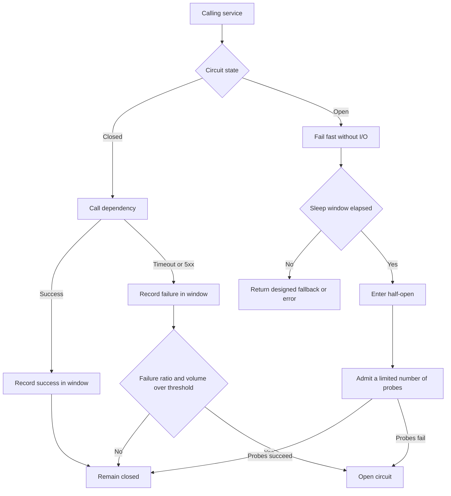

A circuit breaker is a gate on the path to a dependency. While that dependency stays inside an error budget the team has defined, calls pass through and the gate records the outcome. When timeouts, connection failures, and server errors cross the threshold, the gate opens and later calls fail inside the caller, without a socket and without a blocked worker. The open period gives the dependency a chance to recover and keeps the caller from turning a local slowdown into a thread-pool incident. Most of the design is the policy around that gate: which errors trip it, how the key is scoped, how many probes are allowed when it tests recovery, and what the product returns to the user while it is open.

## Concept

Distributed calls fail in shades. A process can accept TCP, sit in a garbage-collection pause, and answer after the caller has already burned its latency budget. A thread parked on that wait is a thread that cannot serve a healthy dependency. The breaker exists to turn that slow failure into a fast local decision, and to stop the caller from adding arrivals to a service that is already behind.

### Closed, open, and half-open

Three states are enough, and each one needs an owner. In the closed state every call is attempted and the outcome is written into a window. In the open state the call is rejected locally and the dependency is left alone. After a sleep window the breaker moves to half-open and admits a small number of trial calls. Success on those trials closes the gate. Failure opens it again and restarts the sleep.

The trip rule is a measured policy. A count-based window opens after a run of consecutive failures, which catches a crash or a bad deploy. A time-based window opens when the failure ratio over the last interval exceeds a threshold and a minimum number of calls has been seen. Three failures on an idle route are noise. A fifty percent error rate across two thousand calls in thirty seconds is a dependency to isolate. Set the volume from normal traffic, and set the ratio from the error budget you will spend before you stop calling.

Half-open is where production breakers embarrass their authors. Releasing every waiting request when the sleep window ends recreates the stampede. Admit one in-flight trial, or a handful, and reopen if those probes fail. Closing should take more than a single lucky success.

### What counts as a failure

The trip set is a product decision recorded as code. Timeouts, connection refusals, connection resets, and 5xx responses from the dependency belong in it. A 400 caused by a bad client payload does not. If client errors move the breaker, one poison publisher can open the gate for every healthy caller of that method. Slow calls deserve an explicit rule too. A dependency that returns in eight seconds against a ten-second timeout has already damaged the caller, even though the call "succeeded." Many teams record those as failures once they cross a slow-call threshold well above the healthy p99.

Business results stay out of the failure window unless you have written down why they belong there. "Out of stock" and "denied" are completed calls. Fold them into the error rate and a sale or a bad client deploy will open the breaker for people who should have received a real decision.

The timeout is what makes the breaker observable. A breaker that only counts thrown exceptions stays closed while every worker blocks on a call with no deadline. Connect timeout and request timeout are separate knobs: a host that never accepts, and a host that accepted and then went quiet. Brownouts live in the second bucket.

### Keys, placement, and the open-state answer

One breaker named after an entire downstream team is too wide. A sick endpoint, shard, or tenant then opens the gate for traffic that was healthy. Key on the failure domain you can roll back: downstream cluster, route or method, and sometimes tenant tier or shard. Hundreds of keys need names and an owner. Review that scheme beside the SLO.

Placement follows who can see the key. An in-process library such as Resilience4j, or the older Hystrix command model, can key per method and run a fallback in-process, at the cost of language lock-in and config drift. A mesh outlier policy applies one rule to every language and ejects bad endpoints, with coarser keys and less say in the user-facing answer. An edge gateway fits a third party you do not operate. Mature platforms run a mesh default and keep libraries for the few calls that need a custom key and a custom fallback.

The open state needs an answer you would ship on purpose. A cached read, an omitted panel, or a default ranking is appropriate when a stale or partial page is acceptable. A hard error is appropriate when a guess becomes an incident: a second card capture, an inventory release you cannot honor, an authorization decision served from a stale allow-list. Write that choice next to the breaker config. A library default of "throw" or "return null" is an unfinished design.

### How the breaker sits with the rest of the stack

Retries and breakers amplify each other when they are configured as separate checkboxes. A closed breaker with aggressive retries multiplies load on a dying dependency and then trips, after the amplification has already landed. The order I want is a deadline first, a bulkhead slot second, a breaker check third, and a retry budget only while the breaker is closed and the deadline still has room. Once the gate is open, retries stop. Retrying an open circuit spends the caller's budget to rediscover a decision you already made.

Size the sleep window past the dependency's restart backoff and inside the degraded-mode budget you will show users. A few hundred milliseconds flaps on a pause. Many minutes stretches an outage that is already over.

## Trade-offs

| Approach | When it wins | Cost / risk |
| -------- | ------------ | ----------- |
| In-process command breaker | Per-method keys, custom fallbacks, sub-second reaction inside one language | Config drift, library upgrades, no cover for polyglot callers |
| Mesh outlier detection | A default for every service without an application change | Coarser keys, ejection lag, little say in the user-facing fallback |
| Count of consecutive failures | A sharp burst: crash loop, bad deploy, total blackhole | Slow brownouts and partial error rates stay under the bar |
| Time-based failure ratio with minimum volume | Elevated error rates under real traffic | A low volume trips on canaries; a high volume never trips on thin routes |
| Open state serves a cached or omitted fallback | Read paths where a degraded answer beats an error | Stale or wrong data, and an SLO that stays green while the dependency burns |
| Open state fails the call | Money, inventory, authorization, any guess that creates a severe incident | That feature's availability drops for the whole sleep window |

The table is the start of the review. A thirty-second client timeout beside a healthy p99 of eighty milliseconds is the user-facing wait while the breaker is closed, and it is how long every half-open trial holds a worker. Set the per-attempt timeout from the latency distribution and the remaining deadline, then let the breaker count the timeouts that still happen.

Shared defaults help a new service onboard and drift once traffic mixes diverge. A fifty percent threshold on a ten-second window can start a steady user-facing RPC. A batch job that calls once a minute, and a fan-out of two hundred calls per request, need their own volume floor. Each production key needs an owner who can explain that floor, the ratio, and the sleep window against the route's SLO.

## Diagram

The loop below is the one a caller should be able to walk in a design review. The edges that matter are the measured trip, the fast fail while the gate is open, and the limited trial in half-open. An implementation that cannot point at each edge is a retry wrapper with a counter.

## Failure modes

### Flapping between open and closed

**Detection.** The dependency's error rate draws a square wave. Caller success recovers for a few seconds, then collapses. Autoscaling on the dependency oscillates. Half-open trial counters increment in a tight loop, and the sleep window is shorter than the time the dependency needs to finish starting.

**Mitigation.** Lengthen the sleep window past the dependency's recovery time. Require several successful probes before closing. Stop retries while the gate is open. If the dependency is crash-looping on a bad build, the breaker should stay open until that build is rolled back. The gate isolates. It does not repair a broken release.

### Half-open stampede

**Detection.** A quiet interval while the breaker is open, then a latency spike and pool exhaustion the moment the sleep window ends, often worse than the original incident. Metrics show a burst of in-flight calls and no concurrency cap on the half-open state. In a large fleet, every pod probes at the same moment.

**Mitigation.** Cap half-open concurrency at a small constant and reject or queue the rest locally. On a low-traffic route, allow a single probe. On a high-traffic fleet, coordinate so that only a few replicas spend a trial token, or jitter the sleep window so a hundred pods do not wake together. Load-test the transition, not only the closed state.

### Errors that should never have tripped the gate

**Detection.** Breakers open during ordinary business: a sale that produces many "out of stock" answers, a client deploy that sends malformed bodies, a bot that collects 401s. The dependency's own golden signals stay healthy while callers degrade and fallbacks fire.

**Mitigation.** Trip on transport failures, timeouts, and 5xx. Keep 4xx and domain refusals on a separate metric. A sustained 429 is backpressure: honor Retry-After and a client budget, and trip only when that status means the shard is finished rather than asking you to slow down. Review the trip set whenever a new status code appears in an incident.

### One key covering many failure domains

**Detection.** A single series named after a whole service. One tenant, one region, or one method is sick, and every caller receives fallbacks. Multi-tenant platforms see this as one customer taking another customer's path down with them.

**Mitigation.** Split keys along the domains that actually fail independently: method, downstream cluster, tenant tier, shard. Cap how many keys you will create, and use shuffle sharding or a small set of tiers for the long tail of tenants rather than one breaker per customer. A breaker with no owner becomes a shared breaker. Put the owner on the dashboard.

## Real-world example

Netflix's Hystrix is the public system that taught this pattern to a generation of service owners. The library is unmaintained. The incident it was built to stop is still the one I use in reviews.

The homepage and the start-play path fanned one member request out to recommendations, bookmarks, ratings, licensing, and a long list of other services. One slow dependency blocked Tomcat threads on the API tier. Once those threads were gone, healthy dependencies could not be reached either. The page looked down. The API process was busy waiting.

Hystrix wrapped each downstream command with a timeout, a breaker, and an isolated thread pool or semaphore. When ratings slowed, the ratings command tripped. The homepage kept rendering. The fallback was a product decision: a cached row of popular titles, a row omitted, a default sort. Members saw a slightly worse page. They did not see a spinner that never resolved. The dashboard showed each command's state, error percentage, and fallback rate, which a single page-level success metric had hidden.

Two details from that system are still the ones I ask for. Fallbacks were designed and instrumented, so a missing recommendation row was an accepted degraded mode. Isolation was per command, so a saturated ratings pool could not steal the workers that licensing still needed. Netflix later moved much of the machinery into sidecars, and the Java ecosystem moved to Resilience4j. The architecture stayed the same: a bounded wait, a measured trip, a narrow probe, and a fallback you would demo. A breaker with no named answer for the open state has not yet done that job.

## What to remember

- A circuit breaker turns a slow dependency failure into a fast local rejection so the caller keeps its workers and the dependency gets room to recover.
- Timeouts create the failures the window can see; retries stop while the circuit is open; half-open admits a few probes, then closes or reopens on purpose.
- Key the breaker on the real failure domain, and keep client errors and ordinary business refusals out of the trip set.
- Decide the open-state answer as a product choice: a designed degraded read, or a hard error on any path where a guess is an incident.
