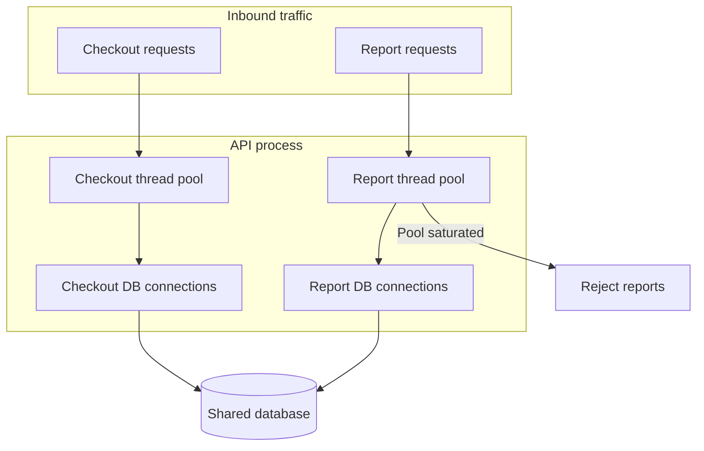

A bulkhead is a hard partition on a shared resource so that one flooded compartment cannot sink the rest of the ship. In a service the compartments are thread pools, connection pools, queues, processes, cells, and sometimes entire accounts. A circuit breaker stops you from calling a dependency that is already sick. A bulkhead stops one workload from consuming the capacity that other workloads still need, even while every dependency looks healthy. If the only control you have is a breaker, a burst of expensive requests from one feature, one tenant, or one batch job can pin every worker before any error rate is high enough to trip.

## Concept

Most microservice diagrams show isolation at the box level and share everything that saturates at runtime: a process thread pool, an HTTP client, a database max-connections setting, a node, a cache cluster, a message partition. Failure travels along those shared resources. Bulkheads put a budget on each compartment and refuse the work that would exceed it. The refusal is the feature. A limit that a compartment can borrow from its neighbor under load disappears during the incident you bought it for.

### Isolation is a resource story

Start from the resource that runs out first. For a blocking service it is usually threads or downstream connections. For a non-blocking service it is event-loop time and outbound concurrency. For a data store it is connections, locks, and CPU on a shard. For a platform it is noisy neighbors on a shared cell.

Hystrix made two application bulkheads famous, and both are still the right vocabulary. Semaphore isolation caps how many calls may be in flight on the calling thread. It is cheap, it creates no extra threads, and it does nothing for work that blocks or burns CPU on that same thread. Thread-pool isolation runs the dependency call on a dedicated pool, so a stalled dependency cannot freeze the request workers that still need to serve other commands. The pool costs memory and context switches. It buys a wall the semaphore cannot draw.

Those two are the in-process end of a larger pattern. A separate connection pool per downstream, a separate consumer group per workload class, a Kubernetes namespace with its own ResourceQuota, a separate database user with its own connection cap, a separate cluster for checkout: each is a bulkhead when the test passes. Can workload A take resource R away from workload B? If it can, they are still in one compartment, whatever the diagram says.

### Workload, tenant, and cell

Three cuts show up once a system has real traffic.

Workload bulkheads separate interactive from batch, read from write, and cheap calls from expensive ones. The browse path should not share a database pool with a report that scans a table. Checkout should not share a worker pool with a recommendation fan-out. This is the cut to make first, because the SLO of checkout is already different from the SLO of "customers also viewed," and you can name both.

Tenant bulkheads stop one customer from exhausting a multi-tenant service. Per-tenant concurrency limits, separate pools for an enterprise tier versus a free tier, and shuffle sharding onto a subset of workers are the usual tools. A private stack per tenant is rarely affordable. The goal is a bounded blast radius: one tenant can degrade the tenants who share its shard, and cannot degrade the region.

Cell-based bulkheads copy a whole slice of the stack. A cell holds its own compute, its own data partition, and its own share of downstream capacity. Traffic is assigned by a mapping that stays stable during an incident. Shuffle sharding assigns each tenant a small combination of cells so that a poison request or a bad host affects the tenants who share that combination. That is a bulkhead on the relationship between tenants, built at the architecture layer rather than inside one process.

### Where the wall is built, and what rejection looks like

Application libraries are the right wall when the contended resource lives in the process. The platform is the right wall for node CPU, a cluster-wide connection limit, or a regional dependency. Gateways are the right wall for inbound fairness, before a request reaches a worker. Walls that disagree get tuned from the wrong dashboard. An application semaphore of fifty on a pod whose mesh already limits concurrency to twenty never fires. Pick an owner for each resource and page on rejection at that owner.

The rejection policy has to be one the product will accept. Shed with a 503 and a Retry-After for work that can be retried. Shed to a degraded mode for reads that have a fallback. An unbounded queue behind the pool converts a concurrency problem into a latency problem and then into a memory problem. Cap the queue at a small multiple of the pool size. If wait time becomes a large fraction of the timeout, the queue is the incident, and the bulkhead has already failed its job.

## Trade-offs

| Approach | When it wins | Cost / risk |
| -------- | ------------ | ----------- |
| Semaphore on the calling thread | Non-blocking I/O, a cheap cap, many keys | Cannot isolate a call that blocks or hogs CPU |
| Dedicated thread pool per command | Blocking I/O toward a dependency that can stall | Thread counts grow, sizing gets harder, queueing adds tail latency |
| Separate connection or client pools | The downstream connection limit is the real shared resource | Idle connections, more file descriptors, metrics split across pools |
| Separate clusters per workload | Checkout and browse have different SLOs and different failure modes | Duplicate toil, lower average utilization, a wider deploy surface |
| Cells plus shuffle sharding | One tenant or one host must not be able to take the region | Spare capacity, a mapping service, cells that must stay feature-complete |
| One shared pool and a breaker only | A small system with a single workload class | The first noisy neighbor becomes a site-wide outage |

Sizing is the unglamorous half. A pool of eight threads in front of a dependency whose p99 is two hundred milliseconds admits on the order of forty calls a second if the threads stay busy. A pool sized from "the machine has sixteen cores" will either waste capacity or reveal its cap during an incident. Size from offered load and service time, then load-test until rejection starts where you chose, and confirm the neighboring compartment still meets its SLO while this one sheds.

Spare capacity is the bill for a real wall. A checkout cell at forty percent can absorb a spike without sharing fate with a recommendation batch. A single shared pool at ninety percent looks efficient until every workload queues together. Draw the cuts along SLO boundaries and tenant tiers. Fifty pools of two threads will reject while the process still has idle CPU, and a class name is a weak reason to spend a pool.

## Diagram

One process serves checkout and reporting against one database. Each workload has its own thread pool and its own connection budget. When the report pool is saturated, reports are rejected inside that compartment. Checkout keeps the connections it was given.

## Failure modes

### Queues that pretend to be walls

**Detection.** Latency climbs smoothly toward the timeout while threads look "healthy" because they are busy waiting. Heap grows. Tail latency for the isolated workload and its neighbors moves together, which is the signature that the wall is porous. Queue depth is either unexported or sits at a number nobody has a limit for.

**Mitigation.** Cap queue depth at a small multiple of the pool. Reject when the queue is full. Export depth, wait time, and rejection count as primary metrics. Alert when wait time is a large fraction of the caller deadline. If the business wants smoothing, give it a bounded queue with a measured wait, and write down the wait you will accept.

### Pools sized for a machine that is not the bottleneck

**Detection.** One compartment rejects constantly while others sit idle and CPU is low. Adding pods does not move the rejection rate, because every pod copied the same too-small pool. The inverse shows up as hundreds of idle threads, longer garbage collections, and a deploy diff nobody meant to make.

**Mitigation.** Size from concurrency equals throughput times service time. Recalculate when p99 moves. Review max pool size in the same change as the SLO. Load-test to the rejection point and watch the other compartment. If the cap is the database rather than the process, sizing the local pool higher only moves the outage one hop downstream.

### A local wall in front of a shared deeper resource

**Detection.** Application pools look isolated on the service dashboard. The database max connections is global. A report compartment uses its "own" forty connections and still exhausts the server because checkout holds forty more and the server allows seventy-five. Or both compartments share a cache whose eviction and CPU are global, so a scan in one tenant evicts the working set of another.

**Mitigation.** Draw the resource graph past the first hop. Put the bulkhead on the resource that actually saturates: separate database users with enforced limits, a proxy that caps per workload, a separate cache, a separate disk. If you cannot split the resource, put one admission controller in front of it and stop treating the in-process pools as sufficient.

### Cell mappings collapsed during the incident

**Detection.** During an outage, a runbook "temporarily" re-pins every tenant onto the surviving cell. That cell then fails the same way, faster. Shuffle sharding is undone by a well-intentioned override. Afterward the mapping no longer matches what capacity planning assumed.

**Mitigation.** Treat cell assignment as an invariant of the incident. Drain a bad cell. Fail over along the precomputed mapping. Do not pile every tenant onto one survivor unless that survivor was provisioned for the combined load. Practice the drain in a game day. If a one-line config can merge cells, someone will merge them at three in the morning, so make the override explicit, reviewed, and alarmed.

## Real-world example

Amazon's public writing on cell-based architecture and shuffle sharding is the large-scale form of this pattern, and it is more useful than another screenshot of a thread pool.

Services that look like one regional endpoint are often a fleet of cells. Each cell has its own compute, its own slice of data, and its own share of downstream capacity. A customer or a resource is mapped onto one cell, or onto a small shuffled subset. When a host fails, when a poison payload hits a pathological path, or when one tenant runs a workload the code did not expect, the blast radius is that cell, or the intersection of cells in the tenant's shuffle. The rest of the region keeps serving.

The shuffle is the part people miss when they hear "bulkhead" and picture eight threads. With eight cells and two cells assigned to each tenant, a tenant that can knock out a cell still shares fate with only a fraction of other tenants. Most customers never meet that failure. The partition is on the graph of who shares a cell, which is why the mapping has to be stable and why "move everyone to the healthy cell" undoes the design.

You run more copies than a fully shared fleet, the mapping must not become a single point of failure, and cells have to stay close in features. Rescue by draining along that mapping, rather than by merging traffic in the middle of the incident.

A payments API with one pool for authorize and another for capture, two database users with separate connection caps, and a separate worker fleet for overnight reconciliation is the same pattern on a smaller board. Isolation is a budget another workload cannot steal. A breaker around "the database" does not create that budget.

## What to remember

- A bulkhead assigns a hard budget to a compartment and refuses overflow; a limit that can be borrowed under load is a suggestion.
- Cut first along SLO boundaries such as checkout versus browse, then along tenant tiers, then along cells when blast radius still spans the region.
- Size pools from latency and offered load, cap the queue, and partition the resource that actually saturates one hop downstream.
- Shuffle sharding and cells bound multi-tenant blast radius only while the mapping stays intact during the incident.
