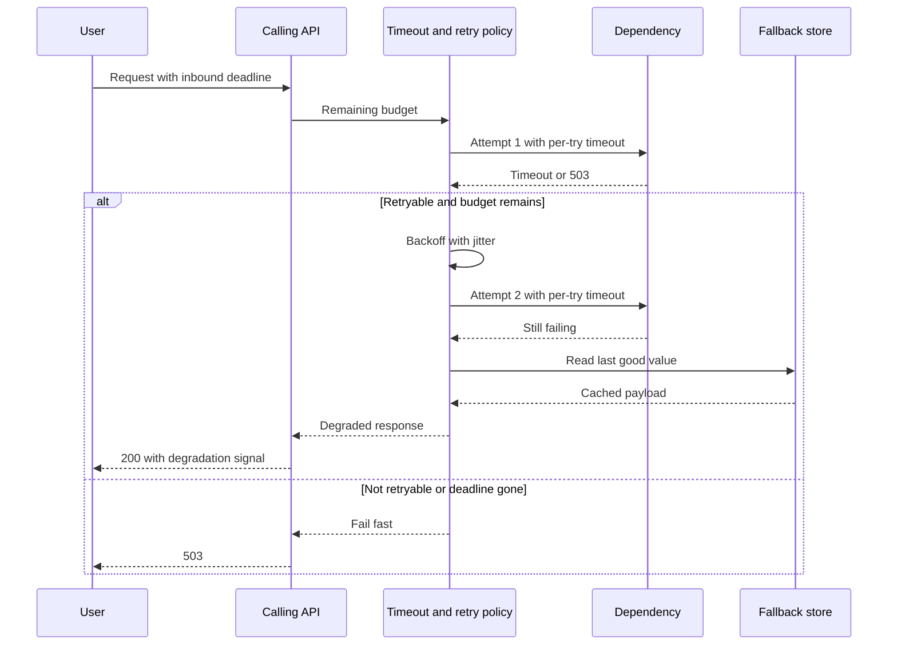

Retry, timeout, and fallback are one policy wearing three names. The timeout bounds how long a single attempt may wait. The retry spends a limited budget, inside the caller's deadline, on errors that might be transient and that are safe to repeat. The fallback is the behavior you serve when that budget is gone. Configure them as unrelated client flags and you get the outages the stack exists to prevent: workers parked for tens of seconds, a retry storm that finishes a dependency that was about to recover, and a catch block that returns an empty payload nobody designed. Circuit breakers and bulkheads sit around this stack. They do not replace a deadline.

## Concept

A remote call ends in one of three ways the caller has to plan for: a timely answer, a late answer, or no useful answer. Timeout policy defines late. Retry policy defines which failures are worth another attempt. Fallback policy defines what the user, or the next service, sees when another attempt is no longer worth it. Leave any of those implicit and the incident will define them for you, usually as "wait until the thread dump" and "return null."

### Timeouts are the root of the stack

Every remote call, every lock wait, every queue poll, and every cache get that crosses a network needs a deadline. The number comes from the dependency's healthy latency, the caller's remaining SLO, and the shape of the fan-out. Twenty calls in parallel are dominated by the slowest of the twenty. Twenty calls in sequence add. A five-second timeout on a dependency whose healthy p99 is forty milliseconds allows a stalled call to consume on the order of a hundred times its normal budget before the caller moves on.

Deadlines have to nest. Each outbound call receives the time still remaining, not a fresh copy of the maximum. A service that stamps a new two-second timeout on every hop will watch its children outlive the parent. Propagate the deadline, cancel outbound work when it fires, and keep connect timeout (host never accepts) separate from request timeout (host accepted, then went quiet). Brownouts live in the second bucket.

### Retries spend a budget you can name

Retries are the right tool for a lost packet, a brief load-balancer failover, and a single instance that has just died. They are the wrong tool for a saturated dependency, for a 400, and for a write you cannot identify if the first attempt landed. A retry against a saturated service is extra load with a delay. Ten thousand clients doing it together is how a partial outage becomes a total one.

A production retry policy names four things. Which errors are retryable: connection failures, a 503, a 429 that carries Retry-After, and maybe a 500 on a read you know is safe to repeat. How many attempts fit inside a total time budget, rather than an unbounded count. How you wait: exponential backoff with full or equal jitter, so the fleet does not retry on the same clock edge. How you cap the fleet: a retry budget, such as retries consuming at most ten percent of outbound calls, so that when the dependency is truly down the clients stop amplifying.

Idempotency is the gate on write retries. If a timed-out payment might already have captured the card, a second attempt with a new request id is a second capture unless an idempotency key makes the duplicate a no-op. Store that key for longer than the full retry envelope. If you do not have the key, the next step after a timeout on a write is a status read, or an explicit unknown state. It is not another submit.

The retry envelope and the deadline share one pie. Three attempts at two seconds each do not fit a three-second inbound budget, so "three retries" in that config is a lie. Compute the worst case and cut attempts or per-attempt timeouts until it fits. A hedged second call, sent in parallel to trim tail latency, spends extra capacity on purpose. Use hedges on cheap replicated reads you have provisioned for, and leave writes alone.

### Fallbacks are product behavior

A fallback is an alternative you are willing to show when the primary dependency is unavailable: a last-good cache, a default ranking, a panel omitted, a cheaper approximation, a queued retry for later, or a clear error. Returning null is an unchecked crash waiting for the first dereference. Returning a success with an empty body is a product bug with a green dashboard.

Design the fallback with the same review you would give the happy path. Who owns the cached copy. How stale it may be. Whether it is safe across tenants. Whether serving it spends the SLO. How support will explain it. I want a metric, a log field, and a degradation signal the client can show. A silent fallback becomes the permanent implementation during a slow outage, because nothing pages.

Count primary success, fallback, and failure separately. A homepage that is 99.9 percent "successful" while eight percent of those responses are yesterday's recommendations has hidden the dependency's error budget. Alert on fallback rate even when the status is 200, and write a degraded mode into the SLO only when product has accepted it.

### The order that keeps the layers from fighting

The stack I want around a client call is short enough to put in a review checklist.

1. Attach the remaining deadline from the inbound request.
2. Take a bulkhead slot. If none is free, fail locally.
3. If the circuit is open, skip the network and go to the fallback.
4. Attempt the call with a per-attempt timeout inside the time still left.
5. On a retryable error, wait with jitter only if the retry budget and the deadline both allow it, then try again.
6. When the budget is exhausted, feed the breaker and serve the fallback you designed.

Pick one hop in the chain that is allowed to retry. If six services each retry three times, one user action can become hundreds of backend calls. Interior hops should fail fast with a signal the chosen hop understands.

## Trade-offs

| Approach | When it wins | Cost / risk |
| -------- | ------------ | ----------- |
| Tight timeout and no retry | Fan-out reads where a late dependency must not stall the page | Single-instance blips become user-visible more often |
| Timeout plus a small jittered retry | Idempotent reads, and writes that carry an idempotency key, behind a flaky balancer | Amplifies load when the real problem is saturation |
| A fleet-wide retry budget | Many clients that would otherwise stampede a recovery | Some callers see more errors during a partial outage, by design |
| Immediate fallback to an isolated cache | User-visible reads with a freshness window you can name | Stale data, tenant leaks, and an SLO that hides the primary failure |
| No fallback; fail the request | Money, inventory, authorization, any guess that becomes a severe incident | Availability of that feature tracks the dependency, so the error must be one a user can understand |
| Hedged duplicate reads | Tail latency on cheap replicated reads you have capacity for | Extra load on the dependency by construction |

Client-side retry and server-side retry need one owner. "Everyone retries a little" is a retry storm drawn in advance. Document the hop. Give interior services a short timeout and a clear retryable status, and let the edge or the designated client spend the budget.

A fallback cache that fills from the failing dependency on a miss is the primary path under another name. Pre-fill it, isolate it, and keep it read-only during the incident, or prefer a static default or an omitted panel.

## Diagram

One user request, one dependency, and the stack in order. The second attempt happens only because the error was retryable and the deadline still had room. The fallback is a marked degraded response, not an empty body.

## Failure modes

### Retry storm while a dependency is trying to recover

**Detection.** Error rate on the dependency was high, then inbound attempts jump above the pre-outage baseline as it starts to recover. CPU and queue depth spike in step with client retry counters. A graph of attempts divided by user requests sits well above one. Anything persistently above a small margin during recovery is amplification you are paying for.

**Mitigation.** Retry budgets, jittered backoff, and a breaker that stays open until probes succeed. One hop retries. Honor Retry-After when the dependency can name a delay. On the server, shed load with a fast 503 so retries fail cheaply instead of queueing. Game-day the recovery, not only the steady state.

### A timeout longer than the caller's deadline

**Detection.** Users see gateway 504s. Outbound metrics still show calls completing after the user is gone. Traces show children that outlive parents. Thread dumps show workers blocked on I/O for requests that have already been cancelled upstream.

**Mitigation.** Propagate deadlines and cancel outbound work when the parent deadline fires. Set each attempt strictly inside the time remaining. Stall the dependency in a test and confirm the caller fails first, with a metric you own, before the gateway invents the failure for you.

### A fallback that quietly becomes the product

**Detection.** Fallback rate sits at a few percent for days and nobody pages. Support starts reporting missing rows or old prices. The primary dependency looks healthier than it is, because callers talk to it less, or because successes include the fallback.

**Mitigation.** Split primary success, fallback, and failure in the metrics. Keep fallbacks out of the full-success SLO unless product has signed that definition. Time-bound cached values. Put fallback rate on the same dashboard as the dependency error budget, and give it an owner who is allowed to say the degraded mode has gone on too long.

### A retry of a write that was not idempotent

**Detection.** Duplicate charges, duplicate messages, duplicate reservations, two rows for one user action with different ids. Finance or a unique constraint finds it. The API dashboard often stays green, because both calls returned success. The forensic join is two writes, one user action, two request ids.

**Mitigation.** Idempotency keys on every write you might retry, stored longer than the retry envelope. For operations you cannot make idempotent, retry a status check and treat a timeout as unknown. Make "unknown" a state the product and the ledger can both represent, so operators are not forced to guess by submitting again.

## Real-world example

Netflix's playback start path is the public system that shows this stack as product behavior rather than as a bag of client flags.

When a member presses play, the device needs a license, a manifest, CDN locations, and enough metadata to draw the player. Those calls do not share an SLO, and they should not share a fallback. Licensing sits close to fail-closed: a wrong or missing license is a business and legal problem, so the honest outcome is a failed start the player can explain. Metadata and artwork sit close to fail-open: a generic title treatment is a better member experience than a spinner. CDN selection can try another origin. A charge to a payment instrument never should.

Timeouts on that path are aggressive because the member is watching the wait. A license server that answers in seconds has already missed the play-start budget. The player would rather fail or try a different endpoint than sit on a black screen while a client library walks a long backoff. Retries exist, and they are aimed at a small set of retryable errors, inside the time the UI is willing to show. They are not "three retries" copied from a template.

The fallbacks are visible. If personalization is down, the member still gets a catalog row from a safer source. If a high-bitrate encode cannot be authorized, the player steps down. If an origin is sick, another origin is selected. Each degraded mode has telemetry. Retries and caches aimed at one saturated dependency can make recovery worse than the outage, which is why the fallback store cannot be a cache-aside over the thing that just failed.

Copy the classification. For each outbound call, name fail-open or fail-closed, fit the timeout to the member's budget, retry only the idempotent subset, and ship a fallback you would show in a review. Playback makes those choices obvious because the member is looking at them.

## What to remember

- Timeout, retry, and fallback are one policy: bound the wait, spend a retry budget only on transient idempotent failures, then serve a degraded mode you designed.
- Deadlines shrink at each hop, and a retry envelope that does not fit the inbound deadline is a configuration bug.
- Retry storms come from unbounded client fleets; use jitter, a retry budget, and a single hop that is allowed to retry.
- Count fallbacks apart from successes, and retry a write only when an idempotency key makes the duplicate a no-op.
