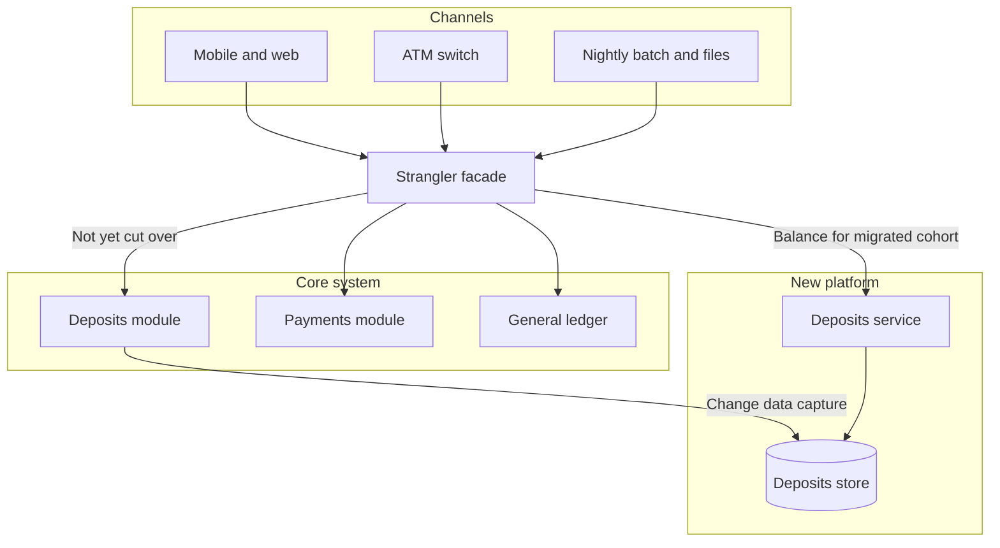

The strangler fig grows around a living tree, takes over the canopy, and eventually stands on its own. The software pattern does the same to a system you cannot stop. You place a facade in front of the old core, intercept slices of behavior, replace them one at a time, and retire the old module when nothing important still calls it. It is the rewrite approach I will sign for a core that still takes money, posts a ledger, or sells a seat. A weekend cutover of a banking core, a reservation system, or a billing engine fails in a familiar way: the dual-run lasts longer than the plan, the cutover window does not fit the batch cycle, and the business keeps the old system because it is the one that still matches the contract.

## Concept

A strangler is the new edge of the system for the life of the migration. It is not a temporary proxy you will delete in six weeks. Every request, batch job, and partner callback that used to hit the legacy core now hits a facade you own. That facade decides, per capability and often per customer cohort, whether the old implementation or the new one answers. The old system keeps running. The new system takes territory in slices a product owner can name, observe, and roll back.

### The facade is the program

If you do not control the edge, you do not yet have a strangler. You have a new system that a few channels use, while the channels that carry the revenue still talk to the core directly. In a bank the facade has to sit in front of mobile, internet banking, the ATM switch, the branch, and the partner APIs. A new web app is one channel. In a retailer the list is web, mobile, store systems, and marketplace feeds. The routing rules are the program plan, and they need tests, traces, and an owner.

Routing starts coarse and becomes finer. A first slice might send balance inquiry for staff users to the new service while everyone else still reads the mainframe. The cohort grows. The write path for that same capability moves later, because writes create the records the reads must see, and because rollback of a write slice is a data problem as well as a routing problem. URL routing is enough for a web monolith with a reverse proxy. Capability routing, by product, transaction type, and customer segment, is what a core actually needs.

The facade stays boring on purpose. It authenticates, routes, translates protocols, and emits traces that say which implementation answered. Business rules stay in the old module or the new service. A facade that grows its own domain model becomes a third system, and you will be strangling that one next.

### Slices that include their data

A slice is a behavior with a boundary you can reconcile: a balance inquiry, a card authorization, a change of address, a statement. The slice includes its data. Moving the API and leaving every write on the legacy database is a new door on the same room. Teams feel faster for a quarter, and then every new field still waits on a copybook change in the core.

Early slices should be frequent, observable, and politically visible, with a read bias: balances, search, case history. They teach deploy, shadow, rollback, and on-call without betting the general ledger. Interest accrual, the ledger itself, and any posting a regulator treats as an invariant move later, after the facade, the pipeline, and the reconciliation are real. If the first slice is the hardest invariant in the bank, the program will stall before it has learned how to route.

Data is the slow part, and it needs a single story per record. Which system is the source of truth. How the other is fed. How you notice they disagree. Dual writes from the facade look simple and split under concurrency. Change-data capture from the current owner into the new store is the usual first bridge. When the new service starts to own writes, the bridge reverses, and an anti-corruption layer keeps the legacy schema from becoming the new model. Reconciliation jobs are how you know the slice is attached to the same balances the finance team will sign.

### Shadow, cutover, and the last slice

Before a slice takes live traffic, it should see live traffic in shadow. The facade sends the request to both implementations, returns the old response, and records the difference. Shadowing finds semantic drift that unit tests miss: rounding, holiday calendars, an overdraft rule, a product code that means something else in one portfolio. A slice with an unexplained diff does not get a cohort.

Cutover stays reversible for a period you declare in advance. The flag that sent ten percent of balance inquiries to the new service must send them back in one change, without a data rewrite, for as long as the old system is still maintained as source of truth. Once the new store owns the writes and the old tables stop receiving updates, rollback is a restoration project. Say which side of that line you are on. Teams get hurt when they talk about a flag flip after the flag can no longer restore the contract.

Retiring the old module is a dated piece of work with an owner and a way to find the last caller. Strangler programs die in the last few percent: behavior that is awkward, lightly used, and still licensed. The core stays staffed and stays in the incident rotation. If you cannot name the last slice at the start, you are running two systems and calling it a migration. A partial strangler can be an honest architecture. It becomes dishonest when the slide still says the core will be gone.

## Trade-offs

| Approach | When it wins | Cost / risk |
| -------- | ------------ | ----------- |
| Big-bang replacement beside the core | A new product with no shared ledger, and leadership that will hold a hard cut | Missed dates and missed parity on any regulated, long-lived core |
| Strangler by HTTP route | A channel-centric system whose edge is already a reverse proxy | Batch, files, message queues, and branch devices keep writing to the core |
| Strangler by capability and cohort | Mixed products and a long tail of customer types | The routing matrix becomes a product, with its own tests and on-call |
| Modularize the monolith, then extract | You still understand the core and can enforce module boundaries | Cleanup can run for years and never change the runtime you pay for |
| Dual-write from the facade | A short window where both stores must accept the same write | Split brain, ordering bugs, and a rollback that is no longer a flag |
| CDC from the current owner, plus reconciliation | Legacy remains source of truth for a while and you can read its log | Lag, transformation bugs, and a pipeline coupled to the legacy schema |

Duration is the cost program plans undercount. An eight-year strangler can be the right outcome for a core bank, and it is also eight years of dual running and a facade team that can bottleneck every change. Keep a burn-down of slices and a date after which an unmoved slice is scheduled or admitted as permanent.

Parity is the other budget. Old cores encode exceptions that customers and regulators treat as the contract. Relocate the rule, including the ugly one, and change behavior later in its own release. If the migration is cover for a product rewrite, shadow diffs never go quiet and traffic will not move.

## Diagram

Every channel hits the facade. Balance inquiry for a migrated cohort is served by the new deposits service. Payments and the ledger still go to the core. Change-data capture keeps the new store aligned while the core still owns writes, and reconciliation reads both sides.

## Failure modes

### Channels that never entered the facade

**Detection.** Revenue and traffic reports disagree with facade metrics. A partner file, a branch terminal, or a scheduler still writes straight to the core. Rolling back a route does not restore behavior, because the caller never used the route. Incidents get debugged twice, once in each stack, and the second stack surprises you.

**Mitigation.** Inventory every entry point before the first slice: HTTP, queues, files, operational consoles, and vendor links. Put them behind the facade or write them out of scope. Stamp a synthetic transaction that only the facade can produce, and alert when the core sees the business event without that stamp. Revisit the inventory when a new partner is onboarded.

### Split brain during a dual write

**Detection.** Reconciliation breaks. A balance differs, a payment exists on one side only, an overdraft is applied twice. Support tickets clear when the customer tries another channel. Shadow diffs change with the order of two near-simultaneous writes, which is the hint that both sides accepted a command.

**Mitigation.** One source of truth per slice at a time. Prefer capture from the current owner over two live writers. If a dual write is unavoidable for a short window, make it an outbox with a single commit on the facade side, and keep that window smaller than the cohort expansion. Stop the second writer before you widen the flag.

### Shadowing that compared the wrong thing

**Detection.** The cutover looks clean in access logs, then finance or a regulator finds a rounding difference, a holiday calendar miss, or a product-code alias. The differ hashed status codes, or JSON field order, and never compared money, posting order, or the customer-visible balance.

**Mitigation.** Shadow at the level of the business invariant. For deposits that means balances, accrued interest, and the order of postings. Build a differ an accountant will sign, with an allow-list of residuals and an owner for each one. Keep a slice dark while any residual is unexplained, including the ones someone has labeled small.

### The permanent remainder

**Detection.** After several easy slices, the program only moves what is convenient. The core license is still paid. The people who understand accrual are still on call for the old runtime. The facade team is now a standing layer, and the target slide still shows an empty legacy box.

**Mitigation.** Name the last slices in the original plan, including the awkward ones, and budget them. If a slice will never move, change the goal from "retire the core" to "retire these modules" and stop spending strangler overhead on a fiction. Publish the coexistence cost so the remainder is a decision, not a drift.

## Real-world example

ING's public account of rebuilding a bank around customer journeys, while the previous platforms kept running, is the case I walk through when a team wants a new core and a weekend to do it.

The bank could not pause payments, cards, or deposits, and a regulator was not waiting on a target architecture. The work that matches this pattern is an edge the bank controlled, a movement of journeys onto new services in slices, and a long period in which the previous stack still owned whatever had not moved. That is a strangler even when the slides talk more about squads than about facades. The org change matters because a routing rule with no owner does not grow.

A deposits slice looks like this. Routing sits in front of every channel that can still reach the old module, not only the browser. You serve current-account balances from a service you own, fed by a pipeline you can diff, and you shadow balances rather than HTTP status. Staff first, then one retail market, then writes, and only then does the old read path go dark. Payments and the ledger wait for their own evidence.

The shape avoids a weekend cutover with one untested conversion. It still has to manage the eternal remainder and a facade that accumulates rules. ING's public emphasis on teams that own a journey, rather than a layer of the old core, is the organizational half of the same idea. If every slice needs a mainframe change, a new-service change, and a committee to move a routing flag, the fig does not grow. One owner for the route, the new service, and the reconciliation of that capability is the minimum that makes the diagram true.

A core migration needs an inventory of channels, a source of truth per slice, a shadow differ an accountant will trust, a reversible window, and a named last module.

## What to remember

- Put every channel through a boring facade; a file drop or an ATM path that still hits the core is outside the strangler.
- Move slices that include data ownership, shadow them against business invariants, and keep cutover reversible until the new system is the source of truth.
- Feed the new store from the current owner and reconcile; two live writers are how a strangler splits a balance.
- Name the last slice at the start, or say plainly that you intend to run two systems and budget the coexistence.
