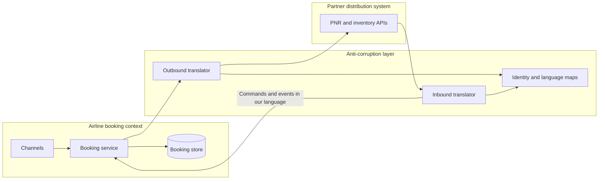

An anti-corruption layer is a translation boundary that keeps a model you own from being rewritten in the vocabulary of a model you do not. It is more than a polite rename of fields. At the boundary you convert identifiers, invariants, life cycles, and language, so the system you are building can keep its own ubiquitous language while it still has to talk to a mainframe, a global distribution system, an ERP, or a partner whose schema last changed in another decade. Skip the boundary and the foreign names leak into your tables, your APIs, and then into the way product talks. At that point the new runtime is a host for the old model.

## Concept

Corruption here is semantic, and it arrives looking like integration progress. A partner status of `C` might mean cancelled, closed, confirmed, or checked in, depending on the message type and the year the feed was written. Their customer identifier might be a concatenation of brand, country, and sequence. Their "order" might bundle shipments, invoices, and a loyalty accrual that you treat as three different consistency boundaries. Persist those shapes and every later feature becomes an archaeology project against someone else's dictionary.

### Four conversions, not a field map

A working layer does four jobs, and a mapper that only does the first half of one of them will not hold.

Identity comes first. Map their keys to yours and store the relationship in a table you own. Their composite key as your primary key makes their allocation scheme your availability story: when they recycle identifiers, change a checksum, or issue two ids for one real-world entity, your aggregates split or merge with them. The translation table is where that shows up, and it is where support looks before they open the partner's UI.

Language is the rename in both directions, including verbs. Their "void" might be your refund when money has moved and your cancel when it has not. Put the mapping in code with fixtures taken from production traffic, sanitized, and reviewed when the partner ships a change. A spreadsheet on an integration laptop will drift from the binary that is actually running, and the drift will look like a production incident with two plausible stories.

Invariants are the part a generated client will never enforce for you. Their payload can be incomplete, contradictory, or legal in their world and illegal in yours. The layer rejects the message, repairs it with a rule you can name, or parks it on an exception queue. A silent coercion, such as filling a missing currency with a home-currency default, writes a lie into your ledger. Money, status, and identity do not get a convenient default. They get a decision.

Life cycle is the last conversion, and the one that shows up after you start accepting updates rather than only pulling snapshots. Their entity may be mutable in ways yours is not, or it may skip states yours requires. A passenger name record can be changed by several agencies while your booking aggregate accepts changes only through commands you own. The layer decides which of their events become your commands, which are ignored as stale, and which go to a human because the two life cycles have diverged.

The layer is allowed to be lossy on the way in. You do not have to store every partner field. You do have to store every field your invariants depend on, and you need a written list of what you ignore, with an owner and a review date. The ignored field is the one that returns as a severity incident.

### Where the layer lives

Three placements show up in platforms that have lived with a hostile integration for years.

An in-process mapper is low latency and easy to leak. The day someone imports a generated SOAP or XML type into the domain package, the boundary is gone, even if a class named `Translator` still exists. I accept an in-process layer only when one service talks to the partner, the contract is stable, and the domain module is forbidden at compile time from seeing the partner types. An architectural test that fails the build on a forbidden import is part of the design, not a nice-to-have.

A dedicated service is the default at a boundary you will keep for years: a core banking host, a global distribution system, an SAP estate, a government gateway. It owns the translation tables, the partner credentials, the retry and timeout policy toward them, and the published language toward your services. You pay an extra hop and an extra on-call rotation. You avoid five teams growing five broken mappers that disagree about what status `C` means.

A worker on a feed fits file drops and change streams. The layer reads their extract or their log, writes your events, and stays off the interactive path. Latency-sensitive reads then hit your model only. This is the right shape when the partner's interface is a nightly file and someone is tempted to parse that file inside the request.

A few neighbors get confused with this layer, and the confusion causes the wrong team to own it. An API gateway routes, authenticates, and limits. A backend-for-frontend shapes a payload for one client. A strangler facade decides which system answers a request during a migration. Any of those can host a translation. None of them does the translation by existing. If the gateway team "owns integration," you will get connectors and you will not get a protected model.

### Conform, publish, or translate

Sometimes you should adopt their model at the edge and say so. A conformist relationship is honest when the partner is a much larger context, you will not own the concept, and their language is good enough for the slice you touch. Isolate that module from your core domain, name it after them, and add a real translation later if you grow your own model. The dishonest version is "we will just store their JSON," followed by six services that cannot change a field without a partner release.

A published language is the other way out. You and the partner, or you and several consumers, agree on a document you both treat as a product. Industry standards often play this role: payment messages, airline messaging, retail EDI. A translation layer still sits on your side of the standard. Two institutions can both claim the same standard and mean different things by the same element, and your invariants still have to be yours. The standard reduces the argument. It does not end it.

## Trade-offs

| Approach | When it wins | Cost / risk |
| -------- | ------------ | ----------- |
| In-process mapper behind a hard module boundary | One service, a stable partner, compile-time bans on partner types | One import leak and the domain compiles against their schema |
| Dedicated translation service | Many internal consumers and a partner that changes slowly or hostilely | Extra hop, and a risk that the service becomes a ticket queue for every connector |
| Conformist module at the edge | You will not own the concept and their model is adequate for the slice | Their outages, versions, and vocabulary become part of your edge |
| Shared kernel of types | Two teams truly share a small model and release together | Lockstep releases, and a kernel that grows until it is the system |
| Persist the partner payload as your model | A prototype you will throw away this month | Permanent corruption of tables, APIs, and the language of later features |

A central translation team turns into a ticket queue: every partner is "just another connector," and domain events become whatever that squad could parse this sprint. Own the layer from the context it protects. Two contexts that need the same partner can keep two layers, or one layer with two published languages, rather than one universal translator.

Versioning is a tax. Tolerate unknown fields, reject unknown semantics on the fields your invariants use, and pin tests to recorded fixtures. A mock you wrote yourself will only confirm the mock.

## Diagram

The booking context speaks only its own model. The anti-corruption layer owns the conversation with the distribution system: identity maps, both directions of translation, and the choice of which partner notifications become internal commands.

## Failure modes

### Partner types leaking into the domain

**Detection.** Domain packages import namespaces named after the partner or the generator. Columns show up as `PNR_STATUS` or the partner's internal customer number. Your mobile API echoes their enumerations. A code search of the domain module is the detector. The compiler will not save you if the types are on the classpath and someone was in a hurry.

**Mitigation.** One module or one service is the only compile-time consumer of generated stubs. Fail the build on a forbidden import. Persist your names. If a partner code must be retained for a round trip, store it in the translation table, not as the aggregate's status field.

### A lossy map that drops an invariant

**Detection.** The partner can represent a case you cannot: a split passenger, a residual in a second currency, a status that means "hold for fraud review." Support resolves it by looking at the partner UI. Your system shows a plausible state that is wrong, and the customer sees the plausible one.

**Mitigation.** Keep an explicit ignore-list with owners. For money, status, and identity, require a fixture round trip: their message in, your model, their expected message out. When you cannot represent a case, park it on an exception queue operated by people who can read both languages. Coercion into a default is how the ledger drifts a cent at a time until it is a finding.

### One deployable that translates the world

**Detection.** A single service holds maps for a dozen partners. Releases wait on the slowest partner change. On-call cannot tell which translation broke without reading a giant changelog. New domain teams wait in a backlog to "get a mapping" before they can ship.

**Mitigation.** Split by the context being protected, or by the partner being isolated, and match the split to the team that owns the invariants. Publish a language to your own services. Do not let them tunnel arbitrary partner calls through you. A tunnel is a gateway. A translation layer has a model on the inside.

### Both sides writing the same entity

**Detection.** You accept their update, apply it, send yours back, and they reject it or echo it. Clocks and last-writer-wins disagree. Duplicate downstream events appear after you start owning writes, which is later than the read-only phase that looked fine in the pilot.

**Mitigation.** One authority per entity at a time. While they are the authority, your outbound messages are requests, and their inbound messages are facts you translate. When you become the authority, their inbound updates are suggestions or are ignored except through a support tool you designed. Store a version or a hash so an echo is visible. Bidirectional "we both update the record" is how the layer loops.

## Real-world example

An airline's passenger system talking to a global distribution system such as Amadeus or Sabre is this pattern in the form the industry has lived with, in public, for decades.

The carrier wants a booking model it can change: a customer, a journey, a fare family, a payment, a set of ancillaries. The distribution system has a passenger name record, fare basis codes, special-service remarks, and an inventory notion that is not the seat map in the carrier's own app. Identifiers do not line up. A cancel on their side is not always a refund in the carrier's payment context. Two agencies can mutate the same record while the airline's mobile app believes it is the only writer.

Without a translation boundary, the carrier's services start storing the passenger name record as the aggregate. Status codes leak into customer APIs. Every feature needs someone who can read the partner's dialect. With the boundary, the booking context keeps its own identifiers and emits commands such as "hold this journey" or "ticket this journey." The layer turns those into the partner's verbs, maps the record locator onto the internal booking id, and turns inbound notifications into events the booking context already understands. Translation failures land on an exception queue staffed by people who speak both languages, rather than as a generic failure on the app.

A strangler decides which system owns the request. This layer decides how two models meet. A booking service that is only a veneer on the partner still cannot change the meaning of a status without a partner release.

The object that makes the layer real is the identity table: their locator, the airline record locator, the internal booking id, the ticket numbers. When those drift, airport, loyalty, and finance argue from different documents. The layer owns that table. A join rebuilt during an incident means you still have mappers, not a boundary.

## What to remember

- Translate identity, language, invariants, and life cycle; a field rename leaves the partner's model in charge of your data.
- Put partner types where the domain cannot import them, and own the layer from the context you are protecting.
- Keep one authority per entity so the two sides do not echo updates at each other.
- Store your own identifiers, and park the partner cases you cannot represent instead of coercing them into a default.
