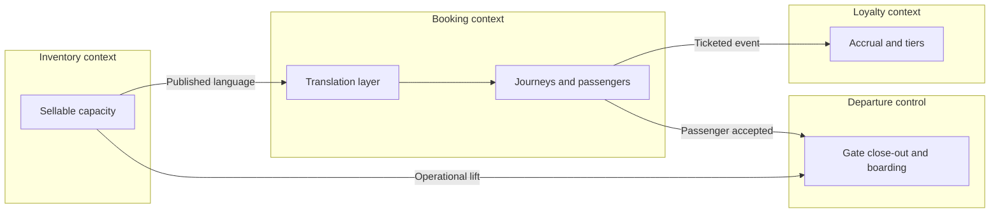

A bounded context is a boundary around a language and a model. Inside it, a word has one meaning, an invariant has one owner, and the model is allowed to be silent about everything outside. Across the boundary, the same English word may mean something else, and integration happens through an explicit relationship. Microservices that ignore the idea split a codebase and keep one confused model. Microservices that take it seriously split where the business already disagrees with itself, which is a much more stable seam than a table diagram.

## Concept

Teams reach for this idea after they have felt the pain in production. A `Flight` table grows to seventy columns. Half of them are null on any given row. A change to boarding logic risks the pricing job because both features "update the flight." That table is several models forced to share a noun. The work of bounded contexts is to give each model a place to be precise, and to make the translation between them visible.

### Language is local

In an airline, "flight" is at least four concepts, and the people who use the word already know which one they mean until software forces them to share a row. Scheduling means a definition: a flight number, a route, a season, an equipment type. Inventory means sellable capacity on an instance of that definition, on a date. Departure control means a live aircraft, a gate, a close-out, a list of boarded passengers. Loyalty means a credit tied to a marketed flight number that may belong to a different operating carrier. One entity cannot carry all four without every conversation becoming a translation nobody is doing out loud.

The ubiquitous language is the discipline of naming things the way the experts inside this context name them, and of refusing to reuse a foreign name without a mapping. It lives in the code, the events, and the database of that context. A glossary on a wiki that the code ignores is a souvenir. When a new engineer has to ask "which flight," the boundary is already leaking into the daily work, and the leak will show up as a defect that is hard to write a test for because both interpretations are locally reasonable.

### The context map is the architecture

Contexts are interesting together. The map of how they relate predicts incidents more reliably than the list of repositories.

Partnership means two contexts that succeed or fail together and can negotiate a protocol. Customer-supplier means an upstream that serves a downstream, with some ability for the downstream to ask for changes. Conformist means a downstream that takes the upstream model as it stands. An anti-corruption layer means a downstream that translates so the upstream model stays outside. An open host with a published language means an upstream that offers a protocol intended for many consumers. A shared kernel means a small model both sides compile against and therefore ship in lockstep. Separate ways means you looked at an integration and declined it.

Most distributed monoliths are an accidental shared kernel: a library of entities every service imports, plus a database someone still joins across "for the report." The map should show that choice in the open. Upstream and downstream, on this map, are about who may change a meaning. A pricing context that publishes fare events is upstream of booking even when booking calls back for a quote. Whoever can change the meaning of "fare" without asking is the upstream. Draw influence that way. A diagram of HTTP arrows will show you a call graph and will hide the coupling that actually slows a change.

### A context is a model, and a service is a deployable

They often line up, and that alignment is a good default, because one model with two teams and two deployables will drift. They do not have to line up on the first day. A modular monolith can host several contexts as separately compiled modules, with no cross-import of domain types and no cross-schema joins. For some companies that is the destination, because the operational cost of a network call is higher than the value of an independent deploy.

What fails is one service per table, or one service per REST resource, with a canonical data model in the middle so that "everyone agrees." Canonical models rebuild the seventy-column flight at the bus. A published language is smaller, specific to a relationship, and allowed to be awkward so the inside of each context can stay clean. The composite a mobile app needs is a backend-for-frontend or a read model. It queries several contexts. It does not become the place where "flight" is defined.

Team shape is part of the boundary. A context with two teams becomes two models unless they share a kernel on purpose and accept the lockstep. A team that owns three contexts will feed one of them and starve the others. I would rather merge two contexts that always change together than pretend a team of six owns an enterprise map. The test I use in a review is plain: can this context define its terms without reading the other context's tables? If it cannot, the boundary is a diagram.

### Seams you can hear

You do not find contexts by clustering nouns on a whiteboard. You find them by listening for disagreements about a word, for documents with different life cycles, for departments that can ship without asking each other, and for events after which a different group cares. A workshop such as event storming makes those disagreements visible. So does sitting with operations through a disruption. The people who reroute aircraft and the people who rebook passengers are not looking at the same flight, and a shared service will force them to.

A seam that exists only in software, a nice interface around a mess, is a module. A seam that exists in the business, with a different language, a different owner, and a different cadence, is a candidate context. Draw the second kind. You can always add a module inside a context. Pulling two contexts back together after you have split their data and their teams is much more expensive, so the early mistake to avoid is a service per noun.

## Trade-offs

| Approach | When it wins | Cost / risk |
| -------- | ------------ | ----------- |
| One context, one service, one team | A clear language, an independent deploy, incentives that match the model | Too many tiny contexts, chatty integration, and an operations load the team cannot carry |
| Several contexts inside a modular monolith | One team and one deploy, with honest boundaries in the code | Packaging discipline; a join or a shared type sneaks back in |
| Shared kernel | Two teams truly share a small, stable set of types and release together | Lockstep releases, and a kernel that grows until every change waits on it |
| Conformist on a strong upstream | The upstream is the business concept, such as a regulator schema or a distribution system | Their model colonizes yours, and their versioning becomes your roadmap |
| Contexts protected by a translation layer | You must integrate with a legacy or partner model you refuse to adopt | Translation cost, identity maps, and another runtime to operate |
| One canonical model for the enterprise | A reporting projection that is allowed to be stale and lossy | As a live integration model, it recreates the confused language on the bus |

Two contexts that always change together and share an invariant that must be immediate are one context you have made expensive. Merging them is a success. The more common failure in a large company is the opposite: "passenger service" is a department name, and inside it inventory, reservation, ticketing, departure control, and disruption handling still share tables. A new logo on that department does not create a boundary.

Every relationship on the map needs a contract and someone who wakes up when it breaks.

## Diagram

Four contexts in a passenger domain, with the relationships explicit. Inventory publishes a language. Booking consumes it through a translation layer so that distribution-system shapes stay out of the booking model. Departure control conforms to operational messages it does not own. Loyalty stays downstream of ticketing events.

## Failure modes

### Services named after nouns

**Detection.** The catalog reads like a schema: Flight, Passenger, Airport. Every feature needs an orchestrator that calls all of them. "Get flight" returns marketing fields, operational fields, and loyalty fields in one document. Teams negotiate column changes in a shared channel, and a boarding fix waits on a pricing review.

**Mitigation.** Split and rename along language: scheduling, inventory, departure control. Retire the generic flight service. If a screen needs a composite, build a read API that queries the contexts and owns no invariant. Watch the orchestrator. If it starts enforcing rules, it has become a hidden context with no boundary.

### One canonical document on the bus

**Detection.** A single schema, often with "enterprise" in the name, consumed by every service. A field change needs a committee. Consumers ignore most of the document. Producers are afraid to delete anything because they cannot see who still reads it.

**Mitigation.** Replace it with a published language per relationship: availability, boarding status, ticketing. Those documents may share a real-world reference, such as a flight number, without sharing an entity or a release train. Version each one on its own. Let the warehouse be the place where a wide, stale picture is allowed to exist.

### Separate processes, one database

**Detection.** Separate repositories, one schema, and reports that join "bounded" tables and then get called like APIs. A migration in one context locks a table another context needs for a payment path. The network boundary is real. The data boundary is not, so the failure domain is still the database.

**Mitigation.** Separate schemas with no cross-grants, and then separate databases when you can. Send reporting through a warehouse or a projection that is allowed to lag. If you cannot split the data, say that you have a modular monolith and enforce module boundaries there. Pretending otherwise trains the organization to route around the map.

### A map that the teams do not match

**Detection.** The slide shows four contexts. The org chart shows one team of twenty and a platform group that owns every API. Or eight teams live inside one context and break one another's names every week. Incidents have no owner because the boundary and the pager disagree.

**Mitigation.** Change the map or change the teams until one team can own one language. If the organization cannot move, reduce the number of contexts to the number of teams that can actually carry one. A paper boundary does not hold when the only person who understands two of them is on leave.

## Real-world example

Airline passenger servicing, the world of systems such as Amadeus Altéa and SabreSonic and of the carriers that operate beside them, is the example I use because the language collisions are public and the cost of getting them wrong shows up in a disruption, not only in a design review.

Weather closes a hub. Inventory sees capacity that is no longer sellable and has to stop taking bookings, then perhaps reopen later at a different number. Booking has to reaccommodate passengers onto other journeys, sometimes with a different fare, sometimes with a voucher. Departure control at an outstation still has an aircraft and a gate timeline. For them the flight is operating or it is not, and boarding is a process with a close-out. Loyalty has to decide whether the marketed flight accrues, whether the operated flight accrues, and what happens to an elite passenger who was bumped. Finance wants the issued ticket to remain a ticket, with a code that says the change was involuntary.

Those are contexts. They have different experts, different clocks, and different definitions of a good outcome. A carrier that puts one flight microservice in front of the passenger service system will ship a status page and then stall on disruption, because the service cannot speak all of those languages in one write model. A carrier that draws the map treats inventory as an upstream with a published availability language, booking as a context that protects its journey model from both the host and the distribution system, departure control as a context that may conform to operational messages, and loyalty as a downstream of ticketing. The disruption becomes a sequence of events across boundaries: inventory closed, passengers rebooked, gate delayed, accrual adjusted. It does not become one distributed transaction on a shared flight row.

You will argue about whether a flight identifier in a boarding message is a scheduled definition, an operational tail, or a marketed number. That argument is the map. A single model that every expert waits on is the more expensive design.

## What to remember

- A bounded context is a language boundary; when experts disagree about a word, you are looking at two models sharing a noun.
- Draw the relationships explicitly, because the map predicts coupling more honestly than the list of services.
- Align teams and data with the model; separate processes on one schema are still one failure domain.
- Split along seams you can hear in a real disruption, and merge contexts that cannot define a term without each other's tables.
