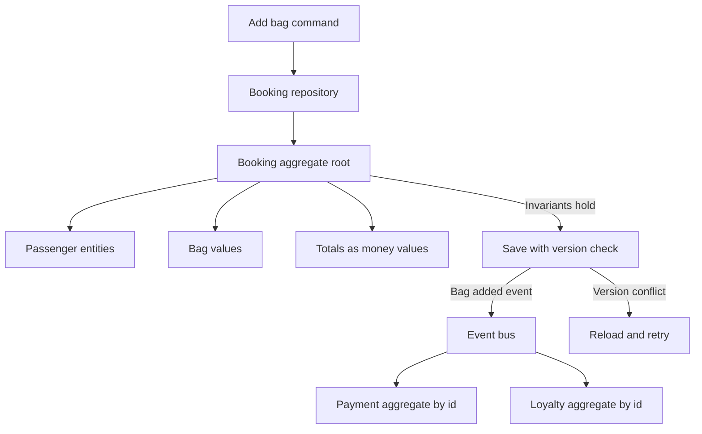

An aggregate is the cluster of domain objects the business changes as one unit. You load it, you run a command against it, and you persist it as a single consistency boundary. Inside the boundary, invariants hold before you acknowledge the command. Outside it, other aggregates are referenced by identity and catch up later, usually by reacting to an event. Size the boundary badly and you either drop an invariant, because the graph is too small, or you create a hotspot, because the graph is too large. A large share of "we tried this and the system got slow" stories are one oversized aggregate mapped through an object graph that joins the world on every save.

## Concept

Entity, value object, and aggregate are rules about identity and about what must be true at the moment you say yes. They are not a set of base classes to sprinkle through a project. If the rules are only in a diagram, the database will keep accepting writes that violate them, and the diagram will not page anyone.

### Entities and value objects

An entity has an identity that survives changes to its attributes. A customer who updates an email address is the same customer. A booking that gains a bag is the same booking. Equality is the identifier. Comparing every field will tell you that two revisions are different objects, which is the wrong question.

A value object has no identity of its own. Money, a date range, an address as a snapshot, a seat designator on a particular cabin of a particular departure. Equality is by value. You replace the value rather than mutating fields from several call sites, which makes the invariant easier to see: the booking total is a money value the root recomputes, not a column three services increment. If the object-relational mapper wants a surrogate key on that value, the key is a persistence detail. It does not promote the value to an entity, and domain code should not start routing commands to it.

### The root is the only door

An aggregate is a graph with one root entity. Callers outside the boundary hold the root's identifier. They change a child by sending a command to the root. That restriction is the design. If any worker can update a line, a passenger, or a ledger entry directly, the invariants live in a convention, and conventions erode the first time a migration script "just fixes the row."

The root enforces the rules that span the graph, in the same transaction as the write, on the data it loaded. An order's quantities match what that order reserved. A payment's captured amount stays within what was authorized. A ledger account's postings respect the overdraft policy for that account. Children inside the graph may still be entities, when the rest of the system must name them later, or values, when they are a snapshot. A return flow needs a line identity. The price captured at purchase usually does not. Choose with the life cycle in mind, not with the shape of the current tables.

### How big the boundary should be

The consistency boundary is also a contention boundary. Everything inside is versioned or locked together. Everything outside can move in parallel, and can be briefly stale.

Too large looks like an order that contains payments, shipments, warehouse picks, and loyalty in one document. Adding a bag contends with a scan in the warehouse. You cannot scale packing independently of checkout. One version column becomes a hotspot, and two teams wait on one repository for unrelated changes. The save gets slower as history accumulates inside the graph, because every command loads notes nobody in this command needed.

Too small looks like an order and its lines as separate aggregates when the business rule says the total must match the lines before the command returns. Two transactions leave a window where the total is wrong. If that window is unacceptable, the line is inside the order. If a few seconds of lag is acceptable, and a policy can repair or reject, the line can be its own aggregate. The sentence I want in a review is: this is the smallest graph that can enforce the invariants that must hold before we acknowledge the command. Write the invariants down. For each one, ask whether it must be true at acknowledgement or true within a defined delay. The first list is the aggregate. The second list is events and other aggregates.

Across the boundary, pass identifiers. An order holds a customer id. It does not hold a customer object graph. If the command needs a credit decision, the handler asks a service and accepts that the answer can race, or it uses a credit snapshot recorded when the decision was made. A snapshot copied into the aggregate is often more honest than a live join you cannot lock.

### Persistence, concurrency, and queries

The aggregate is stored as a unit: a root row and its children, a document, or an event stream whose fold is the current state. Optimistic concurrency, a version or a stream revision, is the default. A conflict means someone else committed a command; you reload and decide whether to retry. Pessimistic locks belong where contention is expected and the business would rather wait than retry. That is rarer than teams assume, and it shows up on a small number of hot roots, not as a default isolation level for the schema.

A repository loads by root id and saves the whole aggregate. A screen that asks "every order due at this warehouse today" is a query. It reads a model shaped for that screen. Loading a thousand aggregates to paint a list will time out, and it will contend with the commands those aggregates still need to serve. If the only way to answer the question is to walk the write model, the read model is missing, and adding indexes to the aggregate tables will only postpone the incident.

Event sourcing is one way to persist an aggregate, useful when the business cares how the state was reached and you are willing to operate snapshots and projections. A document or a relational mapping of the current graph is enough when the current state and a separate audit log answer the questions you have. Choose persistence from the questions. A fashion for streams will not fix a boundary that is the wrong size.

## Trade-offs

| Approach | When it wins | Cost / risk |
| -------- | ------------ | ----------- |
| Small aggregates and eventual consistency between them | High contention, independent scaling, invariants that can lag by a defined amount | More policies, more "not yet" states, and a user experience that must tolerate delay |
| A larger aggregate with immediate invariants | Money movement, inventory reservation, any race that would corrupt a promise | Hotspots, coarse contention, and a painful split once the document is huge |
| One document per aggregate | The graph is a natural tree and you always load it whole | Unbounded growth if history and notes stay inside the document |
| An event-sourced aggregate | An auditable life cycle and many reconstructions of past decisions | Snapshotting, projection lag, and a harder path for ad hoc questions |
| A lazy object graph from an ORM | A prototype where the team is still finding the invariants | Hidden queries in the command path, and invariants that pass only when the cache is warm |

Commands and deployment have to agree. A single-threaded handler for one aggregate is easy to reason about. Horizontal replicas need either affinity, so that one owner handles a given root, or optimistic concurrency with a retry policy that is safe. Hot roots, a flash-sale inventory pool or a concert section, often need the boundary redrawn: many small inventory aggregates, per warehouse or per section, rather than one global counter every click contends on. The invariant "do not promise more than this pool holds" stays immediate. The invariant "every pool in the world agrees" becomes a policy, with a lag you name.

## Diagram

A command to add a bag loads the booking aggregate, checks invariants on the root, and saves with a version. Payment and loyalty are other aggregates. They learn about the change from an event, addressed by identifier.

## Failure modes

### The aggregate that became the business

**Detection.** Saves get slower. Version conflicts spike on features that do not share a rule. The document is hundreds of kilobytes. Two teams block on one repository. A small command still loads shipment history and free-text notes. Conflict graphs show two commands colliding that never read each other's fields.

**Mitigation.** List the invariants and move out anything that can lag. Archive history into a read model. Keep decision snapshots, such as the price and the policy version, instead of live references to other contexts. Split when two hot commands do not share an invariant. Measure conflict rate per command so the split is driven by contention you can see.

### Rules that live in application services

**Detection.** Entities are bags of fields. Three services mutate lines and recompute totals in three ways. Discounts apply twice, or not at all, depending on which endpoint the client hit. Tests construct the service and never the root, so the rule has no single place to fail.

**Mitigation.** Put the invariant on the root as a command method. Application code loads, calls, saves, and publishes. When two use cases disagree about a rule, that disagreement belongs in the domain model, resolved once. If the root method is a pass-through to a service, the boundary is still anemic and the next bug will land between the pass-throughs.

### A transaction that writes two roots

**Detection.** A handler opens one database transaction over two aggregates, or reaches for a distributed transaction across services. Failures leave compensating code that is unsafe to run twice. Design reviews keep ending on "we need a transaction" because the invariant was drawn across a network.

**Mitigation.** Accept a defined lag, or redraw the boundary so the invariant sits inside one root. Publish the fact the second aggregate needs through an outbox, so the event commits with the first write. When a lag is truly unacceptable, such as two accounts in the same book that must move together, model the consistency boundary as the book or as a transfer aggregate. That is a throughput choice. It is a better choice than an ad hoc two-phase commit wrapped around two services that were split for the wrong reason.

### Children addressed as if they were roots

**Detection.** Public APIs accept a patch on a child id and skip the root. Mappers lazy-load associations after the command has already returned success. Defects appear only when the persistence cache is cold, which is why tests on a warm laptop stay green.

**Mitigation.** External APIs name the root and the command. Load the graph the command needs up front, and keep lazy loads out of the command path. If a child must be addressed from outside, treat it as its own aggregate and accept the invariant you can no longer enforce in one write. Hidden reach-throughs give you neither the small boundary nor the safe large one.

## Real-world example

Amazon's retail order path is the public system that shows these boundaries under contention. The company does not publish a domain-model textbook of checkout. The shape of the path is visible anyway, in how place-order, inventory, payment, and fulfillment fail independently and scale independently.

An order at that volume cannot be one object that includes catalog truth, payment capture, a fulfillment-center pick, last-mile tracking, and recommendations. Those change at different rates, on different fleets, with different failure modes. The consistency a customer needs at the moment of "order placed" is smaller. This cart. These prices as quoted. This payment authorization. This reservation against sellable quantity in a pool that can actually ship. That cluster is the checkout aggregate. After the order is placed, fulfillment is allowed to run behind. A warehouse does not open a transaction on the checkout store to mark a unit picked. It has its own aggregate, a shipment or a package, keyed by the order id, reacting to events and publishing its own.

Inventory shows the same cut. One global count per SKU contends on every popular item. The practical boundary is inventory in a fulfillment node or a pooled region, with reservation as a command against that root. "We will not promise more than this pool can cover" is immediate. "The package is on a truck" belongs in a later aggregate.

Payment follows the same cut. Authorization participates in the place-order decision. Capture and settlement can lag. If capture shared an aggregate with warehouse packing, a slow pack would lock a financial write, and a financial retry would lock packing. Those roots are separate because their contention and their invariants are separate.

The review question is the smaller version of that split. What must be true before the customer sees "order placed," and what may catch up? The first list is the aggregate. The second list is other aggregates and the events between them.

## What to remember

- An aggregate is the smallest graph that can enforce the invariants which must hold before you acknowledge the command, and the root is the only door.
- Entities keep identity across changes; value objects compare by value, even when the database stores a surrogate key.
- Point at other aggregates by id, publish events for what can lag, and treat a transaction over two roots as a sign the boundary is wrong.
- Split hot aggregates along real contention, and serve lists from read models so commands do not load the world.
