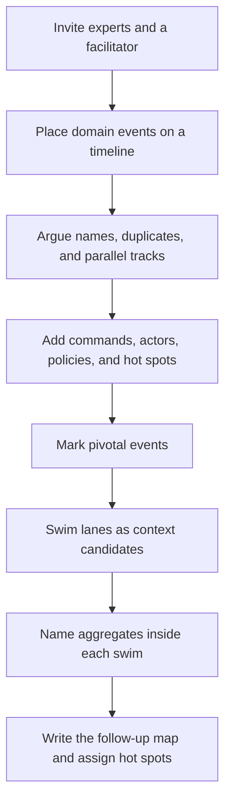

Event storming is a facilitated workshop that puts domain events on a timeline until the room can see the process, the arguments, and the places where language breaks. It is a modeling session with the people who live the exceptions. It is not a requirements interview, and it is not a drawing of microservices. Asking for things that happened, in the past tense, produces a more honest picture than a diagram of entities, because experts will argue about an event in a way they will not argue about a box. Used with care, a day of this work yields context candidates, aggregate names, and a list of hot spots that a slide review would have smoothed over. Used as theater, it yields a photograph of a wall and a backlog that never changes.

## Concept

The format spread because a day with the right people beats a month of analysis written by people who do not run the process. The room needs operations, product, risk, finance, and the engineer who gets paged. A room of only software staff will storm the system you already have, and will reproduce its tables as events. If the expert who knows the exception cannot attend, move the date. A smaller room with the right people is the workshop. A full room without them is a status meeting with stationery.

### Start with the big picture

A big-picture session is a timeline from a trigger to an outcome the business recognizes as finished. Payment initiated through to beneficiary credited and statement available. A passenger search through to boarded and accrual posted. People write events in the past tense, place them from left to right, and argue when two stickies are one event or when one name hides two meanings. Parallel tracks appear when two groups act at once. The wall will be messy. The mess is the input. A tidy wall at the end of the first hour usually means someone edited the argument out.

Other markers earn a place after the events exist. Commands are the requests that caused an event. Actors are who issued them, including policies and other systems, not only humans. Policies are the "whenever this, do that" rules that connect an event to a later command. Read models are what someone looked at before deciding. Aggregates, or consistency boundaries, get names when a cluster of events must not lie to each other. Hot spots mark disagreements, missing experts, regulations, and work that has never been automated. The hot spots are often the most valuable output. They are the architecture backlog, and they deserve owners before anyone discusses a broker.

Keep mechanisms off the timeline in this phase. A sticky that says the name of a log or a platform is a parking-lot item. Process first. The current integration diagram can wait until the language has survived an hour of argument. If it goes up early, the wall becomes the as-is system in a new color, and the experts check out.

### Zoom in only after the language holds

A design-level session takes one slice: one pivot, one candidate context, the commands and policies around a single consistency boundary. This is where a word like "payment" stops being a department and becomes a boundary. Which events live inside the payment aggregate. Which belong to fraud. Which are notifications that must never gate the ledger. You leave with command names that can become an API and event names that can become a contract, written in the experts' language.

A software-design session, when you still need one, adds the systems, the existing interfaces, and the constraints you cannot wish away. Run it after the language has settled. Otherwise the current operation names colonize the wall and you have redrawn the legacy integration with better facilitation. Remote sessions work when the tool is a spatial board people can move, not a spreadsheet of event names. The timeline has to be something the group can walk. Timebox the day. A big-picture session that runs for three days without a close turns into a support group, and the model never gets a curator.

### Pivotal events become the map

The architectural yield is the pivotal event: something happened, and after it a different language, a different owner, or a different service level takes over. "Payment released to the scheme" is often pivotal. Before it, initiation, fraud, and funds reservation are arguing. After it, the clearing scheme, settlement, and investigation are arguing, on a clock you do not control. "Ticket issued" plays the same role in an airline. "Inventory reserved" may or may not, depending on whether a reservation is a promise or a hope. The room's argument about that distinction is the modeling.

Swim the timeline at those pivots. Each swim is a bounded-context candidate. Name it from the events inside it, not from the org chart. Then sketch relationships: this swim publishes a language, that swim conforms, this one will need a translation layer because the events arrive in a vendor dialect. Aggregates fall out of clusters of events that must be consistent with each other. If the room cannot name the root, the cluster is still a soup. Record that as a hot spot. Do not paper over it with a service name.

### What you should not expect the day to decide

The workshop does not vote a microservice topology into existence. A context candidate can live as a module inside one deployable for a year, and that can be the right call. It does not produce a complete specification. Policies discovered on the wall still need their invariants written down, with the cases the stickies were too small to hold. It does not imply that you will store the business events as an event-sourced log. Finding events in the business and choosing a persistence mechanism are different decisions, and collapsing them is how a workshop becomes an expensive queue.

The day is also not free. Senior operators for a full day is a real cost. Spend it on a domain that is actually confused: payments with several regulators, a booking flow with a partner dialect, a claims process nobody can draw the same way twice. A simple create-read-update-delete application that everyone already understands will not repay the room. If you already agree on the language, go write the software.

## Trade-offs

| Approach | When it wins | Cost / risk |
| -------- | ------------ | ----------- |
| Big-picture event storming | Confused language, many actors, a legacy system beside a new one, a need for context candidates | Theater when the experts are absent, and a photo with no follow-up |
| Design-level storming of one slice | The context is already known and you need commands, policies, and a consistency boundary | Too narrow too soon, so upstream pivots never appear |
| User-story mapping | Delivery planning for a journey whose language is already settled | Will not surface two groups using one word for two meanings |
| A formal process model first | Compliance wants a diagram they already know how to sign | Freezes the current process and hides parallel work and hot spots |
| One architect draws the map alone | A tiny domain, an emergency, and you are genuinely the expert | Silent disagreement, and political seams that only appear when an expert is in the room |

Facilitation is its own trade-off. Heavy facilitation keeps the wall readable and can silence the quiet expert who knows the fraud exception. Light facilitation lets the chaos teach and can end with a wall nobody can read back. I want a facilitator who is not the owner of the domain outcome, a visible parking lot for mechanisms, and a read-back every hour by someone who has not yet spoken. That read-back is where you learn whether the timeline is a shared model or one confident person's story.

Paper versus a digital board matters less than who showed up. Paper carries energy when everyone is in one building. A digital board is the practical option when operations sit in three countries. On a digital board, appoint someone to garden the timeline or the events will scatter into columns nobody walks. In either medium, end the day with the wall captured, the hot spots named, and a date for the follow-up map. The medium is a detail. The missing expert is the risk.

## Diagram

The workshop is the flow. Events come first. Commands, policies, and hot spots come next. Pivots become context candidates. Names of infrastructure stay off the timeline until the language holds.

## Failure modes

### A software team storming the software

**Detection.** Events are named after tables and endpoints. Nobody in the room can explain a regulatory exception or what happens when a scheme rejects after you have told the customer success. Every hot spot is technical. The wall looks clean before lunch, which is the warning, not the success.

**Mitigation.** Reschedule if operations, risk, or product cannot come. Give experts permission to contradict the current system. When they say the screens are wrong and the real process is something else, that belongs on a hot spot with their name on it. Capture their verbs. Leave the table names in the parking lot.

### A timeline of generic updates

**Detection.** The wall says created, updated, and deleted for every noun. No policy can be written, because "updated" means everything. Two tracks turn out to be the same write from two user interfaces, and the room has spent an hour distinguishing them.

**Mitigation.** Refuse the generic verb. Ask what happened in the business, in the past tense, specific enough that a policy can fire on it. Beneficiary screening failed. Seat released back to inventory. Overdraft limit breached. If the experts cannot get more specific, you have either a genuinely simple domain or a missing expert. Both are worth knowing before you design a service.

### No artifact the following week

**Detection.** The only record is an image in a wiki. Sprint plans still follow the old service list. The next session starts from a blank board because nobody curated the first one. Hot spots have no names next to them.

**Mitigation.** Close the day with the timeline captured, a hot-spot list with owners, and a first context map drawn from the swims. Within a week, turn pivotal events into named contracts or into spikes that are actually on a backlog. Assign a curator. If the backlog did not change, the workshop was a retrospective with extra steps, and you should not book another one until that is repaired.

### Infrastructure arriving in the first hour

**Detection.** Topics, consumer groups, and a platform proposal are on the wall by mid-morning. Domain experts have gone quiet. The argument is about partitioning and retention. The events, when you read them back, are the names of the topics.

**Mitigation.** The facilitator moves technology to the parking lot and keeps it there. Run a separate session for the software constraints after the language is stable. If engineers are anxious about how the work will be built, give them a timeboxed final hour. Give the domain the rest of the day. A platform decision made before the pivots are known will be shaped by the current topics, which is the coupling you were in the room to see.

## Real-world example

Banks that have talked publicly about domain-driven design, squads aligned to customer journeys, and event-driven integration, ING among them, still had to make a payments slice concrete. The workshop is how that slice gets a language. Splitting a monolith by table does not.

Take credit transfers, including instant payments, as the room. Invite a payments product owner, a fraud analyst, someone from operations who handles investigations, a ledger engineer, and someone from the channel the customer actually uses. Do not fill the room with platform specialists as the primary voices. They will have a later session, and it will be better because this one happened first.

The timeline starts when a customer initiates a payment: initiated, beneficiary screened, balance reserved, accepted, rejected, forwarded to the scheme, acknowledged, beneficiary credited, customer notified, investigation opened. Within the first half hour the room fights over "accepted." Operations means the bank has taken on an obligation. Fraud still unwinds some payments after that. The ledger says nothing is posted until a different event. The hot spot is that one word was three events: fraud cleared, funds reserved, payment released to the scheme.

Pivots appear where the owner and the clock change. Release to the scheme means you are now talking to an external clearing system, with its latency, its rejects, and its investigation rules. An investigation opening means a different model of the same money, with a different owner and a longer life than the original instruction. Swim lanes become candidates: initiation from the channel, a decision context for fraud and limits, the ledger, scheme connectivity, customer notification, and investigations. Aggregates get tentative names. A payment instruction that must not change its beneficiary after release. A reservation against an account. A case in investigations. Policies appear in the experts' own if-then form: when the scheme rejects and you are unsure whether money moved, release the reservation and open a case.

The day pays off when squads own the swims and integration sits at the pivots, with no shared payment table every swim updates. Draw that map, refuse a single payment service that swallows every swim, and keep the hot spots on the program board until product or risk closes them. A status enum that recreates the overloaded word wastes the workshop. One pipe for every payment event moves bytes and leaves "accepted" meaning three things. The transport can wait until the model has names.

## What to remember

- Put past-tense business events on a timeline with the people who handle the exceptions; a wall of generic updates from engineers will rediscover the current schema.
- Mark pivotal events, swim them into context candidates, and name an aggregate only where immediate consistency is actually required.
- Park infrastructure until the language holds, then leave the day with a map, hot-spot owners, and backlog changes in the same week.
- The workshop chooses a model and a map; it does not choose event sourcing, and it does not choose a deployable per sticky.
