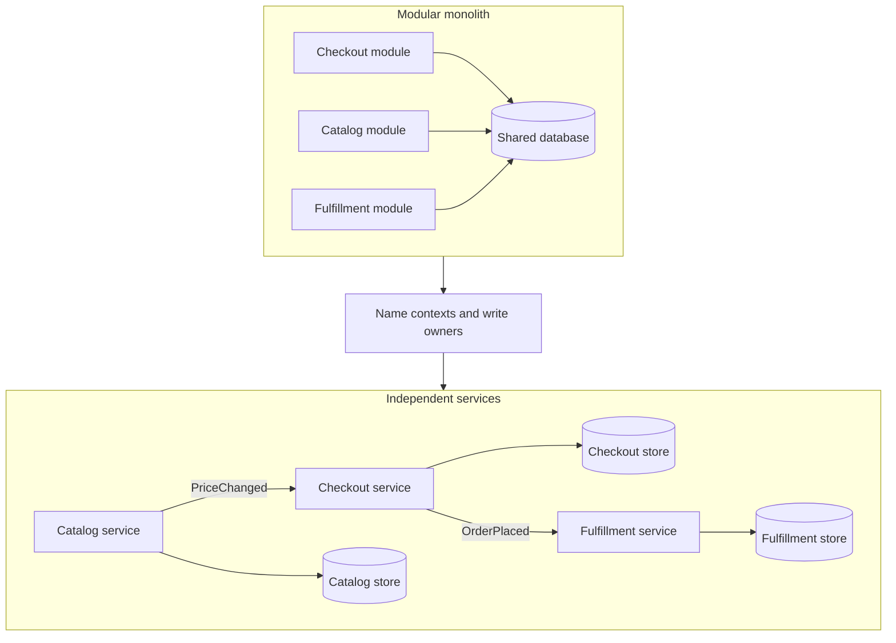

Decomposing a system into services is a decision about which dependencies you are willing to make remote, which data you are willing to replicate, and which teams you are willing to let ship on independent clocks. A clean seam lets a domain change, fail, and scale on its own. A sloppy seam collects the latency and partial-failure cost of a distributed system while the release train stays intact. I treat service count as something you observe after the seams are honest, and I send back any design review that opens with a target number of deployables.

## Concept

### A boundary cuts four things at once

A service boundary is a cut through the domain model, the data, the runtime, and the organization. All four have to move together. A new process that still shares a database, a release calendar, and an on-call rotation has added a network hop and left the coupling where it was. The useful question in a review is which behavior must be able to change, fail, and scale without dragging the rest of the estate with it.

Size follows from that question. A payment authorization service can be a few thousand lines and still be the right deployable, because its consistency rules, audit trail, and scale profile differ from catalog browsing. A fulfillment domain can stay a large modular codebase behind one deployable when picking, packing, and shipping share one invariant. The unit of decomposition is the unit of independent change.

### Bounded contexts are the primary seam

The most reliable cut is a bounded context: a linguistic boundary where a word keeps one meaning, and a different word appears when the meaning changes. Checkout's order is a commercial commitment with payment and fraud. The warehouse's order is a set of pick tasks and carrier labels. Billing's customer is an account with tax identity. Support's customer is a case history. When two teams argue about a field on a shared record, the argument is evidence of a missing context, and the fix is a mapping, an event, or an API.

Inside a context, modules are welcome. Across contexts, integration is explicit. Entity classes stay local. Joins across another team's tables stay forbidden. A practical test I use with new engineers: can they explain the context's language without pointing at another team's schema? If the explanation needs the neighbor's tables, the boundary is still a wish.

### Capability, subdomain, and write ownership

I apply three heuristics in order, and I stop when one of them is dishonest.

Business capability asks what the company does: take payment, price a ride, render a storefront, underwrite a claim. Capabilities map cleanly onto team missions and SLAs. They mislead when a program manager's org chart has glued unrelated models under one name.

Subdomain classification asks where uniqueness lives. Core domains deserve the modeling investment and the most careful boundaries. Supporting domains should be good enough. Generic domains — authentication, email delivery, PDF rendering — should be bought or extracted as platforms, and they should stay out of the product's ubiquitous language.

Write ownership is the enforcement mechanism. A service that does not own its writes is a function with a REST badge. Ownership means one team is the only writer, the schema evolves on that team's clock, and everyone else reads through an API, an event, or a replica they treat as read-only. Two deployables issuing inserts against the same table means the decomposition is unfinished, regardless of how many Kubernetes objects exist.

### Volatility, teams, and what you split last

A boundary that isolates a fast-changing policy from a stable core is often worth more than a textbook domain cut. Rate cards, promotion engines, tax rules, and ranking weights change weekly. The ledger does not. Putting the volatile policy behind a versioned interface lets the stable side sleep through the experiment cycle. The condition is real isolation: if the volatile piece must join the stable piece inside one transaction on every request, the network hop has been added to the hottest path and the volatility has stayed coupled.

Conway's law is a physical constraint, so team topology belongs in the same decision. Two teams that must merge every pull request do not have two services. One team that owns twelve processes which always deploy together has a distributed monolith with extra YAML. The Inverse Conway Maneuver is deliberate: shape the team around a context, then draw the deployable to match. On-call is the honesty metric. A page for "the checkout flow" that requires four teams on a bridge means the runtime boundaries and the human boundaries disagree.

User journeys, reports, and workflows will cross services. That is ordinary. What you leave intact, until you have an explicit saga, is the transaction that enforces an invariant. Data that is only ever consistent as a pair should stay in one write owner. I also delay cuts along technical layers — a frontend service, a business-logic service, a database service — because those cuts follow specialist org charts and produce chatty, anemic systems. A Backend-for-Frontend at the edge is an adapter. The domain stays vertical, with its own data and its own stack.

## Trade-offs

No single heuristic wins everywhere. The table is what I put in the review; the paragraphs are the stories the cells cannot hold.

| Approach | When it wins | Cost / risk |
| -------- | ------------ | ----------- |
| Bounded-context cuts | Several models of the same noun; long-lived product domains; a team that can own a language | Slow to identify; easy to cargo-cult; mapping layers are real work |
| Business-capability cuts | Value streams, SLAs, and cost centers already exist | Org-chart capabilities that are holding pens; data ownership left implicit |
| Volatility cuts | Policy, ranking, pricing, and experiments against a stable core | Catch-all "rules" services; policy that still needs a single transaction with the core |
| Team-topology cuts | Team boundaries and pagers are already honest | Frozen Conway accidents; small teams that still share a database |
| Technical-layer cuts | A BFF or a data platform at the edge, almost never as the primary cut | Anemic entity services, chatty calls, a distributed monolith |

Bounded-context cuts are my default for a system that will live more than two years. They cost modeling time up front and they keep a `CustomerService` from becoming a dumping ground for every team that needs a column. Budget the mapping: anti-corruption layers, published events, versioned APIs. A shared library of entities is a postponed argument, and it will return as a fleet-wide upgrade.

Capability cuts are faster when the business already speaks in value streams and the monolith was built along those streams. Watch names like Platform, Shared, and Core Services. Those names usually mean nobody found a context and invented a holding pen.

Volatility cuts are a scalpel. Peel a rules engine or a ranking model off a stable domain with a versioned contract. If every request still needs both sides in one transaction, keep them together and vary the policy with data or a plugin inside the process.

Team-topology cuts are honest about Conway. They fail when the org is wrong. Another deployable will not repair a team that cannot own the data and the pager. Technical-layer cuts stay a hard no as the primary strategy. A BFF and a data platform are legitimate edges. They are the wrong place to put the company's writes.

## Diagram

The picture I want on the wall is the sequence of cuts: name the contexts, assign write owners, then give each context its own store and its own release. Cross-context communication is an event or an API. Writes land in the owner's database.

## Failure modes

### Entity services

Customer, Order, Item, and Payment became deployables because they were tables. Every page now fans out to four services, and no service owns a business invariant. Detection: the sequence diagram of a hot endpoint is a chain of GETs whose length tracks the number of tables. The p99 is the sum of those tails, and a feature request always starts with a cross-team RFC.

Mitigation: collapse the entity services back into the capability that owns the workflow. Keep a payment service when payment is a real context with its own ledger, audit, and failure modes. Merging an anemic cut is cheaper than living with it, and it should happen in the same quarter you notice the fan-out.

### Shared database after the split

The network appeared and the schema stayed common. Teams add columns, join across foreign data, and block releases on migrations. Detection: one database credential in several secret stores, foreign keys that cross team boundaries, and query logs where service B selects from service A's tables. A migration in repo A that must land before repo B can start is production proof.

Mitigation: break write ownership first. Replicas, events, and read APIs follow. A strangler that leaves the database unsplit has renamed the monolith.

### Chatty orchestration

A new process manager calls ten services synchronously to finish one business action. Latency is the sum of tails. Availability is the product of dependencies. Detection: the orchestrator's p99 is dominated by downstream time, a single timeout pages the whole journey, and deploying the orchestrator requires coordinated contract tests against everyone.

Mitigation: move the workflow into the service that owns the invariant, or run an asynchronous saga with explicit compensations and a short step list. Replacing an in-process call with HTTP is a transport change. It becomes architecture when the timeout, the bulkhead, and the owner are named.

### Premature extraction

The first domain diagram became a fleet, and the following year is spent moving fields back across APIs. Detection: a high rate of "sync this field" tickets, anti-corruption layers that contain most of the logic, and services renamed twice in twelve months.

Mitigation: start in a modular monolith with module-level ownership. Extract when a module has a stable language, a clear write owner, and a reason to scale, fail, or release on its own. Pay the modularization cost inside one process. It is cheaper than an API you will delete.

## Real-world example

Uber's public account of Domain-Oriented Microservice Architecture is the large-scale decomposition story I walk teams through, because it includes the second decomposition, the one you pay for if you skip the first.

Early Uber services clustered around marketplace capabilities that really do differ: dispatch matches rider and driver under a tight latency budget, trip owns the lifecycle of a ride, payments carries audit and money movement, maps and pricing have their own scale and change rates. Those cuts matched how the company made money. Dispatch's correctness profile is unlike catalog browsing. Payments' consistency profile is unlike a map tile. Splitting them was the right first move.

The later failure was grain. Service count outran team grain. A fare experiment touched pricing, trip, payments, and a scatter of supporting services, and no single place owned the language of a fare. Engineers spent their week in coordination. The estate had the topology of a distributed system and the change coupling of a monolith.

DOMA regrouped services into domains — collections around a business context — with a domain gateway as the facade. Product domains sit on infrastructure domains. Extensions let a product customize a domain without forking it. The architectural move is the one this essay argues for: the unit of decomposition is the context, the write owner, and the team that can ship it. Uber still runs many processes. The process stopped being mistaken for the domain.

The lesson I take into reviews is portable at any scale. If you optimize for service count and skip the context and team cuts, you will eventually run a second decomposition, this time of your microservice estate, under load. Do the first one on purpose.

## What to remember

- A service boundary cuts model, data, runtime, and team together; a new process with the old database is still one system.
- Bounded contexts and write ownership are the primary seams; size is a consequence you measure afterward.
- Stay in a modular monolith until a module has a stable language and a reason to release, fail, or scale alone.
- Entity services, shared databases, and synchronous orchestrators are how a decomposition fails quietly.
