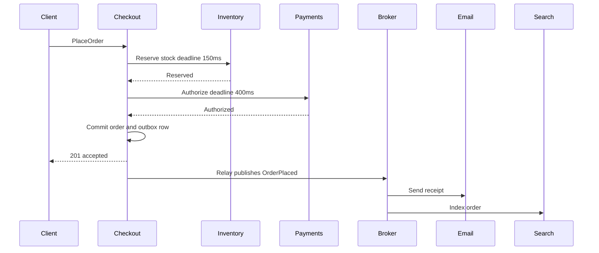

The architecture of a call between services is whether the caller must wait, whether the callee must be up at the same instant, and what happens to the user's request when a dependency is slow or gone. REST, gRPC, and Kafka are transports that follow that decision. Synchronous and asynchronous communication are two contracts with time, capacity, and failure. Mixing them without naming the contract is how latency budgets disappear and how dual-write bugs are born. When I review a design I ask three questions before I ask which library: does the user need this result to render the next screen, must both services be healthy together, and if the callee is down for ten minutes should the user fail or should we take a ticket and drain it later?

## Concept

### Temporal coupling

Synchronous communication couples the caller's progress to the callee's progress. The request occupies a thread, a goroutine, or an event-loop slot until a response or a deadline arrives. The user is still waiting. Asynchronous communication records intent, usually by appending to a durable log or queue, and continues. Someone else processes that intent on a different clock. The user may already hold a 202, a job id, or a screen that says the request was accepted.

Non-blocking I/O does not change the contract. A service can await a gRPC call without blocking an OS thread and still be synchronous in the architectural sense: the request cannot complete until downstream completes. A service can publish to Kafka with a blocking producer and still be asynchronous: the business transaction is "accepted for processing." I separate those phrases in reviews because teams use "async" for both and then discover they still have a user waiting on a chain of RPCs.

### Synchronous request-response

The mechanics resemble a function call. Service A opens a connection, sends a request, and waits. Deadlines should propagate and shrink at each hop. Retries are tempting and, on a non-idempotent write, dangerous. Load is live: A's concurrency is bounded by B's concurrency plus every call still inside its timeout.

The win is cognitive and transactional. The programmer sees a result or an error in one stack. Decisions that must happen now — authorize a card, check a session, confirm a seat is still free — belong here. The cost is multiplicative availability and additive tail latency. A homepage that calls twelve services in a fan-out inherits the worst of those tails unless it hedges, caches, or degrades. Capacity couples too: a spike on A is a spike on B with no buffer. Thread pools, connection pools, and downstream rate limits are part of the design. A sequence diagram that omits the deadline, the bulkhead, and the fallback is a happy-path sketch.

### Asynchronous messaging

The caller writes a message to a durable log or queue and treats that write as the handoff. Consumers pull at their own rate. Processing happens later. Backpressure shows up as lag. The user sees a 504 only when the product has decided that lag is no longer acceptable, which is a separate SLO from the publish itself.

The win is temporal decoupling. Checkout can accept an order at noon. Fraud scoring, search indexing, and email can run when they can. A failure becomes a retry against the log, and the user who closed the laptop is already gone. The cost is a new consistency model. There is no single moment when everything is done. Delivery is at-least-once. A poor partition key reorders work. Consumers must be idempotent. Support needs an answer to "where is my order?"

Asynchrony moves complexity from the request path onto the consumer, the schema, the replay story, and the progress UX. A design that cannot explain a poisoned message and a user-visible status has hidden the wait.

### Time, space, and failure

I keep three axes separate because designs collapse them.

Time: must both parties be live together? Sync says yes. Async says the broker and the disk must be live, and the consumer may be behind.

Space: do they share a process, a memory model, a database? An event that is a row from a shared table is still spatial coupling. The queue did not create a boundary.

Failure: does B's outage fail A's user? Sync fails the user unless a fallback exists. Async fails the user when the publish itself fails, or when the product cannot tolerate delay. A fire-and-forget HTTP POST with no persistence is a discarded error, and I do not count it as asynchronous design.

You can call a service synchronously and still own your own data. You can publish events and still be forced to deploy a schema with every consumer. The second case is a distributed monolith with a queue in the middle.

### Hybrids you will actually ship

Production systems mix the styles per interaction.

The user-critical path stays synchronous and short. Place the order against inventory and payment with deadlines. Emit `OrderPlaced` afterward for email, analytics, and the warehouse.

Request-reply over a bus publishes a command and waits on a reply topic with a correlation id and a timeout. The user is still waiting. You bought a worker pool and a buffer, and you still owe a deadline. I use it for bursty compute — thumbnails, PDFs, inference — where the spinner is acceptable for a few seconds.

The grown-up default for "change state and tell the others" is a synchronous transaction that writes business state and an outbox row together, then a relay that publishes asynchronously. The user-facing call stays sync. The fan-out stays async. The atomicity of state and intent stays inside one database commit. Dual-writing the database and the broker as two calls will diverge, and the outbox is how you stop promising that it will not.

## Trade-offs

Pick the style per interaction. A platform that calls itself event-driven and then synchronously queries five services to build each event has a style guide and a different architecture.

| Approach | When it wins | Cost / risk |
| -------- | ------------ | ----------- |
| Sync RPC | The user needs the answer now; one request can decide; operations stay simple | Tails add; availability multiplies; retry storms; capacity couples |
| Async one-way events | Side effects, fan-out, load leveling, work that can finish later | Eventual consistency; idempotency; progress UX; schema coordination |
| Async request-reply | Isolated workers with a user still waiting; bursty compute under a deadline | Still temporally coupled; correlation and timeouts; dead letters |
| Sync-over-queue RPC | An inherited bus-only estate that will not allow HTTP inside the perimeter | Waiting plus broker semantics; a weak debug story |
| Outbox then async fan-out | A synchronous write must become visible to other services | Relay lag; at-least-once duplicates; outbox growth |

Synchronous RPC wins for prices, authorizations, session validity, and "is this seat free?" Keep the fan-out small. Cache what you can. Give every call a deadline shorter than the user's patience, and a fallback that is allowed to be stale or empty. The failure mode is a fan-out of twelve dependencies with no budget.

One-way events win when consumers have different SLAs. Search can lag five seconds. Fraud review can lag five minutes. The ledger should wait on neither. The product language has to say "accepted" and the query path has to show progress.

Request-reply wins for CPU-heavy work behind a spinner. Put a timeout on the waiter. If you cannot, you wanted fire-and-forget and a notification later.

Outbox-then-fan-out is what I reach for whenever a synchronous write must notify others. The async part starts after commit.

## Diagram

Checkout needs a reservation and a payment decision before it confirms. Email and search can wait. The synchronous core stays short. The asynchronous fan-out can fail without un-charging the card.

## Failure modes

### Timeout amplification and retry storms

Synchronous chains amplify tails. A 100 ms p99 downstream, two retries, and a parent that waited too long become a multi-second user failure and a thundering herd. Detection: downstream QPS exceeds upstream QPS during incidents, retry metrics rise with 5xx, and thread pools saturate while CPU is idle. Clients that give up before servers finish are paying twice.

Mitigation: deadlines that shrink down the stack, bounded retries with jitter on idempotent reads only, bulkheads so one dependency cannot take the worker pool, and circuit breakers that stop a slow service from becoming everyone's outage. Hedge only when the dependency is replicated and cheap.

### Dual writes

The service commits, then fails to publish, or publishes and fails to commit. Detection: consumer lag looks healthy while a fraction of business objects have no event, and "confirmation never arrived" clusters after deploys and broker blips. Reconciliation jobs that everyone is slightly ashamed of are the architecture.

Mitigation: a transactional outbox or change data capture from the commit log. Consumers idempotent on a business key. At-least-once plus idempotency is the engineering contract. Exactly-once across two systems is a phrase for a slide.

### Head-of-line blocking and poison messages

A bad payload, a downstream outage, or a hot key stalls a partition. Sync systems show latency. Async systems show lag on one shard. Detection: one partition lagging, a queue depth that never drains, a consumer restart loop on the same offset, or one tenant whose orders always process last because their key hashes hot.

Mitigation: keys that match real contention, poison handling with a bounded retry then a dead-letter topic, alerts on lag by partition, and a replay runbook that has been rehearsed.

### Causal inversion

`OrderShipped` arrives before `OrderPlaced` because partitions differ or retries reorder. Detection: consumers throw on an unknown order, state machines skip steps, and an "applied out of sequence" metric — if you added one — climbs after a deploy.

Mitigation: partition by aggregate id so one entity stays ordered, carry a version on the aggregate, and let consumers buffer or ignore gaps for a bounded time. Bus-wide total order is something you pay for and measure. A business rule of "A then B" across aggregates is a workflow.

## Real-world example

Netflix is the public system I use to teach this split, because they run both styles at a scale where the failure mechanics are published, and the homepage would not exist if every side effect sat on the critical path.

The user-facing path is synchronous. A request hits the edge, then an API layer fans out to many backend services to assemble a homepage: personalized titles, artwork, continue-watching, experiment assignments. The user is staring at a television. That fan-out is RPC because the next frame depends on it. Netflix's contribution was isolation on that path. Hystrix, and the systems that followed it, bulkheaded pools per dependency, enforced timeouts, and returned fallbacks — a stale row, a default sort, an empty row — so the page survived a sick dependency. Page availability was designed as a product decision.

The path the user is not blocked on is asynchronous. Viewing events, playback beacons, and impression logs are buffered and shipped through streaming pipelines into measurement, recommendations, and operational analytics. If telemetry lags, the title still plays. If a recommendation model is an hour stale, the page still renders. Different SLAs, different failure domains.

Writes that must both commit and notify stayed on the hybrid: the request path under a deadline, side effects on a durable log, consumers built for at-least-once because a view event you drop is a measurement hole and a view event you apply twice must not corrupt the model.

The lesson travels. Use sync where the user is blocked on a decision, and invest in deadlines, bulkheads, and fallbacks until the fan-out is safe. Use async where work can finish later, and invest in keys, lag alerts, and idempotency until the pipeline is safe. A catalog that wrote every impression on the homepage's critical path would not load. A catalog with only RPC would not learn.

## What to remember

- Sync versus async is a contract with time and failure; the protocol is chosen after that contract.
- Keep RPC short, deadlined, and bulkheaded; keep events durable, keyed, and idempotently consumed.
- A database commit plus a separate publish will diverge; commit the intent with the state and relay it.
- The adult shape is a synchronous core decision, then an asynchronous fan-out with an explicit accepted-versus-done experience.
