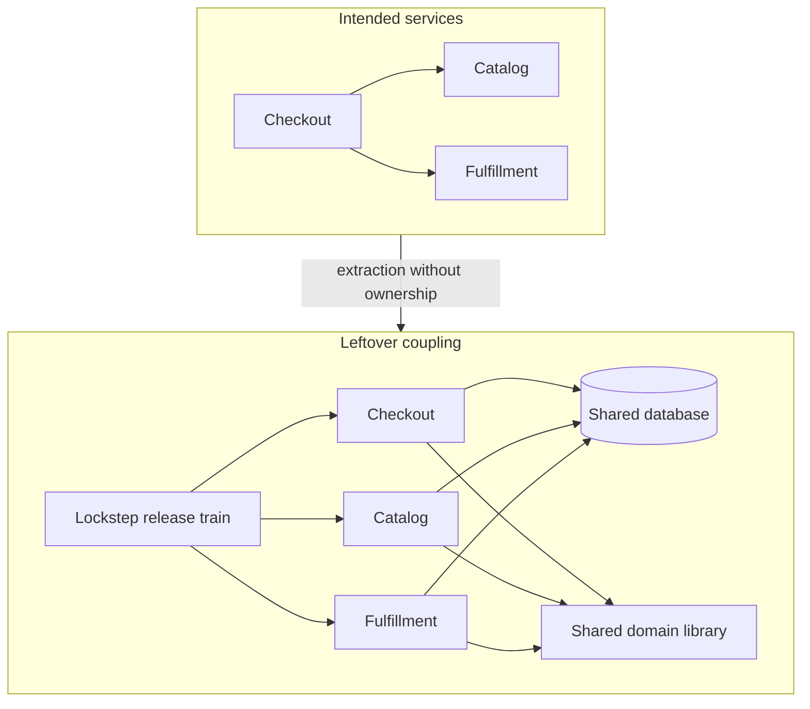

A distributed monolith has taken on the operational cost of microservices and kept the change coupling of a monolith. Several deployables, several repositories, and a network sit between pieces that still cannot ship, fail, or scale alone. Latency and partial failure arrived. Independent release did not. Teams reach this shape by accident and then spend years defending the topology they already paid for. I treat it as an anti-pattern because both honest alternatives — a modular monolith, or services that actually pass an autonomy test — are cheaper to operate than the middle.

## Concept

### Lockstep is the diagnostic

Service count is a poor tell. A well-cut estate can run two hundred processes. A distributed monolith can run eight. The tell is lockstep. You cannot deploy A without a window for B. You cannot change a column without a coordinated migration across callers. A game day that stops B takes A's user journeys with it, and there is no defined degraded mode. The on-call for A pages the team that owns B's schema.

In a modular monolith those couplings are at least local: one binary, one database, one release, in-process calls, a stack trace that crosses modules without a packet capture. In a distributed monolith the same couplings cross a network. Function calls became RPCs. Foreign keys became joins written in application code. A shared library version became a fleet-wide upgrade. The domain did not gain autonomy. The pager got louder.

The definition I use in reviews: if the unit of deployment, the unit of data ownership, the unit of failure, and the unit of team are different blobs on the diagram, you have a monolith you have to traceroute.

### Five leftovers

Distributed monoliths are leftover coupling after a split that stopped early. I look for five leftovers, and two are enough to erase the benefit.

Release coupling is a train: feature flags across six services, a Thursday 2 a.m. migration, a spreadsheet of versions that must move together.

Data coupling is more than one deployable writing the same database, or reading it with the freshness assumptions of a join. The schema is a cross-team API nobody versioned.

Runtime coupling is a synchronous happy path. Availability is the product of the chain. There is no bulkhead, no stale fallback, and no queue.

Type coupling is a shared module of entities, DTOs, and enums imported everywhere. Changing a field is a multi-repo pull request and a dependency bump.

Organizational coupling is one team owning many "services," or many teams owning one table. Conway still applies. The YAML is extra.

Data plus release is the classic pair. Either one, sustained, is enough to call the extraction unfinished.

### How the shape appears

Nobody schedules a project with this name. The usual path extracts processes before it extracts ownership. The first extraction copies a module into a new repo and leaves the table "for now." The second adds REST so a Java import can go away, and the payload is the persistence entity. The third invents a Platform service because nobody wanted to own customers or shared utilities. Six months later contract tests fail unless everyone moves together. Two years later a rewrite is proposed because "microservices are too hard," when the extraction was never finished.

A second path is premature service count. Every noun becomes a deployable. A feature needs four nouns, so an orchestrator appears, and the orchestrator becomes the monolith. The nouns become remote functions.

A third path is a shared library of the domain model. Services that "do not share a database" still share `OrderStatus` and cannot deploy out of order. Compile-time lockstep replaced the foreign key.

### Why a modular monolith is the honest alternative

A modular monolith has one process boundary, one commit, in-memory invariants, and real transactions. Module boundaries can be enforced with the compiler, package visibility, and architecture tests. Latency inside the process is cheap.

A distributed monolith keeps the coupled change set and adds tail latency, serialization, retry bugs, and an observability tax. Incidents require correlating traces across repos whose owners did not intend to be one distributed system. The invariant you still actually have can no longer sit in a database transaction.

If you are not getting independent deployability, independent scale, and independent failure, stay in one process and invest in modules. That is a refusal to pay distributed-systems prices for monolith semantics.

### Autonomy tests

I want five yeses before I call something a service.

Deploy: can this team ship on a Tuesday without another team's window? A feature flag in A that is unsafe until B deploys is a no.

Data: is this team the only writer of its store? A shared cluster "with different schemas" still fails the test when migrations collide or credentials are copied.

Failure: if we stop this process for five minutes, do other teams' SLOs hold in a defined degraded mode? "The site is down" means a runtime monolith.

Version: can A run against last week's B and next week's B for a documented overlap? Contracts that pass only in a lockstep staging deploy are a no.

Team: is there one pager, one backlog, one language of the domain? Two approvers on every change means the boundary is political.

These tests are operational on purpose. Architecture that cannot be operated is a slide.

## Trade-offs

The choice is a topology whose coupling matches the autonomy you can staff.

| Approach | When it wins | Cost / risk |
| -------- | ------------ | ----------- |
| Modular monolith | One product, a few aligned teams, a domain still in motion, invariants that want real transactions | One scale profile; modules rot into a ball of mud if boundaries are unenforced |
| Independently deployable services | Clear contexts, write ownership, aligned pagers, different scale or failure profiles | Sagas replace distributed transactions; contracts, tracing, and a platform must be funded |
| Distributed monolith | It appears as a transition that was never finished | Distributed cost with monolith lockstep; incidents and release trains dominate |
| Modular core plus a few real services | A stable core and one or two contexts that truly need isolation | The temptation to keep extracting; two operating models to staff |

A modular monolith wins for longer than fashion admits. While the domain is still being discovered, while one or two squads own it, and while the data is one consistency boundary, stay together. Enforce modules as if they might be extracted later: no cross-module table access, explicit interfaces, separate fixtures. Extraction then becomes a move.

True services win when the tests pass. Payments that must audit and scale differently from catalog browsing. A storefront renderer with a different latency and cache story from the admin API. A maps platform serving many products. The cost is platform engineering. If you cannot fund CI, schemas, tracing, and on-call, you cannot fund services.

The distributed monolith is in the table so nobody can claim it as a strategy. Recovery is to finish the extraction — split the data, version the contracts, decouple the release — or to collapse back into one process and keep the modules. Both recoveries are cheaper than living in the middle.

The hybrid is what healthy large companies run: a modular core, plus payments, rendering, or a data platform where isolation is honest. The skill is knowing when to stop extracting.

## Diagram

The left side is the topology people draw. The right side is the coupling they shipped. When the diagram looks like the left and the release looks like the right, you are in the anti-pattern.

## Failure modes

### Release coupling

The fleet moves as a train. Staging is a snowflake of six SHAs. A rollback must roll everyone back because a new JSON field is already on the wire. Detection: a shared release calendar, changelogs that name three services in every story, and an inability to run A against the previous B in production for a week. CI that passes only in a mega integration job is the same tell.

Mitigation: consumer-driven contracts and a documented compatibility window, expand-and-contract schema changes, and feature flags local to one service. If versions cannot overlap, stop extracting until they can.

### Data coupling

Several deployables share a cluster, a schema, or a "read only, we promise" path into a neighbor's tables. Detection: one migration repo, foreign keys across teams, credentials copied into multiple secret stores, and an incident where team A's migration locked a table team B needs. Query logs are the judge.

Mitigation: one writer per table. Move reads to APIs, events, or replicas that are allowed to be stale. A join that is the product belongs in one service. Shared-database microservices are a naming error.

### Runtime coupling

Synchronous chains with no deadlines, no bulkheads, and no fallback turn one pause into a site outage. Detection: error rates that move together, a p99 that is the sum of downstream p99s, and load tests that cannot fail one stub without failing the scenario. A game day you are afraid to run is already a finding.

Mitigation: deadlines, bulkheads, retries only on idempotent reads, and an explicit degraded mode. If degraded mode is impossible because the data lives elsewhere and is required for every request, that dependency is part of your service. Merge it, or replicate the slice you can serve stale.

### Shared domain types

A `common-entities` package is imported everywhere. An enum change is a fleet upgrade. Detection: a parent version whose bump is a company event, generated stubs compiled into every binary with no compatibility rules, and a standing channel whose only message is "please upgrade common."

Mitigation: keep domain types local. Share narrow, independently versioned clients if you must. Publish events and API contracts. A copied DTO is cheaper than a coordinated release.

### Organizational coupling

The diagram shows services and the org shows a committee. Detection: every RFC has six approvers, on-call pages people who cannot ship a fix, and a platform team that owns business tables.

Mitigation: one team, one context, one pager. If the org cannot do that, keep a modular monolith and assign module ownership inside it. A service boundary will not repair a RACI chart.

## Real-world example

Shopify's public engineering writing is the large-scale argument I use, because they had the gravity and the traffic to split everything and chose a modular core instead of pretending.

Shopify's commerce engine, Core, is a large Rails modular monolith. That is a response to a domain where shop, order, inventory, and payment are linguistically close and operationally entangled. A naive split produces services that still join the same shop's data on every request, still deploy with the same schema change, and still need one merchant to see a consistent admin. That shape, under Black Friday traffic, is a distributed monolith.

Their strategy was to modularize first, isolate by shop where the unit of scale and failure is the merchant, and extract only the pieces whose runtime or team profile is honestly different. The Storefront Renderer became its own service because serving a storefront has a different latency, cache, and failure story from the admin API. Some messaging and data infrastructure became platforms. Payments and other high-risk slices earned isolation. Checkout and merchandising stayed in the modular monolith with component boundaries, because that is where the invariants still live.

Pods, shop isolation, and component ownership are the autonomy tests in production language: fail a noisy neighbor without taking the fleet, let a component team ship without a core-wide train, and keep a transaction where the business still has a transaction. They also lived the other failure: an unenforced monolith becomes an un-ownable ball of mud. The answer was architecture tests and ownership inside one process.

The lesson is portable below their scale. A company with more traffic than yours still treats the distributed monolith as the outcome to avoid, and treats a modular monolith as a first-class architecture. Extract when the autonomy tests pass. Until then, a network hop is a bill.

## What to remember

- Lockstep is the diagnostic; service count is a vanity metric that hides release, data, and type coupling.
- Run deploy, data, failure, version, and team tests, and treat two failures as an unfinished extraction.
- Recovery is to finish ownership or to collapse back into a modular monolith with enforced modules.
- Shared databases and shared domain libraries are the leftovers that keep the release train running.
