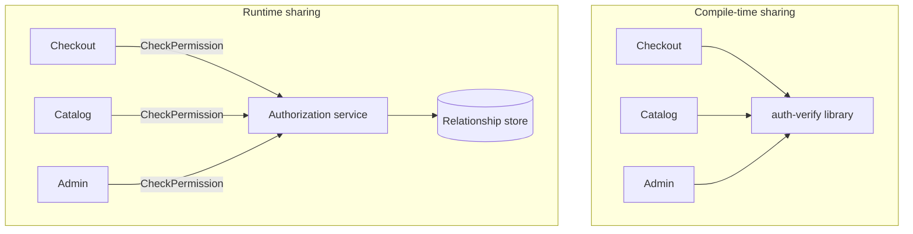

Every growing estate reaches the same argument: this code exists in five services, so it should live in one place. The pressure is real. The mechanism is the decision. One place can mean a library compiled into each binary, a service called at runtime, or a specification that each team implements locally. Those choices have different blast radii, different version clocks, and different failure modes. Treating them as interchangeable produces a platform that cannot be upgraded, or a utility service that cannot fail without taking the product suite with it. I classify the duplicated thing before I pick a home for it.

## Concept

### Classify the duplication first

Five drifting copies of money rounding become a finance incident. Five identical retry policies, aligned too well, become a retry storm. Unifying the wrong way produces either a fleet-wide outage or a fleet-wide freeze. The classification I use is short.

A pure function with stable rules and no private data — hashing, canonical JSON, money in minor units, identifier encoding — wants a library, or a deliberate copy of a short function.

A decision that must be consistent this minute and depends on live data — authorization, tax against a rule table, feature evaluation, inventory reservation — wants a service, or a locally cached replica of that service's answers, with a TTL the owner has accepted.

A domain object — `Order`, `Customer`, a `Money` type that carries tax policy — wants a local type and a mapping. Sharing the class freezes every context to one language that is not actually shared. The integration artifact is an event contract or an API schema, and the types on each side are allowed to differ.

### Libraries couple at compile time

A library ships inside someone else's binary. The producer releases a version. Each consumer adopts it on their own clock, or refuses. A bug in the library is a bug in the process. There is no timeout around an in-process function unless you build one. Performance is local. The trace is a stack, unless the library opens network connections, in which case you have a client and you should name it as a client.

Libraries win at algorithmic consistency and at latency. They lose at version consistency. The day every service must pick up new TLS settings, the library model becomes a compliance sweep across N deploy pipelines. The day business workflow moves into the library, every consumer becomes a deploy target for a product change they do not understand.

The transitive graph is part of the design. A thin logging library that pulls a metrics SDK that pulls an HTTP client that pins an old parser will eventually block a language upgrade. A library is as large as its graph, whatever the repository's line count says.

### Services couple at runtime

A service is called. Versioning is a protocol problem: additive fields, a compatibility window, a deprecation clock. Failure of the service is a new failure domain for every caller, so the design includes an SLO, a timeout, a bulkhead, and a cache or a fallback. In exchange you get independent scale, an independent language, and one place to patch a bug at 2 a.m. without rebuilding the fleet.

Services win when the logic needs data, secrets, or a decision that must not drift across copies. Central authorization is the canonical case: the policy engine reads relationships that do not belong in every product binary. Tax, token issuance, and fleet-wide rate limits often belong here. Services lose when they become string helpers over HTTP, or a `CustomerService` that is a table with a port.

A shared service is a product. It needs a team, a pager, a compatibility policy, and a reason in-process would be wrong. A cleanup ticket that creates an unowned single point of failure has created an outage with a Slack channel.

### Specs, copies, and inner source

Duplication is under-used. A twenty-line idempotency check is cheaper as a copy than as a library with a release train. A wire format belongs in an OpenAPI document or a schema registry; generated stubs are disposable. A context-local DTO that you wrote yourself is a feature of the boundary.

The rule I give teams: share specifications and fixtures more eagerly than code, share code more eagerly than runtime, and share runtime only when one living decision or one living dataset must be the source of truth.

Inner-source libraries with voluntary versioning sit between a copy and a mandate. They work when adoption is optional and the library has no side effects beyond the call. They fail when a platform team uses a version bump as a backdoor fleet deploy: every service must take `common` 14 because security said so. Run that as an owned campaign, or move the control into a sidecar you can roll on its own clock.

### Blast radius and the upgrade clock

Ask who wakes up, and who has to rebuild.

A library bug hits every service that has already upgraded, inside its own process. The patch is a new version and N deploys. Services still on the old version are fine, which is either a relief or a compliance incident.

A service bug hits every live caller at once, unless they have a fallback or a cache. The patch is one deploy. Callers holding a wrong cached answer need an invalidation story.

A library CVE is measured as time-to-upgrade of the slowest important service. A service CVE is time-to-patch of one process, plus whatever logic leaked into client SDKs.

Ownership follows the mechanism. A library without a team is abandoned code on someone else's critical path. A service without a team is an outage waiting for a volunteer. Create either one with an owner named in the same change.

## Trade-offs

Pick the mechanism from the consistency you need and the blast radius you can carry.

| Approach | When it wins | Cost / risk |
| -------- | ------------ | ----------- |
| Shared library | Stable algorithms, latency-sensitive helpers, language-local instrumentation | Version skew, transitive dependency collisions, fleet upgrades, domain types leaking across contexts |
| Shared service | Live decisions over shared data, one place to patch, independent scale and language | Runtime single point of failure, latency on the call, client compatibility, a real owning team |
| Local copy plus a published spec | Small helpers, context-specific mappings, wire formats that may drift safely | Drift of rules that must stay identical, copied security-sensitive code |
| Voluntary inner-source library | Tracing and authn clients with independent adopters | Becomes a silent mandate; "common" absorbs domain types |

Libraries win for canonicalization: how identifiers are encoded, how an HMAC is computed, how trace headers are attached. Keep them boring, small, and free of domain entities. Version them so a minor release preserves behavior. When behavior must change, add a function.

Services win for authorization, token issuance, centralized rate limits, and tax engines whose inputs live outside the caller's database. Cache at the client when the decision can be stale for a known TTL. Set the timeout as a fraction of the caller's budget. String utilities and "render every product's email" belong in a service only when rendering is itself a product with an SLO.

Two bounded contexts that both handle money should each own a type and a documented rounding rule. If finance must certify the rule, certify a library of functions. Leave tax policy out of the shared type.

An SDK for your own service is a legitimate library when it is a client. The moment the SDK contains `OrderStateMachine`, you are back in lockstep, and the state machine should move home to the service that owns the aggregate.

## Diagram

Three product services need "can this user do this?" A signature check on a token is a library, or a short local copy. A decision that reads a relationship graph, which changes on its own clock, is a service. The library in that second path is only the client.

## Failure modes

### Dependency hell and forced upgrades

A library pins a vulnerable or obsolete transitive dependency, and language upgrades stall for a year. Detection: a compatibility matrix spreadsheet, "blocked on common-lib" in every quarterly plan, and scanners that clear only after a parent-build change. Diamond dependencies where two platform libraries disagree on a parser are the same disease.

Mitigation: keep platform libraries small and explicit about allowed dependencies. Prefer the standard library. Publish a support window of current and previous, and run a mandatory upgrade as a campaign with owners.

### The platform call on every request

The shared service hiccups and every product fails, because every request calls it synchronously with an empty cache and an undefined failure policy. Detection: error rates that correlate across unrelated apps, a checkout load test that cannot pass with authorization stubbed, and an SLO for the platform that is weaker than the strictest caller.

Mitigation: run it as critical infrastructure, multi-instance, with load shedding and a client cache whose TTL security has accepted. Fail closed on mutating requests when the decision cannot be made. Bound retries so a brownout does not become a collapse.

### Domain types in common

A shared package accumulates `User`, `Order`, and `Address`, and every context must move together to add a field. Detection: pull requests to common that argue about the meaning of `status`, and a version bump required for an optional field one team uses.

Mitigation: allow primitives, codecs, and clients in platform libraries. Mappings live at each service edge. A shared document, when you need one, is a schema in a registry.

### Skewed security-sensitive code

TLS setup, token verification, and cookie parsing sit on old versions across a long tail of services. Detection: a CVE tracker that never reaches zero, and pentest findings that apply to a third of the fleet.

Mitigation: put verification in a well-owned library with a forced upgrade path, in a mesh sidecar, or in a service. Measure adoption. A control that half the fleet has taken is a suggestion.

## Real-world example

Netflix is the public case, because they ran both mechanisms at scale, published the libraries, and later moved a large part of that library responsibility out of the application process.

In the first microservices decade, product services compiled in a client-side platform: Eureka for discovery, Ribbon for load balancing, Hystrix for isolation and fallbacks, Zuul as an edge. Every team got timeouts, bulkheads, and discovery without inventing them. The company could not have run that many services if retry policy had been folklore copied by hand. The libraries were the mechanism that made the estate operable.

The costs arrived on the schedule this essay predicts. The libraries lived in every JVM. Upgrading Hystrix or the discovery client was a fleet problem. Transitive dependencies collided with product choices. Thread-per-dependency bulkheads interacted badly with container limits. Languages other than Java were second-class, because a library platform is language-local. A bug in the library was a bug in the binary, patched by N deploys.

Shared services ran alongside: Eureka servers, the Zuul edge, metrics, identity, and a fleet cache. Those had pages and SLOs. A bad day at the edge was felt immediately, which is the service trade-off, accepted because a team and a fallback existed.

The later move toward sidecars and a mesh — load balancing, retries, mTLS, timeouts in a process upgraded on a different clock from product code — is the architectural confession. The job those libraries were doing was network policy. A co-located infrastructure process breaks the upgrade coupling of libraries without putting a central utility hop on every call.

What I take from that history: libraries for in-process algorithms and for clients, services for living data and living decisions, and a sidecar when the library's real job is the network. The domain model of a title stays out of the common package.

## What to remember

- Copies, libraries, and services are three mechanisms; choose from the consistency you need and the blast radius you can carry.
- Libraries couple versions at build time; services couple failure and latency at runtime; both need a named owner.
- Keep domain entities out of shared packages; share specs, codecs, and clients.
- Security-sensitive logic needs an upgrade clock you can enforce: a campaign, a sidecar, or a service.
