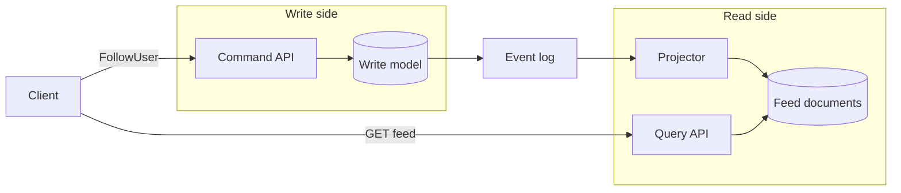

Command Query Responsibility Segregation says the model you use to change state and the model you use to answer questions are allowed to differ, and often should. It is a scaling and modeling pattern. Teams get hurt when they treat it as a mandatory pair of microservices, or when they fold it into event sourcing as one checkbox. Used with a light touch, it keeps writes honest and reads fast. Used as the default for every settings screen, it buys eventual consistency the product never asked for. If a single database with a few indexes still meets the latency target and the invariants, stay there. Split when the write path and the read path are measurably in conflict.

## Concept

### Two responsibilities, two shapes

A command is an intent to change state: `PlaceOrder`, `FollowUser`, `AdjustPrice`. It is authorized, validated against invariants, and committed to a write model normalized enough to protect those invariants. A query is a question: the homepage for this member, the order as the mobile app wants it, the SKUs matching a filter. Queries want denormalization, precomputed joins, search documents, and caches. They rarely want the third-normal-form schema that made the write side safe.

A classical CRUD service lets both shapes share a table, and that is the right design while the table serves both. CQRS earns its keep when indexes that exist only for reads are drowning the write path, or joins that exist only because the write model is normalized are drowning the read path, or read QPS sits an order of magnitude away from writes. Segregation means you stop asking one schema to be both a ledger and a catalog page. It can live in one service, one team, and one network.

### Commands and the consistency boundary

On the command side I want a small consistency boundary: the aggregate or the row set that must be correct together. `FollowUser` must refuse a follow that violates a block. `PlaceOrder` must refuse a reservation that would oversell. That logic sits next to the data it protects, in a model that says no when the invariant would break.

Commands are idempotent on a business key, a `commandId` or an idempotency header. They return acceptance or a committed result. Once you have segregated, rendering the homepage is the query side's job. The command handler commits the write model and emits the fact that something changed.

The write model can be ordinary tables, a document, or an event stream. CQRS requires that writes stay uncompromised by the shape of a dashboard. An event store is a separate decision, covered below.

### Queries, projections, and lag

Query models are shaped like the screens and APIs that consume them. A feed keyed by viewer. A search document. A row that already joins order, latest shipment, and payment status. These are projections: derived, rebuildable, optimized for the read.

Three update mechanisms cover almost every system I review. A same-database view or a table maintained in the same transaction is logical CQRS, and the user sees their write when the transaction commits. Asynchronous events or change data capture are physical CQRS, and lag is real. A nightly rebuild is honest about staleness and belongs to analytics more than to a product screen.

Lag is a product decision you make before you split. A Follow that vanishes on refresh is either a bug or a UI that should have updated from the command response. A search index five seconds behind is usually acceptable. A balance five seconds behind a transfer is not. Introduce the lag you can name in the interface, and design read-your-writes for the actor who just issued the command.

### Separate from event sourcing

Event sourcing stores every change as an immutable fact and treats current state as a fold. CQRS separates the write model from the read model. They compose well, because a fact stream is a convenient feed for projections. They are independent cost structures.

You can run CQRS with a CRUD write database, a projection table, and a read replica. You can event-source and still serve queries from a snapshot in the same store. I reject designs that say "CQRS/ES" as one line item. Pick each pattern for the problem it solves, and budget both if you pick both.

### How far to take the split

Logical CQRS is one database and one service, with a write module and a read module. The write module owns normalized tables. The read module owns views, extra tables updated in the same transaction, or query objects that never write. There is no network and no lag, and the modeling win is real.

Physical CQRS inside one service writes to the system of record and reads from a search index or a document cache, updated by a worker. One team, two stores, lag you show in the UI or hide with read-your-writes.

Physical CQRS across services is a write service and one or more read services, integrated by a durable log. It belongs where teams, scale, or lifecycle actually differ. Most products should stop at the first or second point. The third is how read models become a platform, and it needs the investment LinkedIn put into derived data.

## Trade-offs

CQRS answers a measured conflict between write integrity and read shape or scale.

| Approach | When it wins | Cost / risk |
| -------- | ------------ | ----------- |
| Single-model CRUD | Simple domains, similar read and write scale, one team, strong consistency on every screen | Indexes fight writes; joins get heavy; reads cannot scale alone |
| Logical CQRS in one database | Different shapes, same consistency, cleaner modules without a distributed cost | Discipline; a heavy view can still slow the write transaction |
| Physical CQRS with a separate read store | Feeds, search, dashboards, read QPS the source of truth should not serve | Lag, rebuild cost, drift, dual-write bugs if the bus is skipped |
| CQRS with event sourcing | The write side is already a fact stream and many projections hang off it | Schema evolution and replay on top of projection operations |

Single-model CRUD is the default for admin tools, configuration, and early products. The failure is clinging to it after the homepage query is five joins and a cache added in a panic. At that point you already have an ad hoc read model. Name it and maintain it.

Logical CQRS is the under-used middle. Keep `orders` and an order read model in the same transaction. The user sees their order immediately. You still serve a document shaped for GET. You do not get independent scale, and for a large number of systems that is the correct trade.

Physical CQRS wins for feeds, search, recommendations, and any read whose QPS or shape would punish the source of truth. The write database stays lean. The read store is derived. Correct data on the write side and let the projection catch up. A correction applied only in the search index has created a second source of truth.

Adding event sourcing on top is natural when the write model is already facts and corrections. The operational burden is additive. Adopt the pair when both problems are present, and keep a CRUD write model when only the read shape is the problem.

## Diagram

A follow is committed on the write side and published as a fact. A projector updates the feed. The query path reads the feed and leaves the write tables alone.

## Failure modes

### Stale reads the actor can see

The command succeeded and the next GET shows old data. Detection: tickets clustered on "I did it and it does not show," projection-lag metrics, and traces where the GET hit a different store from the POST. A load test that only issues GETs will miss this. The test has to write, then read.

Mitigation: read-your-writes for the actor. Return the new view from the command, read the just-changed resource from the write model, or let the client wait on a projection version. Optimistic UI helps the screen. A version the client can wait on is what makes the contract explicit when it matters. Everyone else may lag, and the product copy should say so.

### Projection drift

A bug, a dropped event, or a projector that applies twice leaves the read store wrong. Detection: a checksum sample that disagrees with the write model, customer reports that vanish when you hit the write API, and a projector that cannot be replayed. A rebuild that takes longer than the staleness you can tolerate is a latent incident.

Mitigation: idempotent projections keyed by event id or aggregate version, a stored high-water mark per stream, and a replay path on day one. For a large index, rebuild into a new collection and swap an alias.

### Dual-write on the request path

The handler writes the database and the search index in one request. One of them succeeds. Detection: order counts and search documents diverge after timeouts, and there is no outbox. This is the most common implementation of "we did CQRS."

Mitigation: the projector's only input is a durable, per-key ordered stream, fed by an outbox or by capture of the commit log. Application-level dual-write stays off the hot path.

### A pipeline for a two-field document

A settings screen grows a command service, a topic, and a read service. Detection: more deployment config than business logic, admin edits that take minutes to appear, and a small team running a handful of processes for one form.

Mitigation: collapse to one service and one database. Use logical CQRS if the read shape differs. Revisit a physical split when QPS, index contention, or a team boundary shows up in measurements.

## Real-world example

LinkedIn's feed and derived-data stack is the public CQRS system I walk through, because they had to separate "write a social fact" from "read a personalized feed," and they published the machinery.

The write side holds members, follows, connections, and posts in source-of-truth stores, including Espresso for many document-shaped facts. Invariants live there. Follow is a command against that model. The write path can be consistent inside its store without carrying the indexes of every member's homepage.

The read side is a different shape at a different QPS with a different staleness budget: a feed, a profile view, a recommendation list, a search document. Facts committed on the write side are published to Kafka, and derived-data systems consume them. Venice, their derived-data platform, ingests from that log, serves with an SLO, and rebuilds when a projection changes. That is physical CQRS as a platform.

Fan-out-on-write versus fan-out-on-read is the scaling knob inside the same pattern. Precomputing a feed per member makes reads cheap and writes heavy. Computing at read time does the reverse. LinkedIn moved along that spectrum as the graph grew. The pattern held: the graph store does not serve the homepage query, and the feed store is not the system of record for a follow.

For the member, the command acknowledgement means the invariant held. The feed showing new posts is a projection. The investment in schema, lag, and replayable projectors is the cost of taking the split seriously. At a smaller scale you still steal the shape: one write model, one read model, a durable log between them, and an explicit rule for read-your-writes. You can do that with a table and a worker. You still keep the search index from becoming a second place to correct data.

## What to remember

- The write model protects invariants and the read model is shaped for queries; two microservices are a later option, not the definition.
- Event sourcing is a separate choice; a fact stream is one way to feed projections.
- A physical split needs a durable log, idempotent projectors, a lag SLO, and a rebuild path.
- Read-your-writes for the actor is a designed path, decided before the first stale refresh reaches support.
