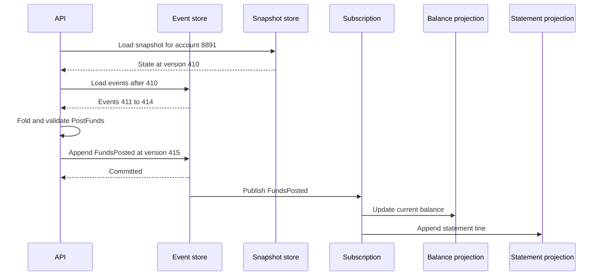

Event sourcing stores what happened, in order, and treats current state as a fold you can rebuild. The source of truth is the stream of postings, holds, reversals, and corrections. A row that says the balance is 412.10 is a convenience derived from that stream. When the domain already speaks in facts — ledgers, bookings, workflows, collaborative edits — you gain audit, replay, and as many read models as you can project. When the domain is "the latest document is the customer," you gain an expensive history that is hard to evolve and a debugger that needs a time machine. I recommend the pattern where corrections are first-class, and I keep CRUD where overwrite is the business.

## Concept

### State as a fold

In a CRUD system you load a row, change fields, and save. In an event-sourced system you load the stream for an aggregate, fold it into a state object, apply a command, and if the command is valid you append new events. The store persists the append atomically and rejects it when the version you loaded is no longer the tip. That optimistic check is the consistency boundary. The balance row, if you keep one, is a projection.

An event is a past-tense fact: `FundsPosted`, `HoldPlaced`, `HoldReleased`, `TransferReversed`. It uses the language of the bounded context. It is immutable. It carries enough data for a fold written later to apply it. It does not carry the layout of a screen. The fold is deterministic: the same events in the same order produce the same state on every node. Emails, HTTP calls, and PDF generation stay out of the fold. Subscribers run those after commit.

### The stream is the record

Each aggregate instance — account 8891, order 12, booking ABC — has a stream. A write loads the stream, or a snapshot plus the tail, decides, and appends at the expected version. A lost race retries. There is no transaction across two streams unless a workflow above them coordinates the steps.

The log that is the system of record needs "append these events to this stream if the version equals N." That can be a dedicated event store or a table with a unique constraint on stream and version. A bus is a fan-out tool. Using it as the only store confuses delivery with the ability to load one aggregate and check its version. After commit, a publisher, the store's subscription API, or capture on the event table emits to consumers. Those consumers are projections and integrations. They are downstream of the record.

### Aggregates, commands, and idempotency

The aggregate is the largest cluster of state you will serialize writes on. For a current account, the account is the aggregate: the fold of postings and holds decides whether a debit is allowed. A transfer between two accounts is two appends and a process that compensates if the second fails. Making "the whole bank" one aggregate would serialize the institution. The process is a workflow, and each account remains its own stream.

Commands are present tense: `PostFunds`, `PlaceHold`. The handler loads, checks, and emits. Idempotency is mandatory because payment networks retry. A command id or a natural key such as a scheme instruction id is recorded so a duplicate appends nothing. Causation and correlation identifiers ride on the events. When a ledger incident is debugged, those two fields turn a pile of facts into a timeline.

### Snapshots, projections, and subscriptions

Replaying millions of events to open one account is an accident. A snapshot stores state at a version so the command path replays only the tail. Snapshots are an optimization. If a snapshot is wrong, you delete it and rebuild from events. The day you cannot delete the snapshot, a second source of truth has appeared.

Projections serve queries: balance as of now, statement lines, fraud features, a search document. They subscribe, apply, and store something queryable. They are idempotent and version-aware. They may lag. Rebuilding one is a first-class operation: new projection, replay, swap. Subscriptions are at-least-once, they resume from a checkpoint, and a payload that cannot be applied lands in a dead letter with a runbook. That operational shape is the pattern.

### Schema evolution and erasure

Events written years ago are still in the log. You will add fields and split meanings. The rule I enforce: the meaning of an existing event type and version stays fixed. New information arrives as optional fields, or as a new event type with a translator in the fold that still understands the old one. Rewriting the log is a versioned copy-and-swap with checksums, scheduled as a project.

Privacy law still applies to an append-only history. Plan a strategy before the first subject asks to be forgotten: encrypt payloads with per-subject keys you can destroy, keep personal data off the log behind a token, or produce a redacted stream and cut over after verification. Immutability is a storage choice. It is not a legal position.

## Trade-offs

Event sourcing has a high floor of discipline. Use it where the business already speaks in facts and corrections.

| Approach | When it wins | Cost / risk |
| -------- | ------------ | ----------- |
| CRUD current state | Simple entities, overwrite is the domain, light audit need | History is weak; "why" lives in logs you may not have kept |
| Audit table beside CRUD | You need who changed a row and when, and mutable state remains the truth | The history is often incomplete and is rarely replayable business state |
| Event sourcing | Ledgers, bookings, workflows, collaboration; audit and point-in-time rebuild are requirements | Schema evolution, replay cost, a team that can think in folds |
| Event sourcing with CQRS | Many read shapes from one fact stream, read scale unlike write scale | Projection lag and rebuild work on top of the event store |

CRUD wins for configuration, profiles, and any record whose truth is the latest row. Uniqueness constraints and "change the email" stay simple, and erasure is an update or a delete.

An audit table beside CRUD is the honest middle when you need who touched a setting. Design it as an event log only if you are prepared to rebuild from it. Otherwise call it an audit table and keep the row as authority.

Event sourcing wins when a correction is a new fact, when a dispute or a regulator will ask for a point in time, and when several projections are inevitable. Payment instruction processing, account ledgers, reservation holds with compensations, and some booking engines fit. Every developer on the team has to think in versions and folds. If the mutable cache becomes the database people actually trust, the stream has become a write-only archive.

CQRS on top is how you serve a statement without folding on the request path. Budget for projectors. The event store is the record. It is a poor warehouse.

## Diagram

A posting loads a snapshot and the tail, validates, and appends. Balance and statement views are subscribers. The balance table is disposable.

## Failure modes

### Poison events

A new code path writes an event the fold cannot apply: a missing field, an unexpected value, a failure inside an old handler. Replay dies at a historical version. Detection: consumer errors pinned to one stream, an aggregate that will not open, and a deploy that fails only when old streams are loaded. If only new accounts work, the fold has lost compatibility with history.

Mitigation: contract tests that replay an anonymized corpus on every build, upcasting in one place, and a quarantine for the broken stream until the translator is fixed. Unknown events are a stop, not a skip.

### Wrong snapshots

A snapshot writer diverges from the fold. Detection: a job that rebuilds from origin and compares, balances that move after a snapshot is dropped, or two nodes disagreeing at the same version. If you never rebuild, you will not know.

Mitigation: treat snapshots as disposable, verify a sample by rebuild, and write them with the same fold the command handler uses. Store the fold's schema version on the snapshot so a code change drops stale ones.

### Personal data in the log

A subject requests erasure and `AccountOpened` contains their name. Detection: a legal request with no redaction pipeline, and new event types that embed raw personal data because it was convenient at the time.

Mitigation: tokenize at the edge of the stream, or crypto-shred with per-subject keys, and review every new event type for data class before it ships. A redaction cutover is a planned migration with checksums.

### Implicit process spaghetti

Every event spawns more events in other services, and nobody can name the process. Detection: cycles of facts causing each other, an inability to draw one command's effect, and incidents that "fix themselves" when replay runs in a surprising order.

Mitigation: keep the event store as the write model of one context. Publish a small set of integration events across contexts. Use an explicit workflow when a process spans aggregates.

## Real-world example

A current-account ledger at a retail bank is the walkthrough I use, because the domain is a journal even when the core is still a mainframe. Modern processors and challenger banks that publish their architecture are implementing this pattern under whatever name they prefer.

Account 8891's operational truth is a sequence: opening, an incoming payment, a card authorization hold, capture or release, interest, a fee, a reversal after a dispute. Available balance is the fold of postings minus active holds, under product rules. A dispute appends `DisputeOpened` and later `ReversalPosted`. The original posting stays. An auditor, a court, or a confused customer can be shown a timeline.

In the event-sourced shape, the account is a stream. `PostFunds` arrives with a scheme instruction id. The handler loads snapshot plus tail, checks idempotency on that id, checks product rules — account open, currency, limits — and appends `FundsPosted`. Optimistic concurrency stops two overlapping posts from both applying at the same version. A subscriber updates the balance projection the mobile app reads. Another writes statement lines. Another feeds financial-crime features. The app's GET reads the projection. A post that originated in the app uses a read-your-writes rule so the member sees the credit they just made.

When interest rules change, future accruals append under the new rules. A correction of the past is `InterestCorrected` with a reason. A new projection, such as balance at close of business under a revised product catalog, is a replay from origin or from snapshots. The balance table is writable only by the projector. That rule is what prevents the classic incident where the journal and the account master disagree.

The discipline pays because the failures are expensive. A poison event means that account cannot be served until the fold is repaired, so schema governance and a repair desk exist. Payee names on statements are a data-class decision on the payload, made when the event type is designed.

The same shape fits any domain whose truth is a journal of facts and corrections. If the truth is the latest JSON document, keep CRUD and add an audit log. If you must reconstruct why the money, the seat, or the entitlement moved, event-source that aggregate and project everything else.

## What to remember

- The event stream is the source of truth; snapshots and balance tables are projections you can drop and rebuild.
- Folds stay deterministic, backward compatible, and free of side effects; subscribers perform the rest after commit.
- Schema evolution and erasure of personal data are designed with the first event type.
- Use the pattern where the domain already speaks in facts and corrections, and keep CRUD where the latest row is the truth.
