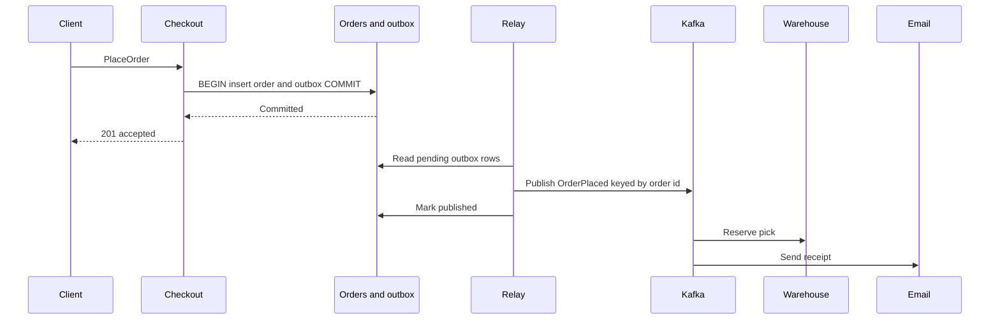

The transactional outbox is how a service tells the rest of the estate that something happened without lying about atomicity. The lie is the dual write: commit a row, then publish to a broker, and hope both succeed. They will not, on a long enough timeline. The outbox puts the business change and a "please publish this" record in the same database transaction. A relay copies that record to the broker. Downstream still sees at-least-once delivery. What disappears is a committed order with no `OrderPlaced`, and an `OrderPlaced` for an order that rolled back. If you have consumers and you are dual-writing, this pattern, or capture of a commit log you are willing to treat as a contract, is the design. A reconciliation job is what you have when you skip it.

## Concept

### The dual-write gap

A checkout handler that inserts an order, commits, and then calls the producer has a crash window between the commit and the send. The order exists and no consumer will pack it, email it, or index it. Reverse the steps and a commit failure after a successful send makes consumers process an order that does not exist. Retries widen both races. A crash in the gap is indistinguishable from a slow publish. Two systems of record, and no atomicity between them, cannot be repaired by a louder retry loop.

Two-phase commit across a database and a broker exists in a few stacks. It adds a protocol, a coordinator, and failure modes most product teams do not want to staff, and broker support is uneven. For almost every checkout, order, and booking service I review, the outbox is the mechanism: the message is a row in the database that already owns the transaction.

### One transaction, two rows

Inside the same begin and commit as the business writes, insert an outbox row: a unique message id, a destination, a payload, an event type, a timestamp, and a status. The payload is the integration event you designed. A dump of the row is the contract only when you have decided the row is public. The message id is the idempotency key the relay and the consumers will share.

On commit, the order and the outbox row both exist, or neither does. That is the invariant. Everything after commit is about copying a durable row to a broker without losing it. Do the minimum inside the transaction. No HTTP, no nested publish, no search-index update. The transaction stays local and short. Publishing from inside it recreates the dual write. Making it slow stalls checkout in order to help the relay, which is the wrong dependency direction.

### Poller or log reader

A poller selects unpublished rows in batches, publishes, and marks them published or deletes them. It is easy to reason about. It needs an index, a claim strategy so two pollers do not take the same row — `FOR UPDATE SKIP LOCKED` or a lease column — and backoff when the broker is down. The polling interval is a latency floor. A few hundred milliseconds is enough for many products. A trading fan-out may need something tighter.

Change data capture on the outbox table is the other relay. A connector reads the insert from the database log and writes it to the bus. You drop the poll loop and you take on connector operations. The outbox still matters: you capture a table of designed events, and the internal columns of `orders` stay private.

A service that is already event-sourced can tail its own stream. That is the same idea with a richer write model. The outbox table is the humble version for a CRUD service, and it is the one I reach for unless the domain already justified an event store.

### At-least-once, order, and retention

The relay publishes at least once. A crash after a successful send and before the row is marked published produces a duplicate. A connector restart can do the same. Consumers treat `message_id` as an idempotency key. A state snapshot is applied by version. A fact is recorded in a table unique on the id, or in a processed set with a retention policy.

The table grows. Published rows are deleted or archived on a schedule. An insert-only outbox becomes a latency problem: indexes bloat, the poller's query slows, and vacuum falls behind. Retention is part of the pattern.

Order is per aggregate when you care about it. Store the aggregate id and publish with that key so one entity's events stay in order on the bus. A single global scan of the table does not give global order, and the API should not promise it.

### What the pattern leaves to other tools

The outbox is the committed intent to publish. A saga still needs its own process state for a long-running workflow. The broker, or another durable log, is what consumers read. Payloads stay small; a large artifact goes to object storage and the event carries a pointer. When consumers are explicitly replicas of a table — search, a cache, a warehouse — capturing that table can be the right feed, with the schema treated as a contract. The outbox is the choice when the integration event should be designed, versioned, and narrower than the table.

## Trade-offs

| Approach | When it wins | Cost / risk |
| -------- | ------------ | ----------- |
| Dual-write to database then broker | It shows up under a deadline and then diverges | Silent missing events, or events for rolled-back state, and a reconciliation job as the real design |
| Outbox plus a poller | A SQL service, any broker, a team that wants a simple relay | Polling lag, poller availability, table growth, a correct claim strategy |
| Outbox plus change data capture | Low publish latency, and a connector platform you already run | Connector operations, still at-least-once, log-retention risk on the primary |
| Tail of an event store | The write model is already a stream | The cost of event sourcing, which is too much if you only needed an outbox |
| Two-phase commit with the broker | Both sides support it and operations can carry the coordinator | Availability and complexity most product systems should refuse |

The poller is my default for a service with a SQL database and a handful of events. Two instances using skip-locked claims are enough availability for most. Measure publish delay. Alert when the oldest pending row exceeds the SLO.

Capture on the outbox wins when you already operate a connector cluster and you want the relay outside the application process. You still design the payload. Capturing `orders` and calling it the integration bus couples every consumer to the table, which is a different, explicit decision.

Tailing an event store wins when you chose event sourcing for the domain. Adding an event store only to avoid an outbox table spends the larger pattern's budget on the smaller problem.

## Diagram

Checkout writes the order and the outbox row in one transaction and returns after commit. The relay runs on the far side of that commit. Consumers tolerate duplicates.

## Failure modes

### A growing backlog

The poller is down, the broker is down, or the table is so large the query misses its target. Detection: a gauge of pending rows, the age of the oldest pending row, a poller heartbeat, and disk growth if published rows are never removed. Checkout still succeeds, which is correct, until warehouse lag becomes the incident you notice from operations rather than from the API.

Mitigation: page on oldest-pending age. Scale pollers only with a real claim. Delete or archive published rows on a tested schedule. Slowing checkout to protect the outbox is a last resort, used when fulfillment would otherwise fall so far behind that accepting more orders is the larger harm.

### Duplicate delivery

The relay published, crashed, and published again. Detection: consumers logging a repeated message id, and a warehouse that double-picks when it lacked an idempotency check.

Mitigation: generate the message id inside the transaction and reuse it on every retry. Consumers upsert by that id. Marking a row published is itself safe to repeat. Connector settings can reduce duplicates. They do not replace consumer discipline.

### The outbox stalls the write path

Large payloads, extra indexes, triggers, or a poller that locks hot order rows show up as checkout latency. Detection: write p99 rising with event volume, lock waits that include the outbox, and the poller's select sitting in active queries at peak.

Mitigation: keep the table narrow, index the claim path, and put a self-contained payload on the row so the poller does not join back to orders. Skip locked rows so checkout and the relay do not queue on each other. If you capture the log, capture the outbox table you mean to publish.

### A poison payload committed with the business row

The event cannot be parsed, or it violates a downstream invariant, and the order is already committed. Detection: a dead-letter pile tied to a producer deploy, one message id failing forever, and a healthy checkout beside a stuck warehouse.

Mitigation: validate the payload against its schema before commit, with compatibility checks in the request path and contract tests in CI. Version the event. Repair with a compensating command or a correction event, plus an operator replay for true poisons. Editing the outbox row by hand trains the team to treat the outbox as mutable business truth.

## Real-world example

Shopify's order pipeline is the commerce system I use for this pattern. An order is a transactional fact in Core, and a wide fan-out must hear about it: payment capture, fulfillment, apps via webhooks, search, analytics, email. The merchant's request cannot wait for all of those, and it cannot succeed as an order row that the rest of the platform never learns about.

The dual-write temptation in a large Rails core is familiar: save the order, publish, enqueue webhooks. At peak volume, with retries and workers restarting, that sequence produces a measurable set of orders that exist in admin and not in fulfillment, or webhooks delivered for an order that rolled back. Shopify's writing on webhooks, background jobs, and eventing is about making the fan-out durable after the commit.

The outbox shape is: in the order transaction, write the invariant cluster — lines, money, taxes — and write an envelope such as `OrderCreated` to a durable outbox or a transactional job table. Return success to the client. A relay, historically job workers and later streaming publishers, drains that intent. Webhooks to apps are a further at-least-once delivery with retry and a signature, keyed by delivery id, because the app will see duplicates and must be told so.

Idempotency is the other half. A worker that handles `OrderCreated` twice must not capture a payment twice or allocate inventory twice. The message id and the order id are the keys. When a piece of the platform is extracted — a renderer, a data platform, a fulfillment path — the contract that travels is the event committed with the order, not a call from the request thread to every downstream.

That is the lesson at commerce scale, and at any checkout smaller than Shopify's. The transaction is small and local. The news is durable. The fan-out is asynchronous. The consumers are idempotent. Copy the shape before you copy a broker brand.

## What to remember

- Commit the event row in the same transaction as the state; a later publish to the broker will eventually diverge from the database.
- The relay delivers at least once, so consumers idempotently apply a stable message id.
- Page on the age of the oldest pending row, and delete published rows, or the table becomes the incident.
- The outbox records intent to publish; workflows, large blobs, and public table contracts belong to other patterns.
