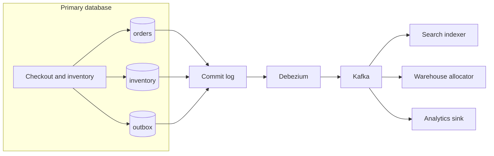

Change data capture turns the database commit log into an event stream. The application writes a transaction. When it commits, the durable log already contains the change, including changes from admin scripts, migrations, and code paths that forgot to publish. Debezium is the open-source connector family most teams mean by "CDC into Kafka": it tails PostgreSQL's write-ahead log, MySQL's binlog, SQL Server's change tables, MongoDB change streams, and others, and it emits a structured envelope per change. Used with an owner and a contract, it feeds search, caches, warehouses, and outbox relays more completely than application code can. Used as a dump of every table to every team, it becomes a shared schema with lag, and the primary database inherits the connector's failures.

## Concept

### The log of what committed

The application runs an update inside a transaction. On commit, the engine's log holds that change in order. CDC reads the log. It is a continuous feed of inserts, updates, and deletes that already happened, sequenced by log position. Trigger-based capture, which runs extra work inside the transaction, and a nightly select, which is a batch copy, solve different problems and carry different load.

Completeness is the property you are buying. Forgotten publishers still show up, because they wrote to the database. The cost is physical coupling: column names, types, and table splits become a public API the moment a consumer depends on them. Debezium, usually running in Kafka Connect or embedded, is the translator. It has opinions about snapshots, offsets, heartbeats, and envelopes. It is neither the database nor the bus.

### How the connectors read

Each engine has a specialist, and the operational scare is specific to that engine.

PostgreSQL uses a logical replication slot and a decoding plugin. The slot holds write-ahead log until the connector acknowledges it. A stopped connector means retained log and a primary disk that fills. Slot lag, a heartbeat so an idle filtered publication still advances, and disk alerts are the job, ahead of schema design.

MySQL reads the binary log, with GTID when you can get it. Row format and a replication user are required. The connector records file and position, and a failover has to leave that position meaningful on the new primary.

SQL Server's CDC feature writes change tables that Debezium reads. MongoDB exposes a change stream from the replica set. In each case offsets live in Kafka Connect's offset topic so a restart can resume. Resume is at-least-once relative to the sink. Duplicates are part of the design, and so is a task crash in the middle of a batch.

### Envelope, topics, and schema

A Debezium record is an envelope: `before`, `after`, an operation code for create, update, delete, or snapshot read, a source block with database, table, and log position, and a timestamp. The key is usually the primary key. The default topic name is server, schema, and table, which is convenient and couples consumers to that naming.

The envelope is why teams adopt the connector. A consumer can tell a backfill row from a live update, can see old and new values, and can trace a disagreement back to a log position. Delete handling, including tombstones on a compacted topic, is how a downstream store drops a SKU that no longer exists.

Schema rides a registry when you emit Avro, JSON Schema, or Protobuf. An added nullable column can be compatible. A type change is a breaking release. Debezium will follow some additive DDL. Your sinks may not. Treat every migration on a captured table as a release of an API.

### Snapshot, then stream

A new connector that needs a correct downstream snapshots current state, then streams from the log position taken around that snapshot, with a defined overlap. The mode — initial snapshot then stream, snapshot only, stream only, or an incremental snapshot while already streaming — is a product choice about history and locking.

Incremental snapshots are how you add a table or repair a sink without a lock-the-world outage, when you have configured them. Offsets are as precious as the database backup. Losing them means a double apply or a gap, and the recovery is a new snapshot you have rehearsed. A connector whose operator cannot say where it is in the log, whether it is snapshotting, and whether the slot is alive, is a production dependency that is not yet operated.

### Table capture and outbox capture

Pointing Debezium at domain tables captures every writer, and it leaks the model. Pointing it at an outbox table the application fills in the same transaction captures designed events and keeps internal columns private. I use outbox capture when the consumers are other product services. I use table capture when the consumer is a search index, a cache, or a warehouse that has agreed the table shape is the contract.

Both in one estate is normal. Inventory quantity flows to search as table capture. `OrderPlaced` flows to fulfillment as an outbox event. Naming which stream is which, in the review, is the architecture.

## Trade-offs

You get completeness of whatever the database did, including the accidents.

| Approach | When it wins | Cost / risk |
| -------- | ------------ | ----------- |
| Application-emitted events | A designed contract and no log-mining operations | Missed code paths, and dual-write unless an outbox exists |
| Outbox captured by Debezium | Designed events plus commit-log reliability | The application must write the outbox row; you operate Connect |
| Table capture with Debezium | Search, cache, and warehouse replicas, including script writers | Consumers couple to schema; personal data can enter the stream |
| Batch extract | High-latency analytics and a small operational surface | Stale data, and a poor fit for operational consumers |
| Trigger-based capture | An engine with no usable log, as a last resort | Write amplification and lock risk on the primary |

Application events win on meaning: `OrderPlaced` says more than row version 17 of `orders`. A disciplined poller at low volume may be enough. Add a connector when polling lag or the poller's operational cost exceeds the cost of Connect.

Outbox plus Debezium is the combination I want for service-to-service facts. The transaction supplies atomicity, the connector is the relay, the bus is the fan-out, and the payload is one you version.

Table capture wins for a catalog in search, a quantity in a cache, and orders in an analytical store. The consumer team sits in the schema review. A migration that looked internal will break them if they were left out.

Batch extract still wins for a daily reconciliation that can be stale. A CDC pipeline is an always-on system that pages someone. Put it on the path when intra-day freshness is a requirement. Triggers are the fallback when the engine cannot offer a log, and write latency is the metric you watch.

## Diagram

A retailer captures inventory as tables and orders as an outbox, through one commit log and one connector, then fans out to search, the warehouse, and analytics.

## Failure modes

### Slot lag takes the primary

The connector falls behind or stops, and PostgreSQL retains log for the slot until disk fills. The outage hits checkout, not only the pipeline. Detection: log disk, replication-slot lag, Connect lag, and a primary that runs out of space while the application error rate is still quiet. On MySQL the equivalent is binlog disk and a connector far behind its GTID.

Mitigation: page the connector owners on slot lag and disk, with a heartbeat so filtered publications still move. Size disk for a connector outage of a stated number of hours. The runbook for dropping a slot includes the snapshot you will run afterward. Catch-up is a plan. Hope is not.

### Snapshot load

An initial snapshot of a huge history table locks or saturates the primary and floods the bus and the sinks. Detection: a cliff in database CPU and I/O after a connector deploy, sink lag exploding, and timeouts on the transactional path.

Mitigation: snapshot from a replica when the engine allows a consistent read there, prefer incremental snapshots, capture only the tables you will serve, and throttle tasks. Announce a backfill as a production change.

### A migration breaks sinks

A column widens, splits, or disappears, and the connector task fails or the sinks throw. Detection: schema-registry compatibility errors, nulls in search documents after a migration that was called harmless, and a connector in a failed state.

Mitigation: every captured table has a consumer inventory, and that inventory is part of the migration review. Use expand-and-contract changes. Check compatibility in CI. Product services should prefer versioned outbox events so a column rename stays internal.

### The topic becomes a company dump

A dozen teams subscribe to the orders table because subscribing was easy. Renames freeze. Personal data lands in a lake and in a debug consumer nobody remembers. Detection: access lists that look like a directory, erasure requests that require replaying CDC history, and migrations blocked by unknown consumers.

Mitigation: topics are products with owners, access control, and retention matched to data class. Cross-domain facts go through the outbox. Table capture stays limited to replicas you would have allowed to query the table. Column filters help. They are not a privacy program by themselves.

## Real-world example

A multi-brand retailer with its own transactional database is the Debezium deployment I walk through, because this is the shape the project is built for and the one that shows up in production: inventory and orders in PostgreSQL or MySQL, too many writers to trust hand-rolled events, too many readers to let them query the primary.

Writers include checkout, a warehouse back office, a returns desk, and the occasional manual fix. If search, allocation, and the analytical lake each depended on every writer emitting a perfect event, they would drift in the first week. Capture of the log is the completeness layer.

Debezium runs as Connect beside the primary or a replica. One connector reads inventory and SKU tables. Every quantity change, including the cartons the back office found on a shelf, becomes an envelope with before and after images. A search indexer upserts documents so the storefront never queries the transactional database for browse. A cache drops keys for the affected SKU. Those consumers have agreed that the table is the contract, and catalog migrations include them.

A capture of the outbox, on the same connector or a second one, carries `OrderPlaced`. Checkout's transaction wrote the order and the envelope together. Fulfillment and email subscribe to that topic. When fulfillment is later split into its own service, it inherits the event, and the orders columns stay an internal concern of the core.

Analytics is a third sink, with more lag tolerance and its own consumer group, loading a warehouse or a lake. It must not be in a position to stall the replication slot that checkout depends on. Separate SLOs, same schema discipline.

The incidents match the failure modes. An undersized Connect cluster pauses, the slot holds log, primary disk hits a dangerous watermark, and checkout fails before search looks unhealthy. The repair is operational: lag and disk pages, and a rehearsed incremental snapshot after a slot rebuild. A later widening of a price column breaks registry consumers, and the cultural repair is a migration checklist that names CDC subscribers. A debug topic of full order rows outlives the project until someone asks where personal data is retained. Access control and an outbox-only rule for anything beyond the inventory replica close that gap.

Debezium makes the database log available. Availability includes operations and schema. The architect who adds it is adding a second production system beside the database. Staff it, or stay on a batch extract and accept the staleness in the product.

## What to remember

- Debezium emits what committed, so admin scripts and forgotten publishers are included along with the application.
- A stalled PostgreSQL slot, or the equivalent retained log on other engines, can take the primary down; page on that lag.
- Use outbox capture for product-to-product events, and table capture only where the table is an agreed replica contract.
- Schema, personal data, and the list of consumers are part of the design; a topic is a product with an owner.
