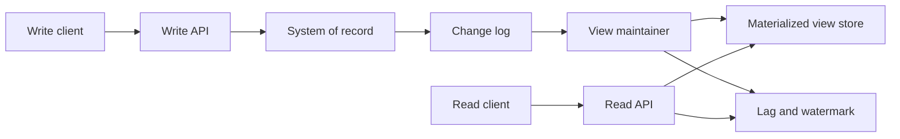

A materialized view is a stored answer. You pay for that answer once, on a schedule you control, so that many readers can consume it without repeating the original join, aggregation, or projection. Architects reach for this pattern when the source of truth is normalized, write-optimized, or simply the wrong shape for a hot read path. The view is not a cache you can drop on a whim. It is a derived data product with an owner, a freshness contract, and a rebuild story.

## Concept

### Stored results, not stored queries

A regular view is a named query. Every read re-executes it against live tables. A materialized view is the result of that query persisted as a table, index, or document collection. Readers hit the stored result. Writers still land on the source of truth; a maintainer then applies the change to the view, either incrementally or by rebuilding a slice.

That distinction matters more than the SQL keyword. PostgreSQL `MATERIALIZED VIEW`, an Oracle snapshot, a denormalized MySQL table filled by a worker, a Kafka Streams table, and an Elasticsearch index of orders are all materialized views. The storage engine changes. The contract does not: someone must keep the derived copy aligned with the source, and someone must tell readers how stale that copy is allowed to be.

### Incremental maintenance versus rebuild

There are two maintenance styles, and mixing them without naming the choice is how teams get surprised.

Incremental maintenance applies each source change to the view. Inserts become inserts. Updates become targeted rewrites of the affected keys. Deletes become deletes or tombstones. This is cheap when the view is a simple projection or a group-by with a small key space. It becomes expensive when a single source row participates in many view rows, or when an update invalidates a large aggregation. Incremental pipelines also inherit the ordering and exactly-once problems of whatever log or trigger feeds them.

Rebuild maintenance recomputes a partition, a time window, or the entire view from source. Rebuilds are operationally simple and easy to reason about: the view is whatever the query says at rebuild time. They waste work, they hold locks or saturate I/O, and they set a floor on freshness equal to the rebuild interval plus runtime. Most production systems use both. They incrementally maintain the hot window and periodically rebuild to repair drift.

### Where the view lives

You can materialize inside the source database, next to it, or in a different engine entirely.

In-database materialization keeps transactional locality. Joins stay in one planner, backups stay in one tool, and permissions stay in one catalog. The cost is load on the primary: refresh jobs compete with OLTP, and the view schema is coupled to the OLTP migration process.

Sidecar materialization uses a replica, a warehouse, or a stream processor. The primary stays write-focused. The view can use a different physical layout: column store for analytics, inverted index for search, wide documents for a mobile API. You now operate two systems and a pipe between them.

Application-maintained tables skip the database feature and write the denormalized row in the same request, or from an outbox consumer. This is flexible and easy to start. Dual writes without a transactional outbox diverge under retries, and every new read model becomes another write that the product team must remember.

### Freshness is an SLA, not a side effect

A materialized view is only useful if callers know how old it is. Product language like "eventually consistent" is not an SLA. Write down a number: p99 lag under five seconds for the checkout summary, under five minutes for the daily sales rollup, under one hour for the fraud feature store. That number drives the maintainer design. Sub-second freshness usually means change data capture into an incremental applier. Hour-scale freshness can be a scheduled SQL rebuild. Mixing those workloads in one view is how you either overpay for the rollup or under-deliver for checkout.

Readers also need a way to observe freshness: a watermark column, a generation id, or a lag metric on the consumer group. Without that, on-call cannot tell a slow view from a wrong view.

### Not a cache, not the source of truth

Caches are optional accelerators. If Redis is empty, you can recompute. Materialized views are often the only representation that satisfies a latency or fan-out budget. If the view is empty, the product is down, even if the source of truth is healthy. Treat the view as a serving store: back it up if rebuilds are slow, capacity-plan it, and give it a runbook.

The source of truth remains the system of record. Corrections, audits, and legal hold belong there. The view can be rebuilt; the source cannot. That split is the whole point of the pattern. Blurring it, by accepting writes on the view and hoping they flow back, turns a derived copy into an accidental multi-leader system.

## Trade-offs

The right materialization strategy is the cheapest one that meets the freshness and correctness bar. Everything else is an operational hobby.

| Approach | When it wins | Cost / risk |
| -------- | ------------ | ----------- |
| In-database materialized view with scheduled refresh | Small-to-medium OLTP, simple aggregations, one team owns the database | Refresh locks or I/O storms; freshness floor is the refresh interval; primary carries the extra storage |
| Incremental CDC or trigger-maintained view | Tight freshness, high read QPS, views that map cleanly to keys | Ordering, duplicates, and schema evolution in the pipeline; hard-to-rebuild aggregations |
| Application dual-write to a denormalized table | Early product, one service, simple projection | Divergence on retries and partial failures; every new view becomes a write-path tax |
| Derived store in a different engine | Search, graph, or OLAP shapes the source cannot serve well | Two operational planes; mapping bugs; rebuilds across the network |
| On-demand compute, no materialization | Low QPS, cheap joins, freshness more important than latency | Does not survive a hot dashboard or a fan-out API |

In-database views are underrated for internal tools and modest SaaS. A nightly refresh of a reporting table is boring and reliable. Teams skip them because the feature feels old, then invent a stream job that does the same work with worse failure modes.

Incremental views are the default once a page cannot wait for a rebuild. The hidden cost is not the stream processor. It is the semantics of updates. A count is easy. A unique-user count over a sliding window is not. If you cannot write the incremental formula on a whiteboard, you do not have an incremental view. You have a rebuild job wearing a streaming costume.

Dual writes look cheap in a pull request and expensive in month six. The first missed retry produces a support ticket that no replica lag dashboard will explain. If the application must maintain a view, put the intent in an outbox and let a single consumer apply it.

Moving the view to another engine is justified when the query shape is hostile to the source: inverted indexes, time-series compression, graph traversals. It is not justified because "we might need it later." Each extra engine is a paging rotation, a backup policy, and a broken mapping waiting for a schema change.

## Diagram

Writes enter the system of record. A change log feeds a maintainer that updates the serving view. Reads go only to the view, with an explicit freshness watermark.

The diagram hides two decisions you still have to make. First, is the maintainer allowed to skip or reorder events? If yes, you need periodic rebuilds. Second, what happens when the view is behind its SLA? The read API should degrade with a stale flag, fail closed, or fall back to the source for a narrow key lookup. Silent staleness is the failure users remember.

## Failure modes

### Stale view after a failed refresh

**Detection.** Track apply lag, last successful refresh timestamp, and row counts versus the source for sampled keys. Alert on SLA breach, not on "job failed" alone. A job can succeed and still apply yesterday's snapshot if the watermark did not advance.

**Mitigation.** Make refresh idempotent and resumable. Store a high-water mark per partition. Page a human when lag exceeds the product SLA, and expose staleness to the API so the UI does not present a lagging number as live. For scheduled rebuilds, keep the previous generation serving until the new one passes a checksum.

### Dual-write divergence

**Detection.** Periodic reconciliation jobs that compare source keys to view keys. Shadow reads in the API that sample a percentage of responses against the source. Audit tables of apply errors.

**Mitigation.** Stop dual-writing from the request path. Use a transactional outbox or CDC so the source commit and the view intent are one fact. Build a repair tool that can re-materialize a key on demand. Treat unexplained mismatches as incidents, not as "eventual consistency."

### Refresh storms and lock contention

**Detection.** Primary CPU, I/O wait, and lock wait graphs that spike on the refresh cadence. Application timeouts clustered at the same minute every hour.

**Mitigation.** Refresh from a replica, not the primary. Rebuild by partition or time bucket. Use concurrent refresh only when the engine supports non-blocking swaps. Throttle incremental appliers so a catch-up does not evict the working set of the serving path.

### Schema drift between source and view

**Detection.** Consumer errors on unknown fields, silent drops of new columns, or views that still serialize the old document shape after a migration. Contract tests in CI that publish a sample event and assert the view mapping.

**Mitigation.** Expand-and-contract the view schema. Ship the maintainer before the source starts emitting a required field. Version the projection. Never reuse a field name for a new meaning. Rebuild after incompatible changes instead of hoping incremental apply will rewrite history.

### Poison records that stall the applier

**Detection.** Consumer lag growing while error rate is a trickle. A single offset or primary key repeating in dead-letter metrics.

**Mitigation.** Isolate poison records: skip with a dead letter, park the partition, and keep other keys flowing. Add a replay path after the mapping is fixed. Bounded retries with a circuit on parse failures. Incremental views without a poison strategy will sit at one bad row until the freshness SLA is already on fire.

## Real-world example

Elasticsearch is the most common materialized view that teams do not call by that name. Consider a product catalog whose system of record is a relational store: SKUs, prices, inventory, and merchandising flags live in normalized tables so checkout can transact. The storefront cannot run those joins per keystroke. Search, faceted filters, and "similar products" need an inverted index.

The architecture looks like this. Catalog writes commit in the relational primary. Debezium or an equivalent CDC connector ships row changes to a Kafka topic. A consumer projects each SKU into a denormalized JSON document: title, attributes, current price, availability, and a handful of ranking features. That document is upserted into an Elasticsearch index keyed by SKU. Storefront queries never touch the primary for browse and search.

Freshness is explicit. Price and inventory must land in the index within a few seconds or the storefront oversells and underprices. Merchandising copy can lag a minute. The team therefore splits indexes or routing: a hot inventory field updated incrementally, and a richer content document rebuilt when editors publish. Nightly, a full reindex from the relational snapshot repairs drift, because incremental mappings miss edge cases such as category tree rewrites.

Failure modes show up in production the same way they do on paper. A mapping change that forgets a new attribute ships to the database first; the index stays searchable but filters lie. A poison SKU with a bad UTF-8 price stalls a single consumer thread; lag grows only for that partition if you keyed Kafka by SKU, or for the whole index if you did not. Dual writes from the catalog service, used before CDC was in place, left orphan documents after a timeout-and-retry. The repair is a compare job: sample SKUs from MySQL, fetch the Elasticsearch document, and enqueue mismatches.

The lesson is not "use Elasticsearch." The lesson is that the search cluster is a materialized view of the catalog. It needs a watermark, a rebuild, a poison strategy, and an owner who understands that deleting an index is not like flushing a cache. Rebuild time is part of the recovery time objective. If a full reindex takes four hours, you do not have a four-hour outage budget unless the relational path can serve a degraded storefront.

## What to remember

- A materialized view is a serving copy with a freshness SLA, not a convenience cache and not a second system of record.
- Choose incremental maintenance only when you can write the update formula; otherwise rebuild slices and spend engineering time on swap and checksums.
- Dual writes from the request path will diverge; CDC or an outbox makes the view a projection of committed facts.
- Budget rebuild time, poison handling, and schema expansion as first-class design items, because those are the incidents you will page for.
