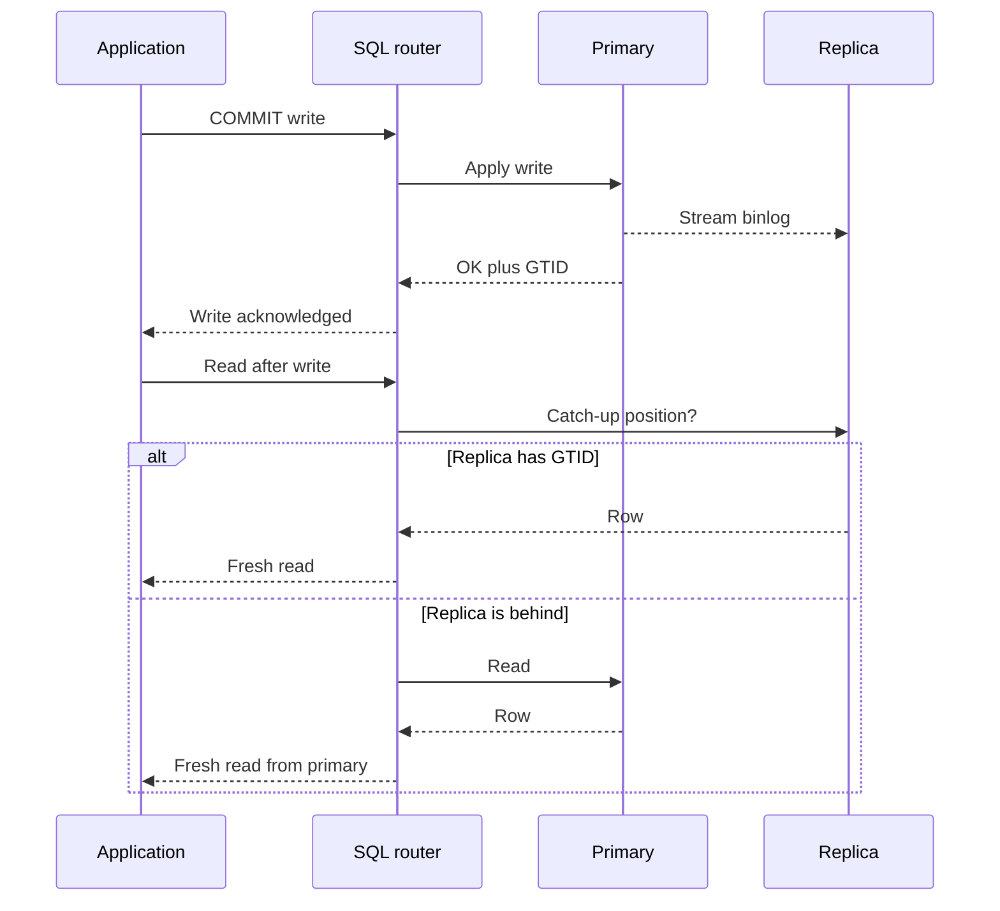

Read replicas are how you buy read throughput without buying a bigger primary. The primary takes writes. Copies of those writes stream to one or more replicas. Application reads fan out. That sentence is the easy part. The hard part is replication lag: the replica is a delayed picture of the primary, and every product behavior that assumes "I just wrote it, so I can read it" will eventually be wrong. Architects who treat lag as a monitoring curiosity rather than a consistency budget ship heisenbugs into checkout, sessions, and admin tools.

## Concept

### What a replica actually is

A replica is not a load-balanced clone of the primary. It is a follower that applies a log of committed changes. In MySQL that log is the binary log, optionally row-based. In PostgreSQL it is the write-ahead log shipped and replayed. Cloud products wrap the same idea: a reader endpoint that is not allowed to take application writes.

Because the replica applies a log, it can only be as fresh as apply speed allows. Disk, CPU, large transactions, and network delay all add lag. A replica can also be promoted to primary, which is why you keep it in the same failure domain design as the writer. Using replicas only for analytics and forgetting they are your failover targets is how a "reporting box" becomes the production primary with the wrong parameter group.

### Synchronous versus asynchronous apply

Synchronous replication waits for at least one replica to acknowledge before the primary reports commit to the client. You buy a tighter durability and freshness story. You pay in write latency and in availability: if the synchronous replica is slow or partitioned, commits stall. Semi-sync variants acknowledge once the replica has received the log, not once it has applied it, which protects against primary disk loss better than it protects against read-your-writes.

Asynchronous replication reports commit as soon as the primary has durable local state. Replicas catch up when they can. This is the default in most OLTP deployments because write latency stays local. The cost is unbounded lag under load and data loss if you failover to a replica that had not received the tail of the log. Asynchronous is not "eventual consistency" as a product feature. It is "the replica might be seconds or minutes behind, and you have to design for that."

### Lag is a consistency budget

Measure lag as time and as bytes, then translate both into user-visible windows. Time lag is what product owners understand: "a follower may be up to two seconds behind." Byte lag and apply-queue depth tell you whether the replica is catching up or drowning. A replica that is one second behind on a quiet Sunday and thirty seconds behind during a flash sale is not one replica. It is two different consistency modes.

Once you have a budget, you can place reads. Anything that must observe a write the same user just made belongs on the primary or on a session that waits for the replica to catch up. Anything that can tolerate the budget, such as a public catalog or a dashboard, belongs on replicas. Mixed workloads on one replica without routing rules will put the strict read next to the scanning report and then blame MySQL for "random stale reads."

### Read-your-writes and monotonic reads

Read-your-writes is the property users notice first. They update a profile, navigate, and see the old name. The fix is not "more replicas." The fixes are: send that user's reads to the primary for a short window, store the write's log position in the session and delay replica selection until the replica has applied it, or serve the write response as the next view without re-reading.

Monotonic reads are the next property. A user who hits replica A, then replica B, should not go backward in time. If A is caught up and B is not, a refresh looks like data vanishing. Sticky sessions to one replica, or a global watermark that refuses to serve a replica older than the last observed position, restore monotonicity. Load balancers that spray connections per request make this worse on purpose.

### Routing, not hope

Replica use is a routing problem. The application, a proxy, or a driver must know: this query is a write, this query is a stale-ok read, this query is a read-your-writes read, this query is a long analytic scan that must never share a replica with user traffic. Vitess, ProxySQL, and cloud reader endpoints all exist to make that routing less ad hoc. If the only rule is "reads go to the replica hostname," you will discover the missing rules in production.

Capacity is part of routing. Adding replicas increases read QPS and increases apply cost on every replica, because each one replays the full write stream. Ten replicas do not share write apply. They duplicate it. At some point you shard instead of scaling replicas.

## Trade-offs

Replicas are a scaling lever with a consistency price. The lever still works. You just have to pick which reads are allowed to pay.

| Approach | When it wins | Cost / risk |
| -------- | ------------ | ----------- |
| Async replicas, stale-ok reads | Read-heavy OLTP, catalogs, feeds, internal dashboards | Stale reads; data loss on naive failover; lag spikes under write bursts |
| Semi-sync or sync to a local replica | Failover with bounded data loss, same-region HA | Higher write latency; commit stalls if the ack replica dies |
| Primary reads for a session window | Read-your-writes after mutations | Primary becomes the read bottleneck for chatty UIs |
| Position-based wait on a replica | Need replica scale and read-your-writes | Tail latency if the replica is behind; thundering waits after catch-up |
| Replica dedicated to analytics | Isolate reporting scans from user reads | Extra copy of the write stream; still lag; not a warehouse |

Async replicas are the right default for user-facing reads that do not include the writer's next page. The operational discipline is lag SLOs and failover policy. Promote only replicas within a loss budget. If finance cannot lose the last second of payments, async promotion is not an HA plan. It is a restoration plan.

Synchronous and semi-synchronous modes earn their keep in the same region, on a dedicated replica, with timeouts that fail to async rather than freeze the primary forever. Cross-region sync is a latency product decision, not a checkbox. A 60 ms round trip on every commit is a different system than a 2 ms local ack.

Session-sticky primary reads are the simplest correctness patch and the first thing that overloads the primary after a launch. Bound the window: one second, or until the replica reports a position past the write. Do not leave "all reads for logged-in users" on the primary because it was easier than teaching the router.

Position waits are the grown-up version. The writer returns a binlog coordinate or GTID. The next read selects a replica that has applied that coordinate, or waits a bounded time and then fails to the primary. This is how you keep replica scale without lying to the user. It requires a driver or proxy that understands GTIDs, and it requires you to load-test the wait path.

## Diagram

A write lands on the primary and streams to replicas. The router sends stale-ok traffic to replicas and sends read-your-writes traffic to the primary or to a replica that has caught up.

If you omit the GTID handshake, the sequence collapses to "write primary, read replica, shrug." That is a valid design for a public homepage. It is not a valid design for "save settings and re-render."

## Failure modes

### Replica lag spikes during write bursts

**Detection.** Seconds behind master, binlog dump rate versus apply rate, replica SQL thread CPU, and application-level stale-read complaints clustered at peak. Track p99 lag, not only average.

**Mitigation.** Separate user replicas from analytics replicas. Break large transactions into smaller commits so the apply thread is not blocked on one statement. Use parallel apply where the engine supports it, keyed by conflict domains. Shed or delay non-critical writes. If lag regularly exceeds the product budget, you have a sharding problem, not a replica-count problem.

### Stale reads after write, including "vanishing" rows

**Detection.** Client telemetry that compares write timestamp to subsequent read. Synthetic probes: insert a canary row, read it from the replica endpoint, measure time-to-visible. Support tickets that mention refresh fixing the page.

**Mitigation.** Route post-mutation reads to the primary or wait on GTID. Sticky replica per session for monotonicity. Cache the write response in the application for the next render. Do not hide this in a retry loop that eventually hits the primary by accident.

### Failover to a lagging replica, lost writes

**Detection.** Replication position at promotion time. Gaps between primary binlog and replica relay log. Customer reports of "submitted but gone" after an HA event.

**Mitigation.** Orchestrators must refuse promotion of replicas outside the loss budget. Semi-sync or lossless failover modes for payment and inventory primaries. After promotion, treat the old primary as poisoned until it is rebuilt as a replica; it may contain writes the new primary never saw. Replicas used only for reads still need HA-grade disk and monitoring if they are promotion candidates.

### Replica overload from a single bad query

**Detection.** One replica's CPU or I/O diverging from its peers. Connection counts and slow-query logs unique to that host. Router error rates on one backend.

**Mitigation.** Do not put ad-hoc analytics on user replicas. Statement timeouts. Query killers. Connection pooling per role. If you use a single reader endpoint, one heavy query still lands somewhere; isolate reporting. Rebuild a replica from snapshot rather than letting it "catch up" if apply is days behind.

### Split-brain after a false failover

**Detection.** Two writers accepting commits. Replication errors about conflicting GTIDs or duplicate keys. Rows that exist only on one side.

**Mitigation.** Fencing: the old primary must not accept writes after a lease loss. STONITH or cloud API to detach disks and security groups. Use a consensus-based orchestrator rather than a single health-check script. Replicas do not create split-brain by themselves; two primaries do.

## Real-world example

MySQL replicas are the workhorse of this pattern, and GitHub's public engineering writing is a useful walkthrough because they ran the pattern at a scale where lag stopped being theoretical.

The system of record for much of GitHub.com was (and in evolved form, through Vitess, still is) MySQL. Writes for issues, pull requests, and metadata hit a primary. A fleet of replicas served the much larger read traffic: rendering a repository page, listing issues, showing a profile. Replication was asynchronous row-based replication. That choice kept write latency on the primary low enough for interactive use.

Lag showed up as product bugs. A user comments on an issue and the issue page, served from a replica, does not show the comment. A repository is created and the next redirect 404s because the replica has not applied the insert. GitHub's response was not "make replication synchronous globally." It was routing and coordination. After a write, subsequent reads for that session could be pinned to the primary for a short window. Replicas were grouped so that expensive reporting did not share apply capacity with HTML rendering. They invested in GTID-based operations so that failover and replica provisioning were position-aware rather than file-and-offset folklore.

At further scale, replica count stopped helping. Every replica applied the same primary write stream. The apply CPU became the bottleneck, and large transactions created multi-second lag cliffs. The architectural move was to shard with Vitess: many primaries, each with its own replica set, so that write apply was partitioned. Replicas remained, but they were replicas of a shard, not of a god primary.

Failover policy was as important as read policy. Promoting a replica that was five seconds behind during an incident would drop those five seconds of writes: stars, comments, and webhook deliveries. Semi-sync and orchestration rules existed to bound that loss. After a promotion, the old primary could not be allowed to accept a stray write.

If you run RDS or Cloud SQL tomorrow, you are in the same design. A reader endpoint is an async replica with a DNS name. Cross-AZ replicas give you failure isolation, not zero lag. Cross-region read replicas give you locality for readers and a disaster-recovery candidate, with lag dominated by the ocean. None of these products magically provide read-your-writes. Your application still has to route.

## What to remember

- Replicas multiply read capacity; they duplicate write apply, so lag is the real scaling limit of a single primary.
- Treat lag as a product SLA and route reads on purpose: stale-ok to replicas, read-your-writes to the primary or a GTID wait.
- Failover to a replica is a data-loss decision unless you bounded that loss with semi-sync and orchestrator policy.
- When replica apply cannot keep up, shard the primary; more replicas will not drain a single write stream faster.
