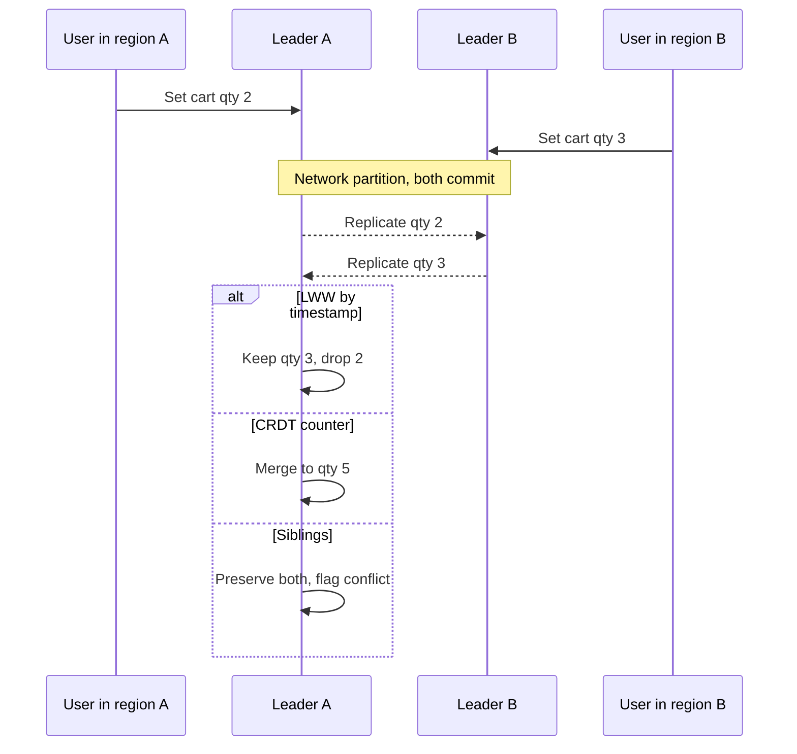

Multi-leader replication lets more than one node accept writes for the same data, then ships those writes to the others. You buy write availability during a region outage, lower write latency next to the user, and a topology that does not bottleneck on a single primary. You pay with conflicts: two leaders can commit different values for the same key before they have seen each other. If you cannot name the conflict policy before you enable the second writer, you do not have a multi-leader system. You have two databases that will disagree in production.

## Concept

### Why a second writer exists

Single-leader replication is operationally kind. One node serializes writes. Replicas are readers and failover candidates. Multi-leader appears when that model hurts: a region cannot wait for a transoceanic round trip to the primary; a mobile or store database must accept writes while partitioned; an active-active pair is a business requirement, not a DR slide.

The topology is a mesh or a ring of leaders, each replicating to the others, often asynchronously. Clients write to the nearest leader. There is no global lock at commit time unless you add one, at which point you have reinvented a single leader with extra steps. Consensus systems like Spanner and Raft-based distributed SQL are not multi-leader in this sense. They coordinate writes. Multi-leader, as practiced in Cassandra, Dynamo-style stores, and some MySQL and PostgreSQL extensions, does not.

### The conflict window

A conflict is two concurrent writes to the same item that neither leader observed before committing. Concurrency here is causal: neither write happened-before the other in the replication graph. Wall clocks do not define concurrency. A write in Frankfurt at 10:00:00.010 and a write in Virginia at 10:00:00.000 can still conflict if the log has not crossed the ocean.

The window is at least the replication delay, and under partition it is unbounded. That is the point of the pattern. You accepted writes during the partition. After heal, you must merge. Teams that "just use timestamps" have chosen a merge function. They have not eliminated conflicts.

### Last-write-wins, merge functions, and CRDTs

Last-write-wins (LWW) picks the value with the greater timestamp, or the greater vector-clock version if you are careful, and discards the other. It is simple, lossy, and contagious. Clock skew becomes data loss. Two users editing a profile can silently drop a field. LWW is acceptable for values where the latest observation is the truth: a GPS ping, a "last seen" heartbeat, a cache fill. It is unacceptable for counters, sets of grants, and shopping carts if you care about every increment.

Typed merge functions keep more information. A counter stores deltas and sums them. A set stores additions and removals with enough metadata to make union deterministic. A document might merge per field: name LWW, tags as a set, balance as a rejected conflict that queues for a human. This is how you stay honest. Each field has a type, and the type has a merge.

Conflict-free replicated data types (CRDTs) are merge functions with proofs. G-counters, OR-sets, and LWW-registers are the ones you will actually ship. They do not remove the need to pick a type. They make the pick mechanically safe under concurrent updates. They still require tombstone hygiene, and they still require that every writer use the same type. A CRDT counter plus an LWW overwrite from a "fixup script" is not a CRDT.

### Application-level resolution

Some conflicts should not be merged automatically. Inventory that went negative in two regions, a unique username claimed twice, a payment captured twice: these are business events. The datastore can preserve both versions, expose a conflict, and let a workflow decide. That is more work than LWW. It is also the only way to stay out of the financial press.

The application must be written for this. Hidden last-write-wins inside the driver will swallow the conflict before your workflow sees it. If the product needs both values, the storage API has to return siblings, as Riak did, or you have to record both writes in a log and resolve in a consumer.

### Identity, causality, and clocks

You cannot resolve what you cannot identify. Primary keys must be unique without a central allocator: ULIDs, shard-local sequences with a node prefix, or coordinated IDs. Autoincrement integers on two leaders collide.

Causality needs more than a wall clock. Version vectors or dotted version vectors tell you whether write A is an ancestor of write B or concurrent. Hybrid logical clocks reduce skew pain without claiming to total-order concurrent writes. TrueTime-style APIs belong to a different architecture. If you are on Cassandra timestamps, you are in LWW land, with microsecond ties broken by some replica-id rule you should read twice.

## Trade-offs

Multi-leader is a write-availability pattern. Conflict policy is the product surface. Pick both in the same design review.

| Approach | When it wins | Cost / risk |
| -------- | ------------ | ----------- |
| Single leader plus local reads | Most OLTP; conflicts would be expensive | Cross-region write latency; writer is a regional SPOF |
| Multi-leader with LWW | Last-observation-wins data, presence, telemetry | Silent data loss; clock skew; poor fit for counters and sets |
| Multi-leader with typed merge or CRDTs | Concurrent increments, sets, collaborative fields | Type discipline; tombstones; repair still required |
| Multi-leader with sibling preservation | Business conflicts that need a workflow | Application complexity; user-visible conflict UX |
| Consensus / distributed SQL | Need one serializable timeline globally | Latency of coordination; not the multi-leader cost model |

Single leader remains the correct default. Enable a second writer only for a named failure or latency requirement. "Active-active" as a brand on a slide is not a requirement. Two regions of readers with one writer is often enough, and it keeps conflicts out of the data model.

LWW is honest when the value is a snapshot of the world. It is a bug when the value is an accumulation. A common disaster is storing a JSON document and letting LWW replace the whole blob. Two concurrent field edits collapse to one document. If you must LWW, LWW per field, and still expect loss.

CRDTs and typed merges are the adult path for collaborative and additive data. They are not free. Tombstones for deletions can grow without bound if you never garbage-collect. Every client, including one-off admin scripts, must speak the type. The moment someone updates a counter with a raw overwrite, you have corrupted the merge.

Sibling preservation is rare in popular databases and common in business reality. If the engine cannot store siblings, keep an event log as the source of truth and make the derived row a merge of the log. That is more operational work and far fewer "the database ate my write" incidents.

## Diagram

Two regions accept writes for the same key during a partition. After the link heals, both values exist and a merge policy must produce one replica state.

The cart example is not a toy. It is the difference between losing an add-to-cart, double-counting, and asking the user which basket is right. Your merge policy is a product decision encoded in storage.

## Failure modes

### Silent overwrite under LWW

**Detection.** Customer reports of missing fields after dual-region writes. Audit diffs that show a version disappearing without a delete. Clock-skew dashboards: replica time offset versus NTP.

**Mitigation.** Stop using document-level LWW for multi-field records. Switch to per-field merge or an event log. Bound clock skew with NTP alerts and reject writes from nodes beyond a skew budget if the engine allows. For irreversible business events, do not LWW at all.

### Divergent replicas after a long partition

**Detection.** Read repair and anti-entropy metrics. Merkle tree mismatches. Spot checks of the same key from two regional endpoints returning different values after heal.

**Mitigation.** Anti-entropy (repair) as a scheduled job, not only as a read-path side effect. Hinted handoff with bounded hint windows. After a partition, run repair before you declare the region healthy for reads that must be globally aligned. Accept that some keys need a rebuild from a log.

### Conflict storms on hot keys

**Detection.** High write QPS to a small key set from multiple regions. Elevated pending-hint and dropped-mutation counters. CPU on merge. User-visible flicker as values bounce.

**Mitigation.** Do not multi-lead a hot counter if you can shard it or make it regional. Use commutative types so merge is cheap. Pin some keys to a home region and proxy writes, keeping multi-leader for the rest. Hot keys plus LWW is a random walk.

### Unique constraints that are not unique

**Detection.** Duplicate usernames, duplicate invoice numbers, two rows that both think they hold a lock. Unique indexes that only hold inside one leader.

**Mitigation.** Do not enforce global uniqueness in a multi-leader row store unless the engine coordinates it. Allocate IDs with a node prefix. For usernames, use a single-leader allocation service or a compare-and-set on a dedicated coordinator. Treat "unique" as a reservation protocol, not an index.

### Repair and tombstone resurrection

**Detection.** Deleted data reappearing after repair. Growing disk from tombstones. Read latency creeping as merge sets enlarge.

**Mitigation.** Tombstone grace periods that outlast repair and backup delay. Repair before dropping tombstones. Document the delete semantics for operators: a delete is a write, and it must replicate. Restore-from-backup into a multi-leader cluster can resurrect data unless you restore all sides to the same snapshot.

## Real-world example

Cassandra is the public system to study here, because it is multi-leader in the default mental model: any replica that owns a token can take a write, and those writes fan out to other replicas according to the replication factor and consistency level.

A write of `UPDATE carts SET qty = 3 WHERE id = X` on a coordinator in `eu-west-1` is timestamped, hashed to token owners, and sent to those replicas. A concurrent write in `us-east-1` for the same partition key does the same. There is no election. If both writes use `LOCAL_QUORUM`, each region can commit without seeing the other. After replication, each replica has two cells for `qty` and Cassandra keeps the one with the greater client timestamp. That is last-write-wins.

This is a reasonable policy for a column that represents "latest known quantity from a single writer," and a terrible policy for "two add-to-cart operations." Netflix and similar Cassandra shops learned to model additive facts as commutative updates, or to avoid concurrent regional writers for the same partition key. Idempotent writes with explicit timestamps, lightweight transactions (Paxos per partition) for the rare compare-and-set, and data models that make conflicts unlikely were the actual architecture. The database did not save you from the product.

Hinted handoff and repair are part of the conflict story. If a replica is down, a peer stores a hint and replays it later. If hints expire, anti-entropy repair compares Merkle trees and streams missing mutations. Repair can apply an old timestamped cell that still wins against a clock-skewed newer write, or resurrect a value if a tombstone has expired. Operators who run repair without understanding timestamps and `gc_grace_seconds` watch deleted rows come back.

Consistency levels change the conflict window, they do not remove it. `QUORUM` across regions makes concurrent commits harder and makes a regional outage a write outage. `LOCAL_QUORUM` keeps regional write availability and accepts a longer merge delay. That is the multi-leader trade-off in one setting.

When teams needed true collaborative merge, they did not ask Cassandra to become a CRDT database for every column. They stored events, or they used types (counters, sets) with known merge behavior, or they pinned a partition to a home region. The lesson for architects is the same outside Cassandra. Multi-leader is easy to turn on. Conflict resolution is the design. If your merge is LWW on a blob, you have chosen to drop concurrent work, and you should say that in the design review.

## What to remember

- A second writer buys availability and local latency; it always creates a conflict window at least as long as replication delay.
- Last-write-wins is a merge function that discards data; use it only for last-observation values, never for counters, sets, or multi-field documents.
- Model each field's type and merge before you enable active-active; CRDTs and sibling workflows are choices, not magic.
- Unique constraints, hot keys, and tombstones fail in multi-leader ways that single-leader testing will not show; repair is part of the product.
