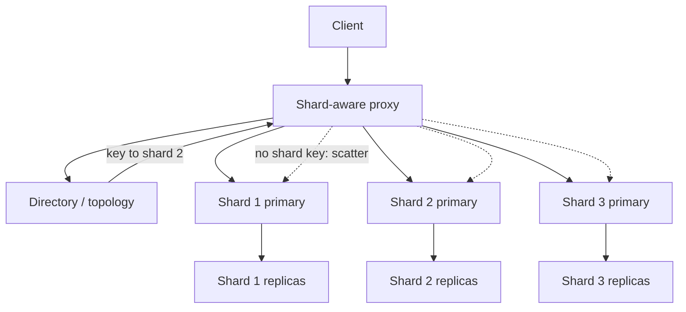

Sharding splits a data set across independent primaries so that no single node owns every row and every write. You pick a shard key, you pick a mapping from that key to a physical shard, and you live with the consequences for years. The three mappings that show up in production are range, hash, and directory. They are not interchangeable defaults. They decide whether adjacent keys live together, whether load is even, and whether you can move data without rewriting every client. Architects who choose a shard key from a convenience column, then pick hash because it "spreads nicely," rediscover hot partitions and scatter-gather queries on the same afternoon.

## Concept

### What sharding actually changes

A replica set scales reads. Sharding scales writes and storage. Each shard is its own primary with its own WAL, its own backups, and its own failure domain. A query that names the shard key becomes a single-shard query. A query that does not becomes a scatter-gather across many shards, with tail latency equal to the slowest shard and operational blast radius equal to the fleet.

The shard key is therefore the most expensive schema decision after "what is the system of record." It should match the access pattern that must stay fast and transactional: customer id for a SaaS tenant, order id for an order service, device id for telemetry. If the fast path is "all orders for this customer today," and you shard by order id hash, you have built a distributed table scan into the product.

### Range sharding

Range sharding assigns contiguous key intervals to shards: A–G on shard 1, H–N on shard 2, O–Z on shard 3. Time-based keys and lexicographic identifiers map naturally. Range scans that stay inside an interval are local. So are time-bounded queries if you shard on a timestamp prefix.

The failure mode is load skew. New data often lands at the high end of a time range, so "today" is one hot shard and last year is cold. Monotonic keys, such as autoincrement ids and ULIDs used as the only shard key, concentrate writes on the latest interval. You then split that interval, and the new high shard heats up again. Range sharding wants a key whose growth is not a moving hotspot, or a willingness to split and merge as part of normal operations.

Range still wins when locality is the product: "give me this user's events from 10:00 to 10:05," "give me all SKUs in this category prefix," "iterate keys in order for a compaction job." Ordered iteration across hashes is a different, more expensive design.

### Hash sharding

Hash sharding computes a hash of the shard key, then maps the hash onto a ring or a modulo of shard count. Adjacent keys scatter. Write load for a well-chosen key is even, assuming no hot key. Single-key lookups are still single-shard. Range queries become scatter-gather unless you stored the range as part of a different access path.

Modulo hashing, `hash(key) % N`, is simple and hostile to growth. Changing N remaps almost every key. Consistent hashing and its descendants (jump, Maglev, rendezvous) remap only a fraction of keys when you add a node, which is why they dominate at fleet scale. Hash sharding does not remove hot keys. A celebrity user id still hashes to one shard. It only removes hot ranges caused by key order.

Hash wins for request patterns that are point lookups and short primary-key transactions, with no need to scan neighbors. Session stores, user profiles by user id, and many OLTP tables look like this. Analytics over a key range does not.

### Directory (lookup) sharding

Directory sharding stores an explicit map: this key, tenant, or chunk lives on that shard. The map sits in a strongly consistent control plane: etcd, ZooKeeper, a small metadata SQL cluster, or a dedicated directory service. Clients, or a proxy, query the directory, cache the location, and send the data plane request.

The directory can encode range assignments, hash vnodes, tenant placements, and exceptions. That is the point. You can pin a noisy tenant to its own shard, move one key away from a hotspot, and reshard by rewriting metadata instead of by changing a hash function in every client. The costs are an extra lookup, cache invalidation when the map changes, and a control plane that can take down routing if it is unavailable.

Pure directory-per-key does not scale to billions of keys. Production directories map chunks, tablets, or key ranges, not individual rows. Bigtable, Vitess Vindexes plus a topology server, MongoDB config servers, and DynamoDB's internal partition map are all directories over ranges or hash slots.

### Combining the three

Most mature systems are hybrids. Hash the tenant id so tenants scatter, then range-partition events inside the tenant by time so a day is local. Keep a directory of those range assignments so you can split a hot tenant without changing the hash. Vitess keyspaces, Cockroach ranges, and Cassandra token rings plus vnodes are this idea with different vocabulary.

The application still sees one rule: a shard key, and whether a query is targeted. Everything else is topology. Do not leak modulo-N into business services if you can put a proxy and a directory in front. Clients that embed shard math become a resharding blocker.

## Trade-offs

Pick the mapping that matches the query you cannot afford to scatter, then mitigate the skew that mapping creates.

| Approach | When it wins | Cost / risk |
| -------- | ------------ | ----------- |
| Range | Ordered scans, time-local queries, prefix locality | Hot head/tail; monotonic keys; split/merge as routine ops |
| Hash (consistent) | Even load for point lookups; easy horizontal add of shards | No locality; scatter-gather ranges; hot keys still concentrate |
| Hash modulo N | Tiny fleets, frozen shard count | Almost total remap on reshard; avoid in anything that will grow |
| Directory of chunks | Custom placement, tenant pins, online moves | Metadata SLO; cache invalidation; control-plane dependency |
| Hybrid hash-then-range | Tenant isolation plus in-tenant scans | More moving parts; two keys to get right |

Range is the right call when the product is a scan. Time-series, inbox threads, and key-ordered migrations all want it. Budget for splits. If your insert key is `now()`, you are building a single hot range unless you add a hash prefix or a bucket.

Consistent hash is the right call when the product is a get/put by id and you expect the fleet to grow. It is the wrong call if the homepage is "latest 50 events for this device" and the shard key is event id. Secondary indexes in a hash-sharded OLTP store are either local (same shard key) or global (another sharded table, dual-written). That second sentence is where hash sharding gets expensive.

Directory placement is how you keep the other two livable. Even a hash ring is a directory of vnode-to-node assignments. Making that directory explicit, versioned, and cached with a generation number is what lets you move data at all. The risk is treating the directory as "just config" instead of as a serving dependency with an SLO.

Modulo hashing deserves a special refusal. It is fine for a proof of concept with four shards you will throw away. It is a trap in any system that will add shard five. The rewrite is consistent hashing plus a directory, which you could have started with.

## Diagram

A router resolves the shard key through a directory, then sends the data query to one shard primary. Scatter-gather is the path when the key is missing.

The dotted scatter path is not a fallback you want on the user request. It is a batch, an admin tool, or an explicit fan-out with a budget. If the homepage needs scatter, the shard key is wrong.

## Failure modes

### Hot range or hot hash slot

**Detection.** Per-shard QPS, CPU, and write throughput that diverge. One shard's replication lag climbing while peers are idle. Tenant or key histograms at the proxy.

**Mitigation.** Split ranges. Rehash with a more granular key (tenant plus bucket). Pin or isolate a hot tenant via the directory. For a single hot key, you need key-level techniques (see hot keys); sharding strategy will not save a celebrity row. Avoid monotonic-only range keys.

### Scatter-gather tail latency

**Detection.** Query traces showing fan-out to all shards. p99 much worse than per-shard p50. Timeouts that disappear when you add a shard key to the query.

**Mitigation.** Require the shard key on user-facing APIs. Maintain a local secondary index per shard, not a cross-shard index, for filters you need. For true global queries, run them on a derived store, not on the OLTP shards. Cap fan-out and fail the request rather than hanging the fleet.

### Directory cache serving stale placement

**Detection.** Requests hitting the wrong shard after a move. Not-found that succeeds on retry. Topology version mismatches in proxy logs.

**Mitigation.** Version the map. On a wrong-shard error, invalidate and refetch. Dual-serve during a move: the proxy tries the old location, then the new. Make directory reads cheap and highly available; a single-node MySQL map will page you independently of the data.

### Cross-shard transactions

**Detection.** Dual writes, orphan rows, or two-phase commit timeouts. Integrity bugs that only appear when related rows hashed apart.

**Mitigation.** Keep a transaction inside one shard by embedding the same shard key on related rows. If you cannot, use a saga or an outbox, not a distributed transaction, unless you have a database that was built for it. Cross-shard foreign keys are a wish, not a constraint.

### Resharding with modulo math baked into clients

**Detection.** Every client release must ship when N changes. Phantom reads during the cut. Teams afraid to add capacity.

**Mitigation.** Hide mapping behind a proxy and a directory on day one. Use consistent hashing or range splits. Treat client-side shard math as a bug.

## Real-world example

Vitess is the public system that made MySQL sharding operable at YouTube and later at Slack, GitHub, and PlanetScale. The unit of sharding is a keyspace split into shards, each a MySQL primary plus replicas. Applications speak SQL to VTGate, a proxy, which routes using Vindexes: a mapping from a column value to a shard.

The default mental model is hash-like: a unique Vindex hashes the keyspace id and places it on a shard. That gives even load for lookups by that column, typically a user or video id. Vitess also supports lookup Vindexes, which are directories: a small, sharded index table records that this secondary key lives on that shard. Range-like behavior appears in how shards are defined as key ranges on the hashed keyspace id. Splitting a shard is splitting a range of that space, not changing a modulo in application code.

YouTube's problem was a classic god-primary: too many writes, too much apply lag on replicas, too much cold data next to hot. They did not ask every feature team to compute `user_id % 1024`. They put VTGate in front, defined a keyspace id, and moved tables into sharded keyspaces incrementally. Queries that include the Vindex column go to one shard. Queries that do not scatter, and Vitess makes that scatter explicit and expensive enough that engineers feel it.

The directory is the topology service: which tablet is primary for shard `-80`, which is `80-`. VTGate caches this. On failover, the topology updates, and the proxy stops sending writes to the old primary. That control plane is part of the sharding strategy. Hash without a directory is a formula. Hash with a topology server is a system you can reshard.

When a shard heated up, the operation was a split: copy a range of keyspace ids to a new pair of shards, then atomically update the topology so VTGate routed the two halves separately. Applications kept sending the same SQL. That is the payoff of directory-backed range-of-hash over modulo hashing in the client. The strategy was not "we hashed, so we are done." It was "we hashed to spread, we tracked assignments as ranges, and we left ourselves a move operation."

If you shard MySQL without a Vitess-like proxy, you will reinvent VTGate poorly: a library in each language, a wiki page of shard maps, and a night when marketing launches in one hash bucket. Study the Vindex and topology split even if you never run Vitess. Range, hash, and directory are three layers of one design, not three vendors.

## What to remember

- Shard keys must match the transaction and lookup you cannot scatter; everything else becomes a fleet-wide query.
- Range preserves locality and creates hot ends; hash spreads point load and destroys locality; a directory makes either one movable.
- Never bake `hash % N` into clients; put mapping in a versioned topology and a proxy.
- Cross-shard work is not a SQL join with extra latency; it is a different product path, and it should be rare on the user request.
