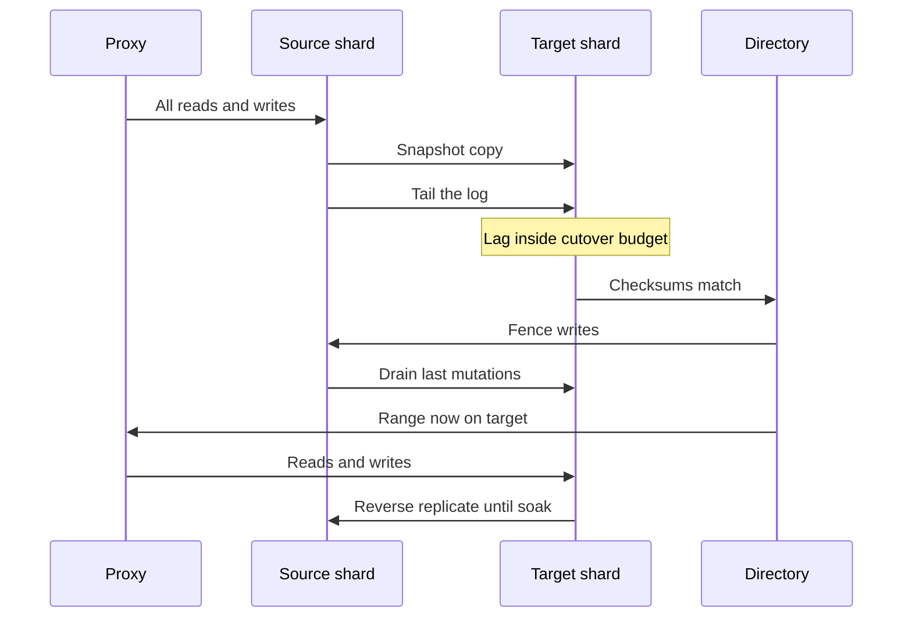

Resharding is moving live data from one shard map to another while clients keep reading and writing. Adding hardware is the easy headline. The work is keeping a moving key correct: no lost writes, no silent duplicates, no reads that bounce between old and new as if the row were flickering. Downtime resharding is a maintenance window and a backup restore. Online resharding is a state machine with dual ownership, verification, and a cutover that can abort. If you cannot abort, you do not have a zero-downtime plan. You have a hope.

## Concept

### Why the map must change while traffic runs

You reshard because a shard is out of disk, out of CPU, or out of apply capacity on its replicas; because a range is hot; because you are migrating off a god-primary; or because a tenant has to move for residency. The business will not freeze writes for the copy time once the data set is large. Copy time is measured in hours to days. The cluster must accept mutations for keys that are in flight.

That requirement implies a dual-ownership window. For some set of keys, both the source shard and the target shard may have a copy, and only one may be allowed to accept writes, or both must receive them in a defined order. Every successful online reshard you will read about is a variation of copy, catch up, dual run, cut over, and decommission.

### Copy and catch-up

The first phase is a bulk copy of a key range or hash slot from source to target. You take a consistent snapshot if the engine allows, or you copy at a low isolation and accept that catch-up will fix it. The copy must be throttled. An unthrottled clone job is an outage of the source shard by another name.

Catch-up applies mutations that happened after the snapshot. The usual mechanism is the replication log: MySQL binlog, MongoDB oplog, Postgres WAL decoded through logical replication, or a change feed. The target is a replica of a subset of the source, not a full twin. You are done with catch-up when the target's apply lag is inside a cutover budget, typically seconds, not hours.

### Dual writes, dual reads, and forwarding

While catch-up runs, writes still hit the source. After the target is close, you have to stop the source from being the only truth. Two patterns dominate.

Forwarding: the router still sends writes to the source, which replicates them to the target. Cutover is "stop writes on source, wait for drain, point the router at the target." This is conceptually a replica promotion of a slice. It fails if the source cannot produce a clean subset log, or if you need to split in place without a replica of that slice.

Dual write: the router sends each mutation to source and target, or the source proxy writes locally and asynchronously to the target with an outbox. Dual write without a log is how keys diverge. Dual write with a log or with blocking on both commits is slower and easier to reason about. Some systems write only to the target once the router has switched, and they reverse-replicate back to the source so rollback is possible. Reverse replication is the difference between a cutover and a trap.

Reads during the move should go to a single owner. Reading both and racing is how users see flicker. If you must read the target before it is the owner, do it only in a shadow path that compares results and never serves the response.

### Atomic cutover

Cutover is a metadata change: the directory now says this range lives on the target. It must be atomic from the client's point of view. In practice that means a generation number, a short fence of writes, or a protocol where the source rejects writes after a timestamp and the target accepts them only after it has the same timestamp.

The fence is the closest you get to "downtime," and it should be sub-second to a few seconds of elevated latency, not a maintenance page. If your directory cannot fence, you will get split writes: one request landed on the source after the target had already taken a later write. Unique keys then duplicate, counters skip, and caches lie.

Abort is a first-class transition. Until cutover is acknowledged, the source remains the owner, the target is a candidate, and you can throw the candidate away. After cutover, rollback is another reshard in the opposite direction, which you should have tested, including reverse replication.

### Verification is the real gate

Copy jobs lie. They skip rows, double-apply, or truncate a type. Before cutover, compare. Row counts per bucket, checksums of key ranges, sampled get-after-write from both sides, and a live differ that consumes both logs. Do not cut over on "the job finished." Cut over on "the differ has been quiet for N minutes and lag is under budget."

After cutover, keep the source in a blocked, read-only, reverse-replicating state until you are confident. Decommission is a later change. Teams that drop the source at the cutover toast find the missing index the next morning.

## Trade-offs

Online resharding always costs extra disk, extra apply CPU, and a control-plane that can freeze writes for a blink. The variants differ in how they keep keys single-writer.

| Approach | When it wins | Cost / risk |
| -------- | ------------ | ----------- |
| Offline dump and restore | Small data, true maintenance window, simple engines | User-visible downtime; write loss if the window overruns |
| Replica-of-a-slice then promote | Engines with subset replication and a topology service | Requires log filtering; promotion fencing |
| Live balancer moving chunks | Mongo-style clusters with background chunk moves | Background I/O; metadata storms; jumbo chunks that will not move |
| Dual write plus differ | Heterogeneous targets, migrations between engines | Divergence; double cost; hard abort unless reverse path exists |
| Consistent hash remap with copy | Adding nodes in vnode systems | Partial remap still copies a lot; hot vnodes need extra care |

Offline is valid. A 20 GB shard in a SaaS you control can be copied in a window. Pretending you need Vitess-grade resharding for that data set is ceremony. The moment copy time exceeds the window, or the business forbids the window, you graduate.

Slice promotion is the cleanest online method when you already replicate. Vitess reshard, some Redis cluster slot migrations, and range splits in distributed SQL all look like this: clone, catch up, update metadata, fence. Invest in the topology primitive. Without it, you will dual-write.

Balancer-driven chunk moves work when chunks are small and the metadata server is stable. They fail when a chunk is jumbo because a single shard key owns too much data, or when the balancer competes with the working set. You still need a throttle and a "balancer off" switch for incidents.

Dual write is the migration between different products: MySQL to DynamoDB, unsharded to sharded, engine A to engine B. Treat it as a product migration with a differ, not as a weekend script. The abort plan is "router still owns source." Never switch reads before the differ is boring.

## Diagram

A range is copied to a new shard, caught up from the log, verified, then the directory flips ownership. The source stays reverse-replicating until decommission.

If any step cannot run while the previous owner is still serving, you are back to a window. The fence plus drain is the only blocking interval. Keep it short and abortable.

## Failure modes

### Lost or duplicated writes at cutover

**Detection.** Unique key violations on the target. Counters that skip. Customer-visible creates that 404. Log position gaps between fence and first target write.

**Mitigation.** Fence the source before declaring the target owner. Drain the log to zero lag. Idempotent applies keyed by primary key plus version. Hold the source in reverse-replication so you can move back. Practice cutover in a dry run that does not flip user traffic.

### Copy job overloads the source

**Detection.** Source CPU, disk, and lag climbing with the clone. User timeouts on the shard being split.

**Mitigation.** Throttle. Copy from a replica, not the primary, when possible. Pause the job on lag SLO breach. Split smaller ranges. Never "let it run overnight at full speed" on a serving shard.

### Silent divergence found after decommission

**Detection.** Checksums that were skipped. Support tickets weeks later. Backups of the source already gone.

**Mitigation.** Differ before cutover and during soak. Sample live reads. Retain the source until a full backup of the target exists and a business verification sign-off is recorded. Delete is a separate, later change.

### Jumbo chunk or unsplittable hot key

**Detection.** Balancer reports a chunk at the max size that cannot split because all data shares one shard key. One key's documents fill a shard.

**Mitigation.** This is not a resharding procedure problem. Change the key, split the document, or isolate the key on a dedicated shard. Resharding moves ownership of a key. It cannot split a key the schema glued together.

### Directory or balancer control-plane failure mid-move

**Detection.** Stuck migrations, shards that think they own overlapping ranges, routers with mixed generations.

**Mitigation.** Migrations must be finite state machines with a single metadata writer. On uncertainty, freeze moves, serve the last committed map, and repair with a documented tool. Do not run two balancers. Do not hand-edit topology in production without a lock.

## Real-world example

MongoDB's sharded clusters implement online resharding as a background balancer that moves chunks of a shard key range between shards, plus, in current versions, an explicit reshardCollection path when the key itself must change.

Take a cluster sharded by `{ customerId: 1, createdAt: 1 }`. Each chunk is a contiguous range of that compound key, stored on one shard. When shard A fills, the balancer picks a chunk, clones its documents to shard B, and updates the config servers so mongos routes that range to B. Reads and writes for other chunks never stop. For the moving chunk, mongos must not strand a write on A after B has taken ownership. The config servers are the directory; the move protocol is copy, catch-up from the oplog, and an atomic metadata commit.

This works while chunks stay small and the shard key distributes. It stops working on jumbo chunks. If one `customerId` owns more data than a chunk can hold, the balancer cannot split on `customerId` alone, and that customer becomes an unsplittable hotspot. Operations then pause the balancer, isolate the tenant, or plan a reshard to a finer key. The online machinery is not a substitute for a shard key that can split.

When MongoDB added reshardCollection, the problem being solved was harder than moving a chunk: changing the shard key for a whole collection without a dump. The internal design is the same state machine at collection scale: build a new distribution in the background, replicate ongoing writes, then commit a metadata change that flips mongos to the new map. Users still pay disk for two copies during the move, still need a throttle, and still cannot ignore the balancer's effect on latency. The headline "reshard without downtime" means "without a user-facing maintenance page," not "without extra load."

A practical runbook looks like this. Confirm there are no jumbo chunks, or accept that those keys will not move. Take a config-server backup. Run the move or reshardCollection against a load-test snapshot first. Watch replication lag on donors and recipients. After the metadata commit, leave old files until checksums and a backup complete. If you are changing the key, update every query that assumed the old locality, or you traded a disk problem for a scatter-gather problem.

The transferable lesson is independent of MongoDB. Online resharding is topology plus clone plus log plus fence. If your store has no chunk metadata and no filtered replication, you will build those pieces in the application: dual write, a differ, and a feature flag for the read owner. That can work for a single collection. It is a poor cluster-wide balancer. Prefer an engine that already treats the map as data, then practice abort.

## What to remember

- Online resharding is dual ownership with a fence, not a file copy; abort must work until the directory commit, and rollback must exist after it.
- Copy from a replica, throttle on lag, and cut over only after checksums and a quiet differ, never after "the job exited zero."
- Jumbo keys cannot be resharded; fix the shard key or isolate the tenant before you blame the balancer.
- Keep the donor until soak, reverse replication, and a backup of the recipient are done; decommission is a later, explicit step.
