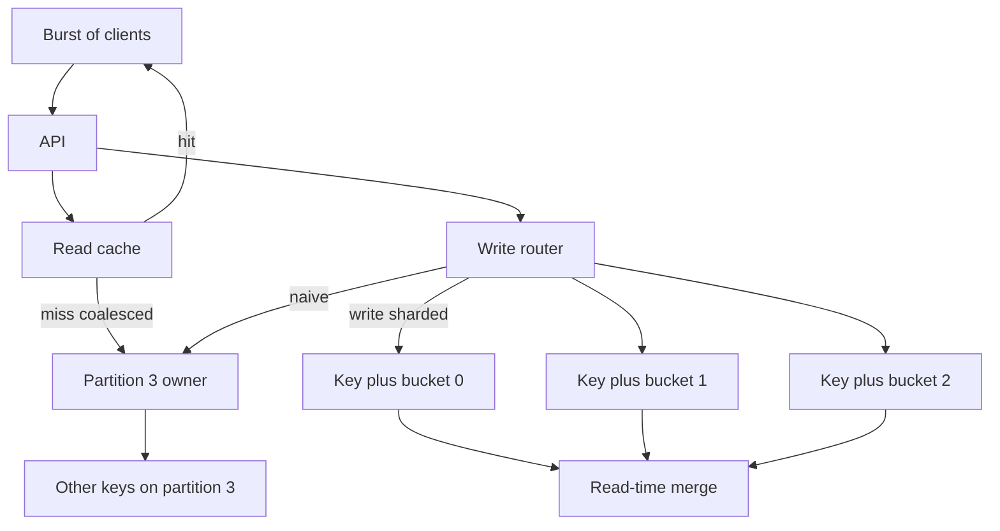

A hot key is a single item that attracts more traffic than one partition can absorb. A hot partition is a slice of the key space that does the same, even if no one row is famous. Sharding assumed that hashing a well-chosen key would spread load. Reality includes celebrity accounts, flash-sale SKUs, a "global" counter, a monotonic timestamp range, and a tenant who is ten percent of revenue. Architects who only watch cluster-wide CPU will miss a shard dying in isolation while the fleet looks idle. This is a data-model problem first and a capacity problem second.

## Concept

### One key, one owner, one budget

In a partitioned store, each key hashes or ranges onto one primary (and its replicas). That primary has a finite write pipeline, a finite lock or latch domain, and a finite network path. Ten thousand QPS to one item is not ten thousand QPS to the table. It is ten thousand QPS to one disk queue and one apply thread. Replicas do not help writes. More shards do not help if the hash still lands on the same owner.

Read-hot keys are a different shape. Many replicas or a cache can spread reads. Write-hot keys cannot, unless you change the key, buffer, or accept a merge. Mixing the two in one conversation leads to "we added replicas" as the fix for a write hotspot, which does nothing.

### Partition heat without a celebrity row

A partition can run hot because a range is busy: today's date prefix, a popular tenant id that is also the partition key, a hash collision of several moderately hot keys, or an open hash slot that received more than its share. DynamoDB, Cassandra, and Kafka all show this as one partition's metrics diverging from siblings.

Range-sharded time series is the textbook case. Inserts cluster on "now." The latest partition takes every write. Splitting it creates a new latest partition that immediately heats up. Hashing the device id and ranging time inside it spreads devices, but a national sports final still heats the devices that are actually writing.

### Why the key was chosen badly

Hotspots are often designed in. Global counters (`SELECT total FROM stats WHERE id = 1`). Session tables keyed by a boolean "isLoggedIn". Product inventory keyed only by `sku` when a flash sale hits one sku. Multi-tenant SaaS keyed by tenant when one tenant is a whale. Secondary indexes that concentrate on a low-cardinality column, so the index partition for `status=open` is a second hotspot.

The fix starts at the access pattern. If the product has a natural celebrity, the schema must not require a single-row update for every viewer. If the product has a whale tenant, the tenant must be splittable: sub-partition by workspace, region, or hash bucket, not one partition key for the whole company.

### Techniques that actually spread load

Cache the read-hot item at the edge and in a local cache with request coalescing so a miss does not become a thundering herd. For write-hot items, split the key: N buckets per logical id, writes go to a random or sticky bucket, reads sum or merge. This is write sharding. It works for counters, likes, and inventory reservations that can be commutative.

Queue and batch: accept the user's write in a log, apply to the canonical row at a sustainable rate. The user sees an accepted intent, not a committed aggregate, unless you read from the log. Rate-limit the key and shed. Isolate the key on a dedicated partition or host (a "sin bin") so it cannot drown neighbors. For time-range heat, add a hash prefix or rotate buckets with time so "now" is many partitions.

Adaptive capacity in managed stores may steal throughput from cold partitions to help a hot one, up to a point. It does not create a second writer for a single key. Treat it as a cushion, not a design.

### Observability has to be per partition

Cluster averages lie. You need QPS, latency, throttling, CPU, and lock wait per partition and per top key. Proxies should log the shard key. Application metrics should include tenant and object id cardinality, not only endpoint. A heatmap of partitions over time tells you whether you have a celebrity, a whale tenant, or a time-range cliff.

## Trade-offs

You cannot make one row infinitely writable. You can move heat, isolate it, or change the user-visible consistency of the hot item.

| Approach | When it wins | Cost / risk |
| -------- | ------------ | ----------- |
| Read cache plus coalescing | Read-hot keys, celebrity profiles, popular SKUs | Stale reads; stampede if TTL aligns; cache is not a write path |
| Write sharding (N buckets) | Commutative counters and aggregates | Read merge cost; extra keys; not for unique constraints |
| Queue and async apply | Bursty writes that can lag the canonical row | Visible delay; backlog; exactly-once apply still required |
| Isolate on dedicated partition | Whale tenant or known celebrity write key | Spare capacity sitting idle; still one-key write limit |
| Hash prefix / time bucketing | Time-range hot partitions | Query fan-out; more operational keys |
| Adaptive capacity / bursting | Managed stores, modest and temporary heat | Hits a ceiling; hides the model problem until a launch |

Caching is the first move for reads and the wrong move for inventory decrement. A cache in front of a write-hot row serializes the miss into a slightly different thundering herd.

Write sharding is the workhorse for likes, views, and rate counters. Pick N from capacity math, not from a lucky number. Reads must merge all buckets or you undercount. Periodic compaction into a canonical row reduces read fan-out at the cost of a job that can itself be hot.

Queuing decouples user latency from apply latency. It is the right model for "we recorded your click" and the wrong model for "the last seat is yours" unless the queue is the reservation system and the row is a projection. Backlogs become incidents.

Isolation protects neighbors. It does not raise the ceiling on a single latch. After isolation, you still need buckets or a different product behavior for that key.

Adaptive bursting on DynamoDB or similar is how you survive a one-hour sale if the key was almost fine. It is how you get surprised if the key is a global counter. Design as if bursting is zero.

## Diagram

A celebrity key hashes to one partition. Reads can fan to a cache. Writes must be split across buckets or they queue on the same owner.

The naive arrow is the outage. Partition 3's neighbors are collateral damage: they share CPU, write-ahead log, and in some engines a partition-wide lock. Hot keys are a noisy-neighbor problem inside the data plane.

## Failure modes

### Write throttling or latency collapse on one partition

**Detection.** Per-partition throttles (DynamoDB `ProvisionedThroughputExceeded`, Cassandra dropped mutations, Kafka produce latency on one partition). Neighbor keys on the same partition slowing down. One shard's replica lag.

**Mitigation.** Confirm it is one key versus one range. Split buckets for commutative writes. Isolate. Shed load with a key-aware limiter before the database. Do not raise cluster-wide provisioned capacity as the first move; you pay for heat you did not spread.

### Cache stampede on a read-hot key

**Detection.** A TTL expiry aligned across the fleet, followed by a spike of identical backend queries. Thread pools exhausting on the owner.

**Mitigation.** Coalesce in-flight misses per key. Soft TTL with probabilistic early refresh. Serve stale on owner failure. Pin a small set of celebrity keys in a local in-memory cache with a longer lifetime.

### Incorrect aggregates after write sharding

**Detection.** Counts that drift, undercount after a missed bucket, or double-count after compaction. Tests that only hit bucket 0.

**Mitigation.** Deterministic bucket count. Compaction that is idempotent. Reads that always include all buckets or a published rollup with a freshness watermark. Never unique-constrain a sharded write key as if it were one row.

### Time-range hotspot that reappears after every split

**Detection.** The highest range partition at 100 percent, the rest idle. Split operations that help for minutes.

**Mitigation.** Stop range-sharding inserts on `now` alone. Hash a device or tenant first. Bucket time at a granularity that creates many concurrent write ranges. Move analytics off the ingest partition.

### Silent product bugs from global rows

**Detection.** A stats row, a settings singleton, or a `tenant_id = ALL` record in the slow-query log. Deploy-day contention.

**Mitigation.** Delete the singleton. Replace with sharded counters, per-tenant config, or an in-memory service with a snapshot in object storage. Global rows in a sharded database are a design error, not an edge case.

## Real-world example

Amazon DynamoDB makes hot keys a first-class operational topic because the unit of throughput is the partition, and a table's capacity is split across partitions by key.

A typical failure looks like this. A flash sale table is keyed by `productId`. Ninety-nine percent of SKUs are quiet. One SKU is the homepage. Every checkout, every inventory decrement, every "watchers" counter update hits that partition key. CloudWatch shows table-level consumed capacity under the provisioned limit, while `ThrottledRequests` climbs and that product's latency p99 falls off a cliff. Neighboring SKUs that happened to hash nearby also throttle. Adaptive capacity may steal unused throughput from cold partitions and delay the pain. When the sale exceeds even the stolen budget, the partition is done.

AWS's own guidance is the architecture. For a leaderboard or a counter, use write sharding: `productId#0` through `productId#N`, clients pick a bucket, reads sum. For a huge item, split the item. For time series, do not use a single `type=sale` partition key with a timestamp sort key for all events; include a dimension that spreads, such as `productId` or a random suffix rotated with time. For a whale tenant, make the partition key more granular than tenant: tenant plus shard.

Cache sits in front for the product page reads: DAX or a fleet cache, with coalescing. Inventory decrement does not go through a long-TTL cache as the source of truth. Some teams move the hot SKU's inventory to a dedicated data structure: a queue of reservations, or a relational row with a single-node limiter, because a single-key strongly consistent decrement is a single-node problem no matter the brand of the store.

On-call for DynamoDB hot partitions is a checklist. Identify the key from exception metrics and injected logging of the partition key. If it is a read storm, cache and coalesce. If it is writes to a commutative value, add buckets and a rollup. If it is a unique inventory row, you cannot hash it away; you isolate, rate-limit, and consider a different workflow (pre-allocated tokens). Then you fix the data model so the next launch does not reuse a singleton.

The same physics appears in Cassandra token ranges, Kafka partition keys (`userId` of a celebrity), and Redis Cluster slots. DynamoDB is simply honest in the API: the partition is the machine, and the key is how you choose the machine. If you pick a key the whole internet will write, you picked a single machine for the whole internet.

## What to remember

- A hot key is a single-owner problem; more shards and more replicas do not spread writes to that key.
- Read heat belongs in a coalesced cache; write heat needs buckets, queues, isolation, or a different product constraint.
- Watch per-partition and top-key metrics; table-wide capacity will hide a dying slice.
- Global singletons and monotonic time as the only partition key are hotspots you designed; remove them from the schema.
