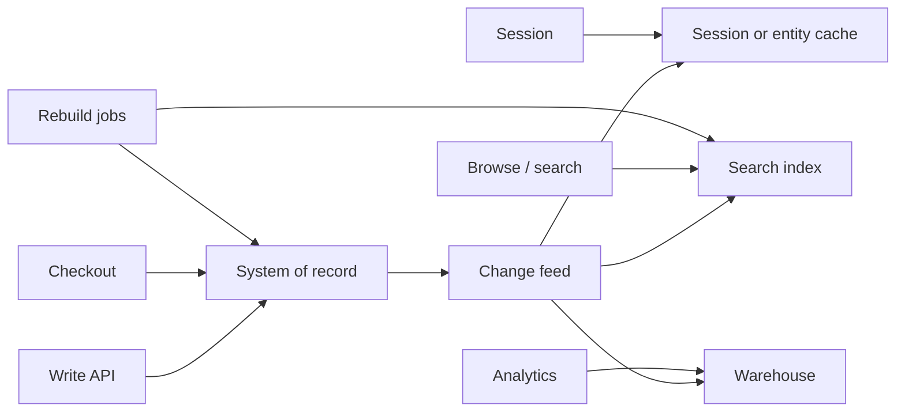

Polyglot persistence is the deliberate use of more than one data engine in a single product, each chosen for a workload it is actually good at. A relational primary for money, an inverted index for search, a log for events, a KV cache for sessions, a time-series store for metrics. The gain is query shape and performance you cannot get from one lowest-common-denominator database. The cost is every consistency, backup, and on-call surface multiplied. Architects who add a store because it is fashionable, without an owner and a sync path, are not being polyglot. They are scattering state.

## Concept

### One engine cannot be every access pattern

Normalized OLTP wants transactions, joins, and constraints. Product search wants ranking, typo tolerance, and faceting. Session state wants sub-millisecond TTL'd gets. Metrics want compression, downsampling, and high-cardinality ingest. Graph queries want traversals. Forcing all of that into MySQL, or all of it into DynamoDB, produces either a slow product or an application that implements a database on top of a database.

Polyglot persistence says: pick a system of record per bounded context, then pick derived engines for the query shapes that the record cannot serve. The word "per bounded context" matters. A checkout service that writes to six stores in one request is not polyglot. It is a distributed transaction you did not design.

### System of record versus serving stores

Every piece of state needs a home of record: the place you restore after a disaster, the place legal hold attaches, the place a correction is applied. Serving stores are projections. Elasticsearch of the catalog, Redis of the session, a warehouse of yesterday's orders. If you cannot name which engine is the record for "the price of SKU 123," you will correct one copy and not the others.

Writes flow into the record. Derived stores update through the same mechanisms as materialized views: CDC, outbox, or a rebuild. Dual-writing from the request to the record and the search cluster is how polyglot systems diverge. The polyglot decision is which engines exist. The integration decision is how they stay aligned. Most failures are integration.

### Mapping workload to engine

Use a relational or strongly consistent document store when you need constraints and multi-row transactions: billing, inventory, identity. Use a log when you need ordered history and replay. Use a wide-column or partitioned KV store when you need large-scale keyed access with a known primary key. Use search when the user types and filters. Use a time-series engine when the key is time plus a metric identity. Use a graph engine when the product is the traversal, not when you have a few foreign keys.

Resist a new engine for a single report. A warehouse or a replica often suffices. Resist a new engine because a team likes the API. Operational skill does not magically appear with the cluster.

### Consistency across stores is a product feature

The user does not care that search is a different database. They care that a renamed document is searchable, that a paid invoice is not "pending" in the cache, that a deleted user cannot be found. You must publish freshness SLAs per store and per flow. Checkout reads the record. Browse can read search with a five-second lag. Admin "view as stored" reads the record. Never mix those in one page without labels.

When a flow needs a transaction across engines, you do not have a transaction. You have a saga: write the record, emit an event, apply the projection, compensate on failure. Or you write only the record and accept that the projection is behind. Designing a two-phase commit across MySQL and Elasticsearch is how you couple availability of search to availability of checkout.

### The operational tax

Each engine is a paging rotation, a backup policy, a version upgrade, a capacity model, a security story, and a vendor bill. Polyglot at a five-person startup with three managed services can be rational. Polyglot with six self-hosted clusters and one data engineer is a bet against sleep. Standardize on a small set. Require a design review to add an engine, including who gets paged and how you rebuild from the record.

Local development and testing multiply too. If engineers cannot run the derived path, they will write only to the record and ship empty indexes. Provide stubs, testcontainers, or a shared dev cluster with noisy-neighbor rules.

## Trade-offs

The right number of engines is the smallest number that meets the query and durability requirements. Each added engine must pay for itself in a named user-facing path.

| Approach | When it wins | Cost / risk |
| -------- | ------------ | ----------- |
| Single engine, stretch it | Early product, one team, modest QPS | Awkward queries; premature limits; hidden application-side DB |
| Record plus one derived store | Search or cache is the only extra shape | One sync pipeline; dual-write temptation |
| Polyglot by bounded context | Multiple domains with different physics | Integration at the edges; platform skill required |
| One request, many writes | Never a goal | Divergence, partial failure, untestable sagas |
| Warehouse as the extra engine | Analytics, not user-facing reads | Freshness in hours; not a serving store |

Single-engine simplicity is a feature. A well-indexed PostgreSQL plus Redis for sessions takes a company very far. The first extra engine should be the one blocking a product requirement, usually search or a job queue, not a graph database for a social feature you might build.

Record-plus-derived is the default polyglot shape. It matches materialized views. It scales to many projections as long as the record is the only writer of truth and CDC is shared. The failure is a second writer: an ops script that "fixes" Elasticsearch, or a service that updates Redis as if it were the profile store.

Polyglot by bounded context is how large orgs work. Billing owns a ledger database. Messaging owns a log. Metrics own a TSDB. They integrate with events, not with shared tables. Conway's law will do this anyway; architecture should make the boundaries explicit so you do not get a shared "core" Mongo cluster that every domain dumps into.

Cross-store writes in one user request should be treated as a smell in review. If you must, the record commit is the only commit that defines success. Everything else is async with retry and repair.

## Diagram

A write commits to the system of record. A change feed updates search and cache. User reads pick a store by SLA. Analytics reads a warehouse that is further behind.

The repair path is not optional. Every derived store needs a rebuild from the record. If rebuild time exceeds the outage budget, the derived store needs its own backup, which is another operational tax you accepted.

## Failure modes

### Dual-write divergence

**Detection.** Search hits that do not exist in the record, or record rows that never appear in search. Cache serving a deleted entity. Reconciliation jobs reporting growing mismatch.

**Mitigation.** Outbox or CDC as the only path into derived stores. Repair-by-key tools. Ban ops updates to projections except through replay. Treat mismatch as a defect, not as "eventual."

### Partial success in a multi-store request

**Detection.** User received 200, search is updated, billing insert failed, or the reverse. Support tickets that depend on which store you query.

**Mitigation.** Single commit on the record. Downstream applies asynchronously. Idempotent consumers. The API success criterion is the record, documented for clients.

### Freshness bugs presented as truth

**Detection.** Users seeing old names, old prices, old permissions in one UI and new in another. No watermark in the response.

**Mitigation.** Per-flow SLA. After-write reads go to the record. UI can show "updating" when the projection watermark is behind. Do not mix record and search in one JSON object without a policy.

### Operational overload and skill gaps

**Detection.** One engineer who understands the search cluster. Backups never tested. Version skew. Cost surprises.

**Mitigation.** Limit the engine catalog. Managed services where the team is small. Game-day restores. On-call runbooks per store. Cost budgets per cluster, because a polyglot bill hides in four invoices.

### Rebuilds that cannot meet RTO

**Detection.** Index deleted or corrupted, rebuild estimated in many hours, product down.

**Mitigation.** Snapshots of derived stores if rebuild is slow. Multi-index blue-green rebuilds. Degraded mode that queries the record for a subset of features. RTO is computed on the slowest required store, not on the record alone.

## Real-world example

Netflix is the public polyglot persistence case that is still worth walking through, because they said the quiet part out loud: one size does not fit all, and they staffed the operational tax.

The playback and metadata world did not live in a single MySQL. Customer data and some transactional domains used relational systems. The huge, keyed, always-on datasets (viewing history, ratings, metadata that must survive a region) moved onto Cassandra, a multi-region partitioned store that matches "get this user's titles" rather than "join five tables for a report." Search and discovery used Elasticsearch-shaped indexes so members can find titles by text and metadata that Cassandra would not rank well. EVCache (Memcached) sat in front of hot objects so the data plane did not see a read storm on a popular title. Analytics and recommendations consumed streams and warehouses, not the serving Cassandra clusters. Billing and similar constraints stayed in systems that can actually transact.

The integration was not "the API writes to all of them." A viewing event landed in a path designed for ingest, then projections fanned out. Caches were filled from the record or from computed results with TTLs. Search indexes were built from metadata pipelines, not from a dual-write in the click handler. When a cache was wrong, the fallback was the source. When an index was wrong, they rebuilt from metadata, which is why rebuild time and pipeline lag were operational metrics, not afterthoughts.

Failure modes they designed around are the ones in this essay. Cassandra is the wrong place for an ad-hoc join, so they did not pretend it was Postgres. Elasticsearch is the wrong place for the system of record, so title truth did not live only in the index. EVCache is the wrong place for durability, so a flush was an availability event for latency, not for data loss. Each engine had a team-shaped ownership: a platform group, client libraries, and standards so every microservice did not invent its own cluster.

If you copy the slide ("we use Cassandra and Elasticsearch and Memcached") without copying the ownership and the pipeline, you get the failure mode of a mid-size company: four clusters, dual writes, and a weekend when search and checkout disagree. Polyglot persistence is a platform. Netflix could afford that platform. Your version might be Postgres, Redis, and a managed OpenSearch with Debezium, and that is still polyglot if you keep the record honest and the projections rebuildable.

## What to remember

- Add an engine only for a named access pattern; the system of record stays one place per fact, and everything else is a projection.
- Never dual-write the request path across stores; CDC or an outbox plus repair is the integration.
- Freshness is a product SLA per flow: checkout reads the record, browse may read a lagging index, and mixed pages need a policy.
- Each engine is an on-call, backup, cost, and rebuild surface; the catalog should be small enough that the team can restore it.
