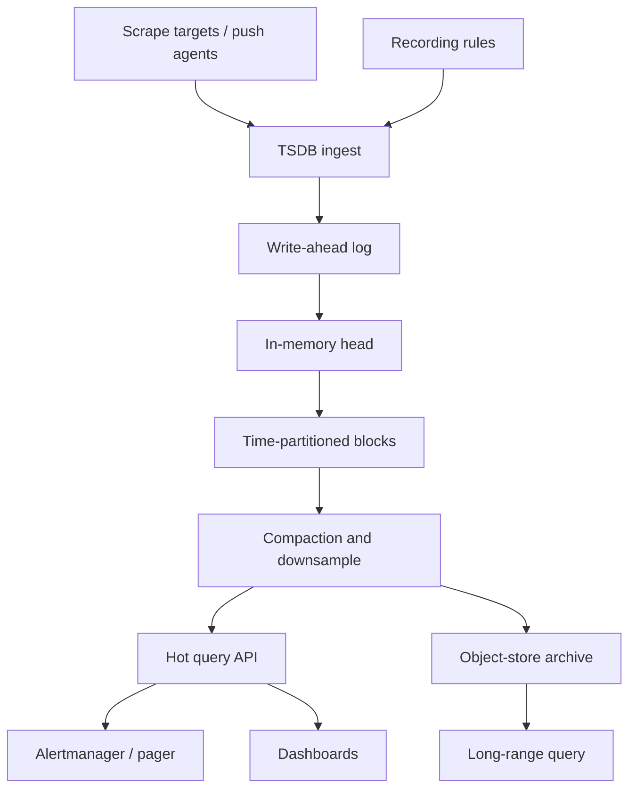

A time-series database is a store whose primary key is time plus a series identity, whose writes are almost always appends, and whose reads are ranges, rollups, and "the last value." That workload is hostile to a generic OLTP engine: it is insert-heavy, it is compressible, it is retained on a decaying schedule, and it explodes when you treat every label as an indexed column. Architects put metrics, IoT, and financial ticks into a TSDB because the engine already knows how to compress, downsample, and expire. They get into trouble when they treat it as a general event store, a high-cardinality customer database, or a system of record for money.

## Concept

### The shape of a series

A series is a unique combination of a metric name and a set of labels (dimensions): `http_requests_total{service="checkout",route="/pay",code="200"}`. Each series is a stream of `(timestamp, value)` points, sometimes with a field set rather than one value. Writes append. Updates of historical points are rare and expensive. Deletes are retention policies, not row-level user edits.

This shape lets the engine lay data out by series and time, compress runs of numbers, and skip files that do not overlap the query range. It is also why cardinality matters. Each unique label combination is a series, which is a file, an index entry, and a memory-resident structure in many engines. Ten services times three routes is fine. User id on the metric is not a dimension. It is a denial-of-service against your own TSDB.

### Ingest, compression, and out-of-order

Ingest paths batch points, hash them to a series id, and append to a WAL then to a time-partitioned block. Compression schemes (Gorilla-style XOR for floats, delta-of-delta for timestamps, dictionary for labels) turn a verbose scrape into bytes you can keep for months. The trade is CPU at ingest and query, and a preference for regular intervals.

Out-of-order writes, late points, and backfill fight the block layout. Engines either reject them, buffer them in a head window, or rewrite blocks. If your producers have skewed clocks or retry with old timestamps, you will pay in ingest lag and in query correctness. Clock policy is part of the data model.

### Downsampling and retention

Raw high-resolution data is expensive. TSDBs expect a retention ladder: full resolution for 24 hours, one-minute rollups for two weeks, five-minute rollups for a year. Rollups are materialized views with time as the axis: avg, p99, min, max, count. Once you drop raw points, you cannot reconstruct a different percentile. Choose aggregations when you choose retention.

Retention is also a product decision. Metrics for paging need days. Capacity planning needs months. Compliance might need years in a warehouse, not in the paging TSDB. Using one Prometheus as both the pager and the seven-year archive is how you page from a disk-full incident.

### Query: range, not join

The useful queries are range aggregations over a selected set of series: rate, increase, histogram quantile, join of two metrics that share labels. The engine is optimized for "scan these series between t1 and t2." It is not optimized for "all events for this customer last year with arbitrary JSON filters." If you need that, you wanted a log store or a warehouse.

Recording rules (Prometheus) and continuous queries (Influx) are materialized views inside the TSDB: precompute a rollup so dashboards do not re-scan raw series on every refresh. They have the same freshness and correctness rules as any other view.

### Cardinality is the capacity plan

Memory, index size, and query fan-out scale with active series, not with points per second alone. A million series at one point per minute is a different cluster than a thousand series at a thousand points per second. The first kills the index. The second is often easy.

Guardrails: drop user ids, request ids, and unbounded paths from labels. Hash or bucket where you must keep a high-cardinality dimension. Use exemplars or logs to find a single bad request. Capacity-plan on series churn (how fast new series appear), not only on current count, because a deploy that adds a label can double the index overnight.

## Trade-offs

A TSDB is the right engine for observations over time. It is the wrong engine for mutable business entities. Inside TSDBs, the next choice is push versus pull, and how much cardinality you allow.

| Approach | When it wins | Cost / risk |
| -------- | ------------ | ----------- |
| Prometheus-style pull, local TSDB | Kubernetes metrics, SRE paging, medium cardinality | Short default retention; pull may miss down scrapes; not a long archive |
| Influx-style push, tagged measurements | IoT, app-written events, irregular points | Cardinality explosions; unbounded tag keys from producers |
| Metric stack plus object-store archive | Long retention, cheaper cold storage | Query two systems; backfill and compact jobs |
| OLTP table of timestamps | Tiny volume, need transactions with business rows | Disk and index blow-up; no compression story |
| Log store as a fake TSDB | You actually needed events, not numbers | Cost; poor regular-interval math; easy to abuse |

Prometheus wins in cloud-native operations because the scrape model, service discovery, and PromQL match how SRE actually pages. Its local TSDB is a brilliant two-hour-to-two-week store. Long-term storage is someone else's job: Thanos, Cortex, Mimir, or a vendor. That split is a feature. Paging stays on a small, fast TSDB.

InfluxDB and similar push models win when producers cannot be scraped: sensors, mobile, batch jobs. The risk is that every producer invents tags. Without a schema gate, you import a high-cardinality incident from a single client release.

Archiving compacted blocks to object storage is how you keep years of capacity data. Querying cold data is slower and should not be on the alerting path. Keep alerting on hot, short retention.

OLTP-as-TSDB is acceptable for a few thousand points a day attached to a parent row. It is how teams accidentally build a 2 TB `events` table with an index on `created_at` that still cannot compute a rate(). Move when compression, retention, or ingest rate demand it.

## Diagram

Producers scrape or push into a hot TSDB. Recording rules write rollups. Alerting reads only the hot path. Compactors ship blocks to object storage for long-range queries.

Alerting should not depend on the cold path. If a compact or archive job fails, you still need to page on last-hour data. That is why the hot TSDB is sized for reliability, not for infinite history.

## Failure modes

### Cardinality explosion

**Detection.** Sudden growth in series count, memory, or index size. Query latency for previously cheap dashboards. Ingest falling behind. A deploy that added a `user_id` or raw URL label.

**Mitigation.** Relabel and drop at ingest. Hard limits on series per metric. Review new metrics like you review schema migrations. Use logs or traces for high-cardinality examples. After an explosion, you may have to abandon the bad metric name; dropping series is slower than never creating them.

### Disk full from retention misconfig

**Detection.** WAL growth, compaction backlogs, filesystem at 90 percent. Ingest 429s or dropped scrapes.

**Mitigation.** Retention is a first-class SLO. Alert on disk and on compaction lag, not only on ingest QPS. Separate short-retention paging from long-retention archive. Never grow a single volume "until we figure out retention."

### Wrong clocks and out-of-order floods

**Detection.** Points rejected or buffered; graphs with gaps or spikes at scrape boundaries; hosts with NTP offset.

**Mitigation.** NTP on producers. Bound future timestamps. Configure out-of-order windows deliberately. Treat a fleet of bad clocks as a data incident, because rates and alerts will lie.

### Dashboard queries that scan too much

**Detection.** Query timeouts, high CPU on the TSDB coinciding with a popular Grafana board, "eval time" in recording rules climbing.

**Mitigation.** Recording rules for expensive views. Shorter time ranges by default. Avoid unbounded regex label matchers. Do not join high-cardinality metrics in the browser. Capacity-plan query load separately from ingest.

### Using the TSDB as a system of record

**Detection.** Business workflows that "read the last metric" as truth for billing or inventory. No rebuild path from a real record. Retention deleted the evidence.

**Mitigation.** Metrics are observations. Money and inventory live in a transactional store. If you must bill from usage, export aggregates to the ledger with an explicit job and an audit log, then retain that export, not the raw series, as the record.

## Real-world example

Prometheus is the public TSDB to study because its design choices are explicit: pull-based scrape, local TSDB on the server, PromQL, and a culture of labeling that both enables and endangers cardinality.

A typical SRE deployment scrapes kubelet, cAdvisor, application `/metrics`, and blackbox probes every 15 seconds. Each target exposes a set of series. Prometheus assigns them labels for job and instance, stores points in a head block, then compact into two-hour blocks on disk with aggressive compression. Alertmanager evaluates rules against this local data. Grafana reads the same API. Default retention might be 15 days. That is enough to page and to debug last week's incident. It is not a warehouse.

Cardinality shows up the first time an application adds a label for `customer_id` on a request counter. Series count jumps from tens of thousands to tens of millions. The Prometheus server's RSS climbs, compaction falls behind, and the on-call dashboard that used to load in two seconds times out. The fix is operational and cultural: relabel configs that drop the offending label, a metric review, and sometimes a wipe of the TSDB if the index is already poisoned. Prometheus did not fail. The data model was used as an event store.

Long-term storage in the Prometheus ecosystem is a second system. Thanos sidecar uploads blocks to S3. A querier fans out to the sidecar for hot data and to object storage for cold. Compactors downsample in the bucket. Alerting still points at a highly available Prometheus pair, not at the cold querier, so a broken object-store credential does not stop paging. That split is the architecture: TSDB for observations with a hot path, object storage for cheap history, and a warehouse if you need joins with business tables.

InfluxDB shows the other ingest model. Agents push line protocol with measurement, tags, and fields. The same cardinality physics apply: a tag for `user_id` is an unbounded index. Influx's continuous queries and retention policies are the downsample ladder. Teams that "just send everything" from IoT devices learn that the tag set is a schema, even if the wire format is schemaless.

If you run either engine, write the rules down. What may be a label. What must be a log field. How long raw data lives. Which recording rules are allowed to run every 15 seconds. Who owns a metric name. A time-series database without those rules becomes a very fast way to fill a disk and a very slow way to answer "what happened."

## What to remember

- A TSDB stores append-only series of numbers indexed by time and labels; cardinality of those labels is the real capacity limit.
- Keep paging on a short-retention hot path; downsample and archive to object storage for history, and do not alert through the archive.
- Drop unbounded identifiers from labels; use logs, traces, or exemplars for per-user and per-request truth.
- Observations are not a ledger; do not make the TSDB the system of record for money, inventory, or anything you cannot afford to expire.
