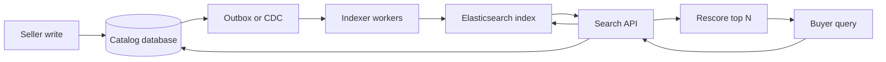

A catalog database answers "load listing 88421." A search system answers "which live listings contain these tokens, survive these filters, and belong in the first ten results for this buyer, inside a hundred milliseconds." The structure that makes the second question affordable is an inverted index: a map from term to the documents that contain it. Elasticsearch, OpenSearch, and Solr are the systems most teams actually run on top of Lucene. The machinery around that map is posting lists, analysis, scoring, shard layout, and the gap between a seller save and a buyer query.

## Concept

### Posting lists

For each term the index stores a posting list: a sorted sequence of document identifiers, usually with payload. Term frequency supports ranking. Positions support phrase and proximity queries. Field bits support boosting a title match over a description match. Because document ids are sorted, the intersection of `leather` and `tote` is a linear merge of two lists. Union is the same walk with a different operator. A negation walks the set of live documents and subtracts a list.

Query cost follows the lists you must touch. A rare SKU code is a short list and finishes quickly. The term `black` on a fashion marketplace is tens or hundreds of millions of postings. A query that looks small in a console can still saturate a data node if it intersects several of those long lists and then aggregates them.

Compression is part of the working set, not a storage footnote. Delta-encoded document ids, frame-of-reference blocks, and skip lists let the engine jump to the next candidate without inflating every integer. Positions make phrases possible and make the index larger. A catalog that never needs `"leather tote"` as a phrase can drop positions and reclaim heap and disk. A catalog whose buyers type quoted phrases cannot.

### Analysis is the search schema

Nothing is indexed as raw text. An analyzer runs character filters, a tokenizer, and token filters: lowercase, ASCII folding, stemming, stop words, synonyms, edge n-grams. The same chain has to run at query time or the tokens never meet. A mismatch is an empty result set with a healthy cluster.

Marketplace fields diverge on purpose. Brand names stay unstemmed. SKU codes stay exact, because lowercasing a code into an English word creates collisions. Titles carry a standard analyzer plus an edge-n-gram subfield for typeahead. Facets (`size`, `color`, `material`) sit on `keyword` fields so filters and aggregations are exact, while a parallel `text` field feeds ranking. Variant arrays need `nested` mappings or a filter on color will match a size on a different variant of the same parent. A strict mapping plus an ingest pipeline is the schema; dynamic mapping will invent `color`, `colour`, and `Color` as three fields.

Synonyms expand either at index time, which enlarges posting lists, or at query time, which keeps the index smaller and makes every query pay for the graph. Multi-lingual catalogs need per-language analyzers.

### Filters, BM25, and a second scoring pass

Boolean retrieval answers membership. Ranking answers which ten documents to show. Lucene's default similarity, BM25, saturates term frequency, normalizes document length, and uses inverse document frequency so common tokens contribute less. Function-score wrappers then fold in business signals: recency, seller quality, in-stock state, price competitiveness.

Filters (`term`, `range`, geo bounds) do not participate in the score. They build bitsets, they cache well, and they should run first. A marketplace query that puts "in stock" and "ships to this country" into scoring clauses spends CPU on scores it will discard and pollutes the filter cache. The durable shape is: filter the candidate set, score what remains, then optionally rescore the top few hundred with a heavier model. Learning-to-rank, a gradient-boosted tree, or a vector similarity on that short list is how semantic retrieval stays inside the latency budget.

### Shards, refresh, and the derived view

An Elasticsearch index is a collection of documents with one mapping, split into primary shards. Each primary has replicas for read capacity and for node loss. A document id hashes to a primary. Changing the primary count means a reindex. There is no cheap online reshard of an existing Lucene index.

Writes land on the primary, replicate, and become searchable on the refresh interval, one second by default. Lucene does not update a document in place. An update is a delete marker plus a new document in a new segment. Durability is a separate knob: the translog and flush policy decide when a crash loses the last writes. Refresh and flush are different SLAs. Sellers notice the first. Operators notice the second when a node dies.

Replicas increase read throughput. They do not increase write throughput, because every write still serializes through its primary. Hot listing indices and cold archive indices need different hardware and different index-lifecycle rules. A practical shape is shards in the tens of gigabytes, a primary count you can live with until the next planned reindex, and an alias in front of the concrete index so cutover is a pointer move.

Search remains a derived view. The listing row in the catalog database is the source of truth. The index is a projection maintained by an outbox consumer, a change-data-capture worker, or a carefully bounded dual-write. A buyer can still see a listing that just sold, or miss a listing that just went live, for as long as the pipeline and the refresh interval allow. The product design names that gap: re-check stock and price on the catalog when the buyer opens the listing, and treat "not yet searchable" as a state for brand-new items.

## Trade-offs

| Approach | When it wins | Cost / risk |
| -------- | ------------ | ----------- |
| Relational `tsvector` or `LIKE` | Small corpus, one database, weak ranking | GIN growth, sequential scans, search load on the OLTP primary, limited facet and synonym machinery |
| Dedicated inverted index (Elasticsearch, OpenSearch, Solr) | Interactive full-text plus structured filters and facets | Pipeline to keep the index coherent, mapping rigidity, cluster operations, near-real-time freshness |
| Time-based indices on the same engine | Logs, audit, high ingest, queries bounded by time | Poor fit for a mutable product catalog; cardinality and lifecycle become the product |
| Lexical index plus a vector index | Short, messy queries where synonyms and embeddings both help | Two projections to keep aligned, embedding cost, recall versus latency on the ANN side |
| Generated columns inside the OLTP store | Strong consistency with checkout, tiny catalog | You outgrow it when merchandising needs facets, analyzers, and personalization |

Freshness, consistency, and cost move together. Synchronous dual-write is easy to sketch and loses updates when search is down or the process crashes between the two writes. An outbox or a WAL consumer survives that crash and adds lag, poison messages, and a schema coupling to the catalog tables. None of these make search linearizable with checkout. Design the click-through path to re-validate the source of truth.

Mapping and shard count are the long-term costs. A `text` field will not aggregate safely, and a `keyword` field will not rank a sentence. Changing either, or changing an analyzer or the primary count, is a new index and an alias swap. Too few primaries create a hot shard when a popular seller hashes into one of them. Too many primaries inflate cluster state and query fan-out. Size both for the index you will have at the next reindex.

## Diagram

A seller write lands in the catalog. A pipeline projects the search document. Buyers talk to a search API that queries the cluster, rescores a short list, and re-checks stock on the source of truth.

## Failure modes

### Mapping explosion and circuit breakers

**Detection.** Data-node heap climbs while query rate is flat. Cluster stats show tens of thousands of fields. Aggregations on analyzed text fields trip the fielddata circuit breaker. Indexing rejects documents that introduce new dynamic fields.

**Mitigation.** Disable dynamic mapping on product indices. Use `keyword` for filters and aggregations and `text` for scoring, on purpose. Cap nested object counts. Set breakers so the node sheds load before it dies. When the mapping is already wrong, build a new index and swap the alias. A mapping does not shrink in place.

### Cluster health and missing replicas

**Detection.** Health is yellow because replicas are unassigned, or red because a primary is gone. Master election flaps. After a zone loss, shards stay unassigned because allocation awareness cannot be satisfied.

**Mitigation.** Run an odd count of master-eligible nodes across failure domains, and keep master work off saturated data nodes. Match shard allocation awareness to the zones you actually have. Yellow during a rolling restart is expected for a short window. Yellow that lasts is capacity or allocation. Red means a primary is missing: restore from snapshot. Replicas are availability, and a snapshot is the backup.

### Refresh storms and a stale index

**Detection.** Sellers save a title and buyers still see the old one past the agreed window. Bulk reindex jobs run with a very short refresh interval and merge CPU saturates. The translog grows because flush cannot keep up with ingest.

**Mitigation.** Set the product SLA separately from the observability cluster. Listings often tolerate a one-second refresh. Bulk rebuilds should disable refresh and refresh once at the end. Size translog and flush for the durability you will actually explain after a crash. Watch segment counts after a burst; merge pressure is a capacity signal.

### Hot shards and unbounded queries

**Detection.** One coordinating node sits at full CPU. Search thread pools reject. Latency correlates with deep `from`/`size` pagination, script queries, leading wildcards, or aggregations on high-cardinality fields. One shard is many times hotter than its peers because a routing key is skewed.

**Mitigation.** Enforce limits at the API: a maximum result window, `search_after` for deep catalogs, a timeout on every query, and a ban on unbounded aggregations. Read the slow log as a product backlog. For a hot shard, change routing or split the index by a dimension that matches the skew, then reindex.

### Pipeline lag and ghost documents

**Detection.** Listing counts diverge between the catalog and the index. Buyers find deleted items. Sold-out items still rank. The indexer consumer group falls behind, or a poison message blocks a partition.

**Mitigation.** Give the indexer its own SLO: lag, error rate, and dead-letter volume. Upsert by listing id so retries are idempotent. Run a reconciler that samples ids and repairs drift. Deletes must arrive as index deletes or the document remains searchable until the next full rebuild. See the tombstone discussion in I48 for how derived stores learn that a key is gone.

## Real-world example

Large marketplaces run search as its own product. Etsy's public engineering writing describes a catalog of hundreds of millions of listings, faceted navigation, and a query mix of short phrases plus structured filters. The listing service and its database remain the source of truth. The inverted index holds titles, tags, taxonomy, shipping attributes, and quality signals in the shape the ranker needs.

The write path is asynchronous. A seller update commits in the catalog, an event or an outbox row is produced, and workers build the search document and upsert by listing id. Mapping changes — a new analyzer, a nested variations field, a new ranking feature — ship as a second index. The alias moves when the new index is warm and a sample of queries matches. Buyers keep hitting the old index until that swap.

The read path is a search service, not a browser talking to the cluster. That service rewrites the query, applies policy and availability filters, scores with business signals, and re-checks price and stock against the catalog for the rows it will render. Deep paging is a cursor. The index has a schema, a release process, and an SLO of its own. A bad synonym, a price field indexed as text, or replicas concentrated in one zone each show up as a search incident rather than a database incident.

## What to remember

- Query cost follows posting-list length and how many lists you intersect. A rare token is cheap. A common token plus an aggregation is a capacity problem.
- Elasticsearch is a near-real-time projection of the catalog. Name the refresh SLA, feed it from an outbox or CDC, and reconcile. The catalog row stays the source of truth.
- Analyzers, `text` versus `keyword`, nested variants, and primary shard count are schema. Changing them means a new index and an alias swap.
- Filter first, score the survivors, rescore a short head. Keep business constraints in filters and keep BM25 and boosts for rank.
