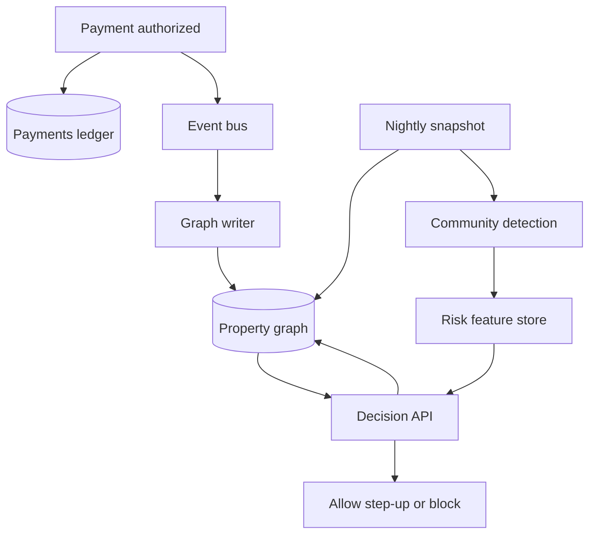

Some questions are about rows that match a predicate. Others are about how entities connect. "Which other accounts share a device, a shipping address, and a funding instrument with this disputed payment, inside three hops, over the last fourteen days?" is the second kind. A recursive SQL query can express it. The plan, the lock footprint, and the next schema change are where teams regret using the ledger tables as a traversal engine.

A graph database stores relationships as first-class records: nodes, typed edges, properties, and a traversal engine that walks adjacency. Fraud rings, access-control graphs, knowledge graphs, and network inventory fit that shape. An order ledger, a balance, and a warehouse scan do not. The practical work is knowing which queries are neighborhood queries, what those queries cost when a node is popular, and how the graph stays aligned with the system of record.

## Concept

### Index-free adjacency

In a labeled property graph, a node carries a label (`Account`, `Device`, `Card`, `Address`) and a property map. A relationship carries a type (`USED_DEVICE`, `SHIPPED_TO`, `FUNDED_BY`), a direction, and its own properties: a timestamp, an amount, a confidence score. The query is a pattern: start at a known node, walk edges of certain types, return a path or a small subgraph.

Index-free adjacency means a node points at its incident edges. The first hop from an account to its devices is pointer chasing or a tight adjacency list, once the node is in cache. It is not a hash join against a global edge table at every step. That is the performance claim, and it holds for local neighborhoods.

Global questions still want indexes, and they want a different engine. "All accounts in Germany with a balance above a threshold" is a scan plus a predicate. Secondary indexes exist so a traversal can *start*: look up `account_id = 4421`, then walk. A missing unique constraint on that business key creates duplicate nodes, and every later traversal under-counts or double-counts the ring.

### Graph traversal cost

Cost is the product of expansion at each hop, after filters, cut off by whatever limit the planner and the API enforce.

If the start node has 8 edges of the types you follow, the next hop lands on nodes of degree 50, and the hop after that lands on nodes of degree 200, the walk can visit 8 × 50 × 200 = 80,000 edges before a filter throws any away. Super-nodes make the product unbounded: a card network, a popular carrier, a shared NAT address, a "null device" bucket you created for missing fingerprints, a single `Visa` node that every card points at. An unconstrained variable-length pattern from that node is a cluster-wide scan written in Cypher.

The controls are modeling and query shape together.

- Cap path length. A synchronous API that walks twelve hops is a research query on the serving path.
- Filter on relationship type, direction, and time before the next expansion. `WHERE r.at > $since` has to be able to use an index or a stored property the planner can see.
- Keep high-degree concepts as properties. The brand of a card is a property of an instrument node. It is a poor idea for a hub that every payment touches.
- Allow variable-length paths only with an upper bound, a `LIMIT`, or a shortest-path algorithm that stops. Bidirectional expansion helps when both ends are known. It does not rescue a super-node in the middle.
- Keep exploratory analytics off the instance that answers login-time decisions.

### Online traversal versus graph compute

An online graph query starts at a known node, walks a small neighborhood, and returns a decision: allow, step-up, block. The latency budget is tens of milliseconds. The working set is the hot subgraph, and RAM should be sized for that set.

Global algorithms are a different workload. PageRank, community detection, similarity, and embedding jobs read a snapshot and shuffle. Neo4j Graph Data Science, Spark GraphFrames, and other Pregel-style engines exist for that. Running them as ad-hoc Cypher on the same cluster that serves the decision API couples a batch shuffle to a synchronous p99.

The split that survives production is three parts: an online graph for bounded neighborhood queries, a snapshot pipeline for global algorithms, and a write path that can feed both from the same events. Features computed overnight (a community id, a component size) are written back as properties the online query can read in one hop.

### Modeling that stays queryable

Reify an event as a node when many entities point at it. A `Payment` node with edges to account, device, card, IP, and address can be entered from any of those. Stuffing the payment onto a single account-to-merchant edge means every new dimension is a migration and most fraud questions cannot start at the device.

Time belongs on the edge or on the event node. A relationship without a timestamp cannot answer "was this device seen in the seven days before the chargeback?" A time property that is indexed, or a coarser time bucket used as a relationship type, is what keeps the three-hop query inside its budget as history grows. Old edges can move to a colder store. The online graph does not have to hold a decade of low-risk traffic.

Identity resolution is the product inside the graph. The useful node is often an entity clustered from device fingerprint, cookie, hashed email, and shipping address, rather than the raw identifier from one event. A merge that is too aggressive links two households and the next traversal flags both. A merge that is too timid leaves a ring as disconnected components. Treat merges as audited operations with a reversible link. Unique constraints on account numbers and instrument tokens stop the writer from creating aliases that make every later score a guess.

## Trade-offs

| Approach | When it wins | Cost / risk |
| -------- | ------------ | ----------- |
| Property graph (Neo4j, Memgraph, Neptune property graph) | Bounded neighborhood queries: fraud, IAM, dependency graphs, two to four hops | Super-nodes, query-language skill, backup and clustering that differ from Postgres, weaker ad-hoc aggregation |
| RDF triple store | Ontology-heavy knowledge graphs, SPARQL, explicit inference | Verbose writes, a smaller pool of OLTP operators, awkward fit for high-rate payment ingest |
| Relational recursive CTE or closure table | Shallow trees: org charts, category parents, bounded "reports to" | Planner cliffs as depth and fan-out grow; closure tables amplify writes |
| Application walks over edge tables | One or two hops and the data already lives in the ledger | N+1 queries and a traversal engine you now have to capacity-plan yourself |
| Graph compute on snapshots | Community detection, embeddings, global similarity | Staleness by design; a second pipeline; unsafe as the synchronous decision path |

The strategic choice is whether the graph is a system of record or a derived index. Balances, settlement, and the legal record of a payment belong in a ledger with ordinary backup, SQL reporting, and well-understood transactions. The graph earns its place as the relationship index over events that have already committed. The write path then persists the payment, emits an event, and merges nodes and edges. You inherit the same dual-write and lag problems as a search index (I41), with a sharper consequence: a missed edge is a missed fraud signal. Size memory for the hot neighborhood, partition or drop cold history by time, and treat Cypher or Gremlin as a reviewed contract: parameterized, timed out, and tested against production-shaped degrees.

## Diagram

Payments commit to the ledger and to an event bus. A writer maintains the property graph. The decision API walks a bounded neighborhood. A nightly snapshot feeds graph compute, which writes features back for the online path.

## Failure modes

### Super-node explosion

**Detection.** A query that used to return in tens of milliseconds now runs for seconds. The profile shows millions of database hits on one expansion. The hot node is a shared IP, a processor BIN, a popular merchant, or a sink you created for missing device data. Degree metrics on that label climb without a matching climb in customers.

**Mitigation.** Replace hub nodes with properties or with intermediate nodes of bounded degree. Use specific relationship types. Hard-cap hop depth in the API. Precompute the neighborhood of known hubs if the product truly needs it. Alert on degree, not only on query latency, so you see the node before the next campaign.

### Divergence from the ledger

**Detection.** Fraud review finds a payment in the ledger with no `Payment` node, or an edge whose payment later rolled back. Writer lag grows. Two nodes exist for one account id.

**Mitigation.** Feed the graph from an outbox or from change data capture. Merge on business keys under a unique constraint. Reconcile recent payments against the graph on a schedule. Keep the HTTP handler from writing the graph as a side effect that can succeed when the ledger transaction fails, or the reverse.

### Locking on dense write spots

**Detection.** Timeouts and deadlocks cluster on `MERGE` of a popular device or a shared address. Ingest latency tracks a single node rather than payment volume.

**Mitigation.** Keep transactions small: one event node and its edges, not half a ring. Partition the writer by node key so concurrent payments do not pile onto the same lock. Prefer appending a new event node over updating a hot node on every authorization. Relationship creation locks endpoints; the ingest design has to assume that.

### Unbounded queries on the serving cluster

**Detection.** Page-cache churn, long garbage-collection pauses, and a query log entry with an unbounded variable-length pattern or a missing limit. An analyst session shows up on the same host as the decision API.

**Mitigation.** Separate serving from exploration. Enforce server-side and driver timeouts. Reject patterns without an upper bound in review, and enforce that with a CI check where you can. Load-test with the degree distribution you have in production. A toy graph of a thousand nodes will not show the super-node.

### Restore and failover gaps

**Detection.** A restore test misses the recovery-time objective. After a leader change, a read replica serves a neighborhood that is missing the latest edges. An upgrade cannot open last week's store files.

**Mitigation.** Write the same RPO and RTO you would write for the ledger, and test a restore. Use acknowledged writes on ingest and a consistency mode on the decision read that matches the fraud SLO. A graph cluster has a backup story, a page cache, and a failover procedure. Treat it as a database.

## Real-world example

Payment companies have published fraud-graph designs on Neo4j for years: customers, accounts, instruments, devices, IPs, merchants, and chargebacks, with edges for "used," "shipped to," and "shares an address with." The query that justifies the store is a neighborhood around a disputed card-not-present payment. From that payment, expand through devices and addresses inside a time window, collect other instruments that touch those entities, and score the component: size, how fast new accounts appeared, how concentrated the chargebacks are.

Ingest follows the authorization stream. The writer merges the account, creates the payment node, and attaches device and instrument edges with timestamps. A separate entity-resolution job, often batch, proposes merges when a fingerprint and a hashed email collide above a threshold. Those merges are reviewed or at least audited, because a bad merge links legitimate households and the online score moves with it.

The decision API runs a bounded pattern: a few hops, relationship types named explicitly, a time predicate, and a limit on how many neighboring accounts come back. The result is a feature vector for a rules engine or a model. Overnight, a graph-compute job finds communities that no single payment would reveal and writes community ids back as properties. Balances and settlement stay in the relational ledger. The graph's SLOs are edge freshness, neighborhood latency, and a false-positive budget owned with fraud operations. Putting the general ledger in the graph couples reconciliation to traversal locks. Keeping the graph as a specialized index leaves finance on a system of record it already trusts.

## What to remember

- Property graphs earn their cost on bounded neighborhood queries. Ledger balances, large aggregations, and warehouse scans belong in other engines.
- Traversal cost is the product of degrees along the path. Bound the hops, filter on type and time, and keep popular concepts off hub nodes.
- Run the graph as a derived index of a system of record: unique business keys, idempotent writers, reconciliation, and a split between online walks and snapshot compute.
- Identity resolution is a product decision. A bad merge is an incident. A missed merge is a ring you will not see.
