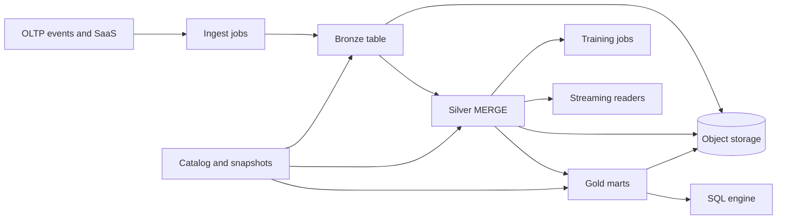

Analytics platforms keep getting renamed, and the access patterns underneath stay stubborn. A warehouse holds modeled tables and answers governed SQL quickly. A data lake holds cheap files and lets many engines read them. A lakehouse is the claim that one copy, on object storage, can do both: warehouse-style tables with schema, transactions, and time travel, and lake-style openness so Spark, a SQL engine, and a training job can share the bytes. The claim holds when you own a table format, a catalog, and the jobs that compact and expire snapshots. A slide that says "platform" does not do that work.

## Concept

### Warehouses

A cloud warehouse such as Snowflake, BigQuery, or Redshift stores data in a managed format, collects statistics, and plans SQL against them. You declare types. You get clustering or partitioning, materialized aggregates, workload isolation, and a permission model analysts can use without learning object-storage prefixes. Storage and compute are metered, often separately, and a suspended warehouse stops the compute bill.

This shape fits a metric with an owner, a dashboard with a grain, and a join of conformed dimensions. It strains when the payload is unbounded semi-structured exhaust, when a training job wants to rescan raw events in Python, or when a second engine must read the same tables without an export. Exports are where two versions of revenue are born.

### Lakes

A lake is object storage plus a convention: `s3://lake/events/dt=2026-10-26/`. Files are Parquet, ORC, Avro, JSON, or CSV. Any engine with credentials can open them. Cost per terabyte is far below a managed warehouse, which is why logs, clickstream, and scientific dumps land there first.

Schema-on-read defers modeling. It does not remove it. Someone still decides what a column means, either when the file is written or during every incident where two jobs infer two types. Without a catalog and a commit protocol, concurrent writers overwrite a prefix, a failed job leaves partial files, and nobody can answer whether the 26 October partition is complete. Listing objects and registering them after the fact is a repair step. It is not a transaction. Teams name the result a swamp once the folder layout is the only documentation.

### Lakehouse table formats

A lakehouse puts a table format over those files so a directory behaves like a table. Apache Iceberg, Delta Lake, and Apache Hudi are the three formats you will be asked to choose. At the level that matters for architecture they share a design.

Data files stay open columnar files in object storage. A metadata layer records which files belong to snapshot N of table T: manifests, a snapshot log or tree, and statistics on partitions and columns. A commit publishes a new snapshot pointer. Readers that pick a snapshot see one consistent set of files, including readers that started before the commit. Optimistic concurrency on the metadata log rejects a writer that based its plan on a stale snapshot.

Operations that warehouses treat as ordinary SQL become metadata plus file rewrites. `DELETE`, `UPDATE`, and `MERGE` are either copy-on-write or merge-on-read. Copy-on-write rewrites the data files touched by the change. Readers stay simple, and a point update of a huge partition is expensive. Merge-on-read writes a delta (delete files, change logs) and pays at read time until a compaction job folds the delta back. Streaming upserts need the merge-on-read path and a compaction schedule you actually run. Partition evolution, schema evolution, time travel, and rollback are metadata operations: a new snapshot points at a new file set, and older snapshots remain until you expire them.

The catalog is the name service. Hive metastore, AWS Glue, Unity Catalog, Polaris, or a Snowflake-managed Iceberg catalog maps `analytics.orders` to a location and a current snapshot. Files without a catalog are a lake. Files with a catalog and a snapshot protocol are tables that more than one engine can open, provided each engine implements the features you rely on. Row-level deletes, identity columns, branching, and row-level security do not land in every engine on the same day. The feature set you can promise is the intersection, not the brochure of the newest runtime.

### Medallion as a pipeline

Bronze, silver, and gold describe a workflow. Bronze keeps raw ingest, large and append-heavy. Silver conforms keys, types, and late data, often with `MERGE`. Gold is the mart a metric owner will defend. You can implement that workflow with landing tables in a warehouse, with three Iceberg tables, or with three folders and no commits. The lakehouse advantage is that bronze can be huge and still have snapshots, silver can upsert late events, and gold can be the same bytes a BI tool and a trainer read. That last sentence is true only when both engines resolve the same snapshot and the same contract.

## Trade-offs

| Approach | When it wins | Cost / risk |
| -------- | ------------ | ----------- |
| Warehouse only | BI-heavy organization, moderate volume, strong SQL and access-control needs | Cost at raw-log scale, awkward handoff to training jobs, export copies that drift |
| Raw lake only | Cheap archive, few writers, exploratory reads of write-once partitions | No atomic commit, no time travel, schema drift, partial files, erasure projects that rewrite prefixes by hand |
| Lakehouse on Iceberg, Delta, or Hudi | One governed copy for SQL, streaming, and training, with engine choice over time | Compaction and snapshot expiry as product work, catalog availability, uneven engine support |
| Warehouse plus a separate lake | A clear split you already operate, and raw data that BI should not scan | Two security models, two pipelines, and two answers for the same metric |
| Warehouse engine over external lake tables | SQL experience with cheap storage | File layout dominates query cost, governance splits across catalog and warehouse roles |

Compare cost on the scans you actually run. A warehouse that suspends compute can beat a lakehouse whose clusters never stop, and a lakehouse that skips compaction loses to a clustered warehouse table once every query plans around thousands of tiny files. Streaming ingest that writes a 2 MB file per micro-batch makes compaction, vacuum, and snapshot expiry part of the table, not a cleanup ticket. Governance has to answer who read a personal column: catalog policy plus engine logs. A shared bucket role cannot.

## Diagram

Ingest commits a bronze snapshot. Silver and gold are further commits over the same object storage. A catalog names the current snapshot. SQL, training, and streaming engines read through that catalog.

## Failure modes

### A swamp with no snapshot

**Detection.** Two jobs write the same prefix. Readers see a missing column or half a day's files. The runbook says to repair the table. Nobody can roll yesterday's job back to a known file set.

**Mitigation.** Every table has a format and a catalog entry. Writers publish snapshots. A failed job leaves no committed snapshot for readers to pick up. Isolate bronze by source. Stop replacing a partition that a downstream snapshot already referenced.

### Schema drift between engines

**Detection.** A Spark job commits, and a SQL engine fails on a widened type. A renamed nested field becomes nulls in a dashboard. A training job reads a column gold does not define.

**Mitigation.** Give each layer a policy. Bronze can be permissive. Silver and gold stay additive, with a contract checked in CI. One canonical schema lives in the table format. Pandas inference is a prototype, not a commit. The compatibility rules in I46 apply to these tables as strictly as they apply to a topic.

### Compaction debt and deletes that linger

**Detection.** Query time rises while the logical row count is flat. File counts per partition reach the tens of thousands. A GDPR delete still returns the row because merge-on-read delete files were never compacted, or because time travel still points at an old snapshot.

**Mitigation.** Schedule compaction and snapshot expiry with the same seriousness as the ingest job. After an erasure, compact, expire snapshots older than the legal window, and remove orphan files. Pick copy-on-write or merge-on-read from the mutation rate, and write down which one the table uses.

### Catalog outage or a wrong snapshot

**Detection.** Every engine fails to resolve table names. The metastore throttles or locks. A restored catalog points at an old or empty snapshot while the files themselves are intact.

**Mitigation.** Run the catalog with the availability and backup expectations of the warehouse it replaced. Files are not a table if you cannot find the current manifest. Test a restore of the catalog and of one table together. Rate-limit engines that list metadata in a loop.

### Two gold copies

**Detection.** The finance dashboard and the data-science notebook disagree on revenue by a fraction of a percent. Each side can explain its filters. Executives pick a number by which team presents last.

**Mitigation.** Publish one gold table and let engines share it. If a warehouse must cache a copy, record the snapshot id of the export. Give the metric a grain, an owner, and a late-data rule. Retire shadow marts that recompute the same measure from silver with different filters.

## Real-world example

Databricks' lakehouse products and Snowflake's Iceberg support are the two public poles of the same architecture. A retailer that used to land clickstream and point-of-sale files in object storage, ETL a slice into a warehouse, and train models by scanning the raw prefix a second time, collapses those copies into transactional tables.

On Databricks with Delta Lake, events land as bronze tables partitioned by date. New fields appear as the event schema evolves, under a policy that allows additions. Silver jobs `MERGE` on order and customer keys and fail the batch when a currency code or a primary key violates an expectation, so a bad day does not flow into gold. Gold dimensional tables serve BI through a SQL warehouse endpoint. The same silver tables feed feature jobs in Spark. Time travel is an operational tool: a bad merge is rolled back to the previous snapshot, and a change-data feed lets gold apply the delta. Unity Catalog holds the grants. Personal columns are masked for the broad data-science role and visible to a narrower finance role.

Snowflake customers reach a similar end state by registering Iceberg tables in a catalog that Spark can also open. The warehouse becomes an engine over open files, which matters on the day you want a second engine, and it matters less on the day the files are tiny, uncompacted, and unowned. The decision that shows up in incidents is whether there is one table format, one catalog, one gold metric, and jobs that compact, vacuum, and expire snapshots on a schedule.

## What to remember

- Warehouses serve governed SQL. Lakes serve cheap multi-engine files. A lakehouse adds a table format so those files have snapshots, schema, and atomic commits.
- Iceberg, Delta Lake, and Hudi are metadata plus columnar files. Compaction, snapshot expiry, and the catalog are part of running them.
- Bronze, silver, and gold are a pipeline. Snapshots and contracts are what keep the layers from becoming three swamps.
- One gold table should back a given metric. Engine choice is wasted when finance and training compute that metric from different copies.
