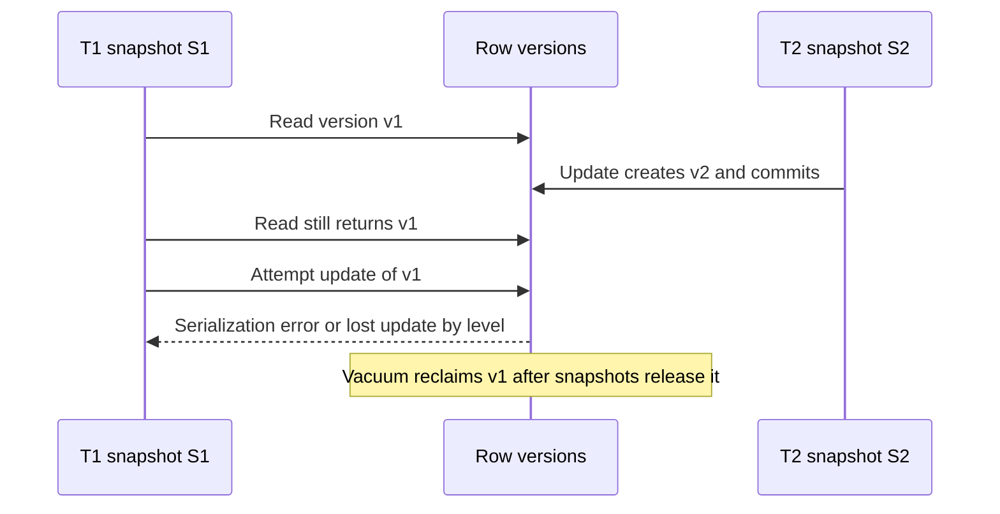

Isolation is the contract that says what one transaction may observe about another. Most production OLTP systems implement that contract with multi-version concurrency control: writers create versions, readers pick a snapshot, and ordinary reads do not take locks. PostgreSQL, Oracle, InnoDB, and a long list of distributed SQL engines all do a version of this. The differences that matter to architects are which anomalies remain at each isolation level, what happens when two writers touch the same row, and what a long-lived snapshot does to the version store.

## Concept

A transaction is a set of reads and writes that should line up with the isolation level you requested. The ANSI names — Read Uncommitted, Read Committed, Repeatable Read, Serializable — are what `SET TRANSACTION` exposes. The phenomena underneath those names (dirty reads, non-repeatable reads, phantoms, write skew) are a better design vocabulary. Snapshot isolation, which many engines offer under the Repeatable Read label, is not the same promise as true serializability. You still have to speak the name your engine prints in the manual.

### MVCC versions

An update under MVCC creates a new version of the row and leaves the previous version in place for snapshots that started earlier. An insert is the first version. A delete is a version whose successor is absence: the deleting transaction is recorded, and readers whose snapshot includes that transaction stop seeing the row.

Each transaction receives a snapshot: the set of transaction ids that are committed and visible to it. A version is visible when its creating transaction is in that set and its deleting transaction is not. Readers and writers of different rows proceed together. That concurrency is the reason teams adopt MVCC. The cost is the versions themselves.

PostgreSQL stores `xmin` and `xmax` on the heap tuple and a commit log that says whether those transaction ids committed. Visibility is checked per tuple, which is why a sequential scan of an update-heavy table slows down as dead tuples accumulate. Index-only scans still consult a visibility map. InnoDB keeps old versions in undo logs for the same reason. "The row" is often a chain.

Old versions become garbage when no snapshot can see them. PostgreSQL's VACUUM reclaims space and freezes old transaction ids so wraparound does not make ancient tuples look like they belong to the future. InnoDB purges undo. A report that opens a snapshot at 09:00 and is still reading at noon pins every version written in between. Disk bloat, replication slots, and `hot_standby_feedback` from a replica are operational consequences of that pin. A forgotten `idle in transaction` session is enough.

### What each level still allows

Read Committed, the PostgreSQL default, takes a new snapshot per statement. Two selects in one transaction can observe different committed values. You get non-repeatable reads and phantoms. You do not see uncommitted data from other sessions. A lost update is still easy to write: read a balance, add ten in application memory, write the sum, interleaved with another session that did the same arithmetic.

Repeatable Read in PostgreSQL is snapshot isolation. The transaction keeps one snapshot, so a row it has read stays stable, and newly committed rows that would match a predicate stay invisible to that snapshot. Write skew remains possible, and an update of a row that a concurrent transaction already changed fails with a serialization error. The application has to retry.

Serializable in PostgreSQL is serializable snapshot isolation. The engine looks for dangerous dependency cycles among concurrent snapshots and aborts one participant when it cannot prove the history matches some serial order. You pay in aborts and retries. You gain checks that actually hold when the invariant spans more than one row.

Engine dialects diverge. InnoDB's REPEATABLE READ uses next-key locks for some predicate protection and is a different mechanism from PostgreSQL's snapshot. Oracle's SERIALIZABLE is snapshot isolation. Porting a mental model from one manual to another produces bugs that pass tests on the wrong engine. Read the page for the database you run.

### Write skew

Write skew is the anomaly that snapshot isolation permits and that architects discover in production. Two doctors are on call. The rule is that at least one remains. Each transaction reads a count of two, decides it may go off call, and updates its own row. Both commit. The count is zero. Neither transaction wrote the row the other wrote, so there is no write-write conflict for MVCC to reject.

The snapshots were internally consistent. The invariant lived across rows and was not backed by a unique index, an exclusion constraint, or a serializable abort. Fixes that work: run the transaction at Serializable and retry aborts; take an explicit lock on a sentinel row that both transactions must update; or encode the rule as a constraint the engine enforces. A team that says it "uses Repeatable Read" has not, by that sentence, enforced a multi-row rule.

### Version lifecycle

Versions die only after every snapshot that could see them has ended. Autovacuum lag on a hot table means the isolation machinery is behind the write rate. Wraparound warnings mean transaction ids are aging toward a point where the cluster will stop accepting writes to protect ancient data. A replica that feeds its oldest query snapshot back to the primary pins the primary's versions for the sake of a report.

The signals to page on are concrete: dead-tuple ratio, transaction-id age, sessions idle in a transaction, and replication slots that retain WAL because a consumer stopped. Isolation level and vacuum policy are one design. Choosing Repeatable Read for a multi-statement read and then holding that transaction across an HTTP call is how a checkout path creates a vacuum incident.

## Trade-offs

| Approach | When it wins | Cost / risk |
| -------- | ------------ | ----------- |
| Read Committed | Short statements, low contention, single-row atomic updates | Non-repeatable reads, phantoms, lost updates from read-modify-write in the application |
| Snapshot isolation / PostgreSQL Repeatable Read | Multi-statement reads that must stay stable, compare-and-set with retry | Write skew, serialization errors on conflicting updates, versions pinned for the life of the snapshot |
| Serializable snapshot isolation | Invariants that span rows when you will accept aborts | Abort rate under contention, retry storms, a poor fit for one globally hot row |
| Explicit row locks on top of Read Committed | Hot rows where optimistic retry would spin | Lock queues and deadlocks; see I45 |
| Long snapshot for reporting on the OLTP primary | Convenience | Bloat, wraparound risk, replica feedback that stalls vacuum |

There is no level that is correct for every transaction in a service. A balance decrement can be a single `UPDATE ... SET balance = balance - $1 WHERE balance >= $1` at Read Committed. The write is the check, and it is atomic. Inventory that must stay consistent across several SKU rows, or a rule that at least one approver remains, needs Serializable, a constraint, or explicit locks. Blanket Serializable on a hot ledger aborts under load. Blanket Read Committed on a workflow with multi-row rules will commit histories the business calls bugs.

Snapshot isolation and Serializable abort transactions the application thought were fine. Idempotent retry, with jitter and a budget, is part of the level you asked for. "Sold out" is a different outcome from "please retry," and the handler has to tell them apart.

## Diagram

Two transactions take snapshots of the same row. T2 commits a new version. T1's repeatable snapshot still sees the old version, and a later update from T1 conflicts or overwrites depending on the isolation level. Vacuum reclaims the old version only after every snapshot that could see it has ended.

## Failure modes

### Lost updates at Read Committed

**Detection.** Two agents edit one ticket and the last write remains. Two checkouts read `quantity = 1` and both commit a sale. The audit log shows two successes. Stock is negative or the title reverted.

**Mitigation.** Make the rule a single atomic update with a predicate (`WHERE quantity >= 1`). Use a version column and retry when the row count is zero (I45). Take `SELECT FOR UPDATE` when the critical section is short and in-database. Keep application memory from being the place where a balance is added up and written back.

### Write skew under snapshot isolation

**Detection.** A multi-row invariant is broken and no serialization error was logged. Each transaction's statements look valid alone. Two reservations both observed one remaining unit stored as a count on a different row from the reservation insert.

**Mitigation.** Collapse the invariant onto one row both transactions must update, add a constraint, or run Serializable and measure the abort rate. Put a concurrent test in CI that runs the two transactions together. A passing single-threaded test will not catch this.

### Snapshots that pin the version store

**Detection.** Table size grows faster than live rows. Autovacuum falls behind. Transaction-id age warnings appear. A replica's feedback holds the primary's horizon. `pg_stat_activity` shows `idle in transaction` for minutes. A migration session was left open.

**Mitigation.** Set idle-in-transaction timeouts. Run long reports on a replica with a known lag budget, or in a warehouse, rather than inside Repeatable Read on the primary. Page on transaction-id age and on the oldest snapshot. A single prepared transaction or an abandoned replication slot is sufficient to stall cleanup.

### Serialization-failure storms

**Detection.** The rate of SQLSTATE `40001` rises with load. Clients retry immediately and amplify. A new Serializable code path shares a row with a hot counter.

**Mitigation.** Retry with jitter and a hard budget. Shorten the transaction. Move a globally contended counter to an atomic increment or a sharded counter that does not need a serializable proof. Serializable is the wrong tool for a single hot row that every request updates.

### Read-your-writes surprises

**Detection.** A worker cannot see a row the API just committed, because it read a replica. A later statement in Read Committed sees a different join result than the statement before it. A retried HTTP call opens a new connection and expects the previous snapshot.

**Mitigation.** Read-your-writes for the request that just wrote, on the primary, in the same session when the product requires it. If you serve reads from replicas, pick a mode with a defined lag and say so in the API. Do not hold a snapshot across a process boundary and assume the next connection still has it.

## Real-world example

PostgreSQL's heap is the MVCC implementation under a large share of production OLTP, including GitLab's application database and a long tail of RDS and self-managed ledgers. Tuples carry `xmin` and `xmax`. A snapshot is a horizon plus the set of in-progress transaction ids. Visibility checks decide which tuple a scan returns. VACUUM and the visibility map reclaim space and make index-only scans possible. Large Postgres operators write about autovacuum, bloat, and wraparound as reliability work, because the version chain is the performance model.

A payments schema on that engine usually mixes levels by invariant. An account balance moves with one atomic update at Read Committed: the `WHERE` clause is the overdraft check, and two concurrent captures cannot both pass it. A transfer between two accounts locks both rows in a fixed id order and then posts the lines, because the invariant is the pair. A "no overlapping reservation" rule is an exclusion constraint on a range, or Serializable plus retries. Teams that used Repeatable Read, selected the overlapping rows, and then inserted, have shipped double bookings. Each transaction's snapshot showed the slot free. That is write skew with a customer attached.

Moving a heavy report off the primary is an isolation decision: that snapshot is what keeps dead tuples alive. Set the level per transaction class, and page on serialization failures, idle-in-transaction time, and transaction-id age.

## What to remember

- MVCC gives each reader a snapshot of row versions so reads and writes of different rows proceed together. VACUUM or undo purge is part of that design.
- Read Committed allows lost updates and non-repeatable reads. Snapshot isolation stabilizes a transaction's reads and still allows write skew. Serializable snapshot isolation aborts histories it cannot prove serial.
- A single-row rule can be an atomic update. A multi-row rule needs Serializable, a constraint, or explicit locks, plus retries where the engine aborts.
- A long snapshot pins versions. Idle transactions, replica feedback, and reports on the OLTP primary are how isolation becomes a disk and wraparound incident.
