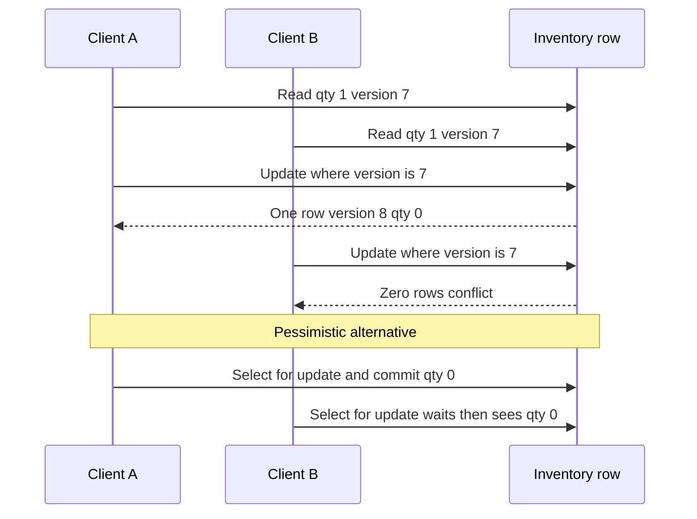

Isolation (I44) decides what a transaction is allowed to see. Locking decides what happens when two writers want the same row. Checkout, a seat map, a support ticket, and a wallet each sit in a different contention regime, and they need different protocols. Pessimistic locking assumes a conflict is likely and takes a row lock before the work. Optimistic locking assumes a conflict is rare, writes with a version check, and retries when the check fails. Both are correct inside their regime. Both become incidents outside it.

## Concept

The application bug both strategies exist to stop is the lost update. Two sessions read `quantity = 1`. Both decide to sell. Both write. The database commits two transactions. The shelf and the ledger disagree with the business. A transaction around each session does not fix that if each transaction read a snapshot, computed a new value in memory, and wrote it back without a predicate.

### Pessimistic: lock, then work

`SELECT ... FOR UPDATE` takes a row lock held until commit or rollback. Variants matter. `FOR NO KEY UPDATE` is enough when you will not change a key. `FOR SHARE` lets others read under a shared lock. `NOWAIT` fails immediately so you can return a conflict to the caller. `SKIP LOCKED` skips rows another worker already holds, which is how a pool of workers leases jobs without waiting on each other.

This fits a hot row with a short critical section that stays inside the database: one inventory row, one wallet, one sequence. Throughput on that row is one divided by the time the lock is held. If the code locks, calls a card network, then updates, the row lock has become a distributed timeout. The connection stays checked out. Unrelated requests queue behind it. Hold pessimistic locks across work you control and can bound. Release them before work you do not.

Lock order is part of the protocol. Two transfers that lock account A then B and B then A will deadlock. Sort the ids and always lock in that order. The engine will abort one victim. Your retry has to be safe, which means the side effect that must not repeat has not happened yet.

Gap and next-key locks in InnoDB extend the idea to the space where a phantom row could be inserted. PostgreSQL's `FOR UPDATE` locks existing rows. It does not, by itself, stop a concurrent insert that matches the same predicate. Uniqueness, exclusion constraints, and Serializable cover that gap. A reservation design copied from MySQL to PostgreSQL without that distinction will create two "only one" rows.

### Optimistic: compare and set

Store a `version` integer, a timestamp, or an ETag on the row. The reader remembers it. The writer updates with `WHERE id = $id AND version = $seen` and increments the version. A row count of zero means someone else committed. Reload, retry, or return a conflict to the user.

HTTP `If-Match` is the same protocol at the API. A git push that rejects a non-fast-forward is the same protocol on a ref. The pattern fits low contention, and it fits think time. A person can have a document open for three minutes. A database lock held for those three minutes would pin a connection and block everyone else. A version check at save time costs nothing when they were the only editor.

High contention breaks the pattern in the other direction. Every client reads version 7, every client writes, one wins, the rest reload and collide again. A flash sale on one SKU is that loop. The right design there is an atomic predicate update, a queue in front of the row, or a short pessimistic lock. Optimistic locking is a detector of conflict. It is not a scaler for a single hot key.

The version has to move on every successful write, including a write that touched a different column. Two features that update disjoint columns through the same version still conflict. That is correct when the row is one aggregate. It is a sign to split the table when the columns are independent lifecycles. A writer that forgets the `WHERE version = ?` clause silently restores lost updates. A trigger that increments the version on any update makes the forgotten clause visible as a conflict on the next save. It does not, by itself, stop the clause-less update from overwriting.

### Atomic predicates, leases, and external mutexes

When the business rule is a predicate on one row, skip the explicit lock and the version dance: `UPDATE seats SET holder = $user WHERE id = $id AND holder IS NULL`. One round trip. The predicate is the rule. This is the form to reach for before inventing a lock service.

A lease splits a long task into a short pessimistic claim and a longer optimistic body. Transaction one marks `locked_until` and a worker id, then commits. The worker calls the outside world. Transaction two completes the job if the lease is still theirs. If the worker dies, the timestamp expires and another worker may claim the row. `SKIP LOCKED` alone is a session lock. It vanishes when the session dies, which is what you want, and it does nothing for a job that must survive a process crash mid-call. The timestamp is the durable part.

An application mutex in Redis or ZooKeeper is a pessimistic lock the database cannot see. It is justified when the critical section spans two databases or two services. It fails open or closed depending on expiry. A process that dies without deleting the key blocks everyone until the TTL. A batch job that forgets to take the key bypasses the protocol entirely. Expiry plus fencing tokens (a monotonic token checked on the write) is the minimum viable design. A mutex key that does not cover every writer is a lost update with extra infrastructure.

### Retries and idempotency

Optimistic conflicts, Serializable aborts, and deadlock victims all require a retry policy. The policy needs a budget, jitter, and a distinction between "conflict, try again" and "predicate failed, stop." Decrementing stock when the quantity is already zero is sold out. It is not a signal to loop.

Idempotency keys sit beside the lock. The first request wins the version or the lock, records the key and the result, and performs the side effect once. A retry with the same key returns the recorded result and does not take the path again. Without that key, a client timeout followed by a retry is how a capture posts twice even though the version check was perfect.

## Trade-offs

| Approach | When it wins | Cost / risk |
| -------- | ------------ | ----------- |
| Pessimistic `FOR UPDATE` | Hot rows, short in-database critical sections, job leasing with `SKIP LOCKED` | Lock queues, deadlocks, a connection held for the wait, disaster if the lock spans a remote call |
| Optimistic version or ETag | Low contention, human think time, document and API resources | Retry storms on a hot key, silent lost updates if any writer skips the version predicate |
| Atomic predicate update | The rule is one row: seat is empty, balance covers the debit | Multi-row invariants need something more |
| Serializable plus retry | Multi-row rules when you would rather not design a lock order | Abort rate under contention; see I44 |
| Distributed mutex | The critical section truly spans stores | Expiry races, writers that skip the mutex, split behavior when the lock store is partitioned |

Under rare conflicts, optimistic locking keeps the uncontended path to a single update and adds latency only to the loser. Under frequent conflicts, the losers repeat their reads and their external work, and a pessimistic queue or an atomic update spends less total capacity. Measure conflict rate on the key, not the average across the table. One SKU can be at fifty percent conflict while the catalog average looks quiet.

Each blocked pessimistic session holds a connection. A burst of lock waits can exhaust the pool and time out routes that never touch the hot row, so `lock_timeout` is mandatory, and optimistic retries belong in a new short transaction after the connection is released. Every writer, including admin scripts, has to bump the version or take the same lock. A console `UPDATE` that skips the protocol puts lost updates back.

## Diagram

Two clients read the same version. The first update wins and bumps the version. The second matches zero rows. On the pessimistic path the second client waits, then observes the committed quantity.

## Failure modes

### Writers that skip the protocol

**Detection.** Two features, two repositories, and only one checks `version`. Support SQL and backfills write the table directly. Overlapping edits appear in the audit log with no conflict error.

**Mitigation.** One write path. A version column that a trigger increments so a bypass at least moves the version for the next optimistic writer. Grants that stop ad-hoc updates in production. An integration test with two concurrent writers that must produce one success and one conflict.

### Deadlocks from lock-order inversion

**Detection.** Deadlock errors in the log, a victim that retries, and a cycle visible in `pg_locks` or the engine's deadlock trace. A new code path locks the child then the parent while the old path does the opposite.

**Mitigation.** A canonical order, smaller transactions, and `lock_timeout` so a wait becomes a fast failure. Retry a deadlock once or twice with jitter, and only when no external side effect has been sent. A retry wrapped around a call that already charged a card will charge it again.

### Locks held across remote calls

**Detection.** An unrelated API's tail latency climbs. Sessions sit on a lock wait or `idle in transaction` for seconds. The stack between `FOR UPDATE` and `COMMIT` includes a payment or email call.

**Mitigation.** Commit an intent, make the remote call, then commit the outcome in a second transaction. An outbox moves the remote work off the lock entirely. A lease with an expiry covers the case where the worker dies between the two transactions. This is the pessimistic-locking outage that shows up in payment code more than any other.

### Optimistic livelock on a hot key

**Detection.** Database QPS and CPU rise, success rate falls, and version numbers on one SKU jump. Clients are all retrying the same row.

**Mitigation.** Cap retries. Move that key to an atomic predicate update or a single worker queue. Back off. Optimistic locking told you the key is hot. Believe it and change the protocol for that key, rather than raising the retry count.

### Skipped and poison jobs

**Detection.** Some jobs never run because workers always skip a row a dead session still appears to hold, or one poison job fails, becomes visible immediately, and occupies a worker forever.

**Mitigation.** Combine `SKIP LOCKED` with a `locked_until` lease and a watchdog. After N failures, move the job to a poison state that the main query does not select. `SKIP LOCKED` is a concurrency primitive. A job system still needs attempts, backoff, and a dead-letter state.

## Real-world example

Payment APIs, Stripe's among the public ones, combine these protocols on purpose. Mutating endpoints take an idempotency key. Resources expose a version or an ETag. A capture is an atomic transition: update the payment to captured where the status is still authorized and the version matches. Two racing captures produce one success. The loser loads the captured payment and, because the idempotency key matches, returns the same result. That is optimistic locking plus idempotency, and it fits a payment object that one flow usually touches.

A merchant balance or an available-credit counter is a hot row. There the platform uses an atomic decrement with a predicate, or a short pessimistic lock around a ledger insert. The lock does not span the call to the card network. Authorization records a pending line and commits. The network call happens. A second transaction posts or voids. When that split is missing, an issuer timeout holds the row and authorization throughput for that account drops to the speed of the timeout.

Commerce systems use the same classification. A CMS edit of a product description is optimistic, because two merchandisers rarely save the same document in the same second, and they think for a long time. The last ten seats, or the last unit of a launch SKU, use an atomic update or a queue. The architecture is a map from conflict rate and critical-section length to a protocol, with retry budgets and idempotency keys in the platform rather than in each handler.

## What to remember

- Pessimistic locks serialize writers up front. Use them for hot rows and short critical sections that stay inside the database.
- Optimistic locking is a compare-and-set on a version. It fits rare conflicts and long think time, and it livelocks on a flash-sale key.
- Prefer an atomic predicate update when the rule is a condition on one row. Pair every retryable write with an idempotency key.
- Lock order, lock timeouts, a single write path, and a retry budget are part of the table's API. A writer that skips them puts lost updates back.
