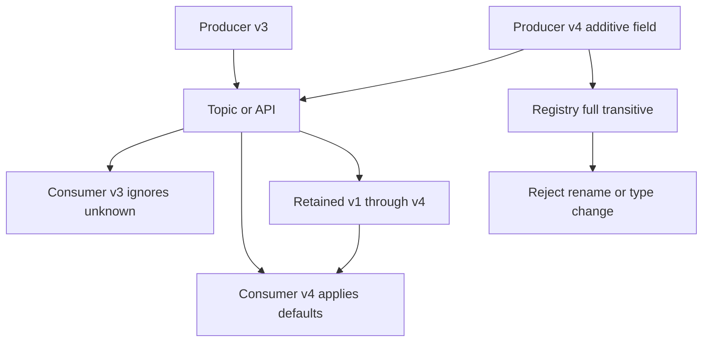

A schema is a promise about what a byte stream means. HTTP bodies, event topics, warehouse columns, and Protobuf packages all have one, including the teams who say they "just send JSON." Evolution starts the moment a producer and a consumer cannot restart in lockstep. Two services, a mobile binary that lives for months, or a topic retained for a year are enough. Backward compatibility means a new consumer can read old payloads. Forward compatibility means an old consumer can safely accept new payloads. Full compatibility is both, and it is what lets you deploy either side first and roll either side back.

The syntax changes with the encoding. Avro, Protobuf, JSON Schema, and relational DDL are different ways of writing the same rules.

## Concept

### Two deploy clocks

Producers ship on their cadence. Consumers ship on theirs. A phone keeps last quarter's build. A log retains events across both. At any moment you are running a matrix of producer versions against consumer versions, plus readers over history. Compatibility is the property that every cell you still operate is safe.

A lockstep deploy is a coordinated restart plan. It works for one binary with no retained stream. It fails the rollback, the second consumer, and the app store. Expand and contract for tables (I47) is this matrix applied to columns: each step has to be valid for the code that is still running and for the code that just shipped.

### Changes that break readers

A breaking change is one that makes an existing reader throw, mis-parse, or quietly compute the wrong value.

Removing a field a reader requires is a break. Renaming a field is a delete plus an add for a JSON reader; Avro aliases can bridge a rename if you planned them. Changing a type, or turning an optional field into a required one, is a break. Reordering positional fields without stable identifiers breaks CSV and any binary layout that uses position as identity. Tightening validation so that a value old producers still send is now rejected is a break.

The most expensive break does not throw. Changing the meaning of a field while keeping its name — `amount` moving from minor units to major units — parses cleanly and corrupts money. Additive changes are the compatible core: a new optional field, a new enum value that old readers can ignore, a new column with a default the old writer does not have to know. Everything else needs a new name, a new version, or a translator.

### Compatibility modes

Backward compatibility: a new reader understands old messages. You need it to deploy a consumer against a retained topic. Data platforms default here because history outlives the process.

Forward compatibility: an old reader understands new messages, usually by ignoring fields it does not know. You need it to deploy a producer first, and you need it for mobile clients you cannot force-upgrade tonight. JSON objects ignore unknown fields unless a validator rejects them. Protobuf ignores unknown field numbers by design. Avro resolves a writer's schema against a reader's schema, which means the reader has to have been given a schema that allows the addition.

Full compatibility is both directions. Transitive full compatibility extends the check across the whole history you still serve, not just the previous version. A rolling deploy plus a rollback plus a year of retained events is a transitive situation: a consumer on v3 must read a producer on v5 and a record written by v2. Pairwise checks between adjacent versions miss that. Confluent Schema Registry's full-transitive setting exists for this reason. If you support a window ("the last four versions") rather than all history, write the window down and enforce it.

### How each encoding carries the rules

JSON has no built-in evolution. Conventions do the work: never remove a name, never reuse a name, never change a type, ignore unknown fields, add fields as optional. JSON Schema's `additionalProperties` and `required` lists are the knobs. Without a registry, each producer invents a dialect and each consumer learns it during an incident.

Avro pairs a writer schema with a reader schema. Adding a field requires a default so old data, which omits it, still resolves. Removing a field from the reader schema drops it from old data. A type change wants a new field or a union, not an in-place edit. Avro is a strong fit for a log. It is a poor fit for a developer who wants a new required field with no default on a topic that already has data.

Protobuf identifies fields by number. A new number is compatible. Reusing a number is silent corruption. `reserved` exists so a deleted number stays dead. Presence versus proto3 defaults matters: a zero can mean "unset" or "the value zero," and readers who guess wrong mis-handle money and flags. New enum values need an unrecognized branch. An old binary that crashes on an unknown status is a compatibility bug in the reader.

Relational DDL has the same matrix with worse defaults. `INSERT` that lists values by position shifts when a column is added. `SELECT *` mapped straight into a struct grows a field the struct may not expect. Change-data-capture payloads gain a column the moment the table does, and every consumer of that stream is now on the forward-compatibility hook. The safe sequence for the table itself is expand and contract, covered in I47. The safe sequence for the stream is the same additive rule as any other schema.

### Registries, versions, and meaning

A schema registry stores versions and rejects an incompatible publish. The failure belongs in CI, on the pull request that renamed a field, rather than in a deserializer at night. Subject naming, schema id in the wire format, and the compatibility mode are one contract. Two teams with two registries and two id schemes will each believe they are safe.

An explicit version in the payload or in a header — a Stripe API version, a vendor media type — is the tool when a change cannot be additive. You run a translator per version. That cost is honest. Prefer additive evolution until a real change of meaning forces a v2 topic or a v2 resource, then run both for a window you can measure.

Syntactic compatibility is weaker than semantic compatibility. An optional `currency` field is legal Avro. If old events meant USD by omission and new events omit the field for a different reason, readers will book euros as dollars. Put the default in the schema and in a test that fails when the default changes. Document it next to the field, not in a chat thread.

## Trade-offs

| Approach | When it wins | Cost / risk |
| -------- | ------------ | ----------- |
| Additive changes, full transitive compatibility | Event buses, mobile clients, multi-team topics, retained history | Renames are forbidden, defaults live forever, feature work goes through new fields |
| Explicit version header or payload version | Public APIs and the rare change that cannot be additive | One adapter per live version, clients that pin forever, a dual-run window |
| Lockstep deploy of producer and consumer | One binary, no retained stream, one team that can restart together | Rollback and a second consumer break the assumption |
| New topic, new endpoint, or new column for a changed meaning | Units, identity, or cardinality genuinely change | Dual-write and dual-read until consumers move, two shapes in the warehouse |
| Schema-on-read over raw JSON | Exploration, a single analyst, no contract yet | Every reader invents a default, and the failures are nulls rather than exceptions |

A default is a value you will defend for the life of the field. An Avro default of `0` for `tax_cents` makes every historical event look tax-free. A null that readers treat as "unknown" is often the honest default, with a later job to fill it. Choose it as if a backfill will be impossible, because on a retained topic it often is.

Public APIs version more heavily than internal topics, because you cannot move every merchant off a four-year-old pin in a sprint. An internal topic can declare a shorter window only when every consumer, including the lake that keeps raw bytes, sits inside it.

## Diagram

Old and new producers write one topic. Old consumers ignore unknown fields. New consumers fill defaults for fields missing from old records. The registry rejects a rename that would break the matrix. Retained history stays readable by the new consumer.

## Failure modes

### Rollback poison

**Detection.** Producer v4 is live, the consumer rolls back to v3, and v3 cannot deserialize v4. The dead-letter queue grows. Or the producer rolls back and a consumer that was only tested against newer data rejects the older shape.

**Mitigation.** Full compatibility for topics that outlive a deploy. Ship the consumer first when it must understand a new field, and ship the producer first only when old consumers can ignore that field. Rehearse a mixed-version rollback in staging, including a consumer that restarts on the previous artifact while the new producer is still publishing.

### Silent semantic change

**Detection.** No deserializer error. A dashboard moves by a few percent after a release. An enum value was reused. `amount` changed scale. A missing currency started meaning something other than USD.

**Mitigation.** Never reuse names or field numbers. Reserve deleted Protobuf numbers. Add `amount_minor` and keep the old field populated through a deprecation window. Contract tests should assert meaning: a fixture with no currency is USD, and the test fails if that assumption changes.

### A registry that does not constrain

**Detection.** The subject is in forward-only mode on a topic with a year of history. Someone set compatibility to none to land a rename. Producers embed one schema id scheme and consumers resolve another.

**Mitigation.** Full transitive, or an explicit support window, enforced in CI against the same registry production uses. A break-glass change has a ticket and an expiry. One subject naming convention for the topic value, and one wire format for the schema id.

### Positional writes and strict clients

**Detection.** A new column ships and an old worker's positional insert writes values into the wrong fields. A generated client that rejects unknown JSON fields breaks when the server adds a response attribute.

**Mitigation.** Named columns in every insert and update. Map queries onto explicit fields. Clients that claim forward compatibility ignore unknown fields. Servers that claim it ignore unknown request fields. `SELECT *` into a positional structure is a break waiting for the next column.

### Closed enums

**Detection.** An old mobile build crashes on a new status. An Avro union grew a branch a deployed reader schema cannot resolve. Support sees a spike in generic errors from one app version.

**Mitigation.** Treat unknown enum values as a normal branch: a generic state in the UI, a payment that still captures, a consumer that records the raw value and continues. Document which enums are closed and therefore require a version bump. New statuses have to be safe for readers that only know the previous set.

## Real-world example

Stripe's API versions are a long-running public example of evolution as a product. An account pins a version. The platform translates between that version and the current internal shape, so a field added this year does not change the JSON a merchant pinned in 2019. Breaking changes ship as a new dated version. Webhook endpoints receive the shape they were configured for, which is the same pin applied to an asynchronous consumer.

Inside a payments platform the event bus has the same matrix with less room for a version header on every message. A charge event consumed by ledger, fraud, email, and the lake cannot drop `amount` or change its unit. New fields appear for years. Old consumers ignore them. When the meaning really changes, a new field is added and the old field stays populated, or a new event type is introduced and both are produced for a window. A schema registry on the bus rejects the incompatible publish in CI. The lake consumer, which keeps raw payloads, is why the check has to be transitive: last year's job still has to parse this week's record.

Name the compatibility mode and enforce it in a registry or in contract tests. Encode a change of meaning as a new field. A rollback will put producer and consumer on different versions even when the usual deploy keeps them together.

## What to remember

- Backward compatibility lets a new reader handle old data. Forward compatibility lets an old reader accept new data. Full transitive compatibility is what rollbacks and retained history require.
- Optional additive fields with an explicit default are compatible. Renames, type changes, reused identifiers, and silent changes of meaning are breaks even when the parser stays quiet.
- A registry or a CI contract has to reject incompatible publishes. Turning the check off to land a rename schedules the incident.
- Public version pins and new fields exist for genuine breaks. Keep the old field's meaning stable for as long as a reader of it is still deployed.
