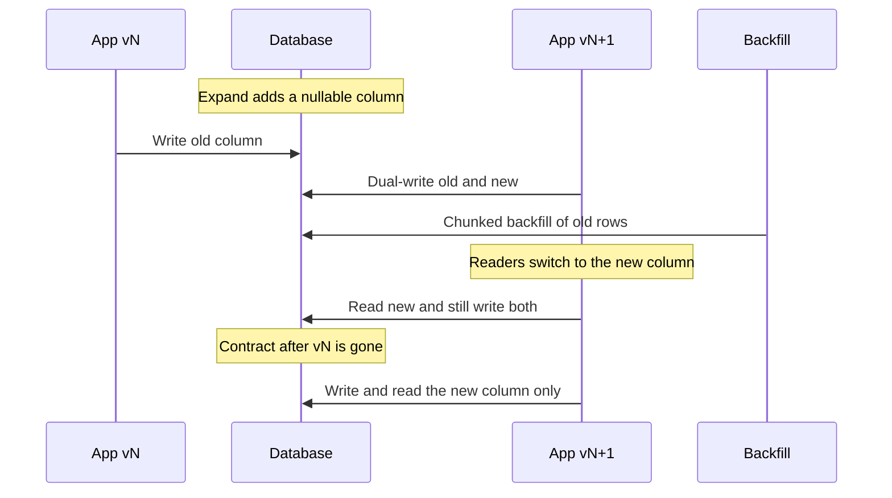

A migration that takes an exclusive lock on a hot table is a deploy that needs a maintenance window. At enough traffic the window is a customer-visible outage, including the window you expected to last two minutes and that waited behind one idle transaction. Expand and contract is how you change a schema while old and new application versions run together. First make the database a superset both versions can use. Then move the data and the readers. Then remove the old shape.

This is the operational pair of schema compatibility (I46). That post is about fields on the wire. This one is about columns, indexes, and the interval in which both shapes exist.

## Concept

Each step has to be valid for the code still running and for the code just shipped. A single change that old code cannot read and that new code has not fully rolled out is two failures at once. You insert steps until that overlap disappears.

### The expand phase

Expand is additive DDL that old code can ignore.

Add a nullable column, a new table, or an index built concurrently. Add a constraint as `NOT VALID` and validate it in a later step once the data is clean. If you use the database to keep shapes in sync, add the trigger in this phase, after the new column exists.

Expand excludes the changes that break the overlap. A `NOT NULL` column with no default, on a table old code still inserts into, fails those inserts. Dropping a column old code still selects fails those reads. An in-place rename, an in-place type change, a unique constraint over duplicates, and a blocking index build on a hot table are contract or rewrite operations wearing an expand ticket.

The lock is the migration. In PostgreSQL, some `ALTER TABLE` forms need `ACCESS EXCLUSIVE`. They queue behind a long-running query, then every new query queues behind them. Set `lock_timeout`, retry, and keep the statement itself short. Concurrent index creation exists so the build does not take that lock for the whole scan. Online schema-change tools — gh-ost, pt-online-schema-change, pgroll, and managed blue-green cutovers — exist because a rewrite of a large table inside a deploy hook is a lock and a replication-lag event. Past a few million hot rows, "run the DDL at startup" is not a strategy.

### Dual-write and backfill

After the new shape exists, new writes have to fill it, and old rows have to be copied.

Application dual-write means the new release writes both columns. The old release writes only the old column, which is why the new column stays nullable until the backfill finishes and every writer has moved. Database dual-write means a trigger copies the old value into the new column, so scripts and old binaries participate without a deploy. Triggers hide the cost in the write path and can surprise you with locks. Application dual-write makes the cost visible and the rollback a code rollback. Pick one mechanism. Two mechanisms that both write the new column will fight, and a checker will not know which one is right.

Backfill is a batch job with a keyset watermark, a chunk size, a throttle, and a progress metric. One `UPDATE` of four hundred million rows is a long transaction, a WAL spike, a replication stall, and a vacuum problem (I44). Walk primary-key ranges, commit each chunk, sleep when replica lag or CPU crosses a budget, and resume from the watermark. Rerunning a chunk has to be safe.

A type change follows the same shape. You do not `ALTER` an integer cents column into a numeric currency-aware column on a live payments table. You add `amount_minor` and `currency`, backfill, dual-write, switch readers, and later drop the old column. An in-place cast takes a strong lock and fails the test that old code is still running.

### Cut over reads

Writers filling both shapes do nothing for a reader that still selects the old column. Cutover is usually a flag or a new release: read the new column when it is present, otherwise the old one, then a release that reads only the new column after the backfill is complete and every writer is on the dual-write path. For an API, the cutover may be a version pin (I46). For a search index, it is an alias swap (I41). The protocol is the same.

Compare the two shapes during the overlap. A metric that counts rows where the new column disagrees with the derivation from the old column is the pager for this phase. If that metric is quiet for a soak period, readers can move. If it is not, you still have a writer you missed.

### The contract phase

Contract removes the old shape, and it is the phase teams postpone until the schema is a museum.

Deploy code that no longer reads or writes the old column. Confirm that replicas, CDC consumers, warehouse extracts, and forgotten workers are off it. Search query stats and the codebase, not your memory. Drop the trigger that dual-wrote. Then drop the column or the table.

Dropping a column in modern PostgreSQL is a metadata change and is still hard to undo without a restore. In older MySQL, a drop can rewrite the table. Contract while an old pod, a Lambda on last week's artifact, or a BI job still references the column, and you get errors or silent nulls. Contract months late and you pay double writes and confuse every new engineer about which column is real. Leave the column unused for one retention period if CDC consumers are slow, then drop it in its own change.

### Splits, merges, and constraints

Splitting a name into given name and family name, moving a column to another table, or extracting a service's storage uses the same phases. A merge does too: create the destination, dual-write, backfill, cut readers over, stop writes to the sources, drop the sources. Uniqueness and foreign keys have to be true at the phase you add them. A unique index on the new column waits until duplicates are cleaned. That cleanup is a backfill step, not a hopeful `ALTER`.

## Trade-offs

| Approach | When it wins | Cost / risk |
| -------- | ------------ | ----------- |
| Expand, dual-write, backfill, cut over reads, contract | Rolling deploys against a database you cannot lock | A multi-deploy calendar, dual-write bugs, flags that must be ordered |
| Maintenance window | Small tables, internal tools, a window you can truly take | Customer impact if you guessed wrong about size or lock queues |
| Online schema-change tool | Large-table rewrites the engine cannot do concurrently | Ghost tables, cutover load, and you still need expand and contract for application compatibility |
| Trigger-based sync | Many writers you do not control, including scripts | Write amplification, trigger defects, lock behavior that is easy to miss in review |
| Read the new column before every writer fills it | A derived value you believe is always present | Mixed fleets return stale or null data; the phase order was skipped |

A rename is a new column, a backfill, a dual-write, a read cutover, and a drop, spread over several deploys so each binary can run beside the previous one. Turn on "read new" only after every writer is dual-writing and the backfill metric is complete. Those are different flags, in that order. Mixed fleets otherwise show a fresh row in one screen and a stale row in another.

## Diagram

Expand adds a nullable column. Old instances write the old column. New instances write both. A job backfills history. Readers move to the new column. After the old version is gone, the old column is dropped.

## Failure modes

### DDL queued behind a long transaction

**Detection.** The migration waits, then the API stalls together. Sessions show a lock wait. When the statement finally runs, replication lag jumps if the change rewrote the table.

**Mitigation.** `lock_timeout` and retries. Concurrent index builds. Online schema-change tools for rewrites. Watch for idle transactions that hold the front of the queue. Never put a table rewrite in the application startup path of a hot service.

### Dual-write divergence

**Detection.** Old and new columns disagree on rows touched during the window. Some paths use a trigger, some use application code, and a worker uses neither. The comparison metric fires, or it never existed and finance finds the gap later.

**Mitigation.** One sync mechanism. A checker that samples and alerts. An idempotent backfill that repairs as well as fills. During the window, ad-hoc SQL goes through the same API or it is banned. The checker stays on until contract, not until the first quiet hour.

### A backfill that stalls or floods

**Detection.** Replica lag and WAL volume climb, autovacuum falls behind, or the job is still at a few percent after a week. A single transaction runs for hours and then rolls back.

**Mitigation.** Keyset pagination, small batches, a statement timeout, and a throttle on lag and CPU. Publish rows remaining. Pause during peak. The job must resume from a watermark. Wrapping the whole table in one transaction is the failure mode, not the backfill.

### Contract while old readers remain

**Detection.** A previous ReplicaSet, a scheduled task on an old artifact, or a warehouse extract still names the column. Errors spike at drop time, or the extract starts loading nulls and nobody pages because the job is green.

**Mitigation.** Inventory application code, workers, CDC, and extracts. Contract code ships only after the old version is absent from every environment. Keep an unused column for one extra cycle if downstream consumers checkpoint slowly. The drop is its own change, with a soak behind it.

### Constraints added too early

**Detection.** Old instances insert null into a new `NOT NULL` column. A unique index fails on duplicates the backfill has not cleaned. Deploy and migration roll back into each other.

**Mitigation.** `NOT NULL` waits until backfill is complete and every writer populates the column, verified by a scan. Unique indexes are built concurrently after duplicates are merged. In PostgreSQL, add the constraint `NOT VALID`, then validate it so the strong lock is short.

## Real-world example

Payments tables are where this sequence stops being optional. Shopify, GitHub, and card-processing platforms have all described online schema change because an exclusive lock at noon is a failed authorization spike. A representative migration is splitting `charges.amount`, an integer of cents with an implied US dollar, into `amount_minor` plus `currency`.

Expand adds both columns nullable. Application version A dual-writes: every insert and update sets the new columns from the old amount and still maintains `amount` for old readers. A trigger is a safety net only if you chose triggers as the single mechanism; otherwise version A is the mechanism, and the trigger would be a second writer. The backfill walks `charges` by primary key in batches of a few thousand, fills nulls, and pauses when replica lag exceeds its budget. The warehouse extract prefers the new columns and falls back to the old ones, and that fallback is temporary and measured.

Version B reads `amount_minor` and `currency` for authorization decisions and still writes both columns. A divergence metric compares the old integer with the new minor amount for USD rows. Idempotency keys and ledger lines already store the new fields, so a retry after cutover does not resurrect the implied-dollar assumption.

Version C stops writing `amount`. After CDC consumers and the warehouse have moved, the trigger is dropped if one existed, and `amount` is dropped in a separate change. There is no cheap undo for that drop. The soak is the rollback plan. Externally, a versioned API still serializes integer cents for old pins and currency-aware fields for new ones. Expand and contract changes the table. Compatibility (I46) changes what callers see. Together they are the zero-downtime path for a money column.

## What to remember

- The sequence is expand, dual-write, chunked backfill, cut over reads, then contract. A mixed fleet corrupts data when a phase is skipped or reordered.
- The lock is the migration. Use lock timeouts, concurrent index builds, and online schema-change tools. Keep table rewrites out of deploy hooks.
- Every writer, including jobs and CDC, has to be on the new shape before contract. A forgotten extract is still a reader.
- A rename or a type change on a live table is a new column and a calendar. It is not an in-place `ALTER` while old binaries are running.
