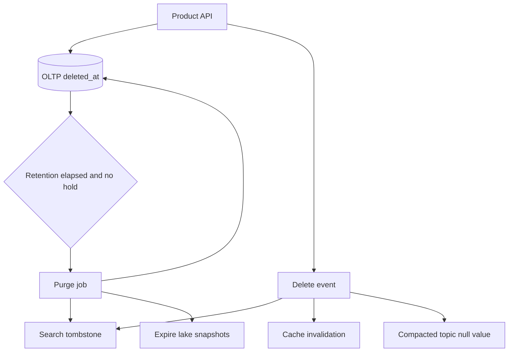

Deleting a row is a product decision wearing a SQL statement. A hard delete removes the record and leaves every copy — replicas, caches, search, the lake, last night's backup — to notice or not. A soft delete keeps the row and asks every query to pretend it is gone. A tombstone is an explicit record of absence so those copies can converge. Retention is the clock that says how long undelete is possible, how long the tombstone must survive, and when the data must become unreadable. Architects who pick a boolean during the first GDPR ticket inherit the unique-index, fan-out, and backup problems that boolean never solved.

## Concept

### Soft deletes

A soft delete keeps the row and marks it. A `deleted_at` timestamp is the useful form, because it carries when the user action happened. A boolean `is_deleted` loses that instant. A status enum (`active`, `deleted`, `purged`) helps when purge is a third state rather than the absence of the row. Reads on the product path add `WHERE deleted_at IS NULL`. Support and audit tools omit that predicate on purpose. Undelete is an update that clears the timestamp.

The mechanics spread further than the column.

Every query is part of the contract. One new endpoint that forgets the predicate shows deleted accounts to customers. An ORM global scope helps until a report uses raw SQL. A database view or a row-level policy that exposes only live rows gives the default a place to live that application code cannot casually drop.

Uniqueness changes meaning. A unique index on email blocks a new account from using the address of a deleted one. A partial unique index on `email WHERE deleted_at IS NULL` lets the address return. If the product wants a cooling-off period, that period is its own record with an expiry, not a soft-deleted row kept forever so the unique index happens to collide.

Foreign keys do not cascade a flag. Children of a soft-deleted parent remain, and `ON DELETE CASCADE` never runs. You cascade the timestamp in the same transaction, reject the delete while children exist, or hard-delete children from a job whose rules you have written down. The same shape shows up on graph edges (I42): a deleted account with live relationships still participates in traversals until those edges are removed or filtered.

Deleted rows stay in the heap and in indexes. Partial indexes on the live predicate keep OLTP lookups on the hot set. They do not shrink the table. MVCC versions (I44) plus a growing deleted population make sequential scans and vacuums more expensive. A purge job is part of soft delete, or the table is an archive you are querying by accident.

Aggregates follow the predicate too. A count of users that includes soft-deleted rows is a count of rows. Revenue joins that include delisted SKUs answer a different question from the one finance asked. The flag is a definition of "active." It belongs in the metric contract.

Soft delete fits undelete, a support window, and a delayed cascade. It is a poor default for an append-only event log, which already has history, and for a queue row, which wants a status machine and then a real delete.

### Tombstones

A tombstone is a stored fact that a key was deleted, written where a replica, a cache, a log, or a compacted topic would otherwise keep the last positive value. Absence in one store is not a delete in another store that still has a copy.

In an LSM tree, the style Cassandra and similar stores use, a delete writes a tombstone with a timestamp. Reads merge versions and let the tombstone win when it is newer. Compaction drops the tombstone and the older values together, and only after a grace period so a replica that was down can still learn about the delete. If grace expires and a late replica delivers an older insert, the row comes back. That resurrection is the classic zombie-row incident. A grace period longer than any outage you will repair inside, or a repair that finishes before grace ends, is the control. A very long grace period keeps tombstones in the read path. A partition that accumulates millions of them becomes a query that times out while merging.

On a Kafka compacted topic, a record with a key and a null payload is the tombstone. Compaction removes earlier values for that key and retains the tombstone for `delete.retention.ms`, so a consumer that is behind still observes the delete. If the tombstone is compacted away before that consumer reads it, the consumer keeps the last non-null value. Size the retention above the longest downtime you still promise to catch up, or run a reconciler that does not depend on the tombstone still being in the log.

Search indexes learn about deletes the same way (I41). A listing removed in the catalog and never sent as a delete stays searchable until a full rebuild. Lucene records a delete marker and drops the document at segment merge. The marker has to be sent.

Caches need an explicit invalidation or a TTL, because a delete on one node is not a delete in a CDN or in another region's cache. A negative cache entry is a tombstone with a short TTL. It absorbs a stampede of misses, and it can hide a key that was recreated inside that TTL. Match the TTL to how quickly a recreation must become visible.

The design rule is one number: the tombstone lives longer than the maximum lag of any copy you still trust to converge on its own.

### Retention, purge, and erasure

Retention states two opposite duties, and payments and healthcare systems carry both. For a window, the business must be able to undelete or to produce the record. After a horizon, the business must not be able to reconstruct a person, unless a legal hold says otherwise.

A policy that can be implemented names the clocks separately. The online window is how long support can see the row and the customer can undo. The purge job hard-deletes or shreds after that window when no hold is set. Derived copies are in scope: search, caches, object storage, logs, warehouse and lake tables. A Postgres delete that leaves the row in Elasticsearch and in yesterday's gold table is a product hide, not an erasure. Lakehouse time travel (I43) will return the row until snapshots are expired and the files are removed. Backups and point-in-time recovery will return it until backup retention ends. Either disclose that horizon or re-apply a purge list after every restore.

Legal hold is data, a flag or a case id that the purge job refuses to cross. Hold-by-email-to-the-oncall is how evidence disappears over a weekend.

Cryptographic erasure fits stores you cannot rewrite cheaply. Encrypt the row or the object with a per-subject key, and delete the key. Ciphertext can remain in an immutable log. This works when every copy of the key is destroyed and the key was never written beside the ciphertext. Identifiers left in clear metadata can still single out the person. Key management is the design; the SQL flag is only the trigger.

An audit log of the delete and of the purge is a different object from the soft-deleted row. The row is mutable product state. The log is evidence that the job ran. You usually need both.

## Trade-offs

| Approach | When it wins | Cost / risk |
| -------- | ------------ | ----------- |
| Hard delete | Queue rows, ephemeral data, secrets that must not linger | No undelete; replicas and search can resurrect the value; weak evidence unless a separate audit log exists |
| Soft delete with a later purge | Undelete, support, a delayed cascade, a defined active set | Predicate discipline, partial unique indexes, table growth, a false sense that the delete was an erasure |
| Tombstones in LSM stores and compacted logs | Replicated and compacted systems that must learn a key is gone | Space and read amplification; grace and retention set wrong resurrect the value |
| Crypto-shred | Immutable logs and lakes where rewriting history is impractical | Key custody, leftover identifiers in metadata, a missed copy of the key |
| Soft window, then fan-out purge, with legal hold | Product tables under a regulator and a support team | A checklist per store, backup horizon, holds that must be tested |

Infinite retention of soft-deleted rows feels conservative and becomes heap bloat, slower scans, and a larger erasure problem. If nobody restores a row after thirty days, purge on day thirty-one and let legal hold be the exception that stays. Soft delete is also a weak audit mechanism. Record the request and the purge as events. Keep the flag for application behavior.

## Diagram

The product API marks the OLTP row and emits a delete event. Search, cache, and a compacted topic each store a tombstone. A purge job runs only when retention has elapsed and no legal hold applies, then removes derived copies and expires lake snapshots.

## Failure modes

### Ghosts in derived stores

**Detection.** A deleted listing still ranks. A cache serves a profile after the account delete. A compacted-topic consumer that was down longer than tombstone retention still has the last payload. Support can see the OLTP flag and the customer can still see the search hit.

**Mitigation.** Treat delete as a fan-out. The search indexer consumes the tombstone. Set log tombstone retention above the maximum consumer downtime you care about, and run a reconciler for anything slower. Keep cache TTLs inside the product's disappearance SLO and invalidate on the event. Compare live OLTP keys to the search index on a schedule.

### Unique indexes against deleted rows

**Detection.** Re-registration fails with a duplicate email for an account the user deleted. Or two deleted rows and one live row exist because the unique index was never partial, and undelete collides.

**Mitigation.** Partial unique indexes on the live subset. A cooling-off table with its own TTL when reuse must wait. Undelete loses if a new live row already owns the key. Test the re-register path with a soft-deleted fixture.

### Resurrection after tombstone grace

**Detection.** A node returns from a long outage and rows that were deleted reappear. Grace expired, compaction dropped the tombstones, and an old replica's insert won the merge. Read latency spikes on partitions that are mostly tombstones.

**Mitigation.** Set grace or `delete.retention.ms` from the outage and consumer-lag numbers you will actually tolerate, and repair or catch up before that window ends. Alert on tombstone-heavy reads. Model deletes so one partition cannot accumulate an unbounded number of them. A reconciler from the source of truth repairs zombies the grace period already allowed.

### Purge that leaves copies behind

**Detection.** An erasure request sets `deleted_at` and closes the ticket. The warehouse, the search index, application logs, and lake time travel still return the person. A backup restore brings the row back with no purge list to re-apply.

**Mitigation.** A checklist per store: OLTP removal or shred, search delete, object-store keys, lake delete plus compaction plus snapshot expiry, log redaction or crypto-shred, and a written backup horizon. Store legal hold as data the job reads. Test a restore and show that the person stays gone or that the purge list runs again before the database is served.

### Predicate leakage

**Detection.** A new admin query, copied forward, lists deleted users on a public route. A batch script disables the ORM filter and the change lands in production. Metrics jump because a dashboard dropped the `deleted_at` predicate.

**Mitigation.** A view or a row-level policy for the live projection, with the application role granted on the view. Tests that insert a deleted fixture and expect a 404 on every public API that takes the id. Review raw SQL against that table as carefully as you review a permissions change.

## Real-world example

GitHub documents account and repository deletion as a grace window followed by purge. During the window the owner can restore. The namespace stays reserved so another user cannot claim the same name and inherit integrations pointed at it. That reservation is a tombstone on a unique key. After purge, primary storage drops the resource, the name can be reused according to the product rules, and some records remain on a longer clock: billing, abuse, and legal obligations. One boolean cannot represent those clocks.

Marketplaces run the same trio. A listing removed by a seller or by policy is soft-deleted in the catalog so an appeal can restore it. A delete event removes it from Elasticsearch so buyers stop finding it (I41). A compacted catalog topic carries a null for that listing id so every downstream projection converges, with tombstone retention longer than a slow consumer's outage. Later, a purge removes personal data from the seller record while the financial ledger keeps what statute requires, under a hold if a dispute is open.

Kafka's null payload and Cassandra's grace window exist so a late copy still learns the delete. Set either shorter than your slowest copy and the old value returns. A payments customer then has three clocks: product state, tombstone propagation, and purge or shred under legal hold. One `is_deleted` flag leaves the warehouse free to keep mailing them.

## What to remember

- Soft delete is a live-row filter, partial unique indexes, and a purge job. It supports undelete. It is not an audit log and it is not an erasure by itself.
- Tombstones tell replicas, compacted logs, search, and caches that a key is gone. Keep them longer than the lag of the slowest copy you still trust, or the old value returns.
- Purge has to include OLTP, search, caches, lakes (including snapshot expiry), and a documented backup horizon. Crypto-shred is how immutable streams forget a subject.
- Legal hold stops purge, and it has to be data the job can see. Reserving a unique key during the undo window is part of the delete design.
